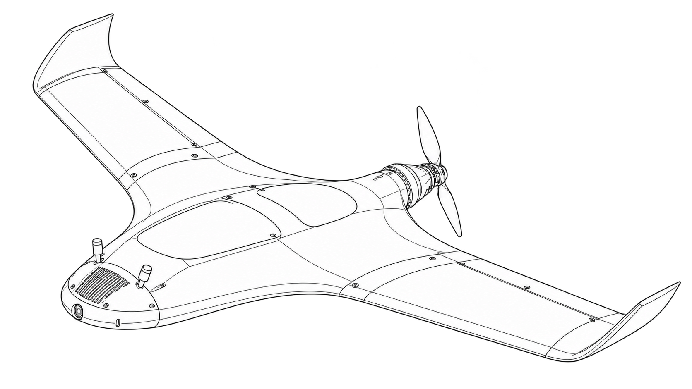
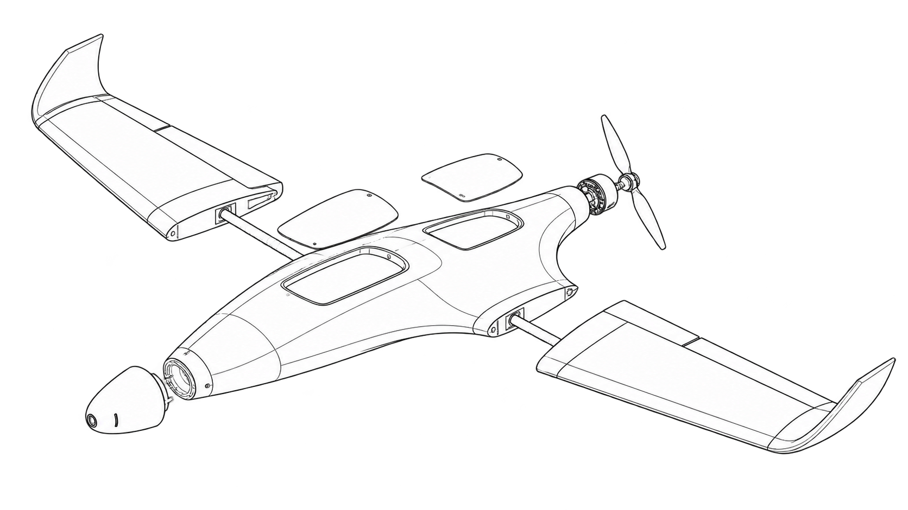
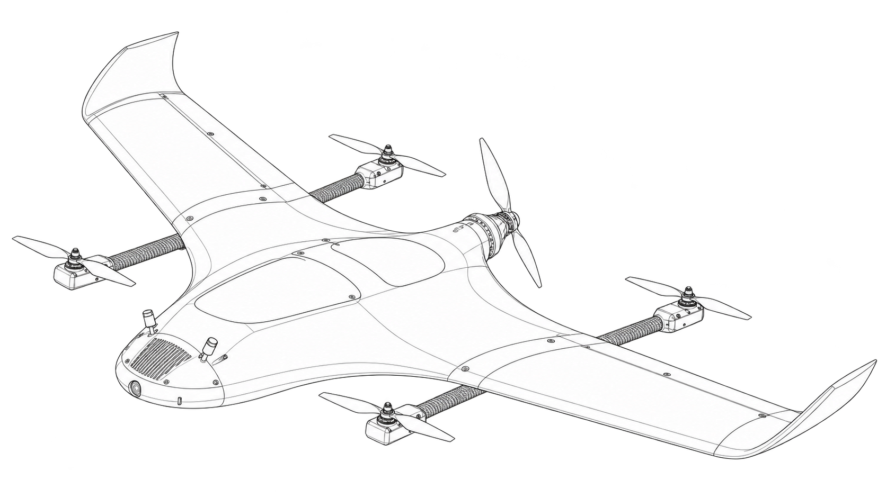
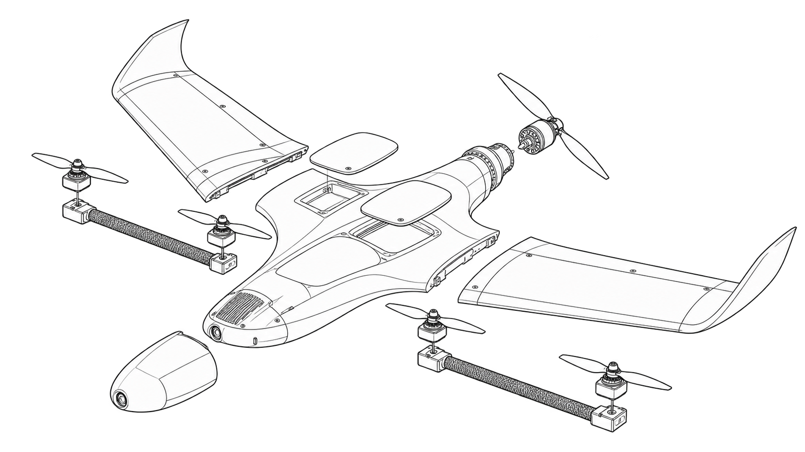

# Flightory — Super Stingray build notes

A build reference for the Super Stingray flying wing and its VTOL conversion, with parts sources for builders in India.

## The aircraft

The [Super Stingray](https://flightory.com/product/superstingray/) is a swept flying wing with a rear pusher motor, removable wings, and a modular nose. The [VTOL pack](https://flightory.com/product/super-stingray-vtol/) adds four lift motors on two booms. It is an add-on to the base aircraft, not a separate complete aircraft kit.

| Item | Fixed wing | VTOL conversion |
| --- | --- | --- |
| Wingspan | 1,130 mm | 1,130 mm |
| Length | 700 mm | 700 mm |
| Flightory listed all-up mass | 1,000–2,500 g | 1,500–2,800 g |
| Motors | One rear pusher | Four lift motors + one rear pusher |
| Print materials | LW-PLA and PETG | LW-PLA and PETG |
| Minimum print bed | 220 × 220 mm | 220 × 220 mm |
| Paid design files | Base package | Base package + VTOL pack |

*Dimensions and mass ranges come from the linked Flightory product pages. They are design references, not measured results from this repository.*

## Design files and credit

Aircraft design: **Flightory, Szymon Wójcik**. Purchase the [base files](https://flightory.com/product/superstingray/) and the [VTOL conversion](https://flightory.com/product/super-stingray-vtol/) from the designer. Flightory lists these products for personal use under its [licence agreement](https://flightory.com/license/). This guide does not grant rights to the paid files.

Use the official product pages and the manual supplied with your purchase for print settings, assembly, centre of gravity, and wiring. These build notes and supplier options do not replace that manual.

## Aircraft images and interactive 3D previews

The inline previews use simplified exterior envelopes of the STL parts with reconstructed part positions. Links below each model open more detailed surface previews. Small holes, wall thickness, and internal print detail are omitted from the inline views. Some joints and mount orientations remain approximate. They are for visual review, not printing or assembly instructions. Motors, propellers, and electronics are not included in the source STL files. The VTOL preview includes two simple boom guides.

Each aircraft has an assembled illustration, an exploded-view illustration, and an interactive 3D preview. The fixed-wing aircraft is first. The VTOL aircraft is below it.

*The line-art images are generated concept illustrations. The exploded views show the main modules only. Use the Flightory manual for assembly.*

### Super Stingray — fixed wing





Drag to rotate the model. Scroll to zoom.

```stl
solid super_stingray_fixed
facet normal -0.74 0.61 -0.26
outer loop
vertex -120.52 162.95 3.71
vertex -117.93 161.97 -5.99
vertex -120 162 0
endloop
endfacet
facet normal -0.89 0.36 -0.27
outer loop
vertex -120.52 162.95 3.71
vertex -71.64 267.54 -16.88
vertex -117.93 161.97 -5.99
endloop
endfacet
facet normal -0.37 -0.91 0.18
outer loop
vertex -120.52 162.95 3.71
vertex -120 162 0
vertex -118 162 4
endloop
endfacet
facet normal 0 0 -0
outer loop
vertex -118 162 4
vertex -120 162 0
vertex -114 162 12
endloop
endfacet
facet normal 0 -1 -0
outer loop
vertex -114 162 12
vertex -120 162 0
vertex -104 162 20
endloop
endfacet
facet normal 0 -1 0.01
outer loop
vertex -117.93 161.97 -5.99
vertex -52 162 -38
vertex -120 162 0
endloop
endfacet
facet normal 0 -1 -0
outer loop
vertex -104 162 20
vertex -120 162 0
vertex -56 162 48
endloop
endfacet
facet normal 0 -1 -0
outer loop
vertex -56 162 48
vertex -120 162 0
vertex 56 162 48
endloop
endfacet
facet normal 0.05 -1 0.08
outer loop
vertex -52 162 -38
vertex -29.56 162.37 -46.13
vertex -120 162 0
endloop
endfacet
facet normal 0.05 -0.99 0.09
outer loop
vertex -29.56 162.37 -46.13
vertex 119.41 174.35 -2.75
vertex -120 162 0
endloop
endfacet
facet normal 0.05 -0.98 -0.18
outer loop
vertex 56 162 48
vertex -120 162 0
vertex 119.41 174.35 -2.75
endloop
endfacet
facet normal -0.37 -0.91 0.18
outer loop
vertex -120.52 162.95 3.71
vertex -118 162 4
vertex -116 162 8
endloop
endfacet
facet normal -0.65 0.21 0.73
outer loop
vertex -116 162 8
vertex -70 268 18
vertex -120.52 162.95 3.71
endloop
endfacet
facet normal -0.9 0.43 0.04
outer loop
vertex -120.52 162.95 3.71
vertex -70 268 18
vertex -71.64 267.54 -16.88
endloop
endfacet
facet normal 0 0 -0
outer loop
vertex -116 162 8
vertex -118 162 4
vertex -114 162 12
endloop
endfacet
facet normal -0.85 0.33 0.42
outer loop
vertex -116 162 8
vertex -114 162 12
vertex -70 268 18
endloop
endfacet
facet normal -0.61 0.19 0.77
outer loop
vertex -48.53 259.54 40.66
vertex -114 162 12
vertex -104 162 20
endloop
endfacet
facet normal -0.66 0.23 0.71
outer loop
vertex -48.53 259.54 40.66
vertex -70 268 18
vertex -114 162 12
endloop
endfacet
facet normal -0.48 0.12 -0.87
outer loop
vertex -71.64 267.54 -16.88
vertex -51.87 195.59 -37.64
vertex -117.93 161.97 -5.99
endloop
endfacet
facet normal -0.55 0.14 0.82
outer loop
vertex -98 162 24
vertex -48.53 259.54 40.66
vertex -104 162 20
endloop
endfacet
facet normal 0 0 -0
outer loop
vertex -98 162 24
vertex -104 162 20
vertex -80 162 36
endloop
endfacet
facet normal 0 -1 -0
outer loop
vertex -80 162 36
vertex -104 162 20
vertex -68 162 42
endloop
endfacet
facet normal 0 -1 -0
outer loop
vertex -68 162 42
vertex -104 162 20
vertex -56 162 48
endloop
endfacet
facet normal -0.54 0.13 0.83
outer loop
vertex -74.21 164.24 39.06
vertex -48.53 259.54 40.66
vertex -98 162 24
endloop
endfacet
facet normal -0.53 0.28 0.8
outer loop
vertex -74.21 164.24 39.06
vertex -98 162 24
vertex -80 162 36
endloop
endfacet
facet normal -0.45 -0.07 0.89
outer loop
vertex -80 162 36
vertex -68 162 42
vertex -74.21 164.24 39.06
endloop
endfacet
facet normal 0.01 1 -0.01
outer loop
vertex -70 268 18
vertex -48 268 36
vertex -71.64 267.54 -16.88
endloop
endfacet
facet normal 0.05 1 -0.03
outer loop
vertex -48 268 36
vertex 39.72 264.11 44.6
vertex -71.64 267.54 -16.88
endloop
endfacet
facet normal 0.02 1 0.03
outer loop
vertex -71.64 267.54 -16.88
vertex 39.72 264.11 44.6
vertex -15.52 267.16 -39.49
endloop
endfacet
facet normal -0.7 0.1 0.7
outer loop
vertex -48.53 259.54 40.66
vertex -60 268 28
vertex -70 268 18
endloop
endfacet
facet normal -0 1 0
outer loop
vertex -60 268 28
vertex -48 268 36
vertex -70 268 18
endloop
endfacet
facet normal -0.42 -0.33 0.84
outer loop
vertex -60.68 168.17 48.06
vertex -68 162 42
vertex -60 162 46
endloop
endfacet
facet normal -0.49 -0.25 0.84
outer loop
vertex -74.21 164.24 39.06
vertex -68 162 42
vertex -60.68 168.17 48.06
endloop
endfacet
facet normal 0 0 -0
outer loop
vertex -60 162 46
vertex -68 162 42
vertex -56 162 48
endloop
endfacet
facet normal -0.58 0.14 0.8
outer loop
vertex -48.53 259.54 40.66
vertex -74.21 164.24 39.06
vertex -60.68 168.17 48.06
endloop
endfacet
facet normal -0.44 0.01 -0.9
outer loop
vertex -51.87 195.59 -37.64
vertex -52 162 -38
vertex -117.93 161.97 -5.99
endloop
endfacet
facet normal -0.5 0.44 0.75
outer loop
vertex -48.53 259.54 40.66
vertex -54 268 32
vertex -60 268 28
endloop
endfacet
facet normal -0 0 0
outer loop
vertex -54 268 32
vertex -48 268 36
vertex -60 268 28
endloop
endfacet
facet normal -0.42 -0.33 0.84
outer loop
vertex -60 162 46
vertex -56 162 48
vertex -60.68 168.17 48.06
endloop
endfacet
facet normal -0.37 0.16 -0.92
outer loop
vertex -71.64 267.54 -16.88
vertex -15.52 267.16 -39.49
vertex -51.87 195.59 -37.64
endloop
endfacet
facet normal -0.5 0.44 0.75
outer loop
vertex -48.53 259.54 40.66
vertex -48 268 36
vertex -54 268 32
endloop
endfacet
facet normal 0.03 0.01 1
outer loop
vertex 39.72 264.11 44.6
vertex -60.68 168.17 48.06
vertex -56 162 48
endloop
endfacet
facet normal -0.05 0.09 0.99
outer loop
vertex 39.72 264.11 44.6
vertex -48.53 259.54 40.66
vertex -60.68 168.17 48.06
endloop
endfacet
facet normal 0 0.03 1
outer loop
vertex 39.72 264.11 44.6
vertex -56 162 48
vertex 56 162 48
endloop
endfacet
facet normal -0.45 0.01 -0.89
outer loop
vertex -48 162 -40
vertex -52 162 -38
vertex -51.87 195.59 -37.64
endloop
endfacet
facet normal 0 0 0
outer loop
vertex -48 162 -40
vertex -40 162 -44
vertex -52 162 -38
endloop
endfacet
facet normal 0.06 -0.99 0.12
outer loop
vertex -40 162 -44
vertex -29.56 162.37 -46.13
vertex -52 162 -38
endloop
endfacet
facet normal -0.45 0.01 -0.89
outer loop
vertex -48 162 -40
vertex -51.87 195.59 -37.64
vertex -40 162 -44
endloop
endfacet
facet normal -0.39 0.18 -0.9
outer loop
vertex -15.52 267.16 -39.49
vertex -40 210 -40
vertex -51.87 195.59 -37.64
endloop
endfacet
facet normal -0.06 0.48 0.87
outer loop
vertex -48.53 259.54 40.66
vertex 39.72 264.11 44.6
vertex -48 268 36
endloop
endfacet
facet normal -0.2 0.11 -0.97
outer loop
vertex -29.56 162.37 -46.13
vertex -40 162 -44
vertex -51.87 195.59 -37.64
endloop
endfacet
facet normal -0.15 0.15 -0.98
outer loop
vertex -40 192 -40
vertex -29.56 162.37 -46.13
vertex -51.87 195.59 -37.64
endloop
endfacet
facet normal -0.19 0 -0.98
outer loop
vertex -51.87 195.59 -37.64
vertex -40 210 -40
vertex -40 192 -40
endloop
endfacet
facet normal 0 0 0
outer loop
vertex -40 192 -40
vertex -40 210 -40
vertex -40 198 -40
endloop
endfacet
facet normal -0.51 0 -0.86
outer loop
vertex -40 198 -40
vertex -40 210 -40
vertex -29.56 162.37 -46.13
endloop
endfacet
facet normal -0.18 0.09 -0.98
outer loop
vertex -15.52 267.16 -39.49
vertex -29.56 162.37 -46.13
vertex -40 210 -40
endloop
endfacet
facet normal -0.51 0 -0.86
outer loop
vertex -40 192 -40
vertex -40 198 -40
vertex -29.56 162.37 -46.13
endloop
endfacet
facet normal 0.04 0.06 -1
outer loop
vertex -15.52 267.16 -39.49
vertex 40.32 266.61 -37.06
vertex -29.56 162.37 -46.13
endloop
endfacet
facet normal -0.63 0.48 -0.61
outer loop
vertex 40.32 266.61 -37.06
vertex 0.24 198.97 -48.44
vertex -29.56 162.37 -46.13
endloop
endfacet
facet normal -0 -0.99 0.12
outer loop
vertex 6 162 -48
vertex 39.25 162.42 -43.63
vertex -29.56 162.37 -46.13
endloop
endfacet
facet normal -0.01 -0.95 0.3
outer loop
vertex 39.25 162.42 -43.63
vertex 119.41 174.35 -2.75
vertex -29.56 162.37 -46.13
endloop
endfacet
facet normal 0.01 1 0.03
outer loop
vertex 40.32 266.61 -37.06
vertex -15.52 267.16 -39.49
vertex 39.72 264.11 44.6
endloop
endfacet
facet normal -0.05 -0.02 -1
outer loop
vertex 0.24 198.97 -48.44
vertex 6 162 -48
vertex -29.56 162.37 -46.13
endloop
endfacet
facet normal -0 -0.01 -1
outer loop
vertex 8 162 -48
vertex 6 162 -48
vertex 0.24 198.97 -48.44
endloop
endfacet
facet normal 0 -0 0
outer loop
vertex 8 162 -48
vertex 18 162 -48
vertex 6 162 -48
endloop
endfacet
facet normal 0 -1 0.09
outer loop
vertex 18 162 -48
vertex 39.25 162.42 -43.63
vertex 6 162 -48
endloop
endfacet
facet normal 0 -0.01 -1
outer loop
vertex 8 162 -48
vertex 0.24 198.97 -48.44
vertex 18 162 -48
endloop
endfacet
facet normal -0.21 0.98 0.03
outer loop
vertex 56 268 32
vertex 40.32 266.61 -37.06
vertex 39.72 264.11 44.6
endloop
endfacet
facet normal 0.18 0.06 -0.98
outer loop
vertex 39.25 162.42 -43.63
vertex 0.24 198.97 -48.44
vertex 40.32 266.61 -37.06
endloop
endfacet
facet normal 0.2 0.08 -0.98
outer loop
vertex 18 162 -48
vertex 0.24 198.97 -48.44
vertex 39.25 162.42 -43.63
endloop
endfacet
facet normal 0.22 0.07 0.97
outer loop
vertex 67.15 165.29 45.31
vertex 39.72 264.11 44.6
vertex 56 162 48
endloop
endfacet
facet normal 0.45 0.05 -0.89
outer loop
vertex 119.41 174.35 -2.75
vertex 39.25 162.42 -43.63
vertex 40.32 266.61 -37.06
endloop
endfacet
facet normal 0.59 -0.56 0.59
outer loop
vertex 60 268 28
vertex 56 268 32
vertex 39.72 264.11 44.6
endloop
endfacet
facet normal 0 0 0
outer loop
vertex 60 268 28
vertex 70 268 18
vertex 56 268 32
endloop
endfacet
facet normal 0 0 0
outer loop
vertex 70 268 18
vertex 72 268 16
vertex 56 268 32
endloop
endfacet
facet normal -0.02 1 -0.02
outer loop
vertex 72 268 16
vertex 40.32 266.61 -37.06
vertex 56 268 32
endloop
endfacet
facet normal 0.35 -0.62 0.7
outer loop
vertex 60 162 46
vertex 67.15 165.29 45.31
vertex 56 162 48
endloop
endfacet
facet normal -0 0 -0
outer loop
vertex 60 162 46
vertex 56 162 48
vertex 68 162 42
endloop
endfacet
facet normal -0.26 -0.81 -0.52
outer loop
vertex 68 162 42
vertex 56 162 48
vertex 119.41 174.35 -2.75
endloop
endfacet
facet normal 0.59 -0.56 0.59
outer loop
vertex 39.72 264.11 44.6
vertex 70 268 18
vertex 60 268 28
endloop
endfacet
facet normal 0.35 -0.62 0.7
outer loop
vertex 67.15 165.29 45.31
vertex 60 162 46
vertex 68 162 42
endloop
endfacet
facet normal 0.65 0.19 0.74
outer loop
vertex 67.15 165.29 45.31
vertex 119.41 174.35 -2.75
vertex 39.72 264.11 44.6
endloop
endfacet
facet normal 0.64 -0.45 0.62
outer loop
vertex 67.15 165.29 45.31
vertex 68 162 42
vertex 119.41 174.35 -2.75
endloop
endfacet
facet normal 0.41 0.81 0.41
outer loop
vertex 83.86 261.81 16.44
vertex 72 268 16
vertex 70 268 18
endloop
endfacet
facet normal 0.64 0.17 0.75
outer loop
vertex 39.72 264.11 44.6
vertex 119.41 174.35 -2.75
vertex 70 268 18
endloop
endfacet
facet normal 0.02 -0.21 0.98
outer loop
vertex 119.41 174.35 -2.75
vertex 83.86 261.81 16.44
vertex 70 268 18
endloop
endfacet
facet normal 0.45 0.84 -0.29
outer loop
vertex 83.86 261.81 16.44
vertex 40.32 266.61 -37.06
vertex 72 268 16
endloop
endfacet
facet normal 0.72 0.42 -0.55
outer loop
vertex 83.86 261.81 16.44
vertex 119.41 174.35 -2.75
vertex 40.32 266.61 -37.06
endloop
endfacet
facet normal -0 0 0
outer loop
vertex -200 76 -4
vertex -200 66 -4
vertex -200 82 -4
endloop
endfacet
facet normal -0.23 0 -0.97
outer loop
vertex -200 76 -4
vertex -200 82 -4
vertex -54 162 -38
endloop
endfacet
facet normal -0 0 0
outer loop
vertex -200 66 -4
vertex -200 42 -4
vertex -200 82 -4
endloop
endfacet
facet normal -1 0 0
outer loop
vertex -200 82 -4
vertex -200 42 -4
vertex -200 42 16
endloop
endfacet
facet normal 0 -0 0
outer loop
vertex -200 82 -2
vertex -200 82 -4
vertex -200 82 0
endloop
endfacet
facet normal -0.71 0.71 0
outer loop
vertex -200 82 -2
vertex -120 162 -4
vertex -200 82 -4
endloop
endfacet
facet normal -1 -0 -0
outer loop
vertex -200 82 0
vertex -200 82 -4
vertex -200 74 8
endloop
endfacet
facet normal -1 -0 -0
outer loop
vertex -200 74 8
vertex -200 82 -4
vertex -200 42 16
endloop
endfacet
facet normal -0.56 0.56 -0.6
outer loop
vertex -113.04 162 -10.53
vertex -200 82 -4
vertex -120 162 -4
endloop
endfacet
facet normal -0.39 0.36 -0.85
outer loop
vertex -113.04 162 -10.53
vertex -54 162 -38
vertex -200 82 -4
endloop
endfacet
facet normal -0.23 0 -0.97
outer loop
vertex -34.02 162.23 -43.51
vertex -200 66 -4
vertex -200 76 -4
endloop
endfacet
facet normal -0.27 0.07 -0.96
outer loop
vertex -34.02 162.23 -43.51
vertex -200 76 -4
vertex -54 162 -38
endloop
endfacet
facet normal -0.23 -0 -0.97
outer loop
vertex -200 66 -4
vertex -7.05 42.85 -48.96
vertex -200 42 -4
endloop
endfacet
facet normal -0.23 -0.01 -0.97
outer loop
vertex -200 66 -4
vertex -34.02 162.23 -43.51
vertex -7.05 42.85 -48.96
endloop
endfacet
facet normal 0 -1 0
outer loop
vertex -200 42 16
vertex -200 42 -4
vertex 8 42 56
endloop
endfacet
facet normal 0 -1 -0.02
outer loop
vertex -7.05 42.85 -48.96
vertex 200 42 -4
vertex -200 42 -4
endloop
endfacet
facet normal 0 -1 -0
outer loop
vertex 8 42 56
vertex -200 42 -4
vertex 200 42 -4
endloop
endfacet
facet normal -0.71 0.71 0
outer loop
vertex -200 82 -2
vertex -200 82 0
vertex -120 162 -4
endloop
endfacet
facet normal -1 -0 -0
outer loop
vertex -200 82 2
vertex -200 82 0
vertex -200 80 4
endloop
endfacet
facet normal -0.71 0.71 0
outer loop
vertex -200 82 2
vertex -120 162 2
vertex -200 82 0
endloop
endfacet
facet normal -1 -0 -0
outer loop
vertex -200 80 4
vertex -200 82 0
vertex -200 78 4
endloop
endfacet
facet normal 0 -0 -0
outer loop
vertex -200 78 4
vertex -200 82 0
vertex -200 74 8
endloop
endfacet
facet normal -0.71 0.71 0
outer loop
vertex -120 162 2
vertex -120 162 -4
vertex -200 82 0
endloop
endfacet
facet normal -0.59 0.57 0.57
outer loop
vertex -114 162 12
vertex -200 82 2
vertex -200 80 4
endloop
endfacet
facet normal -0.71 0.71 0
outer loop
vertex -200 82 2
vertex -120 162 4
vertex -120 162 2
endloop
endfacet
facet normal -0.63 0.62 0.47
outer loop
vertex -114 162 12
vertex -120 162 4
vertex -200 82 2
endloop
endfacet
facet normal -0.09 0 1
outer loop
vertex -114 162 12
vertex -200 80 4
vertex -200 78 4
endloop
endfacet
facet normal -0.59 0.57 0.57
outer loop
vertex -200 78 4
vertex -200 74 8
vertex -100 162 24
endloop
endfacet
facet normal 0 -0.09 1
outer loop
vertex -114 162 12
vertex -200 78 4
vertex -112 162 12
endloop
endfacet
facet normal -0.59 0.56 0.59
outer loop
vertex -104 162 20
vertex -112 162 12
vertex -200 78 4
endloop
endfacet
facet normal -0.59 0.56 0.59
outer loop
vertex -104 162 20
vertex -200 78 4
vertex -100 162 24
endloop
endfacet
facet normal -0.42 0.3 0.86
outer loop
vertex -76 162 38
vertex -200 74 8
vertex -199.99 62.58 11.95
endloop
endfacet
facet normal -1 0 0
outer loop
vertex -199.99 62.58 11.95
vertex -200 74 8
vertex -200 42 16
endloop
endfacet
facet normal -0.42 0.33 0.85
outer loop
vertex -88 162 30
vertex -100 162 24
vertex -200 74 8
endloop
endfacet
facet normal -0.5 0.45 0.74
outer loop
vertex -88 162 30
vertex -200 74 8
vertex -76 162 38
endloop
endfacet
facet normal -0.43 0.31 0.85
outer loop
vertex -76 162 38
vertex -199.99 62.58 11.95
vertex -64 162 44
endloop
endfacet
facet normal -1 -0 -0
outer loop
vertex -200 50 16
vertex -199.99 62.58 11.95
vertex -200 42 16
endloop
endfacet
facet normal -0.41 0.28 0.87
outer loop
vertex -200 50 16
vertex -64 162 44
vertex -199.99 62.58 11.95
endloop
endfacet
facet normal 0 0 -0
outer loop
vertex -200 44 16
vertex -200 50 16
vertex -200 42 16
endloop
endfacet
facet normal -0.22 0 0.98
outer loop
vertex -200 44 16
vertex -56 162 48
vertex -200 50 16
endloop
endfacet
facet normal -0.43 0.3 0.85
outer loop
vertex -200 50 16
vertex -56 162 48
vertex -64 162 44
endloop
endfacet
facet normal -0.23 0 0.97
outer loop
vertex -200 44 16
vertex -200 42 16
vertex -36 60 54
endloop
endfacet
facet normal -0.23 0.01 0.97
outer loop
vertex -200 44 16
vertex -36 60 54
vertex -55.48 145.89 48.23
endloop
endfacet
facet normal -0.22 0.01 0.98
outer loop
vertex -200 44 16
vertex -55.48 145.89 48.23
vertex -56 162 48
endloop
endfacet
facet normal -0.22 -0.06 0.97
outer loop
vertex -40 42 52
vertex -36 60 54
vertex -200 42 16
endloop
endfacet
facet normal 0 -1 -0
outer loop
vertex -40 42 52
vertex -200 42 16
vertex 8 42 56
endloop
endfacet
facet normal -0 1 0
outer loop
vertex -120 162 2
vertex -112 162 12
vertex -120 162 -4
endloop
endfacet
facet normal -0 1 0
outer loop
vertex -112 162 12
vertex -100 162 24
vertex -120 162 -4
endloop
endfacet
facet normal -0 1 -0
outer loop
vertex -113.04 162 -10.53
vertex -120 162 -4
vertex -54 162 -38
endloop
endfacet
facet normal -0 1 0
outer loop
vertex -100 162 24
vertex -56 162 48
vertex -120 162 -4
endloop
endfacet
facet normal -0 1 0
outer loop
vertex -120 162 -4
vertex -56 162 48
vertex 8.45 162.05 -48.2
endloop
endfacet
facet normal -0 1 -0
outer loop
vertex -54 162 -38
vertex -120 162 -4
vertex 8.45 162.05 -48.2
endloop
endfacet
facet normal -0 1 0
outer loop
vertex -120 162 4
vertex -112 162 12
vertex -120 162 2
endloop
endfacet
facet normal -0 1 0
outer loop
vertex -114 162 12
vertex -112 162 12
vertex -120 162 4
endloop
endfacet
facet normal -0 0 0
outer loop
vertex -104 162 20
vertex -100 162 24
vertex -112 162 12
endloop
endfacet
facet normal -0 -1 0
outer loop
vertex -88 162 30
vertex -76 162 38
vertex -100 162 24
endloop
endfacet
facet normal -0 1 0
outer loop
vertex -76 162 38
vertex -64 162 44
vertex -100 162 24
endloop
endfacet
facet normal -0 1 0
outer loop
vertex -64 162 44
vertex -56 162 48
vertex -100 162 24
endloop
endfacet
facet normal -0.26 0.01 0.96
outer loop
vertex -55.48 145.89 48.23
vertex -36 60 54
vertex -56 162 48
endloop
endfacet
facet normal -0.07 0.04 1
outer loop
vertex -19.58 42.6 55.99
vertex -56 162 48
vertex -36 60 54
endloop
endfacet
facet normal -0.04 0.05 1
outer loop
vertex -19.58 42.6 55.99
vertex 4.5 60 56
vertex -56 162 48
endloop
endfacet
facet normal 0 1 0
outer loop
vertex 120 162 2
vertex 8.45 162.05 -48.2
vertex -56 162 48
endloop
endfacet
facet normal 0 0.08 1
outer loop
vertex 4.5 60 56
vertex 56 162 48
vertex -56 162 48
endloop
endfacet
facet normal 0 1 0
outer loop
vertex 56 162 48
vertex 120 162 2
vertex -56 162 48
endloop
endfacet
facet normal 0.02 1 0.1
outer loop
vertex -34.02 162.23 -43.51
vertex -54 162 -38
vertex 8.45 162.05 -48.2
endloop
endfacet
facet normal -0.19 -0.07 0.98
outer loop
vertex -19.58 42.6 55.99
vertex -36 60 54
vertex -40 42 52
endloop
endfacet
facet normal -0.16 0.67 0.73
outer loop
vertex -19.58 42.6 55.99
vertex -40 42 52
vertex -22 42 56
endloop
endfacet
facet normal 0 -1 -0
outer loop
vertex -22 42 56
vertex -40 42 52
vertex -8 42 56
endloop
endfacet
facet normal 0 -1 -0
outer loop
vertex -8 42 56
vertex -40 42 52
vertex 8 42 56
endloop
endfacet
facet normal -0.11 0.02 -0.99
outer loop
vertex -7.05 42.85 -48.96
vertex -34.02 162.23 -43.51
vertex 8.45 162.05 -48.2
endloop
endfacet
facet normal 0 0.02 1
outer loop
vertex -19.58 42.6 55.99
vertex -22 42 56
vertex -10 42 56
endloop
endfacet
facet normal 0 0 -0
outer loop
vertex -10 42 56
vertex -22 42 56
vertex -8 42 56
endloop
endfacet
facet normal 0 0 1
outer loop
vertex -10 42 56
vertex -8 42 56
vertex 4.5 60 56
endloop
endfacet
facet normal -0 0 1
outer loop
vertex -19.58 42.6 55.99
vertex -10 42 56
vertex 4.5 60 56
endloop
endfacet
facet normal 0.07 0.94 -0.33
outer loop
vertex 29.34 161.12 -46.1
vertex 8.45 162.05 -48.2
vertex 54 162 -38
endloop
endfacet
facet normal 0 1 -0
outer loop
vertex 54 162 -38
vertex 8.45 162.05 -48.2
vertex 120 162 2
endloop
endfacet
facet normal 0 0 1
outer loop
vertex 4.5 60 56
vertex -8 42 56
vertex 8 42 56
endloop
endfacet
facet normal 0.1 -0.01 -0.99
outer loop
vertex 8.45 162.05 -48.2
vertex 29.34 161.12 -46.1
vertex -7.05 42.85 -48.96
endloop
endfacet
facet normal 0 0 1
outer loop
vertex 10 42 56
vertex 4.5 60 56
vertex 8 42 56
endloop
endfacet
facet normal 0 0 -0
outer loop
vertex 10 42 56
vertex 8 42 56
vertex 22 42 56
endloop
endfacet
facet normal 0 -1 0
outer loop
vertex 22 42 56
vertex 8 42 56
vertex 28.59 42 54.02
endloop
endfacet
facet normal -0 -1 -0
outer loop
vertex 28.59 42 54.02
vertex 8 42 56
vertex 200 42 16
endloop
endfacet
facet normal -0 -1 -0
outer loop
vertex 200 42 16
vertex 8 42 56
vertex 200 42 -4
endloop
endfacet
facet normal 0 -0 1
outer loop
vertex 10 42 56
vertex 22 42 56
vertex 4.5 60 56
endloop
endfacet
facet normal 0.01 0.07 1
outer loop
vertex 4.5 60 56
vertex 20.35 56.18 56.12
vertex 56 162 48
endloop
endfacet
facet normal -0.01 -0.01 1
outer loop
vertex 20.35 56.18 56.12
vertex 4.5 60 56
vertex 22 42 56
endloop
endfacet
facet normal 0.29 0.03 0.96
outer loop
vertex 20.35 56.18 56.12
vertex 22 42 56
vertex 28.59 42 54.02
endloop
endfacet
facet normal 0.15 -0.06 0.99
outer loop
vertex 20.35 56.18 56.12
vertex 28.59 42 54.02
vertex 36 60 54
endloop
endfacet
facet normal 0.13 0.03 0.99
outer loop
vertex 20.35 56.18 56.12
vertex 36 60 54
vertex 56 162 48
endloop
endfacet
facet normal 0.22 -0.04 -0.98
outer loop
vertex -7.05 42.85 -48.96
vertex 29.34 161.12 -46.1
vertex 200 66 -4
endloop
endfacet
facet normal 0.22 -0.09 0.97
outer loop
vertex 28.59 42 54.02
vertex 200 42 16
vertex 36 60 54
endloop
endfacet
facet normal 0.26 0.01 0.97
outer loop
vertex 55.79 146.66 48.15
vertex 56 162 48
vertex 36 60 54
endloop
endfacet
facet normal 0.23 0.01 0.97
outer loop
vertex 200 44 16
vertex 55.79 146.66 48.15
vertex 36 60 54
endloop
endfacet
facet normal 0.23 0 0.97
outer loop
vertex 200 44 16
vertex 36 60 54
vertex 200 42 16
endloop
endfacet
facet normal 0.3 0.14 -0.94
outer loop
vertex 200 76 -4
vertex 29.34 161.12 -46.1
vertex 54 162 -38
endloop
endfacet
facet normal 0.24 0 -0.97
outer loop
vertex 200 76 -4
vertex 200 66 -4
vertex 29.34 161.12 -46.1
endloop
endfacet
facet normal 0 1 -0
outer loop
vertex 109.35 162 -12.07
vertex 54 162 -38
vertex 116 162 -8
endloop
endfacet
facet normal 0.4 0.36 -0.84
outer loop
vertex 109.35 162 -12.07
vertex 200 82 -4
vertex 54 162 -38
endloop
endfacet
facet normal 0 1 -0
outer loop
vertex 116 162 -8
vertex 54 162 -38
vertex 120 162 2
endloop
endfacet
facet normal 0.23 0 -0.97
outer loop
vertex 200 76 -4
vertex 54 162 -38
vertex 200 82 -4
endloop
endfacet
facet normal 0.22 0.01 0.98
outer loop
vertex 200 44 16
vertex 56 162 48
vertex 55.79 146.66 48.15
endloop
endfacet
facet normal 0 0 0
outer loop
vertex 64 162 44
vertex 76 162 38
vertex 56 162 48
endloop
endfacet
facet normal 0.43 0.3 0.85
outer loop
vertex 200 50 16
vertex 64 162 44
vertex 56 162 48
endloop
endfacet
facet normal 0 1 0
outer loop
vertex 76 162 38
vertex 100 162 24
vertex 56 162 48
endloop
endfacet
facet normal 0 1 0
outer loop
vertex 100 162 24
vertex 120 162 2
vertex 56 162 48
endloop
endfacet
facet normal 0.22 -0 0.98
outer loop
vertex 200 44 16
vertex 200 50 16
vertex 56 162 48
endloop
endfacet
facet normal 0.42 0.31 0.85
outer loop
vertex 64 162 44
vertex 200 70.8 9.42
vertex 76 162 38
endloop
endfacet
facet normal 0.41 0.28 0.87
outer loop
vertex 200 50 16
vertex 200 70.8 9.42
vertex 64 162 44
endloop
endfacet
facet normal 0 -1 0
outer loop
vertex 88 162 30
vertex 100 162 24
vertex 76 162 38
endloop
endfacet
facet normal 0.5 0.44 0.75
outer loop
vertex 88 162 30
vertex 76 162 38
vertex 200 70.8 9.42
endloop
endfacet
facet normal 0.42 0.33 0.84
outer loop
vertex 88 162 30
vertex 200 70.8 9.42
vertex 100 162 24
endloop
endfacet
facet normal -0 -1 -0
outer loop
vertex 112 162 12
vertex 114 162 12
vertex 100 162 24
endloop
endfacet
facet normal 0.59 0.56 0.59
outer loop
vertex 112 162 12
vertex 100 162 24
vertex 200 78 4
endloop
endfacet
facet normal 0 1 0
outer loop
vertex 114 162 12
vertex 120 162 2
vertex 100 162 24
endloop
endfacet
facet normal 0.55 0.5 0.66
outer loop
vertex 200 78 4
vertex 100 162 24
vertex 200 70.8 9.42
endloop
endfacet
facet normal 0.47 0.45 -0.76
outer loop
vertex 109.35 162 -12.07
vertex 116 162 -8
vertex 200 82 -4
endloop
endfacet
facet normal -0 -0.09 1
outer loop
vertex 112 162 12
vertex 200 78 4
vertex 114 162 12
endloop
endfacet
facet normal 0 1 0
outer loop
vertex 120 162 4
vertex 120 162 2
vertex 114 162 12
endloop
endfacet
facet normal 0.63 0.62 0.47
outer loop
vertex 200 82 2
vertex 120 162 4
vertex 114 162 12
endloop
endfacet
facet normal 0.46 0.4 0.79
outer loop
vertex 200 78 4
vertex 200 82 2
vertex 114 162 12
endloop
endfacet
facet normal 0 0 -0
outer loop
vertex 118 162 -6
vertex 116 162 -8
vertex 120 162 -4
endloop
endfacet
facet normal 0.58 0.58 -0.58
outer loop
vertex 118 162 -6
vertex 200 82 -4
vertex 116 162 -8
endloop
endfacet
facet normal 0 1 -0
outer loop
vertex 120 162 -4
vertex 116 162 -8
vertex 120 162 2
endloop
endfacet
facet normal 0.58 0.58 -0.58
outer loop
vertex 118 162 -6
vertex 120 162 -4
vertex 200 82 -4
endloop
endfacet
facet normal 0.71 0.71 0
outer loop
vertex 200 82 0
vertex 120 162 -4
vertex 120 162 2
endloop
endfacet
facet normal 0.71 0.71 0
outer loop
vertex 200 82 -2
vertex 200 82 -4
vertex 120 162 -4
endloop
endfacet
facet normal 0.71 0.71 -0
outer loop
vertex 200 82 -2
vertex 120 162 -4
vertex 200 82 0
endloop
endfacet
facet normal 0.71 0.71 0
outer loop
vertex 200 82 2
vertex 120 162 2
vertex 120 162 4
endloop
endfacet
facet normal 0.71 0.71 -0
outer loop
vertex 200 82 0
vertex 120 162 2
vertex 200 82 2
endloop
endfacet
facet normal 0.21 0 -0.98
outer loop
vertex -7.05 42.85 -48.96
vertex 200 66 -4
vertex 200 42 -4
endloop
endfacet
facet normal 0 0 -0
outer loop
vertex 200 76 -4
vertex 200 82 -4
vertex 200 66 -4
endloop
endfacet
facet normal 0 0 -0
outer loop
vertex 200 66 -4
vertex 200 82 -4
vertex 200 42 -4
endloop
endfacet
facet normal 1 0 0
outer loop
vertex 200 42 16
vertex 200 42 -4
vertex 200 82 -4
endloop
endfacet
facet normal -0 0 0
outer loop
vertex 200 82 -2
vertex 200 82 0
vertex 200 82 -4
endloop
endfacet
facet normal -0 0 0
outer loop
vertex 200 82 0
vertex 200 82 2
vertex 200 82 -4
endloop
endfacet
facet normal 1 0 0
outer loop
vertex 200 82 2
vertex 200 70.8 9.42
vertex 200 82 -4
endloop
endfacet
facet normal 1 -0 -0
outer loop
vertex 200 70.8 9.42
vertex 200 42 16
vertex 200 82 -4
endloop
endfacet
facet normal -1 0 0
outer loop
vertex 200 78 4
vertex 200 70.8 9.42
vertex 200 82 2
endloop
endfacet
facet normal 1 0 0
outer loop
vertex 200 50 16
vertex 200 42 16
vertex 200 70.8 9.42
endloop
endfacet
facet normal -0 0 0
outer loop
vertex 200 44 16
vertex 200 42 16
vertex 200 50 16
endloop
endfacet
facet normal -1 0 -0.01
outer loop
vertex -199.97 41.91 -8.16
vertex -200 -158 -6
vertex -200 42 -6
endloop
endfacet
facet normal -0.2 -0.01 -0.98
outer loop
vertex -28 42 -44
vertex -200 -158 -6
vertex -199.97 41.91 -8.16
endloop
endfacet
facet normal -1 0 0
outer loop
vertex -200 42 -6
vertex -200 -158 -6
vertex -200 42 16
endloop
endfacet
facet normal 0 -0 0
outer loop
vertex -200 42 -4
vertex -200 42 -6
vertex -200 42 16
endloop
endfacet
facet normal 0 1 0
outer loop
vertex -200 42 -4
vertex -196 42 -6
vertex -200 42 -6
endloop
endfacet
facet normal 0 1 -0.04
outer loop
vertex -199.97 41.91 -8.16
vertex -200 42 -6
vertex -196 42 -6
endloop
endfacet
facet normal -1 0 0
outer loop
vertex -200 -158 0
vertex -200 42 16
vertex -200 -158 -6
endloop
endfacet
facet normal 0 -1 0
outer loop
vertex -200 -158 0
vertex -200 -158 -6
vertex 16 -158 24
endloop
endfacet
facet normal -0 -0.19 -0.98
outer loop
vertex -22 42 -44
vertex -200 -158 -6
vertex -28 42 -44
endloop
endfacet
facet normal -0.14 -0.06 -0.99
outer loop
vertex -22 42 -44
vertex -25.48 -6.59 -40.41
vertex -200 -158 -6
endloop
endfacet
facet normal -0.1 -0.1 -0.99
outer loop
vertex -13.65 -82.9 -33.6
vertex -200 -158 -6
vertex -25.48 -6.59 -40.41
endloop
endfacet
facet normal -0.1 -0.11 -0.99
outer loop
vertex -13.65 -82.9 -33.6
vertex -24 -158 -24
vertex -200 -158 -6
endloop
endfacet
facet normal 0 -1 0
outer loop
vertex -24 -158 -24
vertex 4 -158 -24
vertex -200 -158 -6
endloop
endfacet
facet normal 0 -1 0
outer loop
vertex 4 -158 -24
vertex 200 -158 -6
vertex -200 -158 -6
endloop
endfacet
facet normal 0 -1 -0
outer loop
vertex 16 -158 24
vertex -200 -158 -6
vertex 200 -158 -6
endloop
endfacet
facet normal -0 1 0
outer loop
vertex -200 42 -4
vertex -200 42 16
vertex -196 42 -6
endloop
endfacet
facet normal -1 0 -0
outer loop
vertex -200 -74 12
vertex -200 -68 12
vertex -200 -158 0
endloop
endfacet
facet normal -1 0 -0
outer loop
vertex -200 -68 12
vertex -200 -30 16
vertex -200 -158 0
endloop
endfacet
facet normal -1 0 -0
outer loop
vertex -200 -82 12
vertex -200 -74 12
vertex -200 -158 0
endloop
endfacet
facet normal -0.13 -0.15 0.98
outer loop
vertex -200 -82 12
vertex -200 -158 0
vertex 0.22 -144.84 29.34
endloop
endfacet
facet normal -1 0 -0
outer loop
vertex -200 -30 16
vertex -200 42 16
vertex -200 -158 0
endloop
endfacet
facet normal -0.14 -0.13 0.98
outer loop
vertex 0.22 -144.84 29.34
vertex -200 -158 0
vertex -26 -158 24
endloop
endfacet
facet normal 0 -1 -0
outer loop
vertex -26 -158 24
vertex -200 -158 0
vertex 16 -158 24
endloop
endfacet
facet normal 0 0 0
outer loop
vertex -200 -82 12
vertex -200 -68 12
vertex -200 -74 12
endloop
endfacet
facet normal -0.24 0 0.97
outer loop
vertex -200 -82 12
vertex -19.43 41.83 55.69
vertex -200 -68 12
endloop
endfacet
facet normal -1 0 -0
outer loop
vertex -200 -50 16
vertex -200 -30 16
vertex -200 -68 12
endloop
endfacet
facet normal -0.1 -0.22 0.97
outer loop
vertex -200 -50 16
vertex -200 -68 12
vertex -19.43 41.83 55.69
endloop
endfacet
facet normal -0.13 -0.15 0.98
outer loop
vertex 0.22 -144.84 29.34
vertex -19.43 41.83 55.69
vertex -200 -82 12
endloop
endfacet
facet normal 1 0 -0
outer loop
vertex -200 38 16
vertex -200 42 16
vertex -200 22 18
endloop
endfacet
facet normal -0.22 0 0.97
outer loop
vertex -44 42 52
vertex -200 42 16
vertex -200 38 16
endloop
endfacet
facet normal -1 0 -0
outer loop
vertex -200 22 18
vertex -200 42 16
vertex -200 -30 16
endloop
endfacet
facet normal -0 1 -0
outer loop
vertex -196 42 -6
vertex -200 42 16
vertex 0 42 -46
endloop
endfacet
facet normal 0.02 1 -0.09
outer loop
vertex -44 42 52
vertex -19.43 41.83 55.69
vertex -200 42 16
endloop
endfacet
facet normal 0 1 0
outer loop
vertex -200 42 16
vertex -19.43 41.83 55.69
vertex 0 42 -46
endloop
endfacet
facet normal -0.22 0.12 0.97
outer loop
vertex -200 38 16
vertex -200 22 18
vertex -19.43 41.83 55.69
endloop
endfacet
facet normal -0.06 -0.92 0.38
outer loop
vertex -44 42 52
vertex -200 38 16
vertex -19.43 41.83 55.69
endloop
endfacet
facet normal -0.21 0 0.98
outer loop
vertex -200 -50 16
vertex -19.43 41.83 55.69
vertex -200 -30 16
endloop
endfacet
facet normal -1 0 -0
outer loop
vertex -200 -14 18
vertex -200 22 18
vertex -200 -30 16
endloop
endfacet
facet normal -0.17 -0.12 0.98
outer loop
vertex -19.43 41.83 55.69
vertex -200 -14 18
vertex -200 -30 16
endloop
endfacet
facet normal -0.2 0 0.98
outer loop
vertex -200 -14 18
vertex -19.43 41.83 55.69
vertex -200 22 18
endloop
endfacet
facet normal -0.01 1 -0.03
outer loop
vertex -199.97 41.91 -8.16
vertex -196 42 -6
vertex -28 42 -44
endloop
endfacet
facet normal 0 1 -0
outer loop
vertex -28 42 -44
vertex -196 42 -6
vertex -16 42 -44
endloop
endfacet
facet normal -0 1 -0
outer loop
vertex -16 42 -44
vertex -196 42 -6
vertex 0 42 -46
endloop
endfacet
facet normal 0 0 -0
outer loop
vertex -22 42 -44
vertex -28 42 -44
vertex -16 42 -44
endloop
endfacet
facet normal 0 -0.38 0.93
outer loop
vertex -16 -158 24
vertex 0.22 -144.84 29.34
vertex -26 -158 24
endloop
endfacet
facet normal 0 0 -0
outer loop
vertex -16 -158 24
vertex -26 -158 24
vertex -10 -158 24
endloop
endfacet
facet normal 0 0 -0
outer loop
vertex -10 -158 24
vertex -26 -158 24
vertex 16 -158 24
endloop
endfacet
facet normal -0.19 -0.06 -0.98
outer loop
vertex -25.48 -6.59 -40.41
vertex -22 42 -44
vertex -12.09 4.35 -43.62
endloop
endfacet
facet normal 0 -0.13 -0.99
outer loop
vertex -13.65 -82.9 -33.6
vertex -8 -158 -24
vertex -24 -158 -24
endloop
endfacet
facet normal 0 -0 0
outer loop
vertex -8 -158 -24
vertex 4 -158 -24
vertex -24 -158 -24
endloop
endfacet
facet normal -0 1 0
outer loop
vertex -22 42 -44
vertex -16 42 -44
vertex -2 42 -46
endloop
endfacet
facet normal -0.1 -0.04 -0.99
outer loop
vertex -22 42 -44
vertex -2 42 -46
vertex -12.09 4.35 -43.62
endloop
endfacet
facet normal -0.05 -0.1 -0.99
outer loop
vertex 10.84 -24.12 -40.63
vertex -13.65 -82.9 -33.6
vertex -25.48 -6.59 -40.41
endloop
endfacet
facet normal -0.09 -0.18 -0.98
outer loop
vertex 10.84 -24.12 -40.63
vertex -25.48 -6.59 -40.41
vertex -12.09 4.35 -43.62
endloop
endfacet
facet normal 0 1 -0
outer loop
vertex -2 42 -46
vertex -16 42 -44
vertex 0 42 -46
endloop
endfacet
facet normal 0 -0.38 0.93
outer loop
vertex -16 -158 24
vertex -10 -158 24
vertex 0.22 -144.84 29.34
endloop
endfacet
facet normal -0.03 -0.14 0.99
outer loop
vertex 15.93 30.36 55.15
vertex -19.43 41.83 55.69
vertex 0.22 -144.84 29.34
endloop
endfacet
facet normal 0 -0.38 0.93
outer loop
vertex -10 -158 24
vertex 16 -158 24
vertex 0.22 -144.84 29.34
endloop
endfacet
facet normal 0 -0.13 -0.99
outer loop
vertex -13.65 -82.9 -33.6
vertex 4 -158 -24
vertex -8 -158 -24
endloop
endfacet
facet normal 0 -0.06 -1
outer loop
vertex -2 42 -46
vertex 0 42 -46
vertex -12.09 4.35 -43.62
endloop
endfacet
facet normal 0 -0.06 -1
outer loop
vertex -12.09 4.35 -43.62
vertex 0 42 -46
vertex 2 42 -46
endloop
endfacet
facet normal 0.04 -0.08 -1
outer loop
vertex 10.84 -24.12 -40.63
vertex -12.09 4.35 -43.62
vertex 2 42 -46
endloop
endfacet
facet normal 0 -0.13 -0.99
outer loop
vertex -13.65 -82.9 -33.6
vertex 8 -158 -24
vertex 4 -158 -24
endloop
endfacet
facet normal -0 1 0
outer loop
vertex 200 42 -4
vertex 0 42 -46
vertex -19.43 41.83 55.69
endloop
endfacet
facet normal 0 1 -0
outer loop
vertex 2 42 -46
vertex 0 42 -46
vertex 20 42 -44
endloop
endfacet
facet normal 0 -1 -0
outer loop
vertex 20 42 -44
vertex 0 42 -46
vertex 28 42 -44
endloop
endfacet
facet normal 0 1 -0
outer loop
vertex 28 42 -44
vertex 0 42 -46
vertex 200 42 -4
endloop
endfacet
facet normal -0 1 0
outer loop
vertex 200 42 16
vertex 200 42 -4
vertex -19.43 41.83 55.69
endloop
endfacet
facet normal -0.01 -0.08 1
outer loop
vertex 8 42 56
vertex -19.43 41.83 55.69
vertex 15.93 30.36 55.15
endloop
endfacet
facet normal 0 -0.07 1
outer loop
vertex 10 42 56
vertex 8 42 56
vertex 15.93 30.36 55.15
endloop
endfacet
facet normal 0.1 -0.07 -0.99
outer loop
vertex 10.84 -24.12 -40.63
vertex 2 42 -46
vertex 22 42 -44
endloop
endfacet
facet normal 0 1 0
outer loop
vertex 22 42 -44
vertex 2 42 -46
vertex 20 42 -44
endloop
endfacet
facet normal 0.01 -0.12 -0.99
outer loop
vertex -13.65 -82.9 -33.6
vertex 10.84 -24.12 -40.63
vertex 8 -158 -24
endloop
endfacet
facet normal 0 -0 0
outer loop
vertex 8 -158 -24
vertex 24 -158 -24
vertex 4 -158 -24
endloop
endfacet
facet normal 0 -1 0
outer loop
vertex 24 -158 -24
vertex 200 -158 -6
vertex 4 -158 -24
endloop
endfacet
facet normal -0.01 1 -0.04
outer loop
vertex 8 42 56
vertex 36 42 52
vertex -19.43 41.83 55.69
endloop
endfacet
facet normal 0 -0.12 -0.99
outer loop
vertex 8 -158 -24
vertex 10.84 -24.12 -40.63
vertex 24 -158 -24
endloop
endfacet
facet normal 0 -0 0
outer loop
vertex 10 42 56
vertex 20 42 56
vertex 8 42 56
endloop
endfacet
facet normal 0 1 0
outer loop
vertex 20 42 56
vertex 36 42 52
vertex 8 42 56
endloop
endfacet
facet normal 0 -0.07 1
outer loop
vertex 10 42 56
vertex 15.93 30.36 55.15
vertex 20 42 56
endloop
endfacet
facet normal 0.13 -0.24 0.96
outer loop
vertex 0.22 -144.84 29.34
vertex 16 -158 24
vertex 200 -158 0
endloop
endfacet
facet normal -0 -1 -0
outer loop
vertex 200 -158 0
vertex 16 -158 24
vertex 200 -158 -6
endloop
endfacet
facet normal 0 0 -0
outer loop
vertex 22 42 -44
vertex 20 42 -44
vertex 28 42 -44
endloop
endfacet
facet normal 0.24 -0.15 0.96
outer loop
vertex 15.93 30.36 55.15
vertex 28 42 54
vertex 20 42 56
endloop
endfacet
facet normal 0 0 0
outer loop
vertex 28 42 54
vertex 36 42 52
vertex 20 42 56
endloop
endfacet
facet normal 0 -0.19 -0.98
outer loop
vertex 22 42 -44
vertex 28 42 -44
vertex 200 -158 -6
endloop
endfacet
facet normal 0.13 -0.07 -0.99
outer loop
vertex 22 42 -44
vertex 200 -158 -6
vertex 10.84 -24.12 -40.63
endloop
endfacet
facet normal 0.1 -0.11 -0.99
outer loop
vertex 24 -158 -24
vertex 10.84 -24.12 -40.63
vertex 200 -158 -6
endloop
endfacet
facet normal 0.21 0.01 -0.98
outer loop
vertex 199.95 41.99 -7.22
vertex 200 -42 -8
vertex 28 42 -44
endloop
endfacet
facet normal 0 1 -0
outer loop
vertex 199.95 41.99 -7.22
vertex 28 42 -44
vertex 200 42 -4
endloop
endfacet
facet normal 0.2 0 -0.98
outer loop
vertex 200 -54 -8
vertex 28 42 -44
vertex 200 -42 -8
endloop
endfacet
facet normal 0.19 -0.02 -0.98
outer loop
vertex 200 -54 -8
vertex 200 -158 -6
vertex 28 42 -44
endloop
endfacet
facet normal 0.24 -0.15 0.96
outer loop
vertex 15.93 30.36 55.15
vertex 36 42 52
vertex 28 42 54
endloop
endfacet
facet normal 0.19 -0.05 0.98
outer loop
vertex 15.93 30.36 55.15
vertex 200 -14 18
vertex 36 42 52
endloop
endfacet
facet normal 0.17 -0.12 0.98
outer loop
vertex 15.93 30.36 55.15
vertex 200 -30 16
vertex 200 -14 18
endloop
endfacet
facet normal 0 1 0
outer loop
vertex 44 42 52
vertex 200 42 16
vertex 36 42 52
endloop
endfacet
facet normal 0 -0.99 0.11
outer loop
vertex 44 42 52
vertex 36 42 52
vertex 200 38 16
endloop
endfacet
facet normal -0 1 -0.02
outer loop
vertex 36 42 52
vertex 200 42 16
vertex -19.43 41.83 55.69
endloop
endfacet
facet normal 0.22 0.12 0.97
outer loop
vertex 36 42 52
vertex 200 22 18
vertex 200 38 16
endloop
endfacet
facet normal 0.2 -0 0.98
outer loop
vertex 200 -14 18
vertex 200 22 18
vertex 36 42 52
endloop
endfacet
facet normal 0.23 0 0.97
outer loop
vertex 200 -68 12
vertex 15.93 30.36 55.15
vertex 200 -82 12
endloop
endfacet
facet normal 0.11 -0.22 0.97
outer loop
vertex 200 -68 12
vertex 200 -50 16
vertex 15.93 30.36 55.15
endloop
endfacet
facet normal 0.21 0 0.98
outer loop
vertex 200 -30 16
vertex 15.93 30.36 55.15
vertex 200 -50 16
endloop
endfacet
facet normal 0.22 0 0.97
outer loop
vertex 44 42 52
vertex 200 38 16
vertex 200 42 16
endloop
endfacet
facet normal 0.13 -0.16 0.98
outer loop
vertex 15.93 30.36 55.15
vertex 0.22 -144.84 29.34
vertex 200 -82 12
endloop
endfacet
facet normal 0.13 -0.15 0.98
outer loop
vertex 200 -82 12
vertex 0.22 -144.84 29.34
vertex 200 -158 0
endloop
endfacet
facet normal 1 0 -0
outer loop
vertex 200 -54 -8
vertex 200 -42 -8
vertex 200 -158 -6
endloop
endfacet
facet normal 1 0 -0.02
outer loop
vertex 199.95 41.99 -7.22
vertex 200 42 -4
vertex 200 -42 -8
endloop
endfacet
facet normal 1 0 -0
outer loop
vertex 200 -42 -8
vertex 200 42 -4
vertex 200 -158 -6
endloop
endfacet
facet normal 1 0 0
outer loop
vertex 200 -158 0
vertex 200 -158 -6
vertex 200 42 -4
endloop
endfacet
facet normal 1 0 0
outer loop
vertex 200 22 18
vertex 200 -158 0
vertex 200 42 -4
endloop
endfacet
facet normal 1 0 0
outer loop
vertex 200 42 16
vertex 200 22 18
vertex 200 42 -4
endloop
endfacet
facet normal 1 -0 0
outer loop
vertex 200 -82 12
vertex 200 -158 0
vertex 200 -50 16
endloop
endfacet
facet normal 1 -0 0
outer loop
vertex 200 -50 16
vertex 200 -158 0
vertex 200 22 18
endloop
endfacet
facet normal -1 0 0
outer loop
vertex 200 -68 12
vertex 200 -82 12
vertex 200 -50 16
endloop
endfacet
facet normal -1 0 0
outer loop
vertex 200 38 16
vertex 200 22 18
vertex 200 42 16
endloop
endfacet
facet normal -1 0 0
outer loop
vertex 200 -30 16
vertex 200 -50 16
vertex 200 -14 18
endloop
endfacet
facet normal 1 -0 0
outer loop
vertex 200 -14 18
vertex 200 -50 16
vertex 200 22 18
endloop
endfacet
facet normal -1 0 -0
outer loop
vertex -200 -158 0
vertex -200 -158 -6
vertex -200 -194 -4
endloop
endfacet
facet normal -0.1 -0.06 -0.99
outer loop
vertex -200 -158 -6
vertex -20 -158 -24
vertex -200 -194 -4
endloop
endfacet
facet normal -0 1 0
outer loop
vertex -200 -158 0
vertex 0 -158 24
vertex -200 -158 -6
endloop
endfacet
facet normal 0 1 -0
outer loop
vertex -20 -158 -24
vertex -200 -158 -6
vertex 0 -158 -24
endloop
endfacet
facet normal 0 1 -0
outer loop
vertex 0 -158 -24
vertex -200 -158 -6
vertex 200 -158 -6
endloop
endfacet
facet normal 0 1 0
outer loop
vertex 0 -158 24
vertex 200 -158 -6
vertex -200 -158 -6
endloop
endfacet
facet normal -0.14 -0.11 0.98
outer loop
vertex -26 -158 24
vertex -200 -158 0
vertex -200 -194 -4
endloop
endfacet
facet normal -0.09 -0.31 0.95
outer loop
vertex 0.88 -241.68 -1.35
vertex -26 -158 24
vertex -200 -194 -4
endloop
endfacet
facet normal -0 -0.49 -0.87
outer loop
vertex -8 -158 -24
vertex -200 -194 -4
vertex -20 -158 -24
endloop
endfacet
facet normal -0.05 -0.27 -0.96
outer loop
vertex -8 -158 -24
vertex 0.88 -241.68 -1.35
vertex -200 -194 -4
endloop
endfacet
facet normal -0 1 0
outer loop
vertex -26 -158 24
vertex 0 -158 24
vertex -200 -158 0
endloop
endfacet
facet normal 0 -0.29 0.96
outer loop
vertex -16 -158 24
vertex -26 -158 24
vertex 0.88 -241.68 -1.35
endloop
endfacet
facet normal 0 -0 0
outer loop
vertex -16 -158 24
vertex 0 -158 24
vertex -26 -158 24
endloop
endfacet
facet normal 0 0 -0
outer loop
vertex -8 -158 -24
vertex -20 -158 -24
vertex 0 -158 -24
endloop
endfacet
facet normal 0 -0.29 0.96
outer loop
vertex -16 -158 24
vertex 0.88 -241.68 -1.35
vertex 0 -158 24
endloop
endfacet
facet normal 0 -0.26 -0.97
outer loop
vertex -8 -158 -24
vertex 0 -158 -24
vertex 0.88 -241.68 -1.35
endloop
endfacet
facet normal 0 -0.29 0.96
outer loop
vertex 16 -158 24
vertex 0 -158 24
vertex 0.88 -241.68 -1.35
endloop
endfacet
facet normal 0 -0.26 -0.97
outer loop
vertex 15.29 -158 -23.97
vertex 0.88 -241.68 -1.35
vertex 0 -158 -24
endloop
endfacet
facet normal -0 1 0
outer loop
vertex 15.29 -158 -23.97
vertex 0 -158 -24
vertex 36 -158 -20
endloop
endfacet
facet normal 0 -1 -0
outer loop
vertex 36 -158 -20
vertex 0 -158 -24
vertex 200 -158 -6
endloop
endfacet
facet normal 0 -0 0
outer loop
vertex 16 -158 24
vertex 26 -158 24
vertex 0 -158 24
endloop
endfacet
facet normal 0 1 0
outer loop
vertex 26 -158 24
vertex 200 -158 -6
vertex 0 -158 24
endloop
endfacet
facet normal 0.05 -0.27 -0.96
outer loop
vertex 0.88 -241.68 -1.35
vertex 15.29 -158 -23.97
vertex 200 -194 -4
endloop
endfacet
facet normal 0 -0.29 0.96
outer loop
vertex 0.88 -241.68 -1.35
vertex 26 -158 24
vertex 16 -158 24
endloop
endfacet
facet normal -0 1 0
outer loop
vertex 15.29 -158 -23.97
vertex 36 -158 -20
vertex 200 -158 -6
endloop
endfacet
facet normal 0.09 -0.31 0.95
outer loop
vertex 0.88 -241.68 -1.35
vertex 200 -194 -4
vertex 26 -158 24
endloop
endfacet
facet normal 0.1 -0.06 -0.99
outer loop
vertex 200 -158 -6
vertex 200 -194 -4
vertex 15.29 -158 -23.97
endloop
endfacet
facet normal 0 1 0
outer loop
vertex 200 -158 0
vertex 200 -158 -6
vertex 26 -158 24
endloop
endfacet
facet normal 0.14 -0.11 0.98
outer loop
vertex 200 -158 0
vertex 26 -158 24
vertex 200 -194 -4
endloop
endfacet
facet normal 1 0 0
outer loop
vertex 200 -158 0
vertex 200 -194 -4
vertex 200 -158 -6
endloop
endfacet
facet normal 0 0 0
outer loop
vertex -76 266 -4
vertex -76 266 -8
vertex -76 266 -6
endloop
endfacet
facet normal 0.03 -1 0
outer loop
vertex -76 266 -8
vertex -69.23 266.2 -15.72
vertex -76 266 -6
endloop
endfacet
facet normal -0.87 0.5 0
outer loop
vertex -76 266 -4
vertex -73.96 269.53 10.83
vertex -76 266 -8
endloop
endfacet
facet normal -0.92 0.4 0.02
outer loop
vertex -73.96 269.53 10.83
vertex -61.67 299.23 -11
vertex -76 266 -8
endloop
endfacet
facet normal -0.73 0.26 -0.63
outer loop
vertex -76 266 -8
vertex -61.67 299.23 -11
vertex -69.23 266.2 -15.72
endloop
endfacet
facet normal 0 -0 0
outer loop
vertex -76 266 -4
vertex -76 266 -6
vertex -76 266 -0
endloop
endfacet
facet normal 0 -1 0
outer loop
vertex -76 266 -6
vertex -48 266 -28
vertex -76 266 -0
endloop
endfacet
facet normal -0.13 -0.99 -0.11
outer loop
vertex -69.23 266.2 -15.72
vertex -64 266 -20
vertex -76 266 -6
endloop
endfacet
facet normal 0 -1 0
outer loop
vertex -64 266 -20
vertex -48 266 -28
vertex -76 266 -6
endloop
endfacet
facet normal -0.87 0.5 0
outer loop
vertex -76 266 -4
vertex -76 266 -0
vertex -73.96 269.53 10.83
endloop
endfacet
facet normal 0 -0 0
outer loop
vertex -76 266 4
vertex -76 266 -0
vertex -76 266 6
endloop
endfacet
facet normal -0.87 0.5 0
outer loop
vertex -76 266 4
vertex -73.96 269.53 10.83
vertex -76 266 -0
endloop
endfacet
facet normal 0.87 -0.5 0
outer loop
vertex -76 266 6
vertex -76 266 -0
vertex -73.96 269.53 10.83
endloop
endfacet
facet normal -0.19 -0.92 0.34
outer loop
vertex -73.96 269.53 10.83
vertex -76 266 -0
vertex 0 266 44
endloop
endfacet
facet normal 0.21 -0.96 0.21
outer loop
vertex -48 266 -28
vertex 3.04 275.09 -37.35
vertex -76 266 -0
endloop
endfacet
facet normal 0 -1 -0
outer loop
vertex 0 266 44
vertex -76 266 -0
vertex 76 266 -0
endloop
endfacet
facet normal 0 -0.97 -0.24
outer loop
vertex 3.04 275.09 -37.35
vertex 76 266 -0
vertex -76 266 -0
endloop
endfacet
facet normal -0.87 0.5 0
outer loop
vertex -76 266 4
vertex -76 266 6
vertex -73.96 269.53 10.83
endloop
endfacet
facet normal -0.57 0.42 -0.71
outer loop
vertex -69.23 266.2 -15.72
vertex -56 270 -24
vertex -64 266 -20
endloop
endfacet
facet normal -0.45 0 -0.89
outer loop
vertex -56 266 -24
vertex -64 266 -20
vertex -56 270 -24
endloop
endfacet
facet normal 0 0 0
outer loop
vertex -56 266 -24
vertex -48 266 -28
vertex -64 266 -20
endloop
endfacet
facet normal -0.99 0.13 0.08
outer loop
vertex -60 310 -8
vertex -61.67 299.23 -11
vertex -58.7 313.17 3.44
endloop
endfacet
facet normal -0.94 0.31 -0.11
outer loop
vertex -58.7 313.17 3.44
vertex -61.67 299.23 -11
vertex -73.96 269.53 10.83
endloop
endfacet
facet normal -0.56 0.24 -0.8
outer loop
vertex -56 276 -22
vertex -69.23 266.2 -15.72
vertex -61.67 299.23 -11
endloop
endfacet
facet normal -0.56 0.26 -0.78
outer loop
vertex -56 276 -22
vertex -56 270 -24
vertex -69.23 266.2 -15.72
endloop
endfacet
facet normal -0.48 0.28 -0.83
outer loop
vertex -56 276 -22
vertex -61.67 299.23 -11
vertex -56 282 -20
endloop
endfacet
facet normal -0.5 0.26 -0.82
outer loop
vertex -61.67 299.23 -11
vertex -39.81 325.12 -16.02
vertex -56 282 -20
endloop
endfacet
facet normal -0.69 0.4 -0.61
outer loop
vertex -51.28 322.1 -7.57
vertex -61.67 299.23 -11
vertex -58 310 -8
endloop
endfacet
facet normal 0 0.27 -0.96
outer loop
vertex -61.67 299.23 -11
vertex -60 310 -8
vertex -58 310 -8
endloop
endfacet
facet normal 0 0.96 -0.27
outer loop
vertex -60 310 -8
vertex -58.7 313.17 3.44
vertex -58 310 -8
endloop
endfacet
facet normal 0 0 1
outer loop
vertex -60 310 -8
vertex -58 310 -8
vertex -56 312 -8
endloop
endfacet
facet normal -0.86 0.48 -0.19
outer loop
vertex -58 310 -8
vertex -58.7 313.17 3.44
vertex -51.28 322.1 -7.57
endloop
endfacet
facet normal 0.08 -0.08 0.99
outer loop
vertex -51.28 322.1 -7.57
vertex -58 310 -8
vertex -56 312 -8
endloop
endfacet
facet normal -0.08 0.08 -0.99
outer loop
vertex -56 312 -8
vertex -58 310 -8
vertex -51.28 322.1 -7.57
endloop
endfacet
facet normal -0.58 0.33 0.74
outer loop
vertex -73.96 269.53 10.83
vertex -38.82 270.66 37.71
vertex -58.7 313.17 3.44
endloop
endfacet
facet normal -0.66 0 -0.75
outer loop
vertex -51.65 267.33 -27.8
vertex -56 266 -24
vertex -56 270 -24
endloop
endfacet
facet normal -0.52 0.27 -0.81
outer loop
vertex -39.81 325.12 -16.02
vertex -56 270 -24
vertex -56 282 -20
endloop
endfacet
facet normal -0.53 0.27 -0.8
outer loop
vertex -39.81 325.12 -16.02
vertex -51.65 267.33 -27.8
vertex -56 270 -24
endloop
endfacet
facet normal 0 0 -0
outer loop
vertex -56 276 -22
vertex -56 282 -20
vertex -56 270 -24
endloop
endfacet
facet normal -0.3 -0.74 -0.6
outer loop
vertex -51.65 267.33 -27.8
vertex -48 266 -28
vertex -56 266 -24
endloop
endfacet
facet normal -0.89 0.31 -0.34
outer loop
vertex -51.28 322.1 -7.57
vertex -58.7 313.17 3.44
vertex -52 324 -4
endloop
endfacet
facet normal -0.61 0.38 -0.69
outer loop
vertex -61.67 299.23 -11
vertex -51.28 322.1 -7.57
vertex -39.81 325.12 -16.02
endloop
endfacet
facet normal -0.63 0.63 -0.46
outer loop
vertex -51.28 322.1 -7.57
vertex -52 324 -4
vertex -50 326 -4
endloop
endfacet
facet normal -0.66 0.66 0.36
outer loop
vertex -46 330 -4
vertex -52 324 -4
vertex -58.7 313.17 3.44
endloop
endfacet
facet normal 0 0 0
outer loop
vertex -46 330 -4
vertex -50 326 -4
vertex -52 324 -4
endloop
endfacet
facet normal -0.79 0.62 0.05
outer loop
vertex -46 330 -4
vertex -58.7 313.17 3.44
vertex -40.66 335.85 7.17
endloop
endfacet
facet normal -0.57 0.33 0.75
outer loop
vertex -38.82 270.66 37.71
vertex -40.66 335.85 7.17
vertex -58.7 313.17 3.44
endloop
endfacet
facet normal -0.15 -0.96 0.24
outer loop
vertex -38.82 270.66 37.71
vertex -73.96 269.53 10.83
vertex 0 266 44
endloop
endfacet
facet normal -0.63 0.63 -0.46
outer loop
vertex -46 330 -4
vertex -51.28 322.1 -7.57
vertex -50 326 -4
endloop
endfacet
facet normal -0.56 0.62 -0.54
outer loop
vertex -39.81 325.12 -16.02
vertex -51.28 322.1 -7.57
vertex -46 330 -4
endloop
endfacet
facet normal -0.26 -0.59 -0.77
outer loop
vertex -51.65 267.33 -27.8
vertex -36 266 -32
vertex -48 266 -28
endloop
endfacet
facet normal 0 1 0
outer loop
vertex -36 266 -32
vertex -28 266 -36
vertex -48 266 -28
endloop
endfacet
facet normal 0.25 -0.75 0.62
outer loop
vertex -28 266 -36
vertex 3.04 275.09 -37.35
vertex -48 266 -28
endloop
endfacet
facet normal 0.75 -0.38 0.54
outer loop
vertex -46 330 -4
vertex -39.81 325.12 -16.02
vertex -44 334 -4
endloop
endfacet
facet normal -0.11 0.9 -0.42
outer loop
vertex -46 330 -4
vertex -40.66 335.85 7.17
vertex -39.81 325.12 -16.02
endloop
endfacet
facet normal -0.63 -0.71 0.31
outer loop
vertex -39.81 325.12 -16.02
vertex -40.66 335.85 7.17
vertex -44 334 -4
endloop
endfacet
facet normal -0.55 0.84 0.03
outer loop
vertex -27.72 344.67 -4.3
vertex -44 334 -4
vertex -40.66 335.85 7.17
endloop
endfacet
facet normal -0.43 0.65 -0.63
outer loop
vertex -39.81 325.12 -16.02
vertex -44 334 -4
vertex -27.72 344.67 -4.3
endloop
endfacet
facet normal -0.23 0.24 -0.94
outer loop
vertex -51.65 267.33 -27.8
vertex -39.81 325.12 -16.02
vertex -36 266 -32
endloop
endfacet
facet normal -0.44 0.21 -0.87
outer loop
vertex -32 266 -34
vertex -36 266 -32
vertex -39.81 325.12 -16.02
endloop
endfacet
facet normal 0 0 0
outer loop
vertex -32 266 -34
vertex -28 266 -36
vertex -36 266 -32
endloop
endfacet
facet normal -0.22 0.41 0.89
outer loop
vertex -10.93 340.95 12.12
vertex -40.66 335.85 7.17
vertex -38.82 270.66 37.71
endloop
endfacet
facet normal -0.26 0.81 -0.52
outer loop
vertex 3.04 275.09 -37.35
vertex -28 266 -36
vertex -32 266 -34
endloop
endfacet
facet normal -0.16 0.27 -0.95
outer loop
vertex -39.81 325.12 -16.02
vertex 3.04 275.09 -37.35
vertex -32 266 -34
endloop
endfacet
facet normal -0.29 0.62 -0.73
outer loop
vertex -0.3 345.24 -14.51
vertex -39.81 325.12 -16.02
vertex -27.72 344.67 -4.3
endloop
endfacet
facet normal -0.12 0.3 -0.95
outer loop
vertex 3.04 275.09 -37.35
vertex -39.81 325.12 -16.02
vertex -0.3 345.24 -14.51
endloop
endfacet
facet normal -0.17 0.38 0.91
outer loop
vertex -16 266 44
vertex 7.83 280.56 42.36
vertex -38.82 270.66 37.71
endloop
endfacet
facet normal 0 -0.8 -0.59
outer loop
vertex -16 266 44
vertex -38.82 270.66 37.71
vertex -10 266 44
endloop
endfacet
facet normal 0 -0.8 -0.59
outer loop
vertex -10 266 44
vertex -38.82 270.66 37.71
vertex 0 266 44
endloop
endfacet
facet normal -0.34 0.94 0
outer loop
vertex -24 346 -6
vertex -24 346 -8
vertex -27.72 344.67 -4.3
endloop
endfacet
facet normal -0.34 0.94 0
outer loop
vertex -24 346 -6
vertex -27.72 344.67 -4.3
vertex -24 346 -4
endloop
endfacet
facet normal -0.34 0.94 0.1
outer loop
vertex -24 346 -4
vertex -27.72 344.67 -4.3
vertex -15.22 348.46 3.27
endloop
endfacet
facet normal -0.4 0.89 0.23
outer loop
vertex -15.22 348.46 3.27
vertex -27.72 344.67 -4.3
vertex -40.66 335.85 7.17
endloop
endfacet
facet normal 0 -0.94 -0.34
outer loop
vertex -27.72 344.67 -4.3
vertex -24 346 -8
vertex -20 346 -8
endloop
endfacet
facet normal -0 0 0
outer loop
vertex -24 346 -6
vertex -24 346 -4
vertex -24 346 -8
endloop
endfacet
facet normal -0 1 0
outer loop
vertex -24 346 -4
vertex -20 346 -4
vertex -24 346 -8
endloop
endfacet
facet normal 0 0 0
outer loop
vertex -24 346 -8
vertex -14 346 -8
vertex -20 346 -8
endloop
endfacet
facet normal -0.25 0.93 0.25
outer loop
vertex -9.36 349.5 -6.37
vertex -24 346 -8
vertex -20 346 -4
endloop
endfacet
facet normal 0 -0 0
outer loop
vertex -16 346 -8
vertex -14 346 -8
vertex -24 346 -8
endloop
endfacet
facet normal 0 0.42 -0.91
outer loop
vertex -16 346 -8
vertex -24 346 -8
vertex -9.36 349.5 -6.37
endloop
endfacet
facet normal -0.28 -0.55 -0.78
outer loop
vertex -27.72 344.67 -4.3
vertex -20 346 -8
vertex -0.3 345.24 -14.51
endloop
endfacet
facet normal 0 0.95 -0.32
outer loop
vertex -24 346 -4
vertex -15.22 348.46 3.27
vertex -20 346 -4
endloop
endfacet
facet normal -0.17 0.4 0.9
outer loop
vertex -10.93 340.95 12.12
vertex -38.82 270.66 37.71
vertex 7.83 280.56 42.36
endloop
endfacet
facet normal 0 0.99 -0.12
outer loop
vertex -14 346 -8
vertex -0.3 345.24 -14.51
vertex -20 346 -8
endloop
endfacet
facet normal -0.45 0.89 -0.01
outer loop
vertex -16 348 -4
vertex -20 346 -4
vertex -15.22 348.46 3.27
endloop
endfacet
facet normal 0 -0 0
outer loop
vertex -16 348 -4
vertex -12 350 -4
vertex -20 346 -4
endloop
endfacet
facet normal -0.37 0.74 -0.57
outer loop
vertex -9.36 349.5 -6.37
vertex -20 346 -4
vertex -12 350 -4
endloop
endfacet
facet normal 0 0.42 -0.91
outer loop
vertex -16 346 -8
vertex -9.36 349.5 -6.37
vertex -14 346 -8
endloop
endfacet
facet normal -0.45 0.89 -0.01
outer loop
vertex -16 348 -4
vertex -15.22 348.46 3.27
vertex -12 350 -4
endloop
endfacet
facet normal -0 0.11 0.99
outer loop
vertex -16 266 44
vertex -8 266 44
vertex 7.83 280.56 42.36
endloop
endfacet
facet normal 0 0 0
outer loop
vertex -16 266 44
vertex -10 266 44
vertex -8 266 44
endloop
endfacet
facet normal -0.28 0.69 -0.67
outer loop
vertex -0.3 345.24 -14.51
vertex -14 346 -8
vertex -9.36 349.5 -6.37
endloop
endfacet
facet normal -0.23 0.68 0.7
outer loop
vertex -15.22 348.46 3.27
vertex -40.66 335.85 7.17
vertex -8 346 8
endloop
endfacet
facet normal -0.23 0.69 0.68
outer loop
vertex -40.66 335.85 7.17
vertex -10.93 340.95 12.12
vertex -8 346 8
endloop
endfacet
facet normal 0.49 0.78 0.38
outer loop
vertex -12 350 -4
vertex -15.22 348.46 3.27
vertex -9.36 349.5 -6.37
endloop
endfacet
facet normal -0.01 0.99 0.1
outer loop
vertex -9.36 349.5 -6.37
vertex -15.22 348.46 3.27
vertex 9.17 349.63 -6.3
endloop
endfacet
facet normal 0 0 0
outer loop
vertex -10 266 44
vertex 0 266 44
vertex -8 266 44
endloop
endfacet
facet normal 0.03 0.98 0.2
outer loop
vertex 9.17 349.63 -6.3
vertex -15.22 348.46 3.27
vertex 19.3 347.21 3.85
endloop
endfacet
facet normal 0 0.63 0.77
outer loop
vertex -6 346 8
vertex -8 346 8
vertex -10.93 340.95 12.12
endloop
endfacet
facet normal 0.03 0.9 0.43
outer loop
vertex -15.22 348.46 3.27
vertex -8 346 8
vertex 19.3 347.21 3.85
endloop
endfacet
facet normal 0 -0 0
outer loop
vertex -6 346 8
vertex 8 346 8
vertex -8 346 8
endloop
endfacet
facet normal 0 0.96 0.28
outer loop
vertex 19.3 347.21 3.85
vertex -8 346 8
vertex 8 346 8
endloop
endfacet
facet normal 0.04 0.46 0.89
outer loop
vertex 22.17 338.25 11.87
vertex -10.93 340.95 12.12
vertex 7.83 280.56 42.36
endloop
endfacet
facet normal 0.05 0.6 0.8
outer loop
vertex -6 346 8
vertex -10.93 340.95 12.12
vertex 22.17 338.25 11.87
endloop
endfacet
facet normal 0 0.11 0.99
outer loop
vertex 7.83 280.56 42.36
vertex -8 266 44
vertex -4 266 44
endloop
endfacet
facet normal 0 0 -0
outer loop
vertex -4 266 44
vertex -8 266 44
vertex 0 266 44
endloop
endfacet
facet normal -0 0.88 -0.47
outer loop
vertex -9.36 349.5 -6.37
vertex 9.17 349.63 -6.3
vertex -0.3 345.24 -14.51
endloop
endfacet
facet normal 0 -0 0
outer loop
vertex 6 346 8
vertex 8 346 8
vertex -6 346 8
endloop
endfacet
facet normal 0 0.45 0.89
outer loop
vertex 6 346 8
vertex -6 346 8
vertex 22.17 338.25 11.87
endloop
endfacet
facet normal 0 0.11 0.99
outer loop
vertex 7.83 280.56 42.36
vertex -4 266 44
vertex 8 266 44
endloop
endfacet
facet normal 0 0 0
outer loop
vertex 8 266 44
vertex -4 266 44
vertex 0 266 44
endloop
endfacet
facet normal 0 0 0
outer loop
vertex 10 266 44
vertex 8 266 44
vertex 0 266 44
endloop
endfacet
facet normal -0 -1 -0
outer loop
vertex 10 266 44
vertex 0 266 44
vertex 32 266 40
endloop
endfacet
facet normal -0 -1 -0
outer loop
vertex 32 266 40
vertex 0 266 44
vertex 48 266 34
endloop
endfacet
facet normal -0 -1 -0
outer loop
vertex 48 266 34
vertex 0 266 44
vertex 52 266 32
endloop
endfacet
facet normal -0 -1 -0
outer loop
vertex 52 266 32
vertex 0 266 44
vertex 76 266 -0
endloop
endfacet
facet normal -0.28 -0.55 0.79
outer loop
vertex 36 266 -32
vertex 62.48 268.14 -21.08
vertex 3.04 275.09 -37.35
endloop
endfacet
facet normal -0.11 -0.99 -0.03
outer loop
vertex 62.48 268.14 -21.08
vertex 76 266 -0
vertex 3.04 275.09 -37.35
endloop
endfacet
facet normal 0.27 0.68 -0.68
outer loop
vertex 14 346 -8
vertex -0.3 345.24 -14.51
vertex 9.17 349.63 -6.3
endloop
endfacet
facet normal -0.62 0.36 0.7
outer loop
vertex 12 350 -4
vertex 9.17 349.63 -6.3
vertex 19.3 347.21 3.85
endloop
endfacet
facet normal -0 0.45 0.89
outer loop
vertex 6 346 8
vertex 22.17 338.25 11.87
vertex 8 346 8
endloop
endfacet
facet normal 0.18 0.69 0.7
outer loop
vertex 19.3 347.21 3.85
vertex 8 346 8
vertex 22.17 338.25 11.87
endloop
endfacet
facet normal 0 0 0
outer loop
vertex 18 266 44
vertex 8 266 44
vertex 10 266 44
endloop
endfacet
facet normal -0.01 0.11 0.99
outer loop
vertex 7.83 280.56 42.36
vertex 8 266 44
vertex 20.25 266.36 44.11
endloop
endfacet
facet normal 0 -0.28 0.96
outer loop
vertex 16 266 44
vertex 20.25 266.36 44.11
vertex 8 266 44
endloop
endfacet
facet normal 0 0 -0
outer loop
vertex 16 266 44
vertex 8 266 44
vertex 18 266 44
endloop
endfacet
facet normal -0 -1 -0
outer loop
vertex 18 266 44
vertex 10 266 44
vertex 32 266 40
endloop
endfacet
facet normal 0.37 0.73 -0.57
outer loop
vertex 9.17 349.63 -6.3
vertex 12 350 -4
vertex 20 346 -4
endloop
endfacet
facet normal 0.45 0.89 -0.1
outer loop
vertex 16 348 -4
vertex 12 350 -4
vertex 19.3 347.21 3.85
endloop
endfacet
facet normal -0 -0 0
outer loop
vertex 16 348 -4
vertex 20 346 -4
vertex 12 350 -4
endloop
endfacet
facet normal 0.29 0.64 -0.71
outer loop
vertex 43.4 328.32 -11.93
vertex -0.3 345.24 -14.51
vertex 14 346 -8
endloop
endfacet
facet normal 0 0.42 -0.91
outer loop
vertex 16 346 -8
vertex 14 346 -8
vertex 9.17 349.63 -6.3
endloop
endfacet
facet normal 0 -0 0
outer loop
vertex 16 346 -8
vertex 24 346 -8
vertex 14 346 -8
endloop
endfacet
facet normal 0 0.22 -0.98
outer loop
vertex 20 346 -8
vertex 43.4 328.32 -11.93
vertex 14 346 -8
endloop
endfacet
facet normal 0 0 -0
outer loop
vertex 20 346 -8
vertex 14 346 -8
vertex 24 346 -8
endloop
endfacet
facet normal 0 0.42 -0.91
outer loop
vertex 16 346 -8
vertex 9.17 349.63 -6.3
vertex 24 346 -8
endloop
endfacet
facet normal 0.26 0.93 0.26
outer loop
vertex 9.17 349.63 -6.3
vertex 20 346 -4
vertex 24 346 -8
endloop
endfacet
facet normal -0.3 -0.74 0.6
outer loop
vertex 28 266 -36
vertex 36 266 -32
vertex 3.04 275.09 -37.35
endloop
endfacet
facet normal 0.45 0.89 -0.1
outer loop
vertex 16 348 -4
vertex 19.3 347.21 3.85
vertex 20 346 -4
endloop
endfacet
facet normal 0 -0.28 0.96
outer loop
vertex 16 266 44
vertex 18 266 44
vertex 20.25 266.36 44.11
endloop
endfacet
facet normal 0.18 0.31 -0.93
outer loop
vertex 3.04 275.09 -37.35
vertex -0.3 345.24 -14.51
vertex 43.4 328.32 -11.93
endloop
endfacet
facet normal 0.12 -0.9 0.43
outer loop
vertex 20.25 266.36 44.11
vertex 18 266 44
vertex 32 266 40
endloop
endfacet
facet normal 0 0.22 -0.98
outer loop
vertex 20 346 -8
vertex 24 346 -8
vertex 43.4 328.32 -11.93
endloop
endfacet
facet normal 0 0.99 -0.15
outer loop
vertex 19.3 347.21 3.85
vertex 24 346 -4
vertex 20 346 -4
endloop
endfacet
facet normal -0 1 0
outer loop
vertex 20 346 -4
vertex 24 346 -4
vertex 24 346 -8
endloop
endfacet
facet normal 0.37 0.92 0.08
outer loop
vertex 19.3 347.21 3.85
vertex 37.93 339.7 4.08
vertex 24 346 -4
endloop
endfacet
facet normal 0.3 0.74 -0.6
outer loop
vertex 32 266 -34
vertex 28 266 -36
vertex 3.04 275.09 -37.35
endloop
endfacet
facet normal 0 -0 0
outer loop
vertex 24 346 -6
vertex 24 346 -8
vertex 24 346 -4
endloop
endfacet
facet normal 0.41 0.91 0
outer loop
vertex 24 346 -6
vertex 37.93 339.7 4.08
vertex 24 346 -8
endloop
endfacet
facet normal 0.6 0.73 -0.31
outer loop
vertex 37.93 339.7 4.08
vertex 43.4 328.32 -11.93
vertex 24 346 -8
endloop
endfacet
facet normal 0.41 0.91 -0
outer loop
vertex 24 346 -6
vertex 24 346 -4
vertex 37.93 339.7 4.08
endloop
endfacet
facet normal 0.39 0.35 0.85
outer loop
vertex 22.17 338.25 11.87
vertex 7.83 280.56 42.36
vertex 37.93 339.7 4.08
endloop
endfacet
facet normal 0.27 0.69 0.67
outer loop
vertex 22.17 338.25 11.87
vertex 37.93 339.7 4.08
vertex 19.3 347.21 3.85
endloop
endfacet
facet normal -0 0 0
outer loop
vertex 32 266 -34
vertex 36 266 -32
vertex 28 266 -36
endloop
endfacet
facet normal 0.2 0.29 -0.93
outer loop
vertex 32 266 -34
vertex 3.04 275.09 -37.35
vertex 43.4 328.32 -11.93
endloop
endfacet
facet normal 0.32 0.38 0.87
outer loop
vertex 7.83 280.56 42.36
vertex 20.25 266.36 44.11
vertex 32 266 40
endloop
endfacet
facet normal 0.37 0.36 0.85
outer loop
vertex 37.93 339.7 4.08
vertex 7.83 280.56 42.36
vertex 62.72 301.7 9.54
endloop
endfacet
facet normal 0.31 0.48 0.82
outer loop
vertex 40.84 266.56 38.04
vertex 62.72 301.7 9.54
vertex 7.83 280.56 42.36
endloop
endfacet
facet normal 0.44 0.23 -0.87
outer loop
vertex 32 266 -34
vertex 43.4 328.32 -11.93
vertex 36 266 -32
endloop
endfacet
facet normal 0.2 0.18 0.96
outer loop
vertex 7.83 280.56 42.36
vertex 32 266 40
vertex 40.84 266.56 38.04
endloop
endfacet
facet normal 0.16 -0.86 0.49
outer loop
vertex 40.84 266.56 38.04
vertex 32 266 40
vertex 44 266 36
endloop
endfacet
facet normal -0 -1 -0
outer loop
vertex 44 266 36
vertex 32 266 40
vertex 48 266 34
endloop
endfacet
facet normal 0 1 0
outer loop
vertex 32 266 40
vertex 48 266 34
vertex 52 266 32
endloop
endfacet
facet normal 0.23 0.27 -0.93
outer loop
vertex 51.65 267.33 -27.8
vertex 36 266 -32
vertex 43.4 328.32 -11.93
endloop
endfacet
facet normal 0.26 -0.59 -0.77
outer loop
vertex 51.65 267.33 -27.8
vertex 48 266 -28
vertex 36 266 -32
endloop
endfacet
facet normal -0 0 0
outer loop
vertex 48 266 -28
vertex 54 266 -26
vertex 36 266 -32
endloop
endfacet
facet normal -0.23 -0.68 0.7
outer loop
vertex 54 266 -26
vertex 62.48 268.14 -21.08
vertex 36 266 -32
endloop
endfacet
facet normal 0.56 0.75 -0.34
outer loop
vertex 46 330 -4
vertex 43.4 328.32 -11.93
vertex 37.93 339.7 4.08
endloop
endfacet
facet normal 0.74 0.57 -0.36
outer loop
vertex 59.39 310.18 -7.82
vertex 43.4 328.32 -11.93
vertex 46 330 -4
endloop
endfacet
facet normal 0.82 0.56 0.15
outer loop
vertex 46 330 -4
vertex 37.93 339.7 4.08
vertex 62.72 301.7 9.54
endloop
endfacet
facet normal 0 0 0
outer loop
vertex 44 266 36
vertex 48 266 34
vertex 52 266 32
endloop
endfacet
facet normal 0.36 -0.59 0.72
outer loop
vertex 40.84 266.56 38.04
vertex 44 266 36
vertex 52 266 32
endloop
endfacet
facet normal 0.45 0.45 -0.77
outer loop
vertex 59.39 310.18 -7.82
vertex 46 330 -4
vertex 50 326 -4
endloop
endfacet
facet normal 0 0 0
outer loop
vertex 46 330 -4
vertex 52 324 -4
vertex 50 326 -4
endloop
endfacet
facet normal 0.61 0.61 0.52
outer loop
vertex 46 330 -4
vertex 62.72 301.7 9.54
vertex 52 324 -4
endloop
endfacet
facet normal 0.33 -0.84 -0.43
outer loop
vertex 51.65 267.33 -27.8
vertex 62.48 268.14 -21.08
vertex 48 266 -28
endloop
endfacet
facet normal 0.23 0.68 -0.7
outer loop
vertex 48 266 -28
vertex 62.48 268.14 -21.08
vertex 54 266 -26
endloop
endfacet
facet normal 0.53 0.28 -0.8
outer loop
vertex 43.4 328.32 -11.93
vertex 56 270 -24
vertex 51.65 267.33 -27.8
endloop
endfacet
facet normal 0.53 0.29 -0.79
outer loop
vertex 59.39 310.18 -7.82
vertex 62.48 268.14 -21.08
vertex 43.4 328.32 -11.93
endloop
endfacet
facet normal 0.46 0.37 0.81
outer loop
vertex 40.84 266.56 38.04
vertex 52 266 32
vertex 62.72 301.7 9.54
endloop
endfacet
facet normal 0.53 0.33 0.78
outer loop
vertex 62.72 301.7 9.54
vertex 52 266 32
vertex 59.8 265.86 26.72
endloop
endfacet
facet normal 0.45 0.45 -0.77
outer loop
vertex 59.39 310.18 -7.82
vertex 50 326 -4
vertex 52 324 -4
endloop
endfacet
facet normal 0.47 0.38 -0.8
outer loop
vertex 51.65 267.33 -27.8
vertex 56 270 -24
vertex 62.48 268.14 -21.08
endloop
endfacet
facet normal 0.43 0.27 -0.86
outer loop
vertex 62.48 268.14 -21.08
vertex 56 282 -20
vertex 43.4 328.32 -11.93
endloop
endfacet
facet normal 0.89 0.46 0.05
outer loop
vertex 59.39 310.18 -7.82
vertex 52 324 -4
vertex 62.72 301.7 9.54
endloop
endfacet
facet normal -0.08 -0.99 -0.09
outer loop
vertex 59.8 265.86 26.72
vertex 52 266 32
vertex 68 266 18
endloop
endfacet
facet normal -0 -1 -0
outer loop
vertex 68 266 18
vertex 52 266 32
vertex 76 266 -0
endloop
endfacet
facet normal 0.49 0.28 -0.83
outer loop
vertex 43.4 328.32 -11.93
vertex 56 282 -20
vertex 56 270 -24
endloop
endfacet
facet normal 0 -0 0
outer loop
vertex 56 276 -22
vertex 56 270 -24
vertex 56 282 -20
endloop
endfacet
facet normal 0.46 0.28 -0.84
outer loop
vertex 56 276 -22
vertex 62.48 268.14 -21.08
vertex 56 270 -24
endloop
endfacet
facet normal 0.46 0.28 -0.84
outer loop
vertex 62.48 268.14 -21.08
vertex 56 276 -22
vertex 56 282 -20
endloop
endfacet
facet normal -0.38 -0.92 0.15
outer loop
vertex 69.44 266 -16.67
vertex 76 266 -0
vertex 62.48 268.14 -21.08
endloop
endfacet
facet normal 0.7 0.26 -0.67
outer loop
vertex 62.48 268.14 -21.08
vertex 59.39 310.18 -7.82
vertex 72 266 -12
endloop
endfacet
facet normal 0.7 0.26 0.66
outer loop
vertex 59.8 265.86 26.72
vertex 68 266 18
vertex 62.72 301.7 9.54
endloop
endfacet
facet normal 0.42 0.88 -0.23
outer loop
vertex 69.44 266 -16.67
vertex 62.48 268.14 -21.08
vertex 72 266 -12
endloop
endfacet
facet normal 0.81 0.25 0.54
outer loop
vertex 72 266 12
vertex 62.72 301.7 9.54
vertex 68 266 18
endloop
endfacet
facet normal -0 0 -0
outer loop
vertex 72 266 12
vertex 68 266 18
vertex 76 266 6
endloop
endfacet
facet normal -0 -1 -0
outer loop
vertex 76 266 6
vertex 68 266 18
vertex 76 266 -0
endloop
endfacet
facet normal 0.94 0.35 -0.01
outer loop
vertex 59.39 310.18 -7.82
vertex 62.72 301.7 9.54
vertex 76 266 -0
endloop
endfacet
facet normal 0.94 0.35 0
outer loop
vertex 76 266 4
vertex 76 266 -0
vertex 62.72 301.7 9.54
endloop
endfacet
facet normal 0.94 0.35 -0
outer loop
vertex 76 266 4
vertex 62.72 301.7 9.54
vertex 76 266 6
endloop
endfacet
facet normal -0 1 0
outer loop
vertex 72 266 -12
vertex 74 266 -10
vertex 69.44 266 -16.67
endloop
endfacet
facet normal -0 1 0
outer loop
vertex 74 266 -10
vertex 76 266 -8
vertex 69.44 266 -16.67
endloop
endfacet
facet normal -0 -1 0
outer loop
vertex 76 266 -8
vertex 76 266 -0
vertex 69.44 266 -16.67
endloop
endfacet
facet normal 0.68 0.26 -0.68
outer loop
vertex 76 266 -8
vertex 72 266 -12
vertex 59.39 310.18 -7.82
endloop
endfacet
facet normal 0 0 0
outer loop
vertex 72 266 -12
vertex 76 266 -8
vertex 74 266 -10
endloop
endfacet
facet normal 0.81 0.25 0.54
outer loop
vertex 72 266 12
vertex 76 266 6
vertex 62.72 301.7 9.54
endloop
endfacet
facet normal 0.94 0.35 0
outer loop
vertex 76 266 -4
vertex 76 266 -8
vertex 59.39 310.18 -7.82
endloop
endfacet
facet normal -0 0 0
outer loop
vertex 76 266 -4
vertex 76 266 -0
vertex 76 266 -8
endloop
endfacet
facet normal 0.94 0.35 -0
outer loop
vertex 76 266 -4
vertex 59.39 310.18 -7.82
vertex 76 266 -0
endloop
endfacet
facet normal -0 0 0
outer loop
vertex 76 266 4
vertex 76 266 6
vertex 76 266 -0
endloop
endfacet
facet normal -0.97 0.25 0
outer loop
vertex -56 160 48
vertex -41.44 217.02 49.34
vertex -56 160 44
endloop
endfacet
facet normal 0 -1 0
outer loop
vertex -56 160 48
vertex -56 160 44
vertex -52 160 50
endloop
endfacet
facet normal -0.14 0.13 -0.98
outer loop
vertex -41.44 217.02 49.34
vertex 4.65 262.43 48.82
vertex -56 160 44
endloop
endfacet
facet normal 0 -1 -0
outer loop
vertex -52 160 50
vertex -56 160 44
vertex -48 160 52
endloop
endfacet
facet normal 0 -1 -0
outer loop
vertex -48 160 52
vertex -56 160 44
vertex -8 160 60
endloop
endfacet
facet normal 0.05 -0.99 -0.14
outer loop
vertex -8 160 60
vertex -56 160 44
vertex 54.77 164.98 45.87
endloop
endfacet
facet normal 0.02 0.04 -1
outer loop
vertex 54.77 164.98 45.87
vertex -56 160 44
vertex 4.65 262.43 48.82
endloop
endfacet
facet normal -0.45 0.09 0.89
outer loop
vertex -52 160 50
vertex -41.44 217.02 49.34
vertex -56 160 48
endloop
endfacet
facet normal 0 0 0
outer loop
vertex -56 160 48
vertex -52 160 50
vertex -48 160 52
endloop
endfacet
facet normal -0.45 0.09 0.89
outer loop
vertex -52 160 50
vertex -48 160 52
vertex -41.44 217.02 49.34
endloop
endfacet
facet normal -0.32 0.08 0.95
outer loop
vertex -42 160 54
vertex -41.44 217.02 49.34
vertex -48 160 52
endloop
endfacet
facet normal 0 0 -0
outer loop
vertex -42 160 54
vertex -48 160 52
vertex -36 160 56
endloop
endfacet
facet normal 0 -1 -0
outer loop
vertex -36 160 56
vertex -48 160 52
vertex -8 160 60
endloop
endfacet
facet normal -0.32 0.08 0.95
outer loop
vertex -42 160 54
vertex -36 160 56
vertex -41.44 217.02 49.34
endloop
endfacet
facet normal -0.29 0.08 0.95
outer loop
vertex -21.54 193.19 57.54
vertex -41.44 217.02 49.34
vertex -36 160 56
endloop
endfacet
facet normal -0.21 0.04 0.98
outer loop
vertex -21.54 193.19 57.54
vertex -36 160 56
vertex -26.44 160.01 58.02
endloop
endfacet
facet normal -0 -1 0.01
outer loop
vertex -26.44 160.01 58.02
vertex -36 160 56
vertex -8 160 60
endloop
endfacet
facet normal -0.11 0.03 0.99
outer loop
vertex -21.54 193.19 57.54
vertex -26.44 160.01 58.02
vertex -8 160 60
endloop
endfacet
facet normal -0.27 0.28 0.92
outer loop
vertex -8 240 52
vertex 4.65 262.43 48.82
vertex -41.44 217.02 49.34
endloop
endfacet
facet normal -0.28 0.3 0.91
outer loop
vertex -41.44 217.02 49.34
vertex -8 228 56
vertex -8 240 52
endloop
endfacet
facet normal -0.24 0.13 0.96
outer loop
vertex -41.44 217.02 49.34
vertex -21.54 193.19 57.54
vertex -8 228 56
endloop
endfacet
facet normal -0.18 0 0.98
outer loop
vertex -8 192 60
vertex -8 194 60
vertex -21.54 193.19 57.54
endloop
endfacet
facet normal -0.18 0 0.98
outer loop
vertex -8 192 60
vertex -21.54 193.19 57.54
vertex -8 182 60
endloop
endfacet
facet normal 0 -0 -0
outer loop
vertex -8 234 54
vertex -8 240 52
vertex -8 228 56
endloop
endfacet
facet normal -0.31 0.3 0.9
outer loop
vertex -8 234 54
vertex 4.65 262.43 48.82
vertex -8 240 52
endloop
endfacet
facet normal 0.11 0.31 0.94
outer loop
vertex 2.05 217.91 58.14
vertex -8 234 54
vertex -8 228 56
endloop
endfacet
facet normal -0.07 0.21 0.98
outer loop
vertex 2.05 217.91 58.14
vertex 4.65 262.43 48.82
vertex -8 234 54
endloop
endfacet
facet normal -0.12 0.09 0.99
outer loop
vertex 2.05 217.91 58.14
vertex -8 228 56
vertex -21.54 193.19 57.54
endloop
endfacet
facet normal -0 0 0
outer loop
vertex -8 192 60
vertex -8 182 60
vertex -8 194 60
endloop
endfacet
facet normal 0.18 0 0.98
outer loop
vertex -8 194 60
vertex -8 182 60
vertex 2.05 217.91 58.14
endloop
endfacet
facet normal -0.19 0.15 0.97
outer loop
vertex -8 194 60
vertex 2.05 217.91 58.14
vertex -21.54 193.19 57.54
endloop
endfacet
facet normal -0.34 -0.21 0.91
outer loop
vertex -8 182 60
vertex -21.54 193.19 57.54
vertex 2 166 60
endloop
endfacet
facet normal 0.06 0.04 1
outer loop
vertex 2.05 217.91 58.14
vertex -8 182 60
vertex 2 166 60
endloop
endfacet
facet normal -0.04 0.06 1
outer loop
vertex -21.54 193.19 57.54
vertex -8 160 60
vertex 2 166 60
endloop
endfacet
facet normal -0 0 1
outer loop
vertex 15.15 160.01 60.03
vertex 2 166 60
vertex -8 160 60
endloop
endfacet
facet normal 0 -0.94 -0.33
outer loop
vertex 15.15 160.01 60.03
vertex -8 160 60
vertex 54.77 164.98 45.87
endloop
endfacet
facet normal -0.3 0 0.95
outer loop
vertex 8 194 60
vertex 2.05 217.91 58.14
vertex 8 182 60
endloop
endfacet
facet normal 0.2 0.13 0.97
outer loop
vertex 8 194 60
vertex 42.25 208.38 50.94
vertex 2.05 217.91 58.14
endloop
endfacet
facet normal -0.1 0.04 0.99
outer loop
vertex 2.05 217.91 58.14
vertex 2 166 60
vertex 8 182 60
endloop
endfacet
facet normal 0.35 0.21 -0.91
outer loop
vertex 54.77 164.98 45.87
vertex 4.65 262.43 48.82
vertex 42.25 208.38 50.94
endloop
endfacet
facet normal 0 0 0
outer loop
vertex 8 194 60
vertex 8 182 60
vertex 8 192 60
endloop
endfacet
facet normal 0.26 0 0.97
outer loop
vertex 8 194 60
vertex 8 192 60
vertex 42.25 208.38 50.94
endloop
endfacet
facet normal 0.26 0 0.97
outer loop
vertex 42.25 208.38 50.94
vertex 8 192 60
vertex 8 182 60
endloop
endfacet
facet normal 0.35 -0.13 0.93
outer loop
vertex 2 166 60
vertex 42.25 208.38 50.94
vertex 8 182 60
endloop
endfacet
facet normal 0.07 0.15 0.99
outer loop
vertex 2 166 60
vertex 15.15 160.01 60.03
vertex 42.25 208.38 50.94
endloop
endfacet
facet normal -0.16 -0.7 -0.69
outer loop
vertex 24 160 58
vertex 15.15 160.01 60.03
vertex 54.77 164.98 45.87
endloop
endfacet
facet normal 0.22 0.19 0.96
outer loop
vertex 42.25 208.38 50.94
vertex 4.65 262.43 48.82
vertex 2.05 217.91 58.14
endloop
endfacet
facet normal 0.22 0.06 0.97
outer loop
vertex 42.25 208.38 50.94
vertex 15.15 160.01 60.03
vertex 24 160 58
endloop
endfacet
facet normal 0.32 0.02 0.95
outer loop
vertex 42.25 208.38 50.94
vertex 24 160 58
vertex 30 160 56
endloop
endfacet
facet normal 0 0.1 0.99
outer loop
vertex 42.25 208.38 50.94
vertex 30 160 56
vertex 36 160 56
endloop
endfacet
facet normal -0 1 -0
outer loop
vertex 30 160 56
vertex 24 160 58
vertex 44 160 52
endloop
endfacet
facet normal -0.25 -0.49 -0.84
outer loop
vertex 44 160 52
vertex 24 160 58
vertex 54.77 164.98 45.87
endloop
endfacet
facet normal 0 0 -0
outer loop
vertex 36 160 56
vertex 30 160 56
vertex 38 160 56
endloop
endfacet
facet normal -0 -1 -0
outer loop
vertex 38 160 56
vertex 30 160 56
vertex 44 160 52
endloop
endfacet
facet normal -0 1 0
outer loop
vertex 36 160 56
vertex 38 160 56
vertex 44 160 52
endloop
endfacet
facet normal 0.37 0.05 0.93
outer loop
vertex 42.25 208.38 50.94
vertex 36 160 56
vertex 51.53 160.84 49.68
endloop
endfacet
facet normal 0.24 -0.84 0.49
outer loop
vertex 51.53 160.84 49.68
vertex 36 160 56
vertex 44 160 52
endloop
endfacet
facet normal 0.69 0.12 0.71
outer loop
vertex 54.77 164.98 45.87
vertex 42.25 208.38 50.94
vertex 51.53 160.84 49.68
endloop
endfacet
facet normal -0.18 -0.59 -0.79
outer loop
vertex 51.53 160.84 49.68
vertex 44 160 52
vertex 54.77 164.98 45.87
endloop
endfacet
facet normal -1 0.07 0
outer loop
vertex -60 78 44
vertex -60 78 48
vertex -54.19 159.45 52.45
endloop
endfacet
facet normal -0.01 0.1 -0.99
outer loop
vertex -60 78 44
vertex -54.19 159.45 52.45
vertex 62.17 81.48 43.7
endloop
endfacet
facet normal -0.71 -0.71 0
outer loop
vertex -58 76 44
vertex -60 78 48
vertex -60 78 44
endloop
endfacet
facet normal 0.01 -0.44 -0.9
outer loop
vertex -52.24 67.01 49.51
vertex -60 78 44
vertex 62.17 81.48 43.7
endloop
endfacet
facet normal 0 0 0
outer loop
vertex -58 76 44
vertex -60 78 44
vertex -56 74 44
endloop
endfacet
facet normal 0.65 0.65 0.38
outer loop
vertex -52.24 67.01 49.51
vertex -56 74 44
vertex -60 78 44
endloop
endfacet
facet normal -0.05 -0.05 1
outer loop
vertex -56 74 48
vertex -54.19 159.45 52.45
vertex -60 78 48
endloop
endfacet
facet normal -0.43 -0.04 0.9
outer loop
vertex -56 74 48
vertex -52.24 67.01 49.51
vertex -54.19 159.45 52.45
endloop
endfacet
facet normal -0.71 -0.71 -0
outer loop
vertex -58 76 48
vertex -60 78 48
vertex -58 76 44
endloop
endfacet
facet normal -0 -0 0
outer loop
vertex -58 76 48
vertex -56 74 48
vertex -60 78 48
endloop
endfacet
facet normal -0.71 -0.71 -0
outer loop
vertex -58 76 48
vertex -58 76 44
vertex -56 74 48
endloop
endfacet
facet normal -0.65 -0.65 -0.38
outer loop
vertex -58 76 44
vertex -56 74 44
vertex -52.24 67.01 49.51
endloop
endfacet
facet normal -0.88 -0.42 0.23
outer loop
vertex -56 74 48
vertex -58 76 44
vertex -52.24 67.01 49.51
endloop
endfacet
facet normal -0 1 -0.04
outer loop
vertex 55.23 159.85 48.87
vertex -54.19 159.45 52.45
vertex -8 160 60
endloop
endfacet
facet normal -0.03 0.06 -1
outer loop
vertex 62.17 81.48 43.7
vertex -54.19 159.45 52.45
vertex 55.23 159.85 48.87
endloop
endfacet
facet normal -0.03 -0.12 -0.99
outer loop
vertex -52.24 67.01 49.51
vertex 62.17 81.48 43.7
vertex 52 66 46
endloop
endfacet
facet normal -0.03 0.25 -0.97
outer loop
vertex -52.24 67.01 49.51
vertex 52 66 46
vertex -46 62 48
endloop
endfacet
facet normal -0.36 -0.04 0.93
outer loop
vertex -32.53 63.28 56.98
vertex -54.19 159.45 52.45
vertex -52.24 67.01 49.51
endloop
endfacet
facet normal -0.38 -0.17 0.91
outer loop
vertex -44 62 52
vertex -32.53 63.28 56.98
vertex -52.24 67.01 49.51
endloop
endfacet
facet normal 0 -0.29 0.96
outer loop
vertex -44 62 48
vertex -52.24 67.01 49.51
vertex -46 62 48
endloop
endfacet
facet normal -0.54 -0.8 -0.27
outer loop
vertex -46 62 52
vertex -52.24 67.01 49.51
vertex -44 62 48
endloop
endfacet
facet normal -0 0.44 0.9
outer loop
vertex -46 62 52
vertex -44 62 52
vertex -52.24 67.01 49.51
endloop
endfacet
facet normal 0 0 -0
outer loop
vertex -44 62 48
vertex -46 62 48
vertex -40 62 48
endloop
endfacet
facet normal 0 -0.45 -0.89
outer loop
vertex -46 62 48
vertex 52 66 46
vertex -40 62 48
endloop
endfacet
facet normal -0 -1 -0
outer loop
vertex -44 62 52
vertex -46 62 52
vertex -44 62 48
endloop
endfacet
facet normal 0 0 0
outer loop
vertex -46 62 52
vertex -40 62 52
vertex -44 62 52
endloop
endfacet
facet normal 0 -1 0
outer loop
vertex -44 62 52
vertex -44 62 48
vertex -40 62 52
endloop
endfacet
facet normal 0 -1 0
outer loop
vertex -44 62 48
vertex -40 62 48
vertex -40 62 52
endloop
endfacet
facet normal 0 -0.97 0.25
outer loop
vertex -32.53 63.28 56.98
vertex -44 62 52
vertex -40 62 52
endloop
endfacet
facet normal 0.17 -0.99 0
outer loop
vertex -40 62 52
vertex -40 62 48
vertex -32.53 63.28 56.98
endloop
endfacet
facet normal -0.05 -0.98 0.18
outer loop
vertex -40 62 48
vertex 4.01 62.11 60.02
vertex -32.53 63.28 56.98
endloop
endfacet
facet normal 0 -1 0.01
outer loop
vertex 40 62 48
vertex 4.01 62.11 60.02
vertex -40 62 48
endloop
endfacet
facet normal -0 -0.45 -0.89
outer loop
vertex 40 62 48
vertex -40 62 48
vertex 52 66 46
endloop
endfacet
facet normal -0.16 0 0.99
outer loop
vertex -8 154 60
vertex -8 160 60
vertex -54.19 159.45 52.45
endloop
endfacet
facet normal -0.08 0.03 1
outer loop
vertex 4.01 62.11 60.02
vertex -54.19 159.45 52.45
vertex -32.53 63.28 56.98
endloop
endfacet
facet normal -0.16 0 0.99
outer loop
vertex -8 154 60
vertex -54.19 159.45 52.45
vertex -8 150 60
endloop
endfacet
facet normal -0.2 -0.2 0.96
outer loop
vertex -54.19 159.45 52.45
vertex 35.54 95.32 57.67
vertex -8 150 60
endloop
endfacet
facet normal -0 0.07 1
outer loop
vertex 4.01 62.11 60.02
vertex 35.54 95.32 57.67
vertex -54.19 159.45 52.45
endloop
endfacet
facet normal -0 0 0
outer loop
vertex -8 154 60
vertex -8 150 60
vertex -8 160 60
endloop
endfacet
facet normal 0.05 -0 1
outer loop
vertex -8 150 60
vertex 35.54 95.32 57.67
vertex -8 160 60
endloop
endfacet
facet normal 0 -0.04 1
outer loop
vertex 8 160 60
vertex -8 160 60
vertex 35.54 95.32 57.67
endloop
endfacet
facet normal 0 -0 0
outer loop
vertex 8 160 60
vertex 16 160 60
vertex -8 160 60
endloop
endfacet
facet normal 0 1 -0.01
outer loop
vertex 16 160 60
vertex 36.87 159.95 55.97
vertex -8 160 60
endloop
endfacet
facet normal -0 1 -0.02
outer loop
vertex 36.87 159.95 55.97
vertex 55.23 159.85 48.87
vertex -8 160 60
endloop
endfacet
facet normal 0 -0.04 1
outer loop
vertex 35.54 95.32 57.67
vertex 16 160 60
vertex 8 160 60
endloop
endfacet
facet normal 0.19 0.02 0.98
outer loop
vertex 36.87 159.95 55.97
vertex 16 160 60
vertex 35.54 95.32 57.67
endloop
endfacet
facet normal 0.16 -0.09 0.98
outer loop
vertex 4.01 62.11 60.02
vertex 40 62 54
vertex 35.54 95.32 57.67
endloop
endfacet
facet normal -0 -1 0
outer loop
vertex 40 62 48
vertex 40 62 52
vertex 4.01 62.11 60.02
endloop
endfacet
facet normal -0 -1 0
outer loop
vertex 40 62 52
vertex 40 62 54
vertex 4.01 62.11 60.02
endloop
endfacet
facet normal 0.45 -0.04 0.89
outer loop
vertex 44 62 52
vertex 35.54 95.32 57.67
vertex 40 62 54
endloop
endfacet
facet normal 0 0 0
outer loop
vertex 40 62 48
vertex 40 62 54
vertex 40 62 52
endloop
endfacet
facet normal 0 -1 0
outer loop
vertex 40 62 52
vertex 40 62 48
vertex 44 62 52
endloop
endfacet
facet normal 0 -1 -0
outer loop
vertex 44 62 52
vertex 40 62 48
vertex 44 62 48
endloop
endfacet
facet normal 0 0 0
outer loop
vertex 46 62 48
vertex 44 62 48
vertex 40 62 48
endloop
endfacet
facet normal -0 -0.45 -0.89
outer loop
vertex 46 62 48
vertex 40 62 48
vertex 52 66 46
endloop
endfacet
facet normal 0 -1 0
outer loop
vertex 44 62 52
vertex 40 62 54
vertex 40 62 52
endloop
endfacet
facet normal 0.53 -0.85 0
outer loop
vertex 44 62 52
vertex 44 62 48
vertex 52.25 67.14 50.45
endloop
endfacet
facet normal 0 -0.43 0.9
outer loop
vertex 46 62 48
vertex 52.25 67.14 50.45
vertex 44 62 48
endloop
endfacet
facet normal 0.59 -0.79 0.17
outer loop
vertex 46 62 48
vertex 52 66 46
vertex 52.25 67.14 50.45
endloop
endfacet
facet normal 0.36 0.02 0.93
outer loop
vertex 55.23 159.85 48.87
vertex 36.87 159.95 55.97
vertex 35.54 95.32 57.67
endloop
endfacet
facet normal 0.36 0.02 0.93
outer loop
vertex 55.23 159.85 48.87
vertex 35.54 95.32 57.67
vertex 60 110 48
endloop
endfacet
facet normal 0.37 -0 0.93
outer loop
vertex 60 104 48
vertex 60 110 48
vertex 35.54 95.32 57.67
endloop
endfacet
facet normal 0.37 -0 0.93
outer loop
vertex 60 102 48
vertex 60 104 48
vertex 35.54 95.32 57.67
endloop
endfacet
facet normal 0.25 -0.1 0.96
outer loop
vertex 52.25 67.14 50.45
vertex 35.54 95.32 57.67
vertex 44 62 52
endloop
endfacet
facet normal 0.47 0.05 0.88
outer loop
vertex 56 74 48
vertex 35.54 95.32 57.67
vertex 52.25 67.14 50.45
endloop
endfacet
facet normal 0.38 -0.05 0.92
outer loop
vertex 56 74 48
vertex 60 102 48
vertex 35.54 95.32 57.67
endloop
endfacet
facet normal 0.84 -0.54 0.09
outer loop
vertex 52.25 67.14 50.45
vertex 52 66 46
vertex 62.17 81.48 43.7
endloop
endfacet
facet normal 0.62 -0.06 0.78
outer loop
vertex 52.25 67.14 50.45
vertex 62.17 81.48 43.7
vertex 56 74 48
endloop
endfacet
facet normal 0.69 -0.69 -0.21
outer loop
vertex 56 74 48
vertex 62.17 81.48 43.7
vertex 58 76 48
endloop
endfacet
facet normal 0 0 0
outer loop
vertex 56 74 48
vertex 58 76 48
vertex 60 78 48
endloop
endfacet
facet normal 0 0 1
outer loop
vertex 56 74 48
vertex 60 78 48
vertex 60 102 48
endloop
endfacet
facet normal 0.98 0.1 -0.15
outer loop
vertex 62.17 81.48 43.7
vertex 55.23 159.85 48.87
vertex 60 110 48
endloop
endfacet
facet normal 0.69 -0.69 -0.21
outer loop
vertex 60 78 48
vertex 58 76 48
vertex 62.17 81.48 43.7
endloop
endfacet
facet normal 0.89 0 0.45
outer loop
vertex 60 110 48
vertex 60 86 48
vertex 62.17 81.48 43.7
endloop
endfacet
facet normal 0.89 -0 0.45
outer loop
vertex 60 78 48
vertex 62.17 81.48 43.7
vertex 60 86 48
endloop
endfacet
facet normal -0 0 0
outer loop
vertex 60 104 48
vertex 60 86 48
vertex 60 110 48
endloop
endfacet
facet normal -0 0 0
outer loop
vertex 60 102 48
vertex 60 78 48
vertex 60 104 48
endloop
endfacet
facet normal 0 0 0
outer loop
vertex 60 78 48
vertex 60 86 48
vertex 60 104 48
endloop
endfacet
facet normal -0.02 0.84 -0.54
outer loop
vertex -54.22 -61.41 35.8
vertex -54 -60 38
vertex 54 -60 34
endloop
endfacet
facet normal -0.86 0 -0.5
outer loop
vertex -52 -66 32
vertex -54.22 -61.41 35.8
vertex -52 -62 32
endloop
endfacet
facet normal -0.02 0.99 -0.16
outer loop
vertex -54.22 -61.41 35.8
vertex 54 -60 34
vertex -52 -62 32
endloop
endfacet
facet normal -0.14 -0.83 0.54
outer loop
vertex -42.27 -60.27 40.7
vertex -54 -60 38
vertex -54.22 -61.41 35.8
endloop
endfacet
facet normal -0.04 0.97 0.26
outer loop
vertex -42.27 -60.27 40.7
vertex -40 -60 40
vertex -54 -60 38
endloop
endfacet
facet normal -0 -1 0
outer loop
vertex -40 -60 40
vertex -20 -60 44
vertex -54 -60 38
endloop
endfacet
facet normal 0.01 1 -0.04
outer loop
vertex -20 -60 44
vertex 31.78 -60.43 42.99
vertex -54 -60 38
endloop
endfacet
facet normal 0.01 1 -0.07
outer loop
vertex 31.78 -60.43 42.99
vertex 53.84 -61.15 35.9
vertex -54 -60 38
endloop
endfacet
facet normal 0.02 0.85 0.52
outer loop
vertex 54 -60 34
vertex -54 -60 38
vertex 53.84 -61.15 35.9
endloop
endfacet
facet normal 0 0 0
outer loop
vertex -52 -70 32
vertex -52 -66 32
vertex -52 -62 32
endloop
endfacet
facet normal -0.49 0 -0.87
outer loop
vertex -52 -70 32
vertex -52 -62 32
vertex -48.01 -87.61 29.75
endloop
endfacet
facet normal 0.01 0.09 -1
outer loop
vertex -48.01 -87.61 29.75
vertex -52 -62 32
vertex 2.88 -151.96 24.37
endloop
endfacet
facet normal 0 0.08 -1
outer loop
vertex -52 -62 32
vertex 52 -62 32
vertex 2.88 -151.96 24.37
endloop
endfacet
facet normal 0 0.71 -0.71
outer loop
vertex -52 -62 32
vertex 54 -60 34
vertex 52 -62 32
endloop
endfacet
facet normal 0.49 -0 0.87
outer loop
vertex -52 -70 32
vertex -48.01 -87.61 29.75
vertex -52 -66 32
endloop
endfacet
facet normal -0.92 -0.13 -0.38
outer loop
vertex -54.22 -61.41 35.8
vertex -52 -66 32
vertex -48.01 -87.61 29.75
endloop
endfacet
facet normal -0.91 -0.29 0.3
outer loop
vertex -54.22 -61.41 35.8
vertex -48.01 -87.61 29.75
vertex -39.72 -110.71 32.84
endloop
endfacet
facet normal -0.36 -0.16 0.92
outer loop
vertex -42.27 -60.27 40.7
vertex -54.22 -61.41 35.8
vertex -39.72 -110.71 32.84
endloop
endfacet
facet normal -0.91 -0.29 0.29
outer loop
vertex -39.72 -110.71 32.84
vertex -48.01 -87.61 29.75
vertex -44 -102 28
endloop
endfacet
facet normal 0.47 0.23 -0.85
outer loop
vertex -48.01 -87.61 29.75
vertex -42 -106 28
vertex -44 -102 28
endloop
endfacet
facet normal -0 -0 0
outer loop
vertex -42 -106 28
vertex -38 -114 28
vertex -44 -102 28
endloop
endfacet
facet normal -0.89 -0.45 -0.01
outer loop
vertex -44 -102 28
vertex -38 -114 28
vertex -39.72 -110.71 32.84
endloop
endfacet
facet normal 0.47 0.23 -0.85
outer loop
vertex -48.01 -87.61 29.75
vertex -38 -114 28
vertex -42 -106 28
endloop
endfacet
facet normal -0.04 0.05 -1
outer loop
vertex -48.01 -87.61 29.75
vertex 2.88 -151.96 24.37
vertex -38 -114 28
endloop
endfacet
facet normal 0.31 -0.13 0.94
outer loop
vertex -42.27 -60.27 40.7
vertex -39.72 -110.71 32.84
vertex -40 -60 40
endloop
endfacet
facet normal -0.26 -0.14 0.96
outer loop
vertex -31.66 -60.14 42.25
vertex -40 -60 40
vertex -39.72 -110.71 32.84
endloop
endfacet
facet normal -0.05 0.97 0.24
outer loop
vertex -31.66 -60.14 42.25
vertex -20 -60 44
vertex -40 -60 40
endloop
endfacet
facet normal -0.64 -0.72 0.26
outer loop
vertex -39.72 -110.71 32.84
vertex -38 -114 28
vertex 2.88 -151.96 24.37
endloop
endfacet
facet normal -0.14 -0.16 0.98
outer loop
vertex -39.72 -110.71 32.84
vertex -20 -60 44
vertex -31.66 -60.14 42.25
endloop
endfacet
facet normal 0.02 -0.22 0.98
outer loop
vertex -39.72 -110.71 32.84
vertex 31.78 -60.43 42.99
vertex -20 -60 44
endloop
endfacet
facet normal 0.05 0.05 -1
outer loop
vertex 47.21 -89.18 29.67
vertex 38 -114 28
vertex 2.88 -151.96 24.37
endloop
endfacet
facet normal -0 0.09 -1
outer loop
vertex 47.21 -89.18 29.67
vertex 2.88 -151.96 24.37
vertex 52 -62 32
endloop
endfacet
facet normal 0 -0.2 0.98
outer loop
vertex 2.88 -151.96 24.37
vertex 31.78 -60.43 42.99
vertex -39.72 -110.71 32.84
endloop
endfacet
facet normal 0.01 -0.2 0.98
outer loop
vertex 2.88 -151.96 24.37
vertex 39.99 -109.84 32.72
vertex 31.78 -60.43 42.99
endloop
endfacet
facet normal 0.69 -0.66 0.3
outer loop
vertex 2.88 -151.96 24.37
vertex 38 -114 28
vertex 39.99 -109.84 32.72
endloop
endfacet
facet normal 0.89 -0.45 0.02
outer loop
vertex 44 -102 28
vertex 39.99 -109.84 32.72
vertex 38 -114 28
endloop
endfacet
facet normal -0.45 0.23 -0.86
outer loop
vertex 47.21 -89.18 29.67
vertex 42 -106 28
vertex 38 -114 28
endloop
endfacet
facet normal 0 -0 0
outer loop
vertex 42 -106 28
vertex 44 -102 28
vertex 38 -114 28
endloop
endfacet
facet normal -0.45 0.23 -0.86
outer loop
vertex 47.21 -89.18 29.67
vertex 44 -102 28
vertex 42 -106 28
endloop
endfacet
facet normal 0.91 -0.27 0.32
outer loop
vertex 47.21 -89.18 29.67
vertex 39.99 -109.84 32.72
vertex 44 -102 28
endloop
endfacet
facet normal 0.3 -0.15 0.94
outer loop
vertex 39.99 -109.84 32.72
vertex 53.84 -61.15 35.9
vertex 31.78 -60.43 42.99
endloop
endfacet
facet normal 0.44 0 -0.9
outer loop
vertex 52 -70 32
vertex 47.21 -89.18 29.67
vertex 52 -62 32
endloop
endfacet
facet normal 0.92 -0.28 0.28
outer loop
vertex 53.84 -61.15 35.9
vertex 39.99 -109.84 32.72
vertex 47.21 -89.18 29.67
endloop
endfacet
facet normal -0.44 0 0.9
outer loop
vertex 52 -70 32
vertex 52 -66 32
vertex 47.21 -89.18 29.67
endloop
endfacet
facet normal 0.96 -0.17 -0.23
outer loop
vertex 53.84 -61.15 35.9
vertex 47.21 -89.18 29.67
vertex 52 -66 32
endloop
endfacet
facet normal 0 0 0
outer loop
vertex 52 -70 32
vertex 52 -62 32
vertex 52 -66 32
endloop
endfacet
facet normal 0.71 0 -0.71
outer loop
vertex 52 -66 32
vertex 52 -62 32
vertex 54 -60 34
endloop
endfacet
facet normal 0.95 -0.29 -0.09
outer loop
vertex 53.84 -61.15 35.9
vertex 52 -66 32
vertex 54 -60 34
endloop
endfacet
facet normal 0 0 0
outer loop
vertex -60 -16 40
vertex -60 -2 40
vertex -60 0 40
endloop
endfacet
facet normal -1 0 0
outer loop
vertex -60 0 40
vertex -60 -2 40
vertex -60 -2 44
endloop
endfacet
facet normal -0 0 0
outer loop
vertex -60 -10 40
vertex -60 -16 40
vertex -60 0 40
endloop
endfacet
facet normal 0 0 -1
outer loop
vertex -60 -10 40
vertex -60 0 40
vertex -58 2 40
endloop
endfacet
facet normal -0.92 0.36 0.18
outer loop
vertex -54.72 10.58 45.73
vertex -60 0 40
vertex -60 -2 44
endloop
endfacet
facet normal 0 0 -1
outer loop
vertex -60 0 40
vertex -56 6 40
vertex -58 2 40
endloop
endfacet
facet normal -0.81 0.54 -0.25
outer loop
vertex -60 0 40
vertex -54.72 10.58 45.73
vertex -56 6 40
endloop
endfacet
facet normal -1 0 0
outer loop
vertex -60 -16 40
vertex -60 -14 44
vertex -60 -2 40
endloop
endfacet
facet normal -1 0 0
outer loop
vertex -60 -14 44
vertex -60 -2 44
vertex -60 -2 40
endloop
endfacet
facet normal -0.81 -0 -0.59
outer loop
vertex -60 -10 40
vertex -57.16 -35.07 36.1
vertex -60 -16 40
endloop
endfacet
facet normal -0.48 0.08 -0.87
outer loop
vertex -60 -10 40
vertex -58 2 40
vertex -57.16 -35.07 36.1
endloop
endfacet
facet normal -0.99 -0.11 0.06
outer loop
vertex -59.05 -24.07 40.47
vertex -60 -14 44
vertex -60 -16 40
endloop
endfacet
facet normal -0.99 -0.12 -0.11
outer loop
vertex -60 -16 40
vertex -57.16 -35.07 36.1
vertex -59.05 -24.07 40.47
endloop
endfacet
facet normal 0 0 -0
outer loop
vertex -60 -4 44
vertex -60 -2 44
vertex -60 -14 44
endloop
endfacet
facet normal -0.31 0 0.95
outer loop
vertex -60 -4 44
vertex -54.72 10.58 45.73
vertex -60 -2 44
endloop
endfacet
facet normal -0.31 0 0.95
outer loop
vertex -60 -4 44
vertex -60 -14 44
vertex -54.72 10.58 45.73
endloop
endfacet
facet normal -0.79 -0.27 0.55
outer loop
vertex -56 -34 40
vertex -60 -14 44
vertex -59.05 -24.07 40.47
endloop
endfacet
facet normal -0.72 -0.27 0.63
outer loop
vertex -56 -34 40
vertex -45.58 -58.06 41.57
vertex -60 -14 44
endloop
endfacet
facet normal -0.13 -0.1 0.99
outer loop
vertex -45.08 17.82 49.05
vertex -60 -14 44
vertex -45.58 -58.06 41.57
endloop
endfacet
facet normal -0.33 0 0.94
outer loop
vertex -54.72 10.58 45.73
vertex -60 -14 44
vertex -45.08 17.82 49.05
endloop
endfacet
facet normal -0.98 -0.11 -0.14
outer loop
vertex -56 -50 40
vertex -59.05 -24.07 40.47
vertex -57.16 -35.07 36.1
endloop
endfacet
facet normal 0.77 0.09 -0.63
outer loop
vertex -55.47 -59.42 34.77
vertex -57.16 -35.07 36.1
vertex -56 -46 36
endloop
endfacet
facet normal -1 -0.07 0.03
outer loop
vertex -55.47 -59.42 34.77
vertex -56 -50 40
vertex -57.16 -35.07 36.1
endloop
endfacet
facet normal 0.75 0.09 -0.66
outer loop
vertex -57.16 -35.07 36.1
vertex -58 2 40
vertex -56 -46 36
endloop
endfacet
facet normal 0 0.08 -1
outer loop
vertex -58 2 40
vertex 58 2 40
vertex -56 -46 36
endloop
endfacet
facet normal 0 0 -1
outer loop
vertex -58 2 40
vertex -56 6 40
vertex 58 2 40
endloop
endfacet
facet normal 0.15 -0 0.99
outer loop
vertex -56 -50 40
vertex -56 -34 40
vertex -59.05 -24.07 40.47
endloop
endfacet
facet normal 0.04 0.09 -0.99
outer loop
vertex -55.47 -59.42 34.77
vertex -56 -46 36
vertex 52.14 -60.79 39.36
endloop
endfacet
facet normal 0.03 0.01 -1
outer loop
vertex 52.14 -60.79 39.36
vertex -56 -46 36
vertex 58 2 40
endloop
endfacet
facet normal -0.46 -0.45 0.76
outer loop
vertex -56 -50 40
vertex -55.47 -59.42 34.77
vertex -45.58 -58.06 41.57
endloop
endfacet
facet normal -0.81 0.53 -0.24
outer loop
vertex -54.72 10.58 45.73
vertex -52 14 44
vertex -56 6 40
endloop
endfacet
facet normal 0 0 0
outer loop
vertex -54 10 42
vertex -56 6 40
vertex -52 14 44
endloop
endfacet
facet normal 0 0.45 -0.89
outer loop
vertex -54 10 42
vertex 56 6 40
vertex -56 6 40
endloop
endfacet
facet normal 0 0 -1
outer loop
vertex -56 6 40
vertex 56 6 40
vertex 58 2 40
endloop
endfacet
facet normal 0 0 -0
outer loop
vertex -56 -42 40
vertex -56 -34 40
vertex -56 -50 40
endloop
endfacet
facet normal -0.15 0 0.99
outer loop
vertex -56 -42 40
vertex -45.58 -58.06 41.57
vertex -56 -34 40
endloop
endfacet
facet normal 0 0 0
outer loop
vertex -56 -52 40
vertex -56 -42 40
vertex -56 -50 40
endloop
endfacet
facet normal -0.15 0 0.99
outer loop
vertex -56 -52 40
vertex -45.58 -58.06 41.57
vertex -56 -42 40
endloop
endfacet
facet normal 0.15 0 -0.99
outer loop
vertex -56 -52 40
vertex -56 -50 40
vertex -45.58 -58.06 41.57
endloop
endfacet
facet normal -0.02 -0.97 0.23
outer loop
vertex -45.58 -58.06 41.57
vertex -55.47 -59.42 34.77
vertex 52.14 -60.79 39.36
endloop
endfacet
facet normal 0 0.45 -0.89
outer loop
vertex -54 10 42
vertex -52 14 44
vertex 52 14 44
endloop
endfacet
facet normal 0 0.45 -0.89
outer loop
vertex 54 10 42
vertex -54 10 42
vertex 52 14 44
endloop
endfacet
facet normal 0 0.45 -0.89
outer loop
vertex 54 10 42
vertex 56 6 40
vertex -54 10 42
endloop
endfacet
facet normal -0.64 0.69 0.35
outer loop
vertex -45.08 17.82 49.05
vertex -52 14 44
vertex -54.72 10.58 45.73
endloop
endfacet
facet normal 0 0.8 -0.6
outer loop
vertex -45.08 17.82 49.05
vertex 44.48 17.9 49.19
vertex -52 14 44
endloop
endfacet
facet normal 0 0.8 -0.6
outer loop
vertex 48 14 44
vertex -52 14 44
vertex 44.48 17.9 49.19
endloop
endfacet
facet normal 0 0 0
outer loop
vertex 52 14 44
vertex -52 14 44
vertex 48 14 44
endloop
endfacet
facet normal -0 1 -0.03
outer loop
vertex 44.48 17.9 49.19
vertex -45.08 17.82 49.05
vertex 16 18 54
endloop
endfacet
facet normal 0 1 -0.04
outer loop
vertex -16 18 54
vertex 16 18 54
vertex -45.08 17.82 49.05
endloop
endfacet
facet normal -0.17 -0.1 0.98
outer loop
vertex -45.58 -58.06 41.57
vertex -16 18 54
vertex -45.08 17.82 49.05
endloop
endfacet
facet normal 0.02 -0.21 0.98
outer loop
vertex 12.42 -16.23 49.48
vertex -45.58 -58.06 41.57
vertex 52.14 -60.79 39.36
endloop
endfacet
facet normal -0.03 -0.15 0.99
outer loop
vertex -45.58 -58.06 41.57
vertex 12.42 -16.23 49.48
vertex -16 18 54
endloop
endfacet
facet normal 0 -0.13 0.99
outer loop
vertex -12 18 54
vertex -16 18 54
vertex 12.42 -16.23 49.48
endloop
endfacet
facet normal 0 -0 0
outer loop
vertex -12 18 54
vertex 10 18 54
vertex -16 18 54
endloop
endfacet
facet normal 0 -0 0
outer loop
vertex 10 18 54
vertex 16 18 54
vertex -16 18 54
endloop
endfacet
facet normal 0 -0.13 0.99
outer loop
vertex -12 18 54
vertex 12.42 -16.23 49.48
vertex 10 18 54
endloop
endfacet
facet normal 0 -0.13 0.99
outer loop
vertex 12 18 54
vertex 10 18 54
vertex 12.42 -16.23 49.48
endloop
endfacet
facet normal 0 -0.13 0.99
outer loop
vertex 12 18 54
vertex 12.42 -16.23 49.48
vertex 16 18 54
endloop
endfacet
facet normal 0 -0 0
outer loop
vertex 12 18 54
vertex 16 18 54
vertex 10 18 54
endloop
endfacet
facet normal 0.16 -0.15 0.98
outer loop
vertex 12.42 -16.23 49.48
vertex 44.48 17.9 49.19
vertex 16 18 54
endloop
endfacet
facet normal 0.13 -0.11 0.99
outer loop
vertex 52.14 -60.79 39.36
vertex 44.48 17.9 49.19
vertex 12.42 -16.23 49.48
endloop
endfacet
facet normal 0 0.8 -0.6
outer loop
vertex 52 14 44
vertex 48 14 44
vertex 44.48 17.9 49.19
endloop
endfacet
facet normal 0.1 -0.11 0.99
outer loop
vertex 52.14 -60.79 39.36
vertex 60 -14 44
vertex 44.48 17.9 49.19
endloop
endfacet
facet normal 0.35 0.02 0.94
outer loop
vertex 44.48 17.9 49.19
vertex 60 -14 44
vertex 56.46 7.15 44.9
endloop
endfacet
facet normal -0.16 0 0.99
outer loop
vertex 56 -34 40
vertex 52.14 -60.79 39.36
vertex 56 -42 40
endloop
endfacet
facet normal -0.16 0 0.99
outer loop
vertex 56 -42 40
vertex 52.14 -60.79 39.36
vertex 56 -52 40
endloop
endfacet
facet normal 0.65 0.5 0.57
outer loop
vertex 44.48 17.9 49.19
vertex 56.46 7.15 44.9
vertex 52 14 44
endloop
endfacet
facet normal 0 0 0
outer loop
vertex 54 10 42
vertex 52 14 44
vertex 56 6 40
endloop
endfacet
facet normal 0.83 0.52 -0.2
outer loop
vertex 56.46 7.15 44.9
vertex 56 6 40
vertex 52 14 44
endloop
endfacet
facet normal 0.16 0 -0.99
outer loop
vertex 56 -50 40
vertex 56 -52 40
vertex 52.14 -60.79 39.36
endloop
endfacet
facet normal 0.05 0.01 -1
outer loop
vertex 52.14 -60.79 39.36
vertex 58 2 40
vertex 59.81 -18.85 39.97
endloop
endfacet
facet normal 0 0 -1
outer loop
vertex 60 0 40
vertex 58 2 40
vertex 56 6 40
endloop
endfacet
facet normal 0.81 0.54 -0.2
outer loop
vertex 60 0 40
vertex 56 6 40
vertex 56.46 7.15 44.9
endloop
endfacet
facet normal 0 0 0
outer loop
vertex 56 -34 40
vertex 56 -42 40
vertex 56 -50 40
endloop
endfacet
facet normal 0.01 0 1
outer loop
vertex 56 -34 40
vertex 56 -50 40
vertex 59.81 -18.85 39.97
endloop
endfacet
facet normal 0.95 -0.13 -0.3
outer loop
vertex 52.14 -60.79 39.36
vertex 56 -34 40
vertex 60 -14 44
endloop
endfacet
facet normal 0.94 -0.24 0.24
outer loop
vertex 56 -34 40
vertex 59.81 -18.85 39.97
vertex 60 -14 44
endloop
endfacet
facet normal 0 0 0
outer loop
vertex 56 -42 40
vertex 56 -52 40
vertex 56 -50 40
endloop
endfacet
facet normal 0.25 -0.03 -0.97
outer loop
vertex 56 -50 40
vertex 52.14 -60.79 39.36
vertex 59.81 -18.85 39.97
endloop
endfacet
facet normal 0 0 -1
outer loop
vertex 60 0 40
vertex 59.81 -18.85 39.97
vertex 58 2 40
endloop
endfacet
facet normal 0.25 -0 0.97
outer loop
vertex 60 -4 44
vertex 60 -2 44
vertex 56.46 7.15 44.9
endloop
endfacet
facet normal 0.25 0 0.97
outer loop
vertex 60 -4 44
vertex 56.46 7.15 44.9
vertex 60 -14 44
endloop
endfacet
facet normal 1 -0.01 -0.01
outer loop
vertex 60 0 40
vertex 60 -2 44
vertex 59.81 -18.85 39.97
endloop
endfacet
facet normal 0.92 0.34 0.17
outer loop
vertex 56.46 7.15 44.9
vertex 60 -2 44
vertex 60 0 40
endloop
endfacet
facet normal 1 0 -0.05
outer loop
vertex 60 -14 44
vertex 59.81 -18.85 39.97
vertex 60 -2 44
endloop
endfacet
facet normal -0 0 0
outer loop
vertex 60 -4 44
vertex 60 -14 44
vertex 60 -2 44
endloop
endfacet
facet normal -0.5 0 -0.86
outer loop
vertex -4 -222 0
vertex -30.24 -237.82 15.28
vertex -4 -220 0
endloop
endfacet
facet normal -0.56 0.83 0
outer loop
vertex -30.24 -237.82 15.28
vertex -4 -220 34
vertex -4 -220 0
endloop
endfacet
facet normal 0 1 -0.01
outer loop
vertex -4 -238 0
vertex -8 -238 0
vertex -30.24 -237.82 15.28
endloop
endfacet
facet normal -0.58 0 0.81
outer loop
vertex -4 -222 34
vertex -4 -220 34
vertex -30.24 -237.82 15.28
endloop
endfacet
facet normal -0.58 0 0.81
outer loop
vertex -4 -222 34
vertex -30.24 -237.82 15.28
vertex -4 -238 34
endloop
endfacet
facet normal -0.5 0 -0.86
outer loop
vertex -4 -238 0
vertex -30.24 -237.82 15.28
vertex -4 -222 0
endloop
endfacet
facet normal 0 -1 0.01
outer loop
vertex -8 -238 0
vertex 4 -238 0
vertex -30.24 -237.82 15.28
endloop
endfacet
facet normal -0.01 -1 -0
outer loop
vertex -30.24 -237.82 15.28
vertex 4 -238 0
vertex -4 -238 34
endloop
endfacet
facet normal 0 -0 0
outer loop
vertex -4 -238 0
vertex 4 -238 0
vertex -8 -238 0
endloop
endfacet
facet normal 0 0 -0
outer loop
vertex -4 -222 0
vertex -4 -220 0
vertex -4 -226 0
endloop
endfacet
facet normal 0 0 -1
outer loop
vertex -4 -226 0
vertex -4 -220 0
vertex 4 -238 0
endloop
endfacet
facet normal 0 1 0
outer loop
vertex -4 -220 0
vertex -4 -220 34
vertex 4 -220 0
endloop
endfacet
facet normal 0 0 -1
outer loop
vertex -4 -220 0
vertex 4 -220 0
vertex 4 -238 0
endloop
endfacet
facet normal 0 0 0
outer loop
vertex -4 -222 0
vertex -4 -226 0
vertex -4 -238 0
endloop
endfacet
facet normal 0 0 -1
outer loop
vertex -4 -238 0
vertex -4 -226 0
vertex 4 -238 0
endloop
endfacet
facet normal -0 0 0
outer loop
vertex -4 -222 34
vertex -4 -238 34
vertex -4 -220 34
endloop
endfacet
facet normal 0 0 1
outer loop
vertex -4 -238 34
vertex 4 -220 34
vertex -4 -220 34
endloop
endfacet
facet normal 0 1 0
outer loop
vertex 4 -220 34
vertex 4 -220 0
vertex -4 -220 34
endloop
endfacet
facet normal 0 -1 0
outer loop
vertex 9.33 -237.99 31.73
vertex -4 -238 34
vertex 4 -238 0
endloop
endfacet
facet normal 0 -0 1
outer loop
vertex 4 -238 34
vertex 4 -220 34
vertex -4 -238 34
endloop
endfacet
facet normal -0 -1 -0
outer loop
vertex 4 -238 34
vertex -4 -238 34
vertex 9.33 -237.99 31.73
endloop
endfacet
facet normal -0 0 0
outer loop
vertex 4 -222 0
vertex 4 -238 0
vertex 4 -220 0
endloop
endfacet
facet normal 0.25 0 -0.97
outer loop
vertex 4 -222 0
vertex 4 -220 0
vertex 24.47 -234.07 5.34
endloop
endfacet
facet normal 0.57 0.82 0
outer loop
vertex 24.47 -234.07 5.34
vertex 4 -220 0
vertex 4 -220 34
endloop
endfacet
facet normal 0.25 0 -0.97
outer loop
vertex 4 -222 0
vertex 24.47 -234.07 5.34
vertex 4 -238 0
endloop
endfacet
facet normal 0 -1 0
outer loop
vertex 8 -238 0
vertex 16 -238 8
vertex 4 -238 0
endloop
endfacet
facet normal 0 0.81 -0.59
outer loop
vertex 8 -238 0
vertex 4 -238 0
vertex 24.47 -234.07 5.34
endloop
endfacet
facet normal -0 -1 0
outer loop
vertex 16 -238 8
vertex 9.33 -237.99 31.73
vertex 4 -238 0
endloop
endfacet
facet normal 0 0 -0
outer loop
vertex 4 -222 34
vertex 4 -220 34
vertex 4 -238 34
endloop
endfacet
facet normal 0.31 -0 0.95
outer loop
vertex 4 -222 34
vertex 23.76 -233.78 27.58
vertex 4 -220 34
endloop
endfacet
facet normal 0.57 0.82 0.01
outer loop
vertex 23.76 -233.78 27.58
vertex 24.47 -234.07 5.34
vertex 4 -220 34
endloop
endfacet
facet normal 0.31 0 0.95
outer loop
vertex 4 -222 34
vertex 4 -238 34
vertex 23.76 -233.78 27.58
endloop
endfacet
facet normal 0.36 -0.4 0.84
outer loop
vertex 9.33 -237.99 31.73
vertex 23.76 -233.78 27.58
vertex 4 -238 34
endloop
endfacet
facet normal -0 1 0
outer loop
vertex 10 -238 4
vertex 12 -238 4
vertex 8 -238 0
endloop
endfacet
facet normal 0.27 -0.95 -0.14
outer loop
vertex 10 -238 4
vertex 8 -238 0
vertex 24.47 -234.07 5.34
endloop
endfacet
facet normal -0 0 0
outer loop
vertex 12 -238 4
vertex 16 -238 8
vertex 8 -238 0
endloop
endfacet
facet normal 0.38 -0.66 0.65
outer loop
vertex 28.17 -237.13 21.64
vertex 23.76 -233.78 27.58
vertex 9.33 -237.99 31.73
endloop
endfacet
facet normal 0 1 -0
outer loop
vertex 10 -238 4
vertex 28.01 -237.99 12.24
vertex 12 -238 4
endloop
endfacet
facet normal 0.26 -0.77 -0.58
outer loop
vertex 10 -238 4
vertex 24.47 -234.07 5.34
vertex 28.01 -237.99 12.24
endloop
endfacet
facet normal 0 -1 -0
outer loop
vertex 12 -238 4
vertex 28.01 -237.99 12.24
vertex 16 -238 8
endloop
endfacet
facet normal -0 0 0
outer loop
vertex 18 -238 12
vertex 20 -238 16
vertex 16 -238 8
endloop
endfacet
facet normal 0 -1 -0
outer loop
vertex 18 -238 12
vertex 16 -238 8
vertex 28.01 -237.99 12.24
endloop
endfacet
facet normal -0 -1 0
outer loop
vertex 20 -238 16
vertex 9.33 -237.99 31.73
vertex 16 -238 8
endloop
endfacet
facet normal 0.09 -0.99 0.09
outer loop
vertex 28.01 -237.99 12.24
vertex 28.17 -237.13 21.64
vertex 9.33 -237.99 31.73
endloop
endfacet
facet normal 0 -1 -0
outer loop
vertex 18 -238 12
vertex 28.01 -237.99 12.24
vertex 20 -238 16
endloop
endfacet
facet normal 0 -1 0
outer loop
vertex 20 -238 16
vertex 28.01 -237.99 12.24
vertex 9.33 -237.99 31.73
endloop
endfacet
facet normal 0.61 0.79 0.01
outer loop
vertex 23.76 -233.78 27.58
vertex 28.17 -237.13 21.64
vertex 24.47 -234.07 5.34
endloop
endfacet
facet normal 0.8 0.6 -0.07
outer loop
vertex 24.47 -234.07 5.34
vertex 28.17 -237.13 21.64
vertex 28.01 -237.99 12.24
endloop
endfacet
facet normal -1 0 0
outer loop
vertex 204 -10 2
vertex 204 -44 2
vertex 204 42 4
endloop
endfacet
facet normal 0.01 0 -1
outer loop
vertex 204 -10 2
vertex 396 -52 4
vertex 204 -44 2
endloop
endfacet
facet normal 0.02 0.04 -1
outer loop
vertex 204 -10 2
vertex 204 42 4
vertex 396 -52 4
endloop
endfacet
facet normal -1 -0 -0.07
outer loop
vertex 204.04 -130.56 3.1
vertex 204 -142 4
vertex 204 -44 2
endloop
endfacet
facet normal 0.01 -0.01 -1
outer loop
vertex 204.04 -130.56 3.1
vertex 204 -44 2
vertex 396 -98 4
endloop
endfacet
facet normal -1 0 0
outer loop
vertex 204 -44 2
vertex 204 -142 4
vertex 204 42 4
endloop
endfacet
facet normal 0.01 0 -1
outer loop
vertex 396 -52 4
vertex 396 -98 4
vertex 204 -44 2
endloop
endfacet
facet normal -0 0 0
outer loop
vertex 204 64 4
vertex 204 42 4
vertex 204 74 4
endloop
endfacet
facet normal 0 0 -1
outer loop
vertex 204 64 4
vertex 204 74 4
vertex 255 37 4
endloop
endfacet
facet normal -1 0 0
outer loop
vertex 204 74 4
vertex 204 42 4
vertex 204 80 8
endloop
endfacet
facet normal -1 -0 0
outer loop
vertex 204 78 6
vertex 204 74 4
vertex 204 80 8
endloop
endfacet
facet normal 0.23 0.44 -0.87
outer loop
vertex 396 -24 6
vertex 204 74 4
vertex 204 78 6
endloop
endfacet
facet normal 0 0 -1
outer loop
vertex 255 37 4
vertex 204 74 4
vertex 396 -30 4
endloop
endfacet
facet normal 0.17 0.31 -0.94
outer loop
vertex 396 -24 6
vertex 396 -30 4
vertex 204 74 4
endloop
endfacet
facet normal 0 0 -1
outer loop
vertex 204 64 4
vertex 255 37 4
vertex 204 42 4
endloop
endfacet
facet normal -1 0 0
outer loop
vertex 204 42 4
vertex 204 -142 4
vertex 204 80 8
endloop
endfacet
facet normal -0 -0 -1
outer loop
vertex 255 37 4
vertex 396 -52 4
vertex 204 42 4
endloop
endfacet
facet normal -1 -0 0
outer loop
vertex 204.04 -49.5 24.78
vertex 204 80 8
vertex 204 -142 4
endloop
endfacet
facet normal -0.99 -0.03 0.15
outer loop
vertex 204.45 -143.18 6.78
vertex 204.04 -49.5 24.78
vertex 204 -142 4
endloop
endfacet
facet normal -0.02 -0.08 -1
outer loop
vertex 204.04 -130.56 3.1
vertex 396 -190.64 4.77
vertex 204 -142 4
endloop
endfacet
facet normal -0.23 -0.91 -0.35
outer loop
vertex 204.45 -143.18 6.78
vertex 204 -142 4
vertex 396 -190.64 4.77
endloop
endfacet
facet normal 0.35 0.66 -0.66
outer loop
vertex 204 80 8
vertex 396 -22 8
vertex 204 78 6
endloop
endfacet
facet normal 0.35 0.66 -0.66
outer loop
vertex 396 -22 8
vertex 396 -24 6
vertex 204 78 6
endloop
endfacet
facet normal -1 -0 -0
outer loop
vertex 204 78 12
vertex 204 80 8
vertex 204 76 14
endloop
endfacet
facet normal 0.43 0.81 0.4
outer loop
vertex 204 78 12
vertex 396 -22 8
vertex 204 80 8
endloop
endfacet
facet normal -1 -0 -0
outer loop
vertex 204 76 14
vertex 204 80 8
vertex 204 66 20
endloop
endfacet
facet normal -1 -0 -0
outer loop
vertex 204 66 20
vertex 204 80 8
vertex 204 46 24
endloop
endfacet
facet normal -1 -0 -0
outer loop
vertex 204 46 24
vertex 204 80 8
vertex 204.04 -49.5 24.78
endloop
endfacet
facet normal 0.35 0.66 0.66
outer loop
vertex 396 -24 12
vertex 204 78 12
vertex 204 76 14
endloop
endfacet
facet normal 0.43 0.81 0.4
outer loop
vertex 396 -24 12
vertex 396 -22 8
vertex 204 78 12
endloop
endfacet
facet normal -0.12 -0.19 0.97
outer loop
vertex 204.04 -49.5 24.78
vertex 204.45 -143.18 6.78
vertex 395.27 -212.74 16.79
endloop
endfacet
facet normal -0.2 -0.42 0.89
outer loop
vertex 395.27 -212.74 16.79
vertex 204.45 -143.18 6.78
vertex 396 -222.61 12.34
endloop
endfacet
facet normal 1 -0 -0
outer loop
vertex 204 70 16
vertex 204 76 14
vertex 204 66 20
endloop
endfacet
facet normal 0.16 0.31 0.94
outer loop
vertex 204 70 16
vertex 300 22 16
vertex 204 76 14
endloop
endfacet
facet normal 0.36 0.66 0.66
outer loop
vertex 300 22 16
vertex 396 -28 14
vertex 204 76 14
endloop
endfacet
facet normal 0.24 0.43 0.87
outer loop
vertex 396 -24 12
vertex 204 76 14
vertex 396 -28 14
endloop
endfacet
facet normal 0.33 0.67 0.67
outer loop
vertex 204 70 16
vertex 204 66 20
vertex 300 22 16
endloop
endfacet
facet normal -1 -0 -0
outer loop
vertex 204 52 24
vertex 204 66 20
vertex 204 46 24
endloop
endfacet
facet normal 0.32 0.26 0.91
outer loop
vertex 204 52 24
vertex 208 54 22
vertex 204 66 20
endloop
endfacet
facet normal 0.11 0.2 0.97
outer loop
vertex 300 12 20
vertex 204 66 20
vertex 208 54 22
endloop
endfacet
facet normal 0.24 0.43 0.87
outer loop
vertex 300 22 16
vertex 204 66 20
vertex 396 -34 18
endloop
endfacet
facet normal 0.14 0.24 0.96
outer loop
vertex 300 12 20
vertex 396 -34 18
vertex 204 66 20
endloop
endfacet
facet normal 0.45 0 0.89
outer loop
vertex 204 52 24
vertex 204 46 24
vertex 208 54 22
endloop
endfacet
facet normal 1 0 -0
outer loop
vertex 204 40 24
vertex 204 46 24
vertex 204 32 26
endloop
endfacet
facet normal -0 0 1
outer loop
vertex 204 40 24
vertex 396 -64 24
vertex 204 46 24
endloop
endfacet
facet normal 0 -0 -0
outer loop
vertex 204 32 26
vertex 204 46 24
vertex 204 18 28
endloop
endfacet
facet normal -1 -0 -0
outer loop
vertex 204 18 28
vertex 204 46 24
vertex 204.04 -49.5 24.78
endloop
endfacet
facet normal 0.1 0.19 0.98
outer loop
vertex 208 54 22
vertex 204 46 24
vertex 396 -58 24
endloop
endfacet
facet normal 0 -0 1
outer loop
vertex 396 -64 24
vertex 396 -58 24
vertex 204 46 24
endloop
endfacet
facet normal 0.13 0.24 0.96
outer loop
vertex 204 40 24
vertex 204 32 26
vertex 396 -64 24
endloop
endfacet
facet normal 0 -0 1
outer loop
vertex 396 -138.6 24.02
vertex 204.04 -49.5 24.78
vertex 396 -156 24
endloop
endfacet
facet normal -0.08 -0.15 0.99
outer loop
vertex 396 -156 24
vertex 204.04 -49.5 24.78
vertex 396 -182 20
endloop
endfacet
facet normal 0.08 0.14 0.99
outer loop
vertex 204 32 26
vertex 204 18 28
vertex 395.95 -80.83 26.93
endloop
endfacet
facet normal 0.1 0.17 0.98
outer loop
vertex 204 32 26
vertex 395.95 -80.83 26.93
vertex 396 -64 24
endloop
endfacet
facet normal -0.02 -0.05 1
outer loop
vertex 204 18 28
vertex 204.04 -49.5 24.78
vertex 395.95 -80.83 26.93
endloop
endfacet
facet normal -0.06 -0.13 0.99
outer loop
vertex 396 -138.6 24.02
vertex 396 -124 26
vertex 204.04 -49.5 24.78
endloop
endfacet
facet normal -0.01 -0.02 1
outer loop
vertex 395.95 -80.83 26.93
vertex 204.04 -49.5 24.78
vertex 396 -124 26
endloop
endfacet
facet normal 0.1 0.17 0.98
outer loop
vertex 396 -44 20
vertex 300 12 20
vertex 208 54 22
endloop
endfacet
facet normal 0.24 0.43 0.87
outer loop
vertex 396 -44 20
vertex 208 54 22
vertex 396 -48 22
endloop
endfacet
facet normal 0.11 0.2 0.98
outer loop
vertex 396 -48 22
vertex 208 54 22
vertex 396 -58 24
endloop
endfacet
facet normal 0 0 -1
outer loop
vertex 255 37 4
vertex 396 -30 4
vertex 396 -52 4
endloop
endfacet
facet normal 0.18 0.31 0.93
outer loop
vertex 396 -34 16
vertex 396 -28 14
vertex 300 22 16
endloop
endfacet
facet normal 0.5 0.86 -0
outer loop
vertex 396 -34 16
vertex 300 22 16
vertex 396 -34 18
endloop
endfacet
facet normal 0.11 0.19 0.97
outer loop
vertex 396 -44 20
vertex 396 -34 18
vertex 300 12 20
endloop
endfacet
facet normal -0.05 -0.1 0.99
outer loop
vertex 396 -182 20
vertex 204.04 -49.5 24.78
vertex 395.27 -212.74 16.79
endloop
endfacet
facet normal 0.01 -0.01 -1
outer loop
vertex 204.04 -130.56 3.1
vertex 396 -98 4
vertex 396 -190.64 4.77
endloop
endfacet
facet normal -0.07 -0.23 -0.97
outer loop
vertex 204.45 -143.18 6.78
vertex 396 -190.64 4.77
vertex 396 -222.61 12.34
endloop
endfacet
facet normal 0 0 -0
outer loop
vertex 396 -52 4
vertex 396 -30 4
vertex 396 -98 4
endloop
endfacet
facet normal 1 0 0
outer loop
vertex 396 -30 4
vertex 396 -58 24
vertex 396 -98 4
endloop
endfacet
facet normal 1 0 -0
outer loop
vertex 396 -24 6
vertex 396 -22 8
vertex 396 -30 4
endloop
endfacet
facet normal 1 0 0
outer loop
vertex 396 -22 8
vertex 396 -28 14
vertex 396 -30 4
endloop
endfacet
facet normal 1 0 0
outer loop
vertex 396 -28 14
vertex 396 -58 24
vertex 396 -30 4
endloop
endfacet
facet normal 1 0 0
outer loop
vertex 396 -190.64 4.77
vertex 396 -98 4
vertex 396 -222.61 12.34
endloop
endfacet
facet normal 1 -0 0
outer loop
vertex 396 -58 24
vertex 396 -222.61 12.34
vertex 396 -98 4
endloop
endfacet
facet normal 1 0 0
outer loop
vertex 396 -24 12
vertex 396 -28 14
vertex 396 -22 8
endloop
endfacet
facet normal -1 0 0
outer loop
vertex 396 -34 16
vertex 396 -34 18
vertex 396 -28 14
endloop
endfacet
facet normal 1 0 0
outer loop
vertex 396 -34 18
vertex 396 -58 24
vertex 396 -28 14
endloop
endfacet
facet normal 0.96 -0.05 0.27
outer loop
vertex 395.27 -212.74 16.79
vertex 396 -222.61 12.34
vertex 396 -182 20
endloop
endfacet
facet normal 1 0 -0
outer loop
vertex 396 -182 20
vertex 396 -222.61 12.34
vertex 396 -124 26
endloop
endfacet
facet normal 1 -0 -0
outer loop
vertex 396 -124 26
vertex 396 -222.61 12.34
vertex 396 -58 24
endloop
endfacet
facet normal -1 0 0
outer loop
vertex 396 -44 20
vertex 396 -48 22
vertex 396 -34 18
endloop
endfacet
facet normal 1 0 0
outer loop
vertex 396 -48 22
vertex 396 -58 24
vertex 396 -34 18
endloop
endfacet
facet normal 1 -0 0
outer loop
vertex 396 -156 24
vertex 396 -182 20
vertex 396 -124 26
endloop
endfacet
facet normal -1 0 -0.02
outer loop
vertex 396 -64 24
vertex 395.95 -80.83 26.93
vertex 396 -58 24
endloop
endfacet
facet normal 1 0 0.02
outer loop
vertex 395.95 -80.83 26.93
vertex 396 -124 26
vertex 396 -58 24
endloop
endfacet
facet normal -1 -0 0
outer loop
vertex 396 -138.6 24.02
vertex 396 -156 24
vertex 396 -124 26
endloop
endfacet
facet normal -1 0 -0
outer loop
vertex -396 -30 4
vertex -396 -58.93 3.93
vertex -396 -24 6
endloop
endfacet
facet normal -0.17 0.31 -0.94
outer loop
vertex -396 -30 4
vertex -396 -24 6
vertex -204 74 4
endloop
endfacet
facet normal -0 0 -1
outer loop
vertex -396 -58.93 3.93
vertex -396 -30 4
vertex -210 64 4
endloop
endfacet
facet normal 0 0 -1
outer loop
vertex -396 -30 4
vertex -204 74 4
vertex -210 64 4
endloop
endfacet
facet normal -0.01 -0 -1
outer loop
vertex -204 -10 2
vertex -204 -44 2
vertex -396 -58.93 3.93
endloop
endfacet
facet normal -0.02 0.04 -1
outer loop
vertex -204 -10 2
vertex -396 -58.93 3.93
vertex -204 42 4
endloop
endfacet
facet normal -1 0 0
outer loop
vertex -396 -24 6
vertex -396 -58.93 3.93
vertex -396 -58 24
endloop
endfacet
facet normal -1 -0 0
outer loop
vertex -396 -187.3 4.69
vertex -396 -222.61 12.34
vertex -396 -58.93 3.93
endloop
endfacet
facet normal -1 -0 0
outer loop
vertex -396 -58.93 3.93
vertex -396 -222.61 12.34
vertex -396 -58 24
endloop
endfacet
facet normal -0.01 -0.01 -1
outer loop
vertex -396 -187.3 4.69
vertex -396 -58.93 3.93
vertex -204 -92 2
endloop
endfacet
facet normal -0.01 0 -1
outer loop
vertex -204 -92 2
vertex -396 -58.93 3.93
vertex -204 -44 2
endloop
endfacet
facet normal -1 -0 0
outer loop
vertex -396 -22 8
vertex -396 -24 6
vertex -396 -24 12
endloop
endfacet
facet normal -0.35 0.66 -0.66
outer loop
vertex -396 -22 8
vertex -204 80 8
vertex -396 -24 6
endloop
endfacet
facet normal -1 -0 -0
outer loop
vertex -396 -24 12
vertex -396 -24 6
vertex -396 -58 24
endloop
endfacet
facet normal -0.23 0.44 -0.87
outer loop
vertex -204 78 6
vertex -204 74 4
vertex -396 -24 6
endloop
endfacet
facet normal -0.35 0.66 -0.66
outer loop
vertex -204 80 8
vertex -204 78 6
vertex -396 -24 6
endloop
endfacet
facet normal 0.06 -0.21 -0.98
outer loop
vertex -204.45 -143.18 6.78
vertex -396 -222.61 12.34
vertex -396 -187.3 4.69
endloop
endfacet
facet normal 0.21 -0.91 -0.35
outer loop
vertex -204.45 -143.18 6.78
vertex -396 -187.3 4.69
vertex -204 -142 4
endloop
endfacet
facet normal -0.43 0.81 0.4
outer loop
vertex -396 -22 8
vertex -396 -24 12
vertex -204 80 8
endloop
endfacet
facet normal 1 -0 -0
outer loop
vertex -396 -28 14
vertex -396 -24 12
vertex -396 -34 18
endloop
endfacet
facet normal -0.24 0.43 0.87
outer loop
vertex -396 -28 14
vertex -300 24 14
vertex -396 -24 12
endloop
endfacet
facet normal -1 -0 -0
outer loop
vertex -396 -34 18
vertex -396 -24 12
vertex -396 -45.16 20.61
endloop
endfacet
facet normal -1 0 0
outer loop
vertex -396 -45.16 20.61
vertex -396 -24 12
vertex -396 -58 24
endloop
endfacet
facet normal -0.24 0.43 0.87
outer loop
vertex -300 24 14
vertex -204 76 14
vertex -396 -24 12
endloop
endfacet
facet normal -0.43 0.81 0.4
outer loop
vertex -204 78 12
vertex -204 80 8
vertex -396 -24 12
endloop
endfacet
facet normal -0.35 0.66 0.66
outer loop
vertex -204 78 12
vertex -396 -24 12
vertex -204 76 14
endloop
endfacet
facet normal 1 -0 0
outer loop
vertex -396 -34 16
vertex -396 -28 14
vertex -396 -34 18
endloop
endfacet
facet normal -0.18 0.31 0.93
outer loop
vertex -396 -34 16
vertex -300 22 16
vertex -396 -28 14
endloop
endfacet
facet normal -0.36 0.66 0.66
outer loop
vertex -396 -28 14
vertex -300 22 16
vertex -300 24 14
endloop
endfacet
facet normal -0.96 -0.05 0.27
outer loop
vertex -395.27 -212.74 16.79
vertex -396 -182 20
vertex -396 -222.61 12.34
endloop
endfacet
facet normal -1 0 -0
outer loop
vertex -396 -182 20
vertex -396 -124 26
vertex -396 -222.61 12.34
endloop
endfacet
facet normal -1 -0 -0
outer loop
vertex -396 -124 26
vertex -396 -58 24
vertex -396 -222.61 12.34
endloop
endfacet
facet normal 0.2 -0.42 0.89
outer loop
vertex -395.27 -212.74 16.79
vertex -396 -222.61 12.34
vertex -204.45 -143.18 6.78
endloop
endfacet
facet normal -0.5 0.86 0
outer loop
vertex -396 -34 16
vertex -396 -34 18
vertex -300 22 16
endloop
endfacet
facet normal -0.13 0.23 0.97
outer loop
vertex -396 -34 18
vertex -396 -45.16 20.61
vertex -204.34 62.47 21.06
endloop
endfacet
facet normal -0.22 0.41 0.89
outer loop
vertex -396 -34 18
vertex -204.34 62.47 21.06
vertex -300 22 16
endloop
endfacet
facet normal -1 0 -0
outer loop
vertex -396 -156 24
vertex -396 -124 26
vertex -396 -182 20
endloop
endfacet
facet normal 0.08 -0.15 0.99
outer loop
vertex -396 -156 24
vertex -396 -182 20
vertex -204.04 -48.44 24.93
endloop
endfacet
facet normal 0.05 -0.1 0.99
outer loop
vertex -204.04 -48.44 24.93
vertex -396 -182 20
vertex -395.27 -212.74 16.79
endloop
endfacet
facet normal -0.14 0.25 0.96
outer loop
vertex -396 -45.16 20.61
vertex -396 -58 24
vertex -204.34 62.47 21.06
endloop
endfacet
facet normal 1 0 -0
outer loop
vertex -396 -64 24
vertex -396 -58 24
vertex -396 -76 26
endloop
endfacet
facet normal 0 0 1
outer loop
vertex -396 -64 24
vertex -204 40 24
vertex -396 -58 24
endloop
endfacet
facet normal -1 -0 -0
outer loop
vertex -396 -76 26
vertex -396 -58 24
vertex -396 -124 26
endloop
endfacet
facet normal -0.09 0.17 0.98
outer loop
vertex -204.34 62.47 21.06
vertex -396 -58 24
vertex -204 46 24
endloop
endfacet
facet normal 0 -0 1
outer loop
vertex -204 40 24
vertex -204 46 24
vertex -396 -58 24
endloop
endfacet
facet normal -0.1 0.16 0.98
outer loop
vertex -396 -64 24
vertex -396 -76 26
vertex -300 -20 26
endloop
endfacet
facet normal -0.13 0.24 0.96
outer loop
vertex -396 -64 24
vertex -300 -20 26
vertex -204 40 24
endloop
endfacet
facet normal 0 0 -0
outer loop
vertex -396 -146 24
vertex -396 -138 24
vertex -396 -156 24
endloop
endfacet
facet normal -0 0 1
outer loop
vertex -396 -146 24
vertex -342.33 -111.63 24.04
vertex -396 -138 24
endloop
endfacet
facet normal 1 0 -0
outer loop
vertex -396 -138 24
vertex -396 -124 26
vertex -396 -156 24
endloop
endfacet
facet normal 0.07 -0.14 0.99
outer loop
vertex -396 -138 24
vertex -342.33 -111.63 24.04
vertex -396 -124 26
endloop
endfacet
facet normal -0 0 1
outer loop
vertex -396 -146 24
vertex -396 -156 24
vertex -342.33 -111.63 24.04
endloop
endfacet
facet normal -0.01 0.02 1
outer loop
vertex -396 -156 24
vertex -204.04 -48.44 24.93
vertex -342.33 -111.63 24.04
endloop
endfacet
facet normal -0.02 0 1
outer loop
vertex -296.2 -43.19 28.17
vertex -396 -76 26
vertex -396 -124 26
endloop
endfacet
facet normal -0.06 0.11 0.99
outer loop
vertex -300 -20 26
vertex -396 -76 26
vertex -204 18 28
endloop
endfacet
facet normal -0.04 0.07 1
outer loop
vertex -296.2 -43.19 28.17
vertex -204 18 28
vertex -396 -76 26
endloop
endfacet
facet normal 0.08 -0.19 0.98
outer loop
vertex -342.33 -111.63 24.04
vertex -204.04 -48.44 24.93
vertex -396 -124 26
endloop
endfacet
facet normal 0.03 -0.07 1
outer loop
vertex -296.2 -43.19 28.17
vertex -396 -124 26
vertex -204.04 -48.44 24.93
endloop
endfacet
facet normal 0.12 -0.19 0.97
outer loop
vertex -204.04 -48.44 24.93
vertex -395.27 -212.74 16.79
vertex -204.45 -143.18 6.78
endloop
endfacet
facet normal 0 0 -1
outer loop
vertex -396 -58.93 3.93
vertex -210 64 4
vertex -204 42 4
endloop
endfacet
facet normal 0.01 -0.04 -1
outer loop
vertex -204 -92 2
vertex -204 -142 4
vertex -396 -187.3 4.69
endloop
endfacet
facet normal -0.36 0.66 0.66
outer loop
vertex -300 22 16
vertex -204 76 14
vertex -300 24 14
endloop
endfacet
facet normal -0.24 0.45 0.86
outer loop
vertex -204.34 62.47 21.06
vertex -204 76 14
vertex -300 22 16
endloop
endfacet
facet normal -0.13 0.24 0.96
outer loop
vertex -300 -20 26
vertex -204 32 26
vertex -204 40 24
endloop
endfacet
facet normal -0.08 0.14 0.99
outer loop
vertex -300 -20 26
vertex -204 18 28
vertex -204 32 26
endloop
endfacet
facet normal 0.03 -0.05 1
outer loop
vertex -296.2 -43.19 28.17
vertex -204.04 -48.44 24.93
vertex -204 18 28
endloop
endfacet
facet normal 0 0 -1
outer loop
vertex -204 64 4
vertex -210 64 4
vertex -204 74 4
endloop
endfacet
facet normal -0 -0 -1
outer loop
vertex -204 64 4
vertex -204 42 4
vertex -210 64 4
endloop
endfacet
facet normal 1 0 -0
outer loop
vertex -204 -10 2
vertex -204 42 4
vertex -204 -44 2
endloop
endfacet
facet normal 1 0 -0
outer loop
vertex -204 -92 2
vertex -204 -44 2
vertex -204 -142 4
endloop
endfacet
facet normal 1 0 -0
outer loop
vertex -204 -44 2
vertex -204 42 4
vertex -204 -142 4
endloop
endfacet
facet normal 0 0 -0
outer loop
vertex -204 64 4
vertex -204 74 4
vertex -204 42 4
endloop
endfacet
facet normal 1 0 -0
outer loop
vertex -204 74 4
vertex -204 80 8
vertex -204 42 4
endloop
endfacet
facet normal 1 0 -0
outer loop
vertex -204 78 6
vertex -204 80 8
vertex -204 74 4
endloop
endfacet
facet normal 1 0 -0
outer loop
vertex -204 42 4
vertex -204 80 8
vertex -204 -142 4
endloop
endfacet
facet normal 1 -0 0
outer loop
vertex -204.04 -48.44 24.93
vertex -204 -142 4
vertex -204 80 8
endloop
endfacet
facet normal 0.99 -0.03 0.15
outer loop
vertex -204.45 -143.18 6.78
vertex -204 -142 4
vertex -204.04 -48.44 24.93
endloop
endfacet
facet normal 1 0 0
outer loop
vertex -204 78 12
vertex -204 76 14
vertex -204 80 8
endloop
endfacet
facet normal 1 -0.04 -0.03
outer loop
vertex -204 76 14
vertex -204.34 62.47 21.06
vertex -204 80 8
endloop
endfacet
facet normal 1 0.03 0.07
outer loop
vertex -204.34 62.47 21.06
vertex -204 46 24
vertex -204 80 8
endloop
endfacet
facet normal 1 -0 -0
outer loop
vertex -204 46 24
vertex -204.04 -48.44 24.93
vertex -204 80 8
endloop
endfacet
facet normal -1 0 0
outer loop
vertex -204 40 24
vertex -204 32 26
vertex -204 46 24
endloop
endfacet
facet normal 0 0 0
outer loop
vertex -204 32 26
vertex -204 18 28
vertex -204 46 24
endloop
endfacet
facet normal 1 -0 -0
outer loop
vertex -204 18 28
vertex -204.04 -48.44 24.93
vertex -204 46 24
endloop
endfacet
facet normal -0.01 -0.01 -1
outer loop
vertex 396.01 -168.35 12.91
vertex 396 -34 12
vertex 499.97 -125.44 11.9
endloop
endfacet
facet normal -1 -0 0
outer loop
vertex 396 -26 14
vertex 396 -34 12
vertex 396 -22 16
endloop
endfacet
facet normal 0.14 0.24 -0.96
outer loop
vertex 499.99 -83.71 14.26
vertex 396 -34 12
vertex 396 -26 14
endloop
endfacet
facet normal -1 -0 -0
outer loop
vertex 396.01 -168.35 12.91
vertex 396 -222 16
vertex 396 -34 12
endloop
endfacet
facet normal -1 0 0
outer loop
vertex 396 -34 12
vertex 396 -222 16
vertex 396 -22 16
endloop
endfacet
facet normal 0 0.01 -1
outer loop
vertex 500 -110 12
vertex 499.97 -125.44 11.9
vertex 396 -34 12
endloop
endfacet
facet normal 0.06 0.09 -0.99
outer loop
vertex 499.99 -83.71 14.26
vertex 500 -110 12
vertex 396 -34 12
endloop
endfacet
facet normal 1 -0 0
outer loop
vertex 396 -24 16
vertex 396 -26 14
vertex 396 -22 16
endloop
endfacet
facet normal 0.36 0.66 -0.66
outer loop
vertex 396 -24 16
vertex 448 -52 16
vertex 396 -26 14
endloop
endfacet
facet normal 0.29 0.52 -0.8
outer loop
vertex 499.99 -83.71 14.26
vertex 396 -26 14
vertex 448 -52 16
endloop
endfacet
facet normal 0.01 -0.06 -1
outer loop
vertex 396.01 -168.35 12.91
vertex 500 -210 16
vertex 396 -222 16
endloop
endfacet
facet normal 0.01 -0.05 -1
outer loop
vertex 499.97 -125.44 11.9
vertex 500 -168 14
vertex 396.01 -168.35 12.91
endloop
endfacet
facet normal 0.01 -0.05 -1
outer loop
vertex 396.01 -168.35 12.91
vertex 500 -168 14
vertex 500 -210 16
endloop
endfacet
facet normal 0 0 -1
outer loop
vertex 396 -24 16
vertex 396 -22 16
vertex 448 -52 16
endloop
endfacet
facet normal -1 0 -0
outer loop
vertex 396 -112 36
vertex 396 -22 16
vertex 396 -222 16
endloop
endfacet
facet normal -1 0 0
outer loop
vertex 396.01 -32.06 28.83
vertex 396 -22 16
vertex 396 -112 36
endloop
endfacet
facet normal 0 0 -1
outer loop
vertex 500 -80 16
vertex 448 -52 16
vertex 396 -22 16
endloop
endfacet
facet normal 0.44 0.71 0.56
outer loop
vertex 396.01 -32.06 28.83
vertex 499.99 -100.77 34.93
vertex 396 -22 16
endloop
endfacet
facet normal 0.35 0.63 0.69
outer loop
vertex 500 -80 16
vertex 396 -22 16
vertex 499.99 -100.77 34.93
endloop
endfacet
facet normal -1 0 0
outer loop
vertex 396 -222 24
vertex 396 -112 36
vertex 396 -222 16
endloop
endfacet
facet normal -0.42 -0.91 0
outer loop
vertex 406.81 -226.97 23.36
vertex 396 -222 24
vertex 396 -222 16
endloop
endfacet
facet normal -0.38 -0.92 -0.06
outer loop
vertex 420 -232 16
vertex 406.81 -226.97 23.36
vertex 396 -222 16
endloop
endfacet
facet normal 0 0 1
outer loop
vertex 420 -232 16
vertex 396 -222 16
vertex 500 -266 16
endloop
endfacet
facet normal 0 -0 -1
outer loop
vertex 500 -210 16
vertex 500 -266 16
vertex 396 -222 16
endloop
endfacet
facet normal 1 0 -0
outer loop
vertex 396 -214 24
vertex 396 -186 28
vertex 396 -222 24
endloop
endfacet
facet normal 0 0 1
outer loop
vertex 396 -214 24
vertex 396 -222 24
vertex 500 -266 24
endloop
endfacet
facet normal -0.07 -0.14 0.99
outer loop
vertex 396 -214 24
vertex 500 -266 24
vertex 396 -186 28
endloop
endfacet
facet normal 1 0 -0
outer loop
vertex 396 -186 28
vertex 396 -152 32
vertex 396 -222 24
endloop
endfacet
facet normal -1 0 -0
outer loop
vertex 396 -152 32
vertex 396 -112 36
vertex 396 -222 24
endloop
endfacet
facet normal -0.34 -0.8 0.5
outer loop
vertex 406.81 -226.97 23.36
vertex 500 -266 24
vertex 396 -222 24
endloop
endfacet
facet normal -1 0 -0
outer loop
vertex 396 -162 32
vertex 396 -152 32
vertex 396 -186 28
endloop
endfacet
facet normal 0.07 -0.16 0.98
outer loop
vertex 396 -162 32
vertex 396 -186 28
vertex 499.99 -100.77 34.93
endloop
endfacet
facet normal -0.01 -0.07 1
outer loop
vertex 499.99 -100.77 34.93
vertex 396 -186 28
vertex 500 -266 24
endloop
endfacet
facet normal -0.02 -0.01 1
outer loop
vertex 396 -142.15 32.1
vertex 396 -152 32
vertex 499.99 -100.77 34.93
endloop
endfacet
facet normal -0.03 0 1
outer loop
vertex 396 -162 32
vertex 499.99 -100.77 34.93
vertex 396 -152 32
endloop
endfacet
facet normal 1 0 -0
outer loop
vertex 396 -142.15 32.1
vertex 396 -112 36
vertex 396 -152 32
endloop
endfacet
facet normal 0.02 -0.13 0.99
outer loop
vertex 396 -142.15 32.1
vertex 499.99 -100.77 34.93
vertex 396 -112 36
endloop
endfacet
facet normal 0 0.09 1
outer loop
vertex 396.01 -32.06 28.83
vertex 396 -112 36
vertex 499.99 -100.77 34.93
endloop
endfacet
facet normal -0.39 -0.92 -0.07
outer loop
vertex 420 -232 16
vertex 500 -266 16
vertex 406.81 -226.97 23.36
endloop
endfacet
facet normal 0.22 0.41 -0.88
outer loop
vertex 500 -80 16
vertex 499.99 -83.71 14.26
vertex 448 -52 16
endloop
endfacet
facet normal -0.39 -0.92 0
outer loop
vertex 406.81 -226.97 23.36
vertex 500 -266 16
vertex 500 -266 24
endloop
endfacet
facet normal 1 -0 -0.05
outer loop
vertex 499.97 -125.44 11.9
vertex 500 -110 12
vertex 500 -168 14
endloop
endfacet
facet normal 1 0 0
outer loop
vertex 500 -110 12
vertex 499.99 -83.71 14.26
vertex 500 -150 14
endloop
endfacet
facet normal 1 0 0
outer loop
vertex 500 -110 12
vertex 500 -150 14
vertex 500 -168 14
endloop
endfacet
facet normal 1 0 0
outer loop
vertex 499.99 -83.71 14.26
vertex 499.99 -100.77 34.93
vertex 500 -150 14
endloop
endfacet
facet normal 1 0 -0
outer loop
vertex 500 -168 14
vertex 500 -150 14
vertex 500 -210 16
endloop
endfacet
facet normal -1 -0 -0
outer loop
vertex 500 -210 16
vertex 500 -150 14
vertex 500 -266 16
endloop
endfacet
facet normal 1 -0 0
outer loop
vertex 500 -266 16
vertex 500 -150 14
vertex 500 -266 24
endloop
endfacet
facet normal 1 0 0
outer loop
vertex 499.99 -100.77 34.93
vertex 500 -266 24
vertex 500 -150 14
endloop
endfacet
facet normal 1 -0 -0
outer loop
vertex 500 -80 16
vertex 499.99 -100.77 34.93
vertex 499.99 -83.71 14.26
endloop
endfacet
facet normal -1 -0 -0.05
outer loop
vertex -499.97 -126.32 11.94
vertex -500 -168 14
vertex -500 -110 12
endloop
endfacet
facet normal -1 0 0
outer loop
vertex -500 -110 12
vertex -500 -150 14
vertex -499.99 -82.79 14.58
endloop
endfacet
facet normal -1 0 0
outer loop
vertex -500 -110 12
vertex -500 -168 14
vertex -500 -150 14
endloop
endfacet
facet normal -0 0 -1
outer loop
vertex -500 -110 12
vertex -396 -34 12
vertex -499.97 -126.32 11.94
endloop
endfacet
facet normal -0.07 0.09 -0.99
outer loop
vertex -499.99 -82.79 14.58
vertex -396 -34 12
vertex -500 -110 12
endloop
endfacet
facet normal -1 0 0
outer loop
vertex -500 -168 14
vertex -500 -210 16
vertex -500 -150 14
endloop
endfacet
facet normal -1 0 -0
outer loop
vertex -499.99 -82.79 14.58
vertex -500 -150 14
vertex -500 -86 24
endloop
endfacet
facet normal 1 0 0
outer loop
vertex -500 -210 16
vertex -500 -266 16
vertex -500 -150 14
endloop
endfacet
facet normal -1 -0 -0.02
outer loop
vertex -500 -266 16
vertex -500.37 -198.29 37.99
vertex -500 -150 14
endloop
endfacet
facet normal -1 0 -0.01
outer loop
vertex -500 -86 24
vertex -500 -150 14
vertex -500.37 -198.29 37.99
endloop
endfacet
facet normal -0.01 -0.05 -1
outer loop
vertex -500 -168 14
vertex -396.01 -168.35 12.91
vertex -500 -210 16
endloop
endfacet
facet normal -0.01 -0.05 -1
outer loop
vertex -499.97 -126.32 11.94
vertex -396.01 -168.35 12.91
vertex -500 -168 14
endloop
endfacet
facet normal -1 -0 0
outer loop
vertex -500 -80 16
vertex -499.99 -82.79 14.58
vertex -500 -80 18
endloop
endfacet
facet normal -0.24 0.44 -0.87
outer loop
vertex -448 -52 16
vertex -499.99 -82.79 14.58
vertex -500 -80 16
endloop
endfacet
facet normal -0.49 0.87 0
outer loop
vertex -500 -80 16
vertex -500 -80 18
vertex -396 -22 16
endloop
endfacet
facet normal -0 0 -1
outer loop
vertex -448 -52 16
vertex -500 -80 16
vertex -396 -22 16
endloop
endfacet
facet normal -1 -0 -0
outer loop
vertex -500 -80 18
vertex -499.99 -82.79 14.58
vertex -500 -86 24
endloop
endfacet
facet normal -0.31 0.55 -0.77
outer loop
vertex -448 -52 16
vertex -396 -26 14
vertex -499.99 -82.79 14.58
endloop
endfacet
facet normal 0 0 -1
outer loop
vertex -500 -210 16
vertex -396 -222 16
vertex -500 -266 16
endloop
endfacet
facet normal -0.01 -0.06 -1
outer loop
vertex -396.01 -168.35 12.91
vertex -396 -222 16
vertex -500 -210 16
endloop
endfacet
facet normal 0.05 -0.31 0.95
outer loop
vertex -406.81 -226.97 23.36
vertex -500.37 -198.29 37.99
vertex -500 -266 16
endloop
endfacet
facet normal 0.39 -0.92 -0.07
outer loop
vertex -420 -232 16
vertex -406.81 -226.97 23.36
vertex -500 -266 16
endloop
endfacet
facet normal -0 0 1
outer loop
vertex -420 -232 16
vertex -500 -266 16
vertex -396 -222 16
endloop
endfacet
facet normal 0 -0 -0
outer loop
vertex -500 -82 20
vertex -500 -80 18
vertex -500 -86 24
endloop
endfacet
facet normal -0.38 0.65 0.65
outer loop
vertex -500 -82 20
vertex -448 -54 22
vertex -500 -80 18
endloop
endfacet
facet normal -0.42 0.76 0.5
outer loop
vertex -396 -24 20
vertex -500 -80 18
vertex -448 -54 22
endloop
endfacet
facet normal -0.44 0.8 0.4
outer loop
vertex -396 -24 20
vertex -396 -22 16
vertex -500 -80 18
endloop
endfacet
facet normal -0.38 0.65 0.65
outer loop
vertex -500 -82 20
vertex -500 -86 24
vertex -448 -54 22
endloop
endfacet
facet normal -0.12 0.12 0.99
outer loop
vertex -500.37 -198.29 37.99
vertex -396.01 -49.16 31.54
vertex -500 -86 24
endloop
endfacet
facet normal -0.23 0.43 0.87
outer loop
vertex -448 -54 22
vertex -500 -86 24
vertex -396 -30 24
endloop
endfacet
facet normal -0.19 0.36 0.91
outer loop
vertex -396.01 -49.16 31.54
vertex -396 -30 24
vertex -500 -86 24
endloop
endfacet
facet normal 0.11 -0.12 0.99
outer loop
vertex -396.34 -158.53 31.46
vertex -500.37 -198.29 37.99
vertex -396 -186 28
endloop
endfacet
facet normal 0.07 -0.27 0.96
outer loop
vertex -406.81 -226.97 23.36
vertex -396 -222 24
vertex -500.37 -198.29 37.99
endloop
endfacet
facet normal 0.13 0 0.99
outer loop
vertex -396 -214 24
vertex -500.37 -198.29 37.99
vertex -396 -222 24
endloop
endfacet
facet normal 0.11 -0.14 0.98
outer loop
vertex -396 -214 24
vertex -396 -186 28
vertex -500.37 -198.29 37.99
endloop
endfacet
facet normal 0.06 -0.01 1
outer loop
vertex -396 -141.93 32.14
vertex -500.37 -198.29 37.99
vertex -396 -152 32
endloop
endfacet
facet normal 0.1 -0.09 0.99
outer loop
vertex -396.34 -158.53 31.46
vertex -396 -152 32
vertex -500.37 -198.29 37.99
endloop
endfacet
facet normal -0.14 0.24 -0.96
outer loop
vertex -499.99 -82.79 14.58
vertex -396 -26 14
vertex -396 -34 12
endloop
endfacet
facet normal -0.36 0.66 -0.66
outer loop
vertex -448 -52 16
vertex -396 -24 16
vertex -396 -26 14
endloop
endfacet
facet normal 0 0 -1
outer loop
vertex -448 -52 16
vertex -396 -22 16
vertex -396 -24 16
endloop
endfacet
facet normal 0.04 0 1
outer loop
vertex -396 -24 20
vertex -448 -54 22
vertex -396 -26 20
endloop
endfacet
facet normal -0.47 0.88 0
outer loop
vertex -396 -26 22
vertex -396 -26 20
vertex -448 -54 22
endloop
endfacet
facet normal -0.23 0.43 0.87
outer loop
vertex -396 -26 22
vertex -448 -54 22
vertex -396 -30 24
endloop
endfacet
facet normal 0.12 -0.13 0.98
outer loop
vertex -396 -141.93 32.14
vertex -396 -112 36
vertex -500.37 -198.29 37.99
endloop
endfacet
facet normal -0.04 0.07 1
outer loop
vertex -500.37 -198.29 37.99
vertex -396 -112 36
vertex -396.01 -49.16 31.54
endloop
endfacet
facet normal 0.01 -0.01 -1
outer loop
vertex -396.01 -168.35 12.91
vertex -499.97 -126.32 11.94
vertex -396 -34 12
endloop
endfacet
facet normal 0.38 -0.92 -0.06
outer loop
vertex -420 -232 16
vertex -396 -222 16
vertex -406.81 -226.97 23.36
endloop
endfacet
facet normal 0.42 -0.91 0
outer loop
vertex -406.81 -226.97 23.36
vertex -396 -222 16
vertex -396 -222 24
endloop
endfacet
facet normal 1 0 -0
outer loop
vertex -396 -26 14
vertex -396 -22 16
vertex -396 -34 12
endloop
endfacet
facet normal 1 -0 -0
outer loop
vertex -396.01 -168.35 12.91
vertex -396 -34 12
vertex -396 -222 16
endloop
endfacet
facet normal 1 0 -0
outer loop
vertex -396 -34 12
vertex -396 -22 16
vertex -396 -222 16
endloop
endfacet
facet normal -1 0 -0
outer loop
vertex -396 -24 16
vertex -396 -22 16
vertex -396 -26 14
endloop
endfacet
facet normal 1 0 0
outer loop
vertex -396 -112 36
vertex -396 -222 16
vertex -396 -22 16
endloop
endfacet
facet normal 1 0 0
outer loop
vertex -396 -24 20
vertex -396 -26 20
vertex -396 -22 16
endloop
endfacet
facet normal 0 0 0
outer loop
vertex -396 -26 20
vertex -396 -30 24
vertex -396 -22 16
endloop
endfacet
facet normal 1 -0 -0
outer loop
vertex -396 -30 24
vertex -396.01 -49.16 31.54
vertex -396 -22 16
endloop
endfacet
facet normal 1 0 0
outer loop
vertex -396.01 -49.16 31.54
vertex -396 -112 36
vertex -396 -22 16
endloop
endfacet
facet normal 1 -0 0
outer loop
vertex -396 -222 24
vertex -396 -222 16
vertex -396 -112 36
endloop
endfacet
facet normal 1 0 0
outer loop
vertex -396 -26 22
vertex -396 -30 24
vertex -396 -26 20
endloop
endfacet
facet normal -1 0 0
outer loop
vertex -396 -214 24
vertex -396 -222 24
vertex -396 -186 28
endloop
endfacet
facet normal -1 -0 0
outer loop
vertex -396 -186 28
vertex -396 -222 24
vertex -396 -152 32
endloop
endfacet
facet normal 1 -0 0
outer loop
vertex -396 -152 32
vertex -396 -222 24
vertex -396 -112 36
endloop
endfacet
facet normal 0.55 -0.1 0.83
outer loop
vertex -396.34 -158.53 31.46
vertex -396 -186 28
vertex -396 -152 32
endloop
endfacet
facet normal -1 -0 0
outer loop
vertex -396 -141.93 32.14
vertex -396 -152 32
vertex -396 -112 36
endloop
endfacet
facet normal -0.96 0.04 -0.29
outer loop
vertex 503.43 -80.98 15.84
vertex 500 -170 16
vertex 500.73 -83.09 24.52
endloop
endfacet
facet normal 0.03 -0 -1
outer loop
vertex 503.43 -80.98 15.84
vertex 508 -90 16
vertex 500 -170 16
endloop
endfacet
facet normal -0.81 -0.05 0.59
outer loop
vertex 500 -170 16
vertex 515.67 -324.55 24.17
vertex 500.73 -83.09 24.52
endloop
endfacet
facet normal -0 0 -1
outer loop
vertex 508 -114 16
vertex 500 -170 16
vertex 508 -90 16
endloop
endfacet
facet normal 0.14 -0.02 -0.99
outer loop
vertex 522.22 -102.31 17.79
vertex 500 -170 16
vertex 508 -114 16
endloop
endfacet
facet normal 0.18 -0.03 -0.98
outer loop
vertex 522.22 -102.31 17.79
vertex 515.67 -324.55 24.17
vertex 500 -170 16
endloop
endfacet
facet normal -0.93 -0.06 -0.36
outer loop
vertex 500 -144 36
vertex 500.73 -83.09 24.52
vertex 515.67 -324.55 24.17
endloop
endfacet
facet normal -0.03 0.19 0.98
outer loop
vertex 500.73 -83.09 24.52
vertex 500 -144 36
vertex 540 -190 46
endloop
endfacet
facet normal -0.14 0.14 0.98
outer loop
vertex 546.02 -135.45 38.83
vertex 500.73 -83.09 24.52
vertex 540 -190 46
endloop
endfacet
facet normal -0.39 -0.09 0.92
outer loop
vertex 515.67 -324.55 24.17
vertex 540 -212 46
vertex 500 -144 36
endloop
endfacet
facet normal -0.24 0 0.97
outer loop
vertex 540 -194 46
vertex 540 -190 46
vertex 500 -144 36
endloop
endfacet
facet normal -0.24 0 0.97
outer loop
vertex 540 -194 46
vertex 500 -144 36
vertex 540 -212 46
endloop
endfacet
facet normal -0.4 -0.09 0.91
outer loop
vertex 540 -232 44
vertex 540 -212 46
vertex 515.67 -324.55 24.17
endloop
endfacet
facet normal -0 0 0
outer loop
vertex 508 -102 16
vertex 508 -114 16
vertex 508 -90 16
endloop
endfacet
facet normal -0 0 -1
outer loop
vertex 516 -98 16
vertex 508 -102 16
vertex 508 -90 16
endloop
endfacet
facet normal -0.04 -0.04 -1
outer loop
vertex 512 -94 16
vertex 508 -90 16
vertex 503.43 -80.98 15.84
endloop
endfacet
facet normal -0 -0 0
outer loop
vertex 512 -94 16
vertex 516 -98 16
vertex 508 -90 16
endloop
endfacet
facet normal 0.13 0 -0.99
outer loop
vertex 522.22 -102.31 17.79
vertex 508 -114 16
vertex 508 -102 16
endloop
endfacet
facet normal 0.12 -0.23 -0.97
outer loop
vertex 516 -98 16
vertex 522.22 -102.31 17.79
vertex 508 -102 16
endloop
endfacet
facet normal 0.56 0.56 -0.6
outer loop
vertex 512 -94 16
vertex 522.22 -102.31 17.79
vertex 516 -98 16
endloop
endfacet
facet normal 0.33 0.2 -0.92
outer loop
vertex 512 -94 16
vertex 503.43 -80.98 15.84
vertex 522.22 -102.31 17.79
endloop
endfacet
facet normal 0.54 0.41 -0.74
outer loop
vertex 522 -98 20
vertex 522.22 -102.31 17.79
vertex 503.43 -80.98 15.84
endloop
endfacet
facet normal 0.54 0.76 0.35
outer loop
vertex 538.74 -109.86 23.6
vertex 503.43 -80.98 15.84
vertex 500.73 -83.09 24.52
endloop
endfacet
facet normal 0.43 0.43 -0.79
outer loop
vertex 526 -102 20
vertex 522.22 -102.31 17.79
vertex 522 -98 20
endloop
endfacet
facet normal 0.18 -0.04 -0.98
outer loop
vertex 522 -98 20
vertex 503.43 -80.98 15.84
vertex 538.74 -109.86 23.6
endloop
endfacet
facet normal 0 0 0
outer loop
vertex 526 -102 20
vertex 522 -98 20
vertex 528 -104 20
endloop
endfacet
facet normal 0.51 0.51 -0.69
outer loop
vertex 522 -98 20
vertex 538.74 -109.86 23.6
vertex 528 -104 20
endloop
endfacet
facet normal 0.32 -0.04 -0.95
outer loop
vertex 538.74 -109.86 23.6
vertex 515.67 -324.55 24.17
vertex 522.22 -102.31 17.79
endloop
endfacet
facet normal 0.56 0.78 0.27
outer loop
vertex 538.74 -109.86 23.6
vertex 500.73 -83.09 24.52
vertex 534 -108 28
endloop
endfacet
facet normal 0.43 0.43 -0.79
outer loop
vertex 526 -102 20
vertex 528 -104 20
vertex 522.22 -102.31 17.79
endloop
endfacet
facet normal 0.39 0.17 -0.9
outer loop
vertex 538.74 -109.86 23.6
vertex 522.22 -102.31 17.79
vertex 528 -104 20
endloop
endfacet
facet normal 0.25 0.45 0.86
outer loop
vertex 538 -114 30
vertex 534 -108 28
vertex 500.73 -83.09 24.52
endloop
endfacet
facet normal 0.66 0.59 0.46
outer loop
vertex 538.74 -109.86 23.6
vertex 534 -108 28
vertex 542 -120 32
endloop
endfacet
facet normal 0 0 0
outer loop
vertex 538 -114 30
vertex 542 -120 32
vertex 534 -108 28
endloop
endfacet
facet normal 0.94 0.32 -0.13
outer loop
vertex 544 -122 32
vertex 544.34 -123.53 30.8
vertex 538.74 -109.86 23.6
endloop
endfacet
facet normal 0.61 0.61 0.5
outer loop
vertex 544 -122 32
vertex 538.74 -109.86 23.6
vertex 542 -120 32
endloop
endfacet
facet normal 0.24 0.45 0.86
outer loop
vertex 538 -114 30
vertex 500.73 -83.09 24.52
vertex 546.02 -135.45 38.83
endloop
endfacet
facet normal -0.83 -0.55 0
outer loop
vertex 544.34 -123.53 30.8
vertex 542 -120 32
vertex 538 -114 30
endloop
endfacet
facet normal 0.65 0.48 0.58
outer loop
vertex 544.34 -123.53 30.8
vertex 538 -114 30
vertex 546.02 -135.45 38.83
endloop
endfacet
facet normal 0.94 0.31 -0.14
outer loop
vertex 538.74 -109.86 23.6
vertex 544.34 -123.53 30.8
vertex 548 -134 32
endloop
endfacet
facet normal -1 0 0
outer loop
vertex 540 -232 44
vertex 540 -216 46
vertex 540 -212 46
endloop
endfacet
facet normal -0.66 -0.09 0.75
outer loop
vertex 540 -232 44
vertex 542 -246 44
vertex 540 -216 46
endloop
endfacet
facet normal -0.47 -0.07 0.88
outer loop
vertex 540 -232 44
vertex 515.67 -324.55 24.17
vertex 542 -246 44
endloop
endfacet
facet normal -0 0 0
outer loop
vertex 540 -194 46
vertex 540 -212 46
vertex 540 -190 46
endloop
endfacet
facet normal 0 0 0
outer loop
vertex 540 -216 46
vertex 540 -190 46
vertex 540 -212 46
endloop
endfacet
facet normal 0.77 -0 0.64
outer loop
vertex 540 -216 46
vertex 546.02 -135.45 38.83
vertex 540 -190 46
endloop
endfacet
facet normal 0.42 0.09 -0.9
outer loop
vertex 542 -246 44
vertex 515.67 -324.55 24.17
vertex 540 -216 46
endloop
endfacet
facet normal -0.08 -0.18 0.98
outer loop
vertex 548 -274 36
vertex 540 -216 46
vertex 515.67 -324.55 24.17
endloop
endfacet
facet normal 0.78 -0 0.63
outer loop
vertex 548 -274 36
vertex 546.02 -135.45 38.83
vertex 540 -216 46
endloop
endfacet
facet normal -0.58 -0.58 0.57
outer loop
vertex 544.34 -123.53 30.8
vertex 544 -122 32
vertex 542 -120 32
endloop
endfacet
facet normal 0.67 0 -0.74
outer loop
vertex 538.74 -109.86 23.6
vertex 548 -142 32
vertex 548 -158 32
endloop
endfacet
facet normal 0.31 0 -0.95
outer loop
vertex 544.34 -123.53 30.8
vertex 548 -130 32
vertex 548 -132 32
endloop
endfacet
facet normal 0.31 0 -0.95
outer loop
vertex 544.34 -123.53 30.8
vertex 548 -132 32
vertex 548 -134 32
endloop
endfacet
facet normal 0.85 0.43 -0.3
outer loop
vertex 544 -122 32
vertex 548 -130 32
vertex 544.34 -123.53 30.8
endloop
endfacet
facet normal 0.66 0.48 0.58
outer loop
vertex 544.34 -123.53 30.8
vertex 546.02 -135.45 38.83
vertex 548 -130 32
endloop
endfacet
facet normal 0.4 -0.05 -0.91
outer loop
vertex 548 -196 32
vertex 515.67 -324.55 24.17
vertex 538.74 -109.86 23.6
endloop
endfacet
facet normal 0.34 -0.03 -0.94
outer loop
vertex 548 -196 32
vertex 548 -262 34
vertex 515.67 -324.55 24.17
endloop
endfacet
facet normal 0.38 -0.05 -0.92
outer loop
vertex 548 -296 36
vertex 515.67 -324.55 24.17
vertex 548 -262 34
endloop
endfacet
facet normal 0.34 0 -0.94
outer loop
vertex 548 -296 36
vertex 548 -314 36
vertex 515.67 -324.55 24.17
endloop
endfacet
facet normal -0.34 0 0.94
outer loop
vertex 548 -274 36
vertex 515.67 -324.55 24.17
vertex 548 -314 36
endloop
endfacet
facet normal 0.67 0 -0.74
outer loop
vertex 548 -142 32
vertex 538.74 -109.86 23.6
vertex 548 -134 32
endloop
endfacet
facet normal 0.67 0 -0.74
outer loop
vertex 548 -196 32
vertex 538.74 -109.86 23.6
vertex 548 -158 32
endloop
endfacet
facet normal 0.96 0 0.28
outer loop
vertex 548 -130 32
vertex 546.02 -135.45 38.83
vertex 548 -132 32
endloop
endfacet
facet normal 0 0 0
outer loop
vertex 548 -132 32
vertex 548 -206 32
vertex 548 -134 32
endloop
endfacet
facet normal 0.96 0 0.28
outer loop
vertex 548 -132 32
vertex 546.02 -135.45 38.83
vertex 548 -206 32
endloop
endfacet
facet normal 0 0 -0
outer loop
vertex 548 -142 32
vertex 548 -134 32
vertex 548 -158 32
endloop
endfacet
facet normal 0 0 0
outer loop
vertex 548 -134 32
vertex 548 -206 32
vertex 548 -158 32
endloop
endfacet
facet normal 0 0 -0
outer loop
vertex 548 -196 32
vertex 548 -158 32
vertex 548 -198 32
endloop
endfacet
facet normal 0 0 -0
outer loop
vertex 548 -198 32
vertex 548 -158 32
vertex 548 -222 32
endloop
endfacet
facet normal 0 0 0
outer loop
vertex 548 -222 32
vertex 548 -158 32
vertex 548 -206 32
endloop
endfacet
facet normal 0 0 0
outer loop
vertex 548 -196 32
vertex 548 -198 32
vertex 548 -222 32
endloop
endfacet
facet normal -1 0 0
outer loop
vertex 548 -196 32
vertex 548 -222 32
vertex 548 -262 34
endloop
endfacet
facet normal 1 0 -0
outer loop
vertex 548 -222 32
vertex 548 -206 32
vertex 548 -274 36
endloop
endfacet
facet normal 0.98 0.01 0.18
outer loop
vertex 548 -274 36
vertex 548 -206 32
vertex 546.02 -135.45 38.83
endloop
endfacet
facet normal -1 -0 -0
outer loop
vertex 548 -262 34
vertex 548 -222 32
vertex 548 -314 36
endloop
endfacet
facet normal 1 0 0
outer loop
vertex 548 -222 32
vertex 548 -274 36
vertex 548 -314 36
endloop
endfacet
facet normal -1 -0 -0
outer loop
vertex 548 -296 36
vertex 548 -262 34
vertex 548 -314 36
endloop
endfacet
facet normal -0.72 0 -0.7
outer loop
vertex -541.99 -118.66 25.85
vertex -548 -142 32
vertex -548 -134 32
endloop
endfacet
facet normal -0.72 0 -0.7
outer loop
vertex -548 -196 32
vertex -548 -158 32
vertex -541.99 -118.66 25.85
endloop
endfacet
facet normal -0.46 -0.03 -0.89
outer loop
vertex -548 -196 32
vertex -541.99 -118.66 25.85
vertex -530.12 -330.08 27.9
endloop
endfacet
facet normal -0.71 0.53 0.46
outer loop
vertex -541.99 -118.66 25.85
vertex -548 -132 32
vertex -546.12 -135.41 38.87
endloop
endfacet
facet normal -0 0 0
outer loop
vertex -548 -134 32
vertex -548 -142 32
vertex -548 -132 32
endloop
endfacet
facet normal 0 0 -0
outer loop
vertex -548 -134 32
vertex -548 -132 32
vertex -548 -180 32
endloop
endfacet
facet normal -0.96 0 0.26
outer loop
vertex -548 -134 32
vertex -546.12 -135.41 38.87
vertex -548 -132 32
endloop
endfacet
facet normal -0.72 0 -0.7
outer loop
vertex -548 -134 32
vertex -548 -132 32
vertex -541.99 -118.66 25.85
endloop
endfacet
facet normal -0 0 0
outer loop
vertex -548 -142 32
vertex -548 -158 32
vertex -548 -132 32
endloop
endfacet
facet normal 0 0 0
outer loop
vertex -548 -132 32
vertex -548 -158 32
vertex -548 -180 32
endloop
endfacet
facet normal 0 0 0
outer loop
vertex -548 -222 32
vertex -548 -134 32
vertex -548 -180 32
endloop
endfacet
facet normal -0.96 0 0.26
outer loop
vertex -548 -222 32
vertex -546.12 -135.41 38.87
vertex -548 -134 32
endloop
endfacet
facet normal -0.72 -0 -0.7
outer loop
vertex -548 -142 32
vertex -541.99 -118.66 25.85
vertex -548 -158 32
endloop
endfacet
facet normal 0 0 0
outer loop
vertex -548 -222 32
vertex -548 -180 32
vertex -548 -158 32
endloop
endfacet
facet normal -0 0 0
outer loop
vertex -548 -196 32
vertex -548 -198 32
vertex -548 -158 32
endloop
endfacet
facet normal -0 0 0
outer loop
vertex -548 -198 32
vertex -548 -222 32
vertex -548 -158 32
endloop
endfacet
facet normal 0 0 0
outer loop
vertex -548 -196 32
vertex -548 -222 32
vertex -548 -198 32
endloop
endfacet
facet normal 1 0 0
outer loop
vertex -548 -196 32
vertex -548 -262 34
vertex -548 -222 32
endloop
endfacet
facet normal -0.42 -0.03 -0.91
outer loop
vertex -548 -196 32
vertex -530.12 -330.08 27.9
vertex -548 -262 34
endloop
endfacet
facet normal 1 0 0
outer loop
vertex -548 -314 36
vertex -548 -222 32
vertex -548 -262 34
endloop
endfacet
facet normal -0.99 0.01 0.14
outer loop
vertex -548 -274 36
vertex -546.12 -135.41 38.87
vertex -548 -222 32
endloop
endfacet
facet normal -1 -0 -0
outer loop
vertex -548 -274 36
vertex -548 -222 32
vertex -548 -314 36
endloop
endfacet
facet normal 1 0 0
outer loop
vertex -548 -296 36
vertex -548 -314 36
vertex -548 -262 34
endloop
endfacet
facet normal -0.49 -0.05 -0.87
outer loop
vertex -530.12 -330.08 27.9
vertex -548 -296 36
vertex -548 -262 34
endloop
endfacet
facet normal -0.77 -0 0.63
outer loop
vertex -548 -274 36
vertex -540 -216 46
vertex -546.12 -135.41 38.87
endloop
endfacet
facet normal -0.76 0 0.65
outer loop
vertex -540 -216 46
vertex -540 -190 46
vertex -546.12 -135.41 38.87
endloop
endfacet
facet normal -0.71 0 0.71
outer loop
vertex -548 -274 36
vertex -548 -314 36
vertex -546 -326 38
endloop
endfacet
facet normal -0.77 -0 0.64
outer loop
vertex -548 -274 36
vertex -546 -326 38
vertex -540 -216 46
endloop
endfacet
facet normal -0.41 0 -0.91
outer loop
vertex -530.12 -330.08 27.9
vertex -548 -314 36
vertex -548 -296 36
endloop
endfacet
facet normal -0.56 -0.23 -0.79
outer loop
vertex -548 -314 36
vertex -530.12 -330.08 27.9
vertex -546 -326 38
endloop
endfacet
facet normal -0.28 0.5 0.82
outer loop
vertex -528.44 -99.39 22.88
vertex -546.12 -135.41 38.87
vertex -502.19 -80.5 20.36
endloop
endfacet
facet normal 0.5 -0.17 0.85
outer loop
vertex -546 -326 38
vertex -530.12 -330.08 27.9
vertex -500 -208 34
endloop
endfacet
facet normal -0.83 0 0.55
outer loop
vertex -542 -258 44
vertex -542 -246 44
vertex -546 -326 38
endloop
endfacet
facet normal -0.45 0.09 -0.89
outer loop
vertex -540 -216 46
vertex -546 -326 38
vertex -542 -246 44
endloop
endfacet
facet normal 0.34 -0.1 0.93
outer loop
vertex -542 -258 44
vertex -546 -326 38
vertex -500 -208 34
endloop
endfacet
facet normal -0.67 0.55 0.49
outer loop
vertex -528.44 -99.39 22.88
vertex -541.99 -118.66 25.85
vertex -546.12 -135.41 38.87
endloop
endfacet
facet normal 0 0 1
outer loop
vertex -542 -258 44
vertex -540 -232 44
vertex -542 -246 44
endloop
endfacet
facet normal 0.66 -0.09 0.75
outer loop
vertex -540 -216 46
vertex -542 -246 44
vertex -540 -232 44
endloop
endfacet
facet normal 0.21 -0.02 0.98
outer loop
vertex -542 -258 44
vertex -500 -186 36
vertex -540 -232 44
endloop
endfacet
facet normal 0.33 -0.09 0.94
outer loop
vertex -542 -258 44
vertex -500 -208 34
vertex -500 -186 36
endloop
endfacet
facet normal 0.22 0.15 0.96
outer loop
vertex -546.12 -135.41 38.87
vertex -540 -190 46
vertex -502.19 -80.5 20.36
endloop
endfacet
facet normal 1 0 0
outer loop
vertex -540 -212 46
vertex -540 -216 46
vertex -540 -232 44
endloop
endfacet
facet normal 0.33 -0.09 0.94
outer loop
vertex -540 -212 46
vertex -540 -232 44
vertex -500 -170 36
endloop
endfacet
facet normal 0.2 0 0.98
outer loop
vertex -500 -170 36
vertex -540 -232 44
vertex -500 -186 36
endloop
endfacet
facet normal 0 0 -0
outer loop
vertex -540 -194 46
vertex -540 -190 46
vertex -540 -206 46
endloop
endfacet
facet normal 0.24 -0 0.97
outer loop
vertex -540 -194 46
vertex -500 -144 36
vertex -540 -190 46
endloop
endfacet
facet normal 0 0 0
outer loop
vertex -540 -216 46
vertex -540 -206 46
vertex -540 -190 46
endloop
endfacet
facet normal -0.03 0.24 0.97
outer loop
vertex -502.19 -80.5 20.36
vertex -540 -190 46
vertex -500 -144 36
endloop
endfacet
facet normal 0.24 0 0.97
outer loop
vertex -540 -194 46
vertex -540 -206 46
vertex -500 -144 36
endloop
endfacet
facet normal 0 0 -0
outer loop
vertex -540 -210 46
vertex -540 -206 46
vertex -540 -216 46
endloop
endfacet
facet normal 0.24 -0 0.97
outer loop
vertex -540 -210 46
vertex -500 -166 36
vertex -540 -206 46
endloop
endfacet
facet normal 0.24 0 0.97
outer loop
vertex -540 -206 46
vertex -500 -166 36
vertex -500 -144 36
endloop
endfacet
facet normal 0 0 -0
outer loop
vertex -540 -212 46
vertex -540 -210 46
vertex -540 -216 46
endloop
endfacet
facet normal 0.24 -0 0.97
outer loop
vertex -540 -212 46
vertex -500 -170 36
vertex -540 -210 46
endloop
endfacet
facet normal 0.24 -0 0.97
outer loop
vertex -500 -170 36
vertex -500 -166 36
vertex -540 -210 46
endloop
endfacet
facet normal -0.5 0.22 -0.84
outer loop
vertex -541.99 -118.66 25.85
vertex -528.44 -99.39 22.88
vertex -528.21 -109.04 20.16
endloop
endfacet
facet normal -0.98 0.03 -0.2
outer loop
vertex -528 -104 20
vertex -528.21 -109.04 20.16
vertex -528.44 -99.39 22.88
endloop
endfacet
facet normal -0.36 -0.04 -0.93
outer loop
vertex -541.99 -118.66 25.85
vertex -528.21 -109.04 20.16
vertex -511.52 -276.9 20.21
endloop
endfacet
facet normal -0.32 -0.03 -0.95
outer loop
vertex -541.99 -118.66 25.85
vertex -511.52 -276.9 20.21
vertex -530.12 -330.08 27.9
endloop
endfacet
facet normal 0.03 -0.03 -1
outer loop
vertex -526 -102 20
vertex -528.21 -109.04 20.16
vertex -528 -104 20
endloop
endfacet
facet normal -0.37 0.1 -0.92
outer loop
vertex -526 -102 20
vertex -520 -98 18
vertex -528.21 -109.04 20.16
endloop
endfacet
facet normal -0.44 0.44 -0.78
outer loop
vertex -528 -104 20
vertex -528.44 -99.39 22.88
vertex -522 -98 20
endloop
endfacet
facet normal -0.44 0.51 -0.74
outer loop
vertex -502.19 -80.5 20.36
vertex -522 -98 20
vertex -528.44 -99.39 22.88
endloop
endfacet
facet normal -0 0 0
outer loop
vertex -526 -102 20
vertex -528 -104 20
vertex -522 -98 20
endloop
endfacet
facet normal -0.58 0.58 -0.58
outer loop
vertex -526 -102 20
vertex -522 -98 20
vertex -520 -98 18
endloop
endfacet
facet normal -0.39 -0.04 -0.92
outer loop
vertex -528.21 -109.04 20.16
vertex -515.42 -137.5 15.96
vertex -511.52 -276.9 20.21
endloop
endfacet
facet normal -0.55 0.63 -0.55
outer loop
vertex -502.19 -80.5 20.36
vertex -520 -98 18
vertex -522 -98 20
endloop
endfacet
facet normal -0.28 0.02 -0.96
outer loop
vertex -528.21 -109.04 20.16
vertex -520 -98 18
vertex -515.42 -137.5 15.96
endloop
endfacet
facet normal -0.45 -0.01 -0.89
outer loop
vertex -516 -98 16
vertex -515.42 -137.5 15.96
vertex -520 -98 18
endloop
endfacet
facet normal -0.41 0.41 -0.82
outer loop
vertex -516 -98 16
vertex -520 -98 18
vertex -512 -94 16
endloop
endfacet
facet normal -0.45 0.55 -0.7
outer loop
vertex -502.19 -80.5 20.36
vertex -512 -94 16
vertex -520 -98 18
endloop
endfacet
facet normal 0 0 -1
outer loop
vertex -516 -98 16
vertex -508 -102 16
vertex -515.42 -137.5 15.96
endloop
endfacet
facet normal 0 0 0
outer loop
vertex -516 -98 16
vertex -512 -94 16
vertex -508 -90 16
endloop
endfacet
facet normal 0 0 -1
outer loop
vertex -516 -98 16
vertex -508 -90 16
vertex -508 -102 16
endloop
endfacet
facet normal 0.01 0 -1
outer loop
vertex -508 -102 16
vertex -508 -114 16
vertex -515.42 -137.5 15.96
endloop
endfacet
facet normal -0.61 0.61 -0.51
outer loop
vertex -512 -94 16
vertex -502.19 -80.5 20.36
vertex -508 -90 16
endloop
endfacet
facet normal -0.07 -0.03 -1
outer loop
vertex -511.52 -276.9 20.21
vertex -515.42 -137.5 15.96
vertex -500 -170 16
endloop
endfacet
facet normal 0 0 -0
outer loop
vertex -508 -102 16
vertex -508 -90 16
vertex -508 -114 16
endloop
endfacet
facet normal 0 0 -1
outer loop
vertex -508 -114 16
vertex -508 -90 16
vertex -500 -170 16
endloop
endfacet
facet normal 0.54 0.05 -0.84
outer loop
vertex -502.19 -80.5 20.36
vertex -500 -170 16
vertex -508 -90 16
endloop
endfacet
facet normal 0 0 -1
outer loop
vertex -515.42 -137.5 15.96
vertex -508 -114 16
vertex -504 -142 16
endloop
endfacet
facet normal 0 0 0
outer loop
vertex -504 -142 16
vertex -508 -114 16
vertex -500 -170 16
endloop
endfacet
facet normal 0 0 -1
outer loop
vertex -515.42 -137.5 15.96
vertex -504 -142 16
vertex -500 -170 16
endloop
endfacet
facet normal -0.2 -0.07 -0.98
outer loop
vertex -500 -306 20
vertex -530.12 -330.08 27.9
vertex -511.52 -276.9 20.21
endloop
endfacet
facet normal -0.02 0 -1
outer loop
vertex -500 -306 20
vertex -511.52 -276.9 20.21
vertex -500 -286 20
endloop
endfacet
facet normal -0.34 -0 -0.94
outer loop
vertex -500 -202 16
vertex -511.52 -276.9 20.21
vertex -500 -170 16
endloop
endfacet
facet normal -0.06 -0.05 -1
outer loop
vertex -500 -202 16
vertex -500 -286 20
vertex -511.52 -276.9 20.21
endloop
endfacet
facet normal -0.06 -0.24 -0.97
outer loop
vertex -500 -306 20
vertex -500 -314 22
vertex -530.12 -330.08 27.9
endloop
endfacet
facet normal 1 0 0
outer loop
vertex -500 -202 16
vertex -500 -170 16
vertex -500 -286 20
endloop
endfacet
facet normal 0.97 0.01 0.26
outer loop
vertex -500 -170 16
vertex -502.19 -80.5 20.36
vertex -500 -314 22
endloop
endfacet
facet normal 1 -0 -0
outer loop
vertex -500 -286 20
vertex -500 -170 16
vertex -500 -314 22
endloop
endfacet
facet normal 0.99 0.01 -0.1
outer loop
vertex -500 -144 36
vertex -500 -314 22
vertex -502.19 -80.5 20.36
endloop
endfacet
facet normal 1 0 -0
outer loop
vertex -500 -306 20
vertex -500 -286 20
vertex -500 -314 22
endloop
endfacet
facet normal 0.25 -0.11 0.96
outer loop
vertex -530.12 -330.08 27.9
vertex -500 -314 22
vertex -500 -208 34
endloop
endfacet
facet normal 1 -0 0
outer loop
vertex -500 -208 34
vertex -500 -314 22
vertex -500 -144 36
endloop
endfacet
facet normal 1 -0 0
outer loop
vertex -500 -166 36
vertex -500 -208 34
vertex -500 -144 36
endloop
endfacet
facet normal 1 -0 0
outer loop
vertex -500 -186 36
vertex -500 -208 34
vertex -500 -166 36
endloop
endfacet
facet normal -0 0 0
outer loop
vertex -500 -170 36
vertex -500 -186 36
vertex -500 -166 36
endloop
endfacet
facet normal -0.99 0.13 0.07
outer loop
vertex 540.01 -174.57 43.96
vertex 542 -160 44
vertex 544.25 -141.36 39.67
endloop
endfacet
facet normal -0.76 0.06 0.64
outer loop
vertex 564 -254 80
vertex 540.01 -174.57 43.96
vertex 540 -196 46
endloop
endfacet
facet normal -0.72 0.1 0.69
outer loop
vertex 564 -254 80
vertex 542 -160 44
vertex 540.01 -174.57 43.96
endloop
endfacet
facet normal 1 0 0
outer loop
vertex 540 -214 46
vertex 540 -238 44
vertex 540 -234 44
endloop
endfacet
facet normal 0.83 0 0.55
outer loop
vertex 544 -322 38
vertex 540 -234 44
vertex 540 -238 44
endloop
endfacet
facet normal -0.85 -0.05 0.52
outer loop
vertex 567.39 -347.32 77.27
vertex 540 -214 46
vertex 540 -234 44
endloop
endfacet
facet normal -0.88 -0.07 0.48
outer loop
vertex 567.39 -347.32 77.27
vertex 540 -234 44
vertex 544 -322 38
endloop
endfacet
facet normal -1 0 -0
outer loop
vertex 540.01 -174.57 43.96
vertex 540 -238 44
vertex 540 -196 46
endloop
endfacet
facet normal -0.71 -0 -0.7
outer loop
vertex 544.25 -141.36 39.67
vertex 540 -238 44
vertex 540.01 -174.57 43.96
endloop
endfacet
facet normal -1 0 -0
outer loop
vertex 540 -214 46
vertex 540 -196 46
vertex 540 -238 44
endloop
endfacet
facet normal -0.66 0.02 -0.75
outer loop
vertex 546 -330 36
vertex 544 -322 38
vertex 540 -238 44
endloop
endfacet
facet normal -0.77 0.01 -0.64
outer loop
vertex 546 -330 36
vertex 540 -238 44
vertex 544.25 -141.36 39.67
endloop
endfacet
facet normal -0.82 0 0.58
outer loop
vertex 540 -214 46
vertex 564 -266 80
vertex 540 -196 46
endloop
endfacet
facet normal -0.82 0 0.58
outer loop
vertex 564 -254 80
vertex 540 -196 46
vertex 564 -264 80
endloop
endfacet
facet normal -0.82 0 0.58
outer loop
vertex 564 -264 80
vertex 540 -196 46
vertex 564 -266 80
endloop
endfacet
facet normal -0.85 -0.05 0.52
outer loop
vertex 567.39 -347.32 77.27
vertex 564 -266 80
vertex 540 -214 46
endloop
endfacet
facet normal 0.13 0.21 0.97
outer loop
vertex 542 -160 44
vertex 544 -152 42
vertex 544.25 -141.36 39.67
endloop
endfacet
facet normal -0.28 0.3 0.91
outer loop
vertex 542 -160 44
vertex 564 -250 80
vertex 544 -152 42
endloop
endfacet
facet normal -0.85 0 0.52
outer loop
vertex 564 -254 80
vertex 564 -250 80
vertex 542 -160 44
endloop
endfacet
facet normal -0.96 -0.26 0.07
outer loop
vertex 546 -330 36
vertex 547.54 -335.48 37.1
vertex 544 -322 38
endloop
endfacet
facet normal -0.89 -0.26 0.37
outer loop
vertex 567.39 -347.32 77.27
vertex 544 -322 38
vertex 547.54 -335.48 37.1
endloop
endfacet
facet normal -0.08 0.34 0.94
outer loop
vertex 566 -246 80
vertex 546.91 -131.12 36.13
vertex 544.25 -141.36 39.67
endloop
endfacet
facet normal -0.45 0.21 0.87
outer loop
vertex 563.65 -186.15 57.8
vertex 546.91 -131.12 36.13
vertex 572.94 -247.2 77.07
endloop
endfacet
facet normal 0.41 0.38 0.83
outer loop
vertex 566 -246 80
vertex 572.94 -247.2 77.07
vertex 546.91 -131.12 36.13
endloop
endfacet
facet normal -0.57 0.19 0.8
outer loop
vertex 566 -246 80
vertex 544.25 -141.36 39.67
vertex 544 -152 42
endloop
endfacet
facet normal -0.82 0.01 -0.57
outer loop
vertex 546.91 -131.12 36.13
vertex 548 -234 32
vertex 544.25 -141.36 39.67
endloop
endfacet
facet normal -0.9 0 -0.44
outer loop
vertex 546 -330 36
vertex 544.25 -141.36 39.67
vertex 548 -234 32
endloop
endfacet
facet normal -0.47 0.23 0.85
outer loop
vertex 566 -246 80
vertex 544 -152 42
vertex 564 -250 80
endloop
endfacet
facet normal -0.97 -0 -0.26
outer loop
vertex 548 -130 32
vertex 548 -234 32
vertex 546.91 -131.12 36.13
endloop
endfacet
facet normal 0.89 0 0.45
outer loop
vertex 546 -330 36
vertex 548 -234 32
vertex 548 -202 32
endloop
endfacet
facet normal 0.5 -0.03 -0.87
outer loop
vertex 546 -330 36
vertex 548 -202 32
vertex 547.54 -335.48 37.1
endloop
endfacet
facet normal 0 0 0
outer loop
vertex 548 -130 32
vertex 548 -132 32
vertex 548 -134 32
endloop
endfacet
facet normal 0.97 0 0.26
outer loop
vertex 546.91 -131.12 36.13
vertex 548 -132 32
vertex 548 -130 32
endloop
endfacet
facet normal 0 0 0
outer loop
vertex 548 -130 32
vertex 548 -134 32
vertex 548 -234 32
endloop
endfacet
facet normal 0.51 0 -0.86
outer loop
vertex 551.5 -140.73 34.09
vertex 548 -134 32
vertex 548 -132 32
endloop
endfacet
facet normal 0.7 0.71 0.04
outer loop
vertex 546.91 -131.12 36.13
vertex 550.61 -134.79 35.81
vertex 548 -132 32
endloop
endfacet
facet normal 0.87 0.25 -0.42
outer loop
vertex 550.61 -134.79 35.81
vertex 551.5 -140.73 34.09
vertex 548 -132 32
endloop
endfacet
facet normal 0 0 0
outer loop
vertex 548 -234 32
vertex 548 -134 32
vertex 548 -202 32
endloop
endfacet
facet normal 0.51 0 -0.86
outer loop
vertex 551.5 -140.73 34.09
vertex 548 -202 32
vertex 548 -134 32
endloop
endfacet
facet normal 0.66 -0.03 -0.75
outer loop
vertex 558.87 -339.81 47.29
vertex 547.54 -335.48 37.1
vertex 548 -202 32
endloop
endfacet
facet normal 0.73 -0.02 -0.68
outer loop
vertex 551.5 -140.73 34.09
vertex 558.87 -339.81 47.29
vertex 548 -202 32
endloop
endfacet
facet normal 0.5 0.44 0.75
outer loop
vertex 550.61 -134.79 35.81
vertex 546.91 -131.12 36.13
vertex 555.97 -153.09 42.96
endloop
endfacet
facet normal -0.2 -0.96 -0.18
outer loop
vertex 547.54 -335.48 37.1
vertex 558.87 -339.81 47.29
vertex 567.39 -347.32 77.27
endloop
endfacet
facet normal 0.96 0.2 -0.18
outer loop
vertex 551.5 -140.73 34.09
vertex 550.61 -134.79 35.81
vertex 556 -154 44
endloop
endfacet
facet normal -0.87 -0.38 -0.31
outer loop
vertex 550.61 -134.79 35.81
vertex 555.97 -153.09 42.96
vertex 556 -154 44
endloop
endfacet
facet normal 0.54 0.45 0.71
outer loop
vertex 563.65 -186.15 57.8
vertex 555.97 -153.09 42.96
vertex 546.91 -131.12 36.13
endloop
endfacet
facet normal 0.69 -0.02 -0.73
outer loop
vertex 558.87 -339.81 47.29
vertex 551.5 -140.73 34.09
vertex 568.57 -208.32 52.34
endloop
endfacet
facet normal 0.81 0.5 0.3
outer loop
vertex 556 -154 44
vertex 559.45 -159.78 44.26
vertex 551.5 -140.73 34.09
endloop
endfacet
facet normal 0.85 0.07 -0.53
outer loop
vertex 559.45 -159.78 44.26
vertex 568.57 -208.32 52.34
vertex 551.5 -140.73 34.09
endloop
endfacet
facet normal -0.03 -0.93 -0.36
outer loop
vertex 558.87 -339.81 47.29
vertex 556 -340 48
vertex 547.54 -335.48 37.1
endloop
endfacet
facet normal 0.03 0.93 0.36
outer loop
vertex 547.54 -335.48 37.1
vertex 556 -340 48
vertex 558.87 -339.81 47.29
endloop
endfacet
facet normal -0.86 -0.39 -0.32
outer loop
vertex 560 -166 48
vertex 556 -154 44
vertex 555.97 -153.09 42.96
endloop
endfacet
facet normal 0.67 0.43 0.61
outer loop
vertex 556 -154 44
vertex 564 -178 52
vertex 559.45 -159.78 44.26
endloop
endfacet
facet normal 0 0 0
outer loop
vertex 560 -166 48
vertex 564 -178 52
vertex 556 -154 44
endloop
endfacet
facet normal 0.53 0.45 0.72
outer loop
vertex 560 -166 48
vertex 555.97 -153.09 42.96
vertex 563.65 -186.15 57.8
endloop
endfacet
facet normal -0 0.97 0.25
outer loop
vertex 558.87 -339.81 47.29
vertex 556 -340 48
vertex 562 -342 56
endloop
endfacet
facet normal 0.97 0.24 -0
outer loop
vertex 562 -170 48
vertex 559.45 -159.78 44.26
vertex 564 -178 52
endloop
endfacet
facet normal 0.95 0.13 -0.29
outer loop
vertex 559.45 -159.78 44.26
vertex 562 -170 48
vertex 568.57 -208.32 52.34
endloop
endfacet
facet normal 0.64 0.43 0.64
outer loop
vertex 563.65 -186.15 57.8
vertex 564 -178 52
vertex 560 -166 48
endloop
endfacet
facet normal -0.01 -0.97 -0.24
outer loop
vertex 567.39 -347.32 77.27
vertex 558.87 -339.81 47.29
vertex 562 -342 56
endloop
endfacet
facet normal 0.98 0.16 -0.1
outer loop
vertex 562 -170 48
vertex 564 -180 52
vertex 568.57 -208.32 52.34
endloop
endfacet
facet normal 0.89 0 -0.45
outer loop
vertex 562 -170 48
vertex 564 -178 52
vertex 566 -190 56
endloop
endfacet
facet normal 0 0 0
outer loop
vertex 562 -170 48
vertex 566 -190 56
vertex 564 -180 52
endloop
endfacet
facet normal 0.94 -0.06 -0.35
outer loop
vertex 568.57 -208.32 52.34
vertex 562 -342 56
vertex 558.87 -339.81 47.29
endloop
endfacet
facet normal 0.96 -0.05 -0.26
outer loop
vertex 567.39 -347.32 77.27
vertex 562 -342 56
vertex 568.57 -208.32 52.34
endloop
endfacet
facet normal 0.84 0.29 0.46
outer loop
vertex 563.65 -186.15 57.8
vertex 566 -190 56
vertex 564 -178 52
endloop
endfacet
facet normal 0.98 0.16 -0.1
outer loop
vertex 568.57 -208.32 52.34
vertex 564 -180 52
vertex 566 -190 56
endloop
endfacet
facet normal -0 0 0
outer loop
vertex 564 -254 80
vertex 564 -264 80
vertex 564 -250 80
endloop
endfacet
facet normal -0 0 0
outer loop
vertex 564 -264 80
vertex 564 -266 80
vertex 564 -250 80
endloop
endfacet
facet normal 0.31 0 0.95
outer loop
vertex 564 -250 80
vertex 564 -266 80
vertex 572.94 -247.2 77.07
endloop
endfacet
facet normal 0.36 -0.18 0.92
outer loop
vertex 566 -246 80
vertex 564 -250 80
vertex 572.94 -247.2 77.07
endloop
endfacet
facet normal 0.34 -0.02 0.94
outer loop
vertex 564 -266 80
vertex 567.39 -347.32 77.27
vertex 572.94 -247.2 77.07
endloop
endfacet
facet normal 0.49 -0.1 0.86
outer loop
vertex 568.57 -208.32 52.34
vertex 566 -190 56
vertex 563.65 -186.15 57.8
endloop
endfacet
facet normal 0.97 0.19 0.12
outer loop
vertex 568.57 -208.32 52.34
vertex 563.65 -186.15 57.8
vertex 572.94 -247.2 77.07
endloop
endfacet
facet normal 0.97 -0.05 -0.26
outer loop
vertex 572.94 -247.2 77.07
vertex 567.39 -347.32 77.27
vertex 568.57 -208.32 52.34
endloop
endfacet
facet normal -0.99 -0.03 -0.15
outer loop
vertex -571.58 -229.06 63.84
vertex -570.24 -310.4 71.46
vertex -572 -236 68
endloop
endfacet
facet normal -1 -0.03 -0.04
outer loop
vertex -572 -236 68
vertex -570.24 -310.4 71.46
vertex -572 -254 80
endloop
endfacet
facet normal -0.86 0.28 0.43
outer loop
vertex -570 -245.79 78.56
vertex -572 -236 68
vertex -572 -242 72
endloop
endfacet
facet normal -0.83 0.32 0.46
outer loop
vertex -570 -245.79 78.56
vertex -571.58 -229.06 63.84
vertex -572 -236 68
endloop
endfacet
facet normal 0 -0 -0
outer loop
vertex -572 -242 72
vertex -572 -236 68
vertex -572 -254 80
endloop
endfacet
facet normal -0.86 0.28 0.43
outer loop
vertex -570 -245.79 78.56
vertex -572 -242 72
vertex -572 -254 80
endloop
endfacet
facet normal 0.76 -0.07 0.64
outer loop
vertex -572 -254 80
vertex -570.24 -310.4 71.46
vertex -570 -245.79 78.56
endloop
endfacet
facet normal -0.97 -0.02 0.23
outer loop
vertex -570.24 -310.4 71.46
vertex -567.38 -345.84 80.05
vertex -570 -245.79 78.56
endloop
endfacet
facet normal -0.91 -0.05 -0.41
outer loop
vertex -565.32 -196.62 45.76
vertex -570.24 -310.4 71.46
vertex -571.58 -229.06 63.84
endloop
endfacet
facet normal -0.98 0.18 -0.01
outer loop
vertex -571.58 -229.06 63.84
vertex -568 -210 60
vertex -565.32 -196.62 45.76
endloop
endfacet
facet normal -0.73 -0 -0.68
outer loop
vertex -568 -206 60
vertex -568 -210 60
vertex -571.58 -229.06 63.84
endloop
endfacet
facet normal -0.96 0.18 0.2
outer loop
vertex -568 -206 60
vertex -571.58 -229.06 63.84
vertex -565.99 -197.06 61.5
endloop
endfacet
facet normal -0.93 0.19 0.31
outer loop
vertex -570 -245.79 78.56
vertex -565.99 -197.06 61.5
vertex -571.58 -229.06 63.84
endloop
endfacet
facet normal -0.98 0 -0.19
outer loop
vertex -565.32 -196.62 45.76
vertex -568 -210 60
vertex -568 -198 60
endloop
endfacet
facet normal -0.97 0.16 -0.17
outer loop
vertex -565.32 -196.62 45.76
vertex -568 -198 60
vertex -566 -190 56
endloop
endfacet
facet normal 0 0 0
outer loop
vertex -568 -198 60
vertex -568 -210 60
vertex -568 -206 60
endloop
endfacet
facet normal -0.6 0 0.8
outer loop
vertex -568 -198 60
vertex -568 -206 60
vertex -565.99 -197.06 61.5
endloop
endfacet
facet normal -0.66 0.46 0.59
outer loop
vertex -568 -198 60
vertex -565.99 -197.06 61.5
vertex -566 -190 56
endloop
endfacet
facet normal -0.92 -0.05 -0.38
outer loop
vertex -561.26 -343.96 53.5
vertex -570.24 -310.4 71.46
vertex -565.32 -196.62 45.76
endloop
endfacet
facet normal -0.96 -0.13 -0.23
outer loop
vertex -570.24 -310.4 71.46
vertex -561.26 -343.96 53.5
vertex -567.38 -345.84 80.05
endloop
endfacet
facet normal -0.21 0.01 0.98
outer loop
vertex -564 -264 80
vertex -570 -245.79 78.56
vertex -567.38 -345.84 80.05
endloop
endfacet
facet normal -0.34 -0.17 0.92
outer loop
vertex -566 -246 80
vertex -570 -245.79 78.56
vertex -564 -250 80
endloop
endfacet
facet normal -0.23 0 0.97
outer loop
vertex -564 -250 80
vertex -570 -245.79 78.56
vertex -564 -256 80
endloop
endfacet
facet normal -0.23 0 0.97
outer loop
vertex -564 -256 80
vertex -570 -245.79 78.56
vertex -564 -264 80
endloop
endfacet
facet normal 0.02 -0 1
outer loop
vertex -564 -310 80
vertex -564 -264 80
vertex -567.38 -345.84 80.05
endloop
endfacet
facet normal -0.83 0.34 0.44
outer loop
vertex -565.99 -197.06 61.5
vertex -562 -170 48
vertex -566 -190 56
endloop
endfacet
facet normal -0.98 0.13 -0.15
outer loop
vertex -564 -180 52
vertex -565.32 -196.62 45.76
vertex -566 -190 56
endloop
endfacet
facet normal 0 0 0
outer loop
vertex -564 -180 52
vertex -566 -190 56
vertex -562 -170 48
endloop
endfacet
facet normal -0.29 0.38 0.88
outer loop
vertex -566 -246 80
vertex -544 -138 40
vertex -570 -245.79 78.56
endloop
endfacet
facet normal 0.05 0.33 0.94
outer loop
vertex -570 -245.79 78.56
vertex -544 -138 40
vertex -565.99 -197.06 61.5
endloop
endfacet
facet normal 0.47 0.23 0.85
outer loop
vertex -566 -246 80
vertex -564 -250 80
vertex -544 -152 42
endloop
endfacet
facet normal 0.83 -0.33 -0.45
outer loop
vertex -566 -246 80
vertex -544.95 -137.79 38.08
vertex -544 -138 40
endloop
endfacet
facet normal 0.38 0.27 0.89
outer loop
vertex -566 -246 80
vertex -544 -152 42
vertex -544.95 -137.79 38.08
endloop
endfacet
facet normal 0.91 -0.08 0.42
outer loop
vertex -567.38 -345.84 80.05
vertex -539.66 -222.46 44.74
vertex -564 -310 80
endloop
endfacet
facet normal 0.83 -0.54 0.15
outer loop
vertex -567.38 -345.84 80.05
vertex -561.26 -343.96 53.5
vertex -544 -322 38
endloop
endfacet
facet normal 0.89 -0.07 0.45
outer loop
vertex -567.38 -345.84 80.05
vertex -544 -322 38
vertex -539.66 -222.46 44.74
endloop
endfacet
facet normal -0.22 0.11 -0.97
outer loop
vertex -564 -174 48
vertex -562 -170 48
vertex -565.32 -196.62 45.76
endloop
endfacet
facet normal -1 0.05 0.08
outer loop
vertex -564 -174 48
vertex -565.32 -196.62 45.76
vertex -564 -180 52
endloop
endfacet
facet normal -0.74 0.37 0.56
outer loop
vertex -564 -174 48
vertex -564 -180 52
vertex -562 -170 48
endloop
endfacet
facet normal 0.89 -0.45 0
outer loop
vertex -564 -174 48
vertex -560 -166 46
vertex -562 -170 48
endloop
endfacet
facet normal -0.6 0.43 0.68
outer loop
vertex -565.99 -197.06 61.5
vertex -556.57 -148 38.97
vertex -562 -170 48
endloop
endfacet
facet normal -0.42 0.44 0.79
outer loop
vertex -556.57 -148 38.97
vertex -565.99 -197.06 61.5
vertex -544 -138 40
endloop
endfacet
facet normal 0 0 -0
outer loop
vertex -564 -254 80
vertex -564 -250 80
vertex -564 -256 80
endloop
endfacet
facet normal 0.85 -0 0.52
outer loop
vertex -564 -254 80
vertex -542 -160 44
vertex -564 -250 80
endloop
endfacet
facet normal 0.28 0.3 0.91
outer loop
vertex -544 -152 42
vertex -564 -250 80
vertex -542 -160 44
endloop
endfacet
facet normal 0 0 0
outer loop
vertex -564 -254 80
vertex -564 -256 80
vertex -564 -264 80
endloop
endfacet
facet normal 0.83 0 0.56
outer loop
vertex -564 -254 80
vertex -564 -264 80
vertex -539.84 -177.06 44.23
endloop
endfacet
facet normal 0.71 0.1 0.7
outer loop
vertex -564 -254 80
vertex -539.84 -177.06 44.23
vertex -542 -160 44
endloop
endfacet
facet normal 0 0 -0
outer loop
vertex -564 -284 80
vertex -564 -264 80
vertex -564 -310 80
endloop
endfacet
facet normal 0.82 -0 0.57
outer loop
vertex -564 -284 80
vertex -539.66 -222.46 44.74
vertex -564 -264 80
endloop
endfacet
facet normal 0.82 0.01 0.58
outer loop
vertex -539.66 -222.46 44.74
vertex -539.84 -177.06 44.23
vertex -564 -264 80
endloop
endfacet
facet normal 0.82 0 0.57
outer loop
vertex -564 -284 80
vertex -564 -310 80
vertex -539.66 -222.46 44.74
endloop
endfacet
facet normal -0.83 0.15 -0.53
outer loop
vertex -560 -166 46
vertex -565.32 -196.62 45.76
vertex -562 -170 48
endloop
endfacet
facet normal -0.32 -0.29 -0.9
outer loop
vertex -556.57 -148 38.97
vertex -560 -166 46
vertex -562 -170 48
endloop
endfacet
facet normal -0.98 0.17 -0.04
outer loop
vertex -556.57 -148 38.97
vertex -565.32 -196.62 45.76
vertex -560 -166 46
endloop
endfacet
facet normal -0.22 0.33 0.92
outer loop
vertex -556.57 -148 38.97
vertex -544.95 -137.79 38.08
vertex -549.69 -133.83 35.54
endloop
endfacet
facet normal -0.6 0.71 0.37
outer loop
vertex -556.57 -148 38.97
vertex -544 -138 40
vertex -544.95 -137.79 38.08
endloop
endfacet
facet normal -0.62 0 -0.78
outer loop
vertex -565.32 -196.62 45.76
vertex -556.57 -148 38.97
vertex -548 -202 32
endloop
endfacet
facet normal -0.85 0.31 -0.42
outer loop
vertex -549.69 -133.83 35.54
vertex -548 -134 32
vertex -556.57 -148 38.97
endloop
endfacet
facet normal -0.9 0 -0.43
outer loop
vertex -549.69 -133.83 35.54
vertex -548 -132 32
vertex -548 -134 32
endloop
endfacet
facet normal -0.63 0 -0.78
outer loop
vertex -556.57 -148 38.97
vertex -548 -134 32
vertex -548 -202 32
endloop
endfacet
facet normal -0.73 -0.06 -0.68
outer loop
vertex -561.26 -343.96 53.5
vertex -565.32 -196.62 45.76
vertex -546 -330 36
endloop
endfacet
facet normal 0 0 0
outer loop
vertex -548 -130 32
vertex -548 -134 32
vertex -548 -132 32
endloop
endfacet
facet normal -0.9 -0 -0.43
outer loop
vertex -548 -130 32
vertex -548 -132 32
vertex -549.69 -133.83 35.54
endloop
endfacet
facet normal 0 0 0
outer loop
vertex -548 -130 32
vertex -548 -226 32
vertex -548 -134 32
endloop
endfacet
facet normal 0.89 0 -0.45
outer loop
vertex -548 -130 32
vertex -544.95 -137.79 38.08
vertex -548 -226 32
endloop
endfacet
facet normal 0.13 0.64 0.76
outer loop
vertex -548 -130 32
vertex -549.69 -133.83 35.54
vertex -544.95 -137.79 38.08
endloop
endfacet
facet normal 0 0 0
outer loop
vertex -548 -226 32
vertex -548 -202 32
vertex -548 -134 32
endloop
endfacet
facet normal 0 0 0
outer loop
vertex -548 -234 32
vertex -548 -202 32
vertex -548 -226 32
endloop
endfacet
facet normal -0.89 0 0.45
outer loop
vertex -548 -234 32
vertex -546 -330 36
vertex -548 -202 32
endloop
endfacet
facet normal -0.63 -0.03 -0.78
outer loop
vertex -546 -330 36
vertex -565.32 -196.62 45.76
vertex -548 -202 32
endloop
endfacet
facet normal 0.89 0 -0.45
outer loop
vertex -548 -234 32
vertex -548 -226 32
vertex -546 -330 36
endloop
endfacet
facet normal 0.89 -0 -0.45
outer loop
vertex -548 -226 32
vertex -544.95 -137.79 38.08
vertex -546 -330 36
endloop
endfacet
facet normal 0.83 -0.32 0.46
outer loop
vertex -546 -330 36
vertex -544 -322 38
vertex -561.26 -343.96 53.5
endloop
endfacet
facet normal 0.66 0.02 -0.75
outer loop
vertex -546 -330 36
vertex -540 -238 44
vertex -544 -322 38
endloop
endfacet
facet normal 0.79 0 -0.62
outer loop
vertex -546 -330 36
vertex -544.95 -137.79 38.08
vertex -540 -238 44
endloop
endfacet
facet normal -0.9 0.07 -0.43
outer loop
vertex -544 -322 38
vertex -542 -258 44
vertex -539.66 -222.46 44.74
endloop
endfacet
facet normal 0.8 -0.08 0.59
outer loop
vertex -544 -322 38
vertex -540 -238 44
vertex -542 -258 44
endloop
endfacet
facet normal 0.77 0 -0.64
outer loop
vertex -539.84 -177.06 44.23
vertex -540 -238 44
vertex -544.95 -137.79 38.08
endloop
endfacet
facet normal 0.14 0.27 0.95
outer loop
vertex -544 -152 42
vertex -542 -160 44
vertex -544.95 -137.79 38.08
endloop
endfacet
facet normal 0.99 0.13 -0.02
outer loop
vertex -544.95 -137.79 38.08
vertex -542 -160 44
vertex -539.84 -177.06 44.23
endloop
endfacet
facet normal 0.52 -0.05 0.85
outer loop
vertex -542 -258 44
vertex -540 -238 44
vertex -539.66 -222.46 44.74
endloop
endfacet
facet normal 0.91 -0 -0.41
outer loop
vertex -539.66 -222.46 44.74
vertex -540 -238 44
vertex -539.84 -177.06 44.23
endloop
endfacet
facet normal -1 -0.01 -0.04
outer loop
vertex 203.42 -142.34 10.74
vertex 201.15 13.06 31.24
vertex 202 34 4
endloop
endfacet
facet normal -1 0.01 -0.01
outer loop
vertex 202 44 26
vertex 202.52 82.48 8.64
vertex 202 34 4
endloop
endfacet
facet normal -1 0.03 -0.01
outer loop
vertex 201.15 13.06 31.24
vertex 202 44 26
vertex 202 34 4
endloop
endfacet
facet normal 0 0 -1
outer loop
vertex 204 34 4
vertex 202 34 4
vertex 212 58 4
endloop
endfacet
facet normal -0 -0 -1
outer loop
vertex 204 34 4
vertex 212 -110 4
vertex 202 34 4
endloop
endfacet
facet normal -0.53 -0.04 -0.85
outer loop
vertex 212 -110 4
vertex 203.42 -142.34 10.74
vertex 202 34 4
endloop
endfacet
facet normal -0.23 0.1 -0.97
outer loop
vertex 202.52 82.48 8.64
vertex 212 58 4
vertex 202 34 4
endloop
endfacet
facet normal -1 -0.01 -0.06
outer loop
vertex 202 70 20
vertex 202.52 82.48 8.64
vertex 202 44 26
endloop
endfacet
facet normal 0.47 0.58 0.66
outer loop
vertex 202.52 82.48 8.64
vertex 202 70 20
vertex 211.91 60.12 21.72
endloop
endfacet
facet normal 0.76 0.16 0.63
outer loop
vertex 202.35 64.26 21.02
vertex 202 70 20
vertex 202 62 22
endloop
endfacet
facet normal 0 0.17 0.98
outer loop
vertex 202.35 64.26 21.02
vertex 211.91 60.12 21.72
vertex 202 70 20
endloop
endfacet
facet normal 0 -0 -0
outer loop
vertex 202 62 22
vertex 202 70 20
vertex 202 54 24
endloop
endfacet
facet normal -1 -0 -0
outer loop
vertex 202 54 24
vertex 202 70 20
vertex 202 44 26
endloop
endfacet
facet normal 0.07 0.24 0.97
outer loop
vertex 211.91 60.12 21.72
vertex 202 62 22
vertex 202 54 24
endloop
endfacet
facet normal 0.1 0.38 0.92
outer loop
vertex 211.91 60.12 21.72
vertex 202.35 64.26 21.02
vertex 202 62 22
endloop
endfacet
facet normal 0.1 0.2 0.98
outer loop
vertex 202 54 24
vertex 202 44 26
vertex 211.91 60.12 21.72
endloop
endfacet
facet normal 0.16 0.16 0.97
outer loop
vertex 201.15 13.06 31.24
vertex 211.91 60.12 21.72
vertex 202 44 26
endloop
endfacet
facet normal 0 0 -1
outer loop
vertex 212 -106 4
vertex 204 34 4
vertex 212 58 4
endloop
endfacet
facet normal -0 -0 -1
outer loop
vertex 212 -106 4
vertex 212 -110 4
vertex 204 34 4
endloop
endfacet
facet normal -0.26 -0.13 0.96
outer loop
vertex 201.15 13.06 31.24
vertex 203.42 -142.34 10.74
vertex 211.78 -105.96 17.93
endloop
endfacet
facet normal 0.7 -0.02 0.71
outer loop
vertex 211.91 60.12 21.72
vertex 201.15 13.06 31.24
vertex 211.78 -105.96 17.93
endloop
endfacet
facet normal 0 0 -0
outer loop
vertex 212 -106 4
vertex 212 58 4
vertex 212 -110 4
endloop
endfacet
facet normal 1 -0 0.02
outer loop
vertex 212 -110 4
vertex 212 58 4
vertex 211.78 -105.96 17.93
endloop
endfacet
facet normal 0.93 0.37 -0.04
outer loop
vertex 202.52 82.48 8.64
vertex 211.91 60.12 21.72
vertex 212 58 4
endloop
endfacet
facet normal 1 -0 0.01
outer loop
vertex 211.91 60.12 21.72
vertex 211.78 -105.96 17.93
vertex 212 58 4
endloop
endfacet
facet normal 0.97 -0.24 0.08
outer loop
vertex 203.42 -142.34 10.74
vertex 212 -110 4
vertex 211.78 -105.96 17.93
endloop
endfacet
facet normal -0 0 0
outer loop
vertex -212 -106 4
vertex -212 -110 4
vertex -212 58 4
endloop
endfacet
facet normal 0 0 -1
outer loop
vertex -212 -106 4
vertex -212 58 4
vertex -204 34 4
endloop
endfacet
facet normal -1 0 0.04
outer loop
vertex -212 -110 4
vertex -211.46 -114.22 16.16
vertex -212 58 4
endloop
endfacet
facet normal -0.93 0.36 -0.08
outer loop
vertex -203.85 80.92 11.09
vertex -212 58 4
vertex -212.3 60.87 20.45
endloop
endfacet
facet normal -0.85 0.4 -0.33
outer loop
vertex -203.85 80.92 11.09
vertex -201.93 82.24 7.68
vertex -212 58 4
endloop
endfacet
facet normal -1 -0 -0.02
outer loop
vertex -212.3 60.87 20.45
vertex -212 58 4
vertex -211.46 -114.22 16.16
endloop
endfacet
facet normal 0.18 0.07 -0.98
outer loop
vertex -201.93 82.24 7.68
vertex -202 34 4
vertex -212 58 4
endloop
endfacet
facet normal 0 0 -1
outer loop
vertex -204 34 4
vertex -212 58 4
vertex -202 34 4
endloop
endfacet
facet normal 0 0 -1
outer loop
vertex -212 -106 4
vertex -204 34 4
vertex -212 -110 4
endloop
endfacet
facet normal -0.96 -0.28 -0.05
outer loop
vertex -211.46 -114.22 16.16
vertex -212 -110 4
vertex -202.62 -142.21 4
endloop
endfacet
facet normal 0 -0 -1
outer loop
vertex -204 34 4
vertex -202 34 4
vertex -212 -110 4
endloop
endfacet
facet normal 0 -0 -1
outer loop
vertex -212 -110 4
vertex -202 34 4
vertex -202.62 -142.21 4
endloop
endfacet
facet normal -0.95 -0.31 0.01
outer loop
vertex -202.6 -142.01 11.62
vertex -211.46 -114.22 16.16
vertex -202.62 -142.21 4
endloop
endfacet
facet normal -0.72 -0.02 0.69
outer loop
vertex -212.3 60.87 20.45
vertex -211.46 -114.22 16.16
vertex -202.31 -28.63 28.18
endloop
endfacet
facet normal -0.22 0.34 0.92
outer loop
vertex -207.4 48.26 26.27
vertex -202.15 64.65 21.48
vertex -212.3 60.87 20.45
endloop
endfacet
facet normal -0.8 -0.04 0.59
outer loop
vertex -207.4 48.26 26.27
vertex -212.3 60.87 20.45
vertex -202.31 -28.63 28.18
endloop
endfacet
facet normal 0.05 -0.14 0.99
outer loop
vertex -202.31 -28.63 28.18
vertex -211.46 -114.22 16.16
vertex -202.6 -142.01 11.62
endloop
endfacet
facet normal -0.27 0.5 0.82
outer loop
vertex -202.15 64.65 21.48
vertex -203.85 80.92 11.09
vertex -212.3 60.87 20.45
endloop
endfacet
facet normal 0.18 0.22 0.96
outer loop
vertex -207.4 48.26 26.27
vertex -202.11 36.7 27.93
vertex -202.15 64.65 21.48
endloop
endfacet
facet normal -0.29 0 0.96
outer loop
vertex -202.11 36.7 27.93
vertex -207.4 48.26 26.27
vertex -202.31 -28.63 28.18
endloop
endfacet
facet normal 1 -0 0
outer loop
vertex -202.62 -142.21 4
vertex -202 34 4
vertex -202.31 -28.63 28.18
endloop
endfacet
facet normal 1 -0 0
outer loop
vertex -202.11 36.7 27.93
vertex -202 34 4
vertex -201.93 82.24 7.68
endloop
endfacet
facet normal 1 -0 0.01
outer loop
vertex -202.31 -28.63 28.18
vertex -202 34 4
vertex -202.11 36.7 27.93
endloop
endfacet
facet normal 1 -0 -0
outer loop
vertex -202.6 -142.01 11.62
vertex -202.62 -142.21 4
vertex -202.31 -28.63 28.18
endloop
endfacet
facet normal 0.7 0.43 0.56
outer loop
vertex -203.85 80.92 11.09
vertex -202.15 64.65 21.48
vertex -201.93 82.24 7.68
endloop
endfacet
facet normal 1 0.01 0.03
outer loop
vertex -202.15 64.65 21.48
vertex -202.11 36.7 27.93
vertex -201.93 82.24 7.68
endloop
endfacet
facet normal -1 0 -0
outer loop
vertex 204 -196 2
vertex 204 -156 8
vertex 204.03 -145.11 0.47
endloop
endfacet
facet normal -1 -0.01 -0
outer loop
vertex 204 -142 4
vertex 204.03 -145.11 0.47
vertex 204 -144 8
endloop
endfacet
facet normal -1 -0 -0
outer loop
vertex 204 -144 8
vertex 204.03 -145.11 0.47
vertex 204 -156 8
endloop
endfacet
facet normal 0.03 -0.03 -1
outer loop
vertex 204.03 -145.11 0.47
vertex 358.45 -241.19 8.16
vertex 204 -196 2
endloop
endfacet
facet normal 0.31 0.72 -0.63
outer loop
vertex 204.03 -145.11 0.47
vertex 204 -142 4
vertex 368 -212 4
endloop
endfacet
facet normal -1 -0 0
outer loop
vertex 204 -195.15 3.93
vertex 204 -150 8
vertex 204 -196 2
endloop
endfacet
facet normal -0.35 -0.86 0.38
outer loop
vertex 204 -195.15 3.93
vertex 204 -196 2
vertex 320 -242 6
endloop
endfacet
facet normal 1 0 0
outer loop
vertex 204 -150 8
vertex 204 -156 8
vertex 204 -196 2
endloop
endfacet
facet normal 0.1 0.22 -0.97
outer loop
vertex 358.45 -241.19 8.16
vertex 351.5 -252.08 4.89
vertex 204 -196 2
endloop
endfacet
facet normal -0.16 -0.31 0.94
outer loop
vertex 320 -242 6
vertex 204 -196 2
vertex 284 -230 4
endloop
endfacet
facet normal -0.03 -0.12 -0.99
outer loop
vertex 284 -230 4
vertex 204 -196 2
vertex 351.5 -252.08 4.89
endloop
endfacet
facet normal -1 -0 -0
outer loop
vertex 204 -142 6
vertex 204 -142 4
vertex 204 -144 8
endloop
endfacet
facet normal 0.4 0.91 0
outer loop
vertex 204 -142 6
vertex 219.63 -148.9 4.38
vertex 204 -142 4
endloop
endfacet
facet normal 0.2 0.49 0.85
outer loop
vertex 244 -158 4
vertex 204 -142 4
vertex 219.63 -148.9 4.38
endloop
endfacet
facet normal -0 -0 -1
outer loop
vertex 244 -158 4
vertex 368 -212 4
vertex 204 -142 4
endloop
endfacet
facet normal -0.03 -0.09 1
outer loop
vertex 242.41 -163.11 8.05
vertex 204 -150 8
vertex 204 -195.15 3.93
endloop
endfacet
facet normal -0.05 -0.07 1
outer loop
vertex 242.41 -163.11 8.05
vertex 204 -195.15 3.93
vertex 358.45 -241.19 8.16
endloop
endfacet
facet normal -0.05 -0.09 0.99
outer loop
vertex 320 -242 6
vertex 358.45 -241.19 8.16
vertex 204 -195.15 3.93
endloop
endfacet
facet normal 0.24 0.69 0.69
outer loop
vertex 244 -158 8
vertex 204 -142 6
vertex 204 -144 8
endloop
endfacet
facet normal 0.37 0.9 -0.24
outer loop
vertex 244 -158 8
vertex 219.63 -148.9 4.38
vertex 204 -142 6
endloop
endfacet
facet normal 0 0 -0
outer loop
vertex 204 -150 8
vertex 204 -144 8
vertex 204 -156 8
endloop
endfacet
facet normal -0 0 1
outer loop
vertex 242.41 -163.11 8.05
vertex 204 -144 8
vertex 204 -150 8
endloop
endfacet
facet normal 0.01 0.03 1
outer loop
vertex 242.41 -163.11 8.05
vertex 244 -162 8
vertex 204 -144 8
endloop
endfacet
facet normal 0.12 0.35 0.93
outer loop
vertex 244 -158 8
vertex 204 -144 8
vertex 368 -212 12
endloop
endfacet
facet normal -0.25 -0.55 0.8
outer loop
vertex 244 -162 8
vertex 368 -212 12
vertex 204 -144 8
endloop
endfacet
facet normal 0.27 0.69 0.67
outer loop
vertex 244 -158 4
vertex 219.63 -148.9 4.38
vertex 368 -210 8
endloop
endfacet
facet normal 0.37 0.89 -0.27
outer loop
vertex 244 -158 8
vertex 368 -210 8
vertex 219.63 -148.9 4.38
endloop
endfacet
facet normal 0.36 0.83 -0.42
outer loop
vertex 244 -158 4
vertex 368 -210 8
vertex 368 -212 4
endloop
endfacet
facet normal 0.35 0.84 0.42
outer loop
vertex 244 -158 8
vertex 368 -212 12
vertex 368 -210 8
endloop
endfacet
facet normal -0.02 0.07 1
outer loop
vertex 284 -178 10
vertex 244 -162 8
vertex 242.41 -163.11 8.05
endloop
endfacet
facet normal 0.37 0.91 -0.17
outer loop
vertex 284 -178 10
vertex 368 -212 12
vertex 244 -162 8
endloop
endfacet
facet normal -0.31 -0.94 -0.14
outer loop
vertex 320 -242 6
vertex 284 -230 4
vertex 351.5 -252.08 4.89
endloop
endfacet
facet normal -0.1 -0.14 0.98
outer loop
vertex 284 -178 10
vertex 242.41 -163.11 8.05
vertex 358.45 -241.19 8.16
endloop
endfacet
facet normal -0.07 -0.11 0.99
outer loop
vertex 284 -178 10
vertex 358.45 -241.19 8.16
vertex 368 -212 12
endloop
endfacet
facet normal -0.05 -0.26 0.96
outer loop
vertex 320 -242 6
vertex 351.5 -252.08 4.89
vertex 358.45 -241.19 8.16
endloop
endfacet
facet normal -0.03 -0.13 -0.99
outer loop
vertex 204.03 -145.11 0.47
vertex 368 -212 4
vertex 358.45 -241.19 8.16
endloop
endfacet
facet normal 0.95 -0.29 0.14
outer loop
vertex 358.45 -241.19 8.16
vertex 368 -212 4
vertex 368 -210 8
endloop
endfacet
facet normal 0.95 -0.29 -0.15
outer loop
vertex 368 -210 8
vertex 368 -212 12
vertex 358.45 -241.19 8.16
endloop
endfacet
facet normal -0.94 -0.31 0.15
outer loop
vertex -360.85 -232.33 7.15
vertex -368 -210 8
vertex -368 -212 4
endloop
endfacet
facet normal -0.36 0.83 -0.42
outer loop
vertex -244 -158 4
vertex -368 -212 4
vertex -368 -210 8
endloop
endfacet
facet normal 0.04 -0.14 -0.99
outer loop
vertex -204.03 -145.11 0.47
vertex -360.85 -232.33 7.15
vertex -368 -212 4
endloop
endfacet
facet normal 0 -0 -1
outer loop
vertex -244 -158 4
vertex -204 -142 4
vertex -368 -212 4
endloop
endfacet
facet normal -0.31 0.72 -0.63
outer loop
vertex -204 -142 4
vertex -204.03 -145.11 0.47
vertex -368 -212 4
endloop
endfacet
facet normal -0.94 -0.3 -0.15
outer loop
vertex -360.85 -232.33 7.15
vertex -368 -212 12
vertex -368 -210 8
endloop
endfacet
facet normal -0.35 0.84 0.42
outer loop
vertex -244 -158 8
vertex -368 -210 8
vertex -368 -212 12
endloop
endfacet
facet normal -0.27 0.69 0.67
outer loop
vertex -244 -158 4
vertex -368 -210 8
vertex -219.63 -148.9 4.38
endloop
endfacet
facet normal -0.37 0.89 -0.27
outer loop
vertex -219.63 -148.9 4.38
vertex -368 -210 8
vertex -244 -158 8
endloop
endfacet
facet normal 0.1 -0.2 0.98
outer loop
vertex -284 -178 10
vertex -368 -212 12
vertex -360.85 -232.33 7.15
endloop
endfacet
facet normal -0.37 0.91 -0.17
outer loop
vertex -244 -162 8
vertex -368 -212 12
vertex -284 -178 10
endloop
endfacet
facet normal -0.12 0.35 0.93
outer loop
vertex -244 -158 8
vertex -368 -212 12
vertex -204 -144 8
endloop
endfacet
facet normal 0.25 -0.55 0.8
outer loop
vertex -244 -162 8
vertex -204 -144 8
vertex -368 -212 12
endloop
endfacet
facet normal -0.04 0.04 -1
outer loop
vertex -284 -230 4
vertex -352 -254 6
vertex -360.85 -232.33 7.15
endloop
endfacet
facet normal -0.04 0.04 -1
outer loop
vertex -284 -230 4
vertex -360.85 -232.33 7.15
vertex -204 -196 2
endloop
endfacet
facet normal -0.93 -0.38 -0
outer loop
vertex -352 -254 8
vertex -360.85 -232.33 7.15
vertex -352 -254 6
endloop
endfacet
facet normal 0.35 -0.94 0
outer loop
vertex -320 -242 6
vertex -352 -254 8
vertex -352 -254 6
endloop
endfacet
facet normal 0.29 -0.77 0.57
outer loop
vertex -320 -242 6
vertex -352 -254 6
vertex -284 -230 4
endloop
endfacet
facet normal 0.31 -0.72 0.62
outer loop
vertex -320 -242 6
vertex -204 -194 4
vertex -352 -254 8
endloop
endfacet
facet normal 0.01 0.04 1
outer loop
vertex -360.85 -232.33 7.15
vertex -352 -254 8
vertex -204 -194 4
endloop
endfacet
facet normal 0.13 -0.23 0.96
outer loop
vertex -242.41 -163.11 8.05
vertex -284 -178 10
vertex -360.85 -232.33 7.15
endloop
endfacet
facet normal 0.04 -0.08 1
outer loop
vertex -242.41 -163.11 8.05
vertex -360.85 -232.33 7.15
vertex -204 -194 4
endloop
endfacet
facet normal 0.16 -0.31 0.94
outer loop
vertex -320 -242 6
vertex -284 -230 4
vertex -204 -196 2
endloop
endfacet
facet normal 0.37 -0.93 0
outer loop
vertex -320 -242 6
vertex -204 -196 2
vertex -204 -196 4
endloop
endfacet
facet normal 0.02 0 1
outer loop
vertex -320 -242 6
vertex -204 -196 4
vertex -204 -194 4
endloop
endfacet
facet normal 0.02 0.07 1
outer loop
vertex -242.41 -163.11 8.05
vertex -244 -162 8
vertex -284 -178 10
endloop
endfacet
facet normal -0.03 -0.03 -1
outer loop
vertex -204.03 -145.11 0.47
vertex -204 -196 2
vertex -360.85 -232.33 7.15
endloop
endfacet
facet normal -0.2 0.49 0.85
outer loop
vertex -244 -158 4
vertex -219.63 -148.9 4.38
vertex -204 -142 4
endloop
endfacet
facet normal -0.37 0.9 -0.24
outer loop
vertex -219.63 -148.9 4.38
vertex -244 -158 8
vertex -204 -142 6
endloop
endfacet
facet normal -0.24 0.69 0.69
outer loop
vertex -204 -142 6
vertex -244 -158 8
vertex -204 -144 8
endloop
endfacet
facet normal -0.01 0.03 1
outer loop
vertex -242.41 -163.11 8.05
vertex -204 -144 8
vertex -244 -162 8
endloop
endfacet
facet normal 0.03 -0.09 1
outer loop
vertex -242.41 -163.11 8.05
vertex -204 -194 4
vertex -204 -150 8
endloop
endfacet
facet normal 0 0 1
outer loop
vertex -242.41 -163.11 8.05
vertex -204 -150 8
vertex -204 -144 8
endloop
endfacet
facet normal -0.4 0.91 0
outer loop
vertex -204 -142 6
vertex -204 -142 4
vertex -219.63 -148.9 4.38
endloop
endfacet
facet normal 1 0 -0
outer loop
vertex -204 -196 2
vertex -204.03 -145.11 0.47
vertex -204 -158 8
endloop
endfacet
facet normal 1 0 -0
outer loop
vertex -204 -144 8
vertex -204 -158 8
vertex -204.03 -145.11 0.47
endloop
endfacet
facet normal 1 -0.01 -0
outer loop
vertex -204 -142 4
vertex -204 -144 8
vertex -204.03 -145.11 0.47
endloop
endfacet
facet normal 1 -0 0
outer loop
vertex -204 -196 4
vertex -204 -196 2
vertex -204 -194 4
endloop
endfacet
facet normal 1 -0 0
outer loop
vertex -204 -194 4
vertex -204 -196 2
vertex -204 -158 8
endloop
endfacet
facet normal 1 0 0
outer loop
vertex -204 -142 6
vertex -204 -144 8
vertex -204 -142 4
endloop
endfacet
facet normal -1 -0 0
outer loop
vertex -204 -150 8
vertex -204 -194 4
vertex -204 -158 8
endloop
endfacet
facet normal -0 0 0
outer loop
vertex -204 -150 8
vertex -204 -158 8
vertex -204 -144 8
endloop
endfacet
facet normal -0.09 -0.13 0.99
outer loop
vertex 499.54 -316.11 10.26
vertex 499.96 -282.17 14.68
vertex 355.49 -248.75 5.76
endloop
endfacet
facet normal -0.19 -0.46 -0.87
outer loop
vertex 355.49 -248.75 5.76
vertex 500 -312 8
vertex 499.54 -316.11 10.26
endloop
endfacet
facet normal -0.95 0.32 0
outer loop
vertex 355.49 -248.75 5.76
vertex 368 -212 12
vertex 368 -212 4
endloop
endfacet
facet normal -1 0 0
outer loop
vertex 368 -212 12
vertex 368 -210 8
vertex 368 -212 4
endloop
endfacet
facet normal 0.35 0.84 -0.42
outer loop
vertex 368 -210 8
vertex 500 -266 8
vertex 368 -212 4
endloop
endfacet
facet normal 0.01 -0.05 -1
outer loop
vertex 500 -270 8
vertex 355.49 -248.75 5.76
vertex 368 -212 4
endloop
endfacet
facet normal 0.03 0 -1
outer loop
vertex 500 -270 8
vertex 368 -212 4
vertex 500 -266 8
endloop
endfacet
facet normal 0.34 0.84 0.42
outer loop
vertex 368 -212 12
vertex 500 -266 12
vertex 368 -210 8
endloop
endfacet
facet normal 0.41 0.91 0
outer loop
vertex 440 -242 10
vertex 404 -226 8
vertex 368 -210 8
endloop
endfacet
facet normal -0.27 -0.61 0.75
outer loop
vertex 404 -226 8
vertex 486 -260 10
vertex 368 -210 8
endloop
endfacet
facet normal 0.08 0.12 -0.99
outer loop
vertex 440 -242 10
vertex 368 -210 8
vertex 500 -266 12
endloop
endfacet
facet normal 0.39 0.92 -0.03
outer loop
vertex 486 -260 10
vertex 500 -266 8
vertex 368 -210 8
endloop
endfacet
facet normal -0.09 -0.14 0.99
outer loop
vertex 355.49 -248.75 5.76
vertex 499.96 -282.17 14.68
vertex 368 -212 12
endloop
endfacet
facet normal 0.07 0.16 0.98
outer loop
vertex 499.96 -282.17 14.68
vertex 500 -266 12
vertex 368 -212 12
endloop
endfacet
facet normal 0.27 0.7 0.67
outer loop
vertex 440 -242 10
vertex 486 -260 10
vertex 404 -226 8
endloop
endfacet
facet normal 0.02 0 -1
outer loop
vertex 355.49 -248.75 5.76
vertex 500 -270 8
vertex 500 -292 8
endloop
endfacet
facet normal 0.02 0 -1
outer loop
vertex 355.49 -248.75 5.76
vertex 500 -292 8
vertex 500 -312 8
endloop
endfacet
facet normal 0.36 0.93 0
outer loop
vertex 440 -242 10
vertex 486 -260 12
vertex 486 -260 10
endloop
endfacet
facet normal -0.31 -0.72 0.62
outer loop
vertex 440 -242 10
vertex 500 -266 12
vertex 486 -260 12
endloop
endfacet
facet normal 0.39 0.92 -0
outer loop
vertex 486 -260 10
vertex 486 -260 12
vertex 500 -266 8
endloop
endfacet
facet normal 0.39 0.92 0
outer loop
vertex 486 -260 12
vertex 500 -266 12
vertex 500 -266 8
endloop
endfacet
facet normal 1 0 -0
outer loop
vertex 500 -266 8
vertex 500 -266 12
vertex 500 -270 8
endloop
endfacet
facet normal 0 0 -0
outer loop
vertex 500 -292 8
vertex 500 -270 8
vertex 500 -312 8
endloop
endfacet
facet normal 0.98 -0 0.2
outer loop
vertex 500 -312 8
vertex 500 -270 8
vertex 499.54 -316.11 10.26
endloop
endfacet
facet normal 1 -0.01 -0.01
outer loop
vertex 499.54 -316.11 10.26
vertex 500 -270 8
vertex 499.96 -282.17 14.68
endloop
endfacet
facet normal 1 -0 0
outer loop
vertex 500 -266 12
vertex 499.96 -282.17 14.68
vertex 500 -270 8
endloop
endfacet
facet normal -1 0 0
outer loop
vertex -500 -266 8
vertex -500 -270 8
vertex -500 -266 12
endloop
endfacet
facet normal -0.03 -0 -1
outer loop
vertex -500 -266 8
vertex -368 -212 4
vertex -500 -270 8
endloop
endfacet
facet normal -0.39 0.92 0
outer loop
vertex -486 -260 12
vertex -500 -266 8
vertex -500 -266 12
endloop
endfacet
facet normal -0.39 0.92 0
outer loop
vertex -486 -260 10
vertex -500 -266 8
vertex -486 -260 12
endloop
endfacet
facet normal -0.39 0.92 -0.03
outer loop
vertex -486 -260 10
vertex -368 -210 8
vertex -500 -266 8
endloop
endfacet
facet normal -0.35 0.84 -0.42
outer loop
vertex -368 -210 8
vertex -368 -212 4
vertex -500 -266 8
endloop
endfacet
facet normal -0 0 0
outer loop
vertex -500 -292 8
vertex -500 -312 8
vertex -500 -270 8
endloop
endfacet
facet normal -0.03 0 -1
outer loop
vertex -500 -292 8
vertex -500 -270 8
vertex -365.84 -223.58 4
endloop
endfacet
facet normal -0.99 0 0.14
outer loop
vertex -500 -312 8
vertex -499.75 -316.66 9.75
vertex -500 -270 8
endloop
endfacet
facet normal -1 -0.01 -0.02
outer loop
vertex -499.75 -316.66 9.75
vertex -500 -290.74 14.95
vertex -500 -270 8
endloop
endfacet
facet normal -1 0 -0
outer loop
vertex -500 -266 12
vertex -500 -270 8
vertex -500 -290.74 14.95
endloop
endfacet
facet normal -0.03 -0.01 -1
outer loop
vertex -365.84 -223.58 4
vertex -500 -270 8
vertex -368 -212 4
endloop
endfacet
facet normal -0.03 -0 -1
outer loop
vertex -500 -292 8
vertex -365.84 -223.58 4
vertex -500 -312 8
endloop
endfacet
facet normal 0.19 -0.33 -0.92
outer loop
vertex -365.84 -223.58 4
vertex -499.75 -316.66 9.75
vertex -500 -312 8
endloop
endfacet
facet normal 0.09 -0.2 0.98
outer loop
vertex -500 -290.74 14.95
vertex -499.75 -316.66 9.75
vertex -356.74 -243.16 11.69
endloop
endfacet
facet normal -0.02 0.12 0.99
outer loop
vertex -356.74 -243.16 11.69
vertex -500 -266 12
vertex -500 -290.74 14.95
endloop
endfacet
facet normal 0.31 -0.72 0.62
outer loop
vertex -440 -242 10
vertex -486 -260 12
vertex -500 -266 12
endloop
endfacet
facet normal -0.08 0.12 -0.99
outer loop
vertex -440 -242 10
vertex -500 -266 12
vertex -368 -210 8
endloop
endfacet
facet normal -0.01 0.11 0.99
outer loop
vertex -356.74 -243.16 11.69
vertex -368 -210 8
vertex -500 -266 12
endloop
endfacet
facet normal -0.36 0.93 0
outer loop
vertex -486 -260 10
vertex -486 -260 12
vertex -440 -242 10
endloop
endfacet
facet normal -0.27 0.7 0.67
outer loop
vertex -486 -260 10
vertex -440 -242 10
vertex -404 -226 8
endloop
endfacet
facet normal 0.27 -0.61 0.75
outer loop
vertex -486 -260 10
vertex -404 -226 8
vertex -368 -210 8
endloop
endfacet
facet normal -0.41 0.91 0
outer loop
vertex -440 -242 10
vertex -368 -210 8
vertex -404 -226 8
endloop
endfacet
facet normal 0.98 0.18 -0.09
outer loop
vertex -368 -210 8
vertex -365.84 -223.58 4
vertex -368 -212 4
endloop
endfacet
facet normal 0.88 0.26 -0.39
outer loop
vertex -368 -210 8
vertex -356.74 -243.16 11.69
vertex -365.84 -223.58 4
endloop
endfacet
facet normal 0.16 -0.29 -0.94
outer loop
vertex -499.75 -316.66 9.75
vertex -365.84 -223.58 4
vertex -356.74 -243.16 11.69
endloop
endfacet
endsolid super_stingray_fixed
```

[Open the more detailed STL preview](docs/models/super-stingray-fixed-preview.stl).

### Super Stingray — VTOL





Drag to rotate the model. Scroll to zoom.

```stl
solid super_stingray_vtol
facet normal -0.74 0.61 -0.26
outer loop
vertex -120.52 162.95 3.71
vertex -117.93 161.97 -5.99
vertex -120 162 0
endloop
endfacet
facet normal -0.89 0.36 -0.27
outer loop
vertex -120.52 162.95 3.71
vertex -71.64 267.54 -16.88
vertex -117.93 161.97 -5.99
endloop
endfacet
facet normal -0.37 -0.91 0.18
outer loop
vertex -120.52 162.95 3.71
vertex -120 162 0
vertex -118 162 4
endloop
endfacet
facet normal 0 0 -0
outer loop
vertex -118 162 4
vertex -120 162 0
vertex -114 162 12
endloop
endfacet
facet normal 0 -1 -0
outer loop
vertex -114 162 12
vertex -120 162 0
vertex -104 162 20
endloop
endfacet
facet normal 0 -1 0.01
outer loop
vertex -117.93 161.97 -5.99
vertex -52 162 -38
vertex -120 162 0
endloop
endfacet
facet normal 0 -1 -0
outer loop
vertex -104 162 20
vertex -120 162 0
vertex -56 162 48
endloop
endfacet
facet normal 0 -1 -0
outer loop
vertex -56 162 48
vertex -120 162 0
vertex 56 162 48
endloop
endfacet
facet normal 0.05 -1 0.08
outer loop
vertex -52 162 -38
vertex -29.56 162.37 -46.13
vertex -120 162 0
endloop
endfacet
facet normal 0.05 -0.99 0.09
outer loop
vertex -29.56 162.37 -46.13
vertex 119.41 174.35 -2.75
vertex -120 162 0
endloop
endfacet
facet normal 0.05 -0.98 -0.18
outer loop
vertex 56 162 48
vertex -120 162 0
vertex 119.41 174.35 -2.75
endloop
endfacet
facet normal -0.37 -0.91 0.18
outer loop
vertex -120.52 162.95 3.71
vertex -118 162 4
vertex -116 162 8
endloop
endfacet
facet normal -0.65 0.21 0.73
outer loop
vertex -116 162 8
vertex -70 268 18
vertex -120.52 162.95 3.71
endloop
endfacet
facet normal -0.9 0.43 0.04
outer loop
vertex -120.52 162.95 3.71
vertex -70 268 18
vertex -71.64 267.54 -16.88
endloop
endfacet
facet normal 0 0 -0
outer loop
vertex -116 162 8
vertex -118 162 4
vertex -114 162 12
endloop
endfacet
facet normal -0.85 0.33 0.42
outer loop
vertex -116 162 8
vertex -114 162 12
vertex -70 268 18
endloop
endfacet
facet normal -0.61 0.19 0.77
outer loop
vertex -48.53 259.54 40.66
vertex -114 162 12
vertex -104 162 20
endloop
endfacet
facet normal -0.66 0.23 0.71
outer loop
vertex -48.53 259.54 40.66
vertex -70 268 18
vertex -114 162 12
endloop
endfacet
facet normal -0.48 0.12 -0.87
outer loop
vertex -71.64 267.54 -16.88
vertex -51.87 195.59 -37.64
vertex -117.93 161.97 -5.99
endloop
endfacet
facet normal -0.55 0.14 0.82
outer loop
vertex -98 162 24
vertex -48.53 259.54 40.66
vertex -104 162 20
endloop
endfacet
facet normal 0 0 -0
outer loop
vertex -98 162 24
vertex -104 162 20
vertex -80 162 36
endloop
endfacet
facet normal 0 -1 -0
outer loop
vertex -80 162 36
vertex -104 162 20
vertex -68 162 42
endloop
endfacet
facet normal 0 -1 -0
outer loop
vertex -68 162 42
vertex -104 162 20
vertex -56 162 48
endloop
endfacet
facet normal -0.54 0.13 0.83
outer loop
vertex -74.21 164.24 39.06
vertex -48.53 259.54 40.66
vertex -98 162 24
endloop
endfacet
facet normal -0.53 0.28 0.8
outer loop
vertex -74.21 164.24 39.06
vertex -98 162 24
vertex -80 162 36
endloop
endfacet
facet normal -0.45 -0.07 0.89
outer loop
vertex -80 162 36
vertex -68 162 42
vertex -74.21 164.24 39.06
endloop
endfacet
facet normal 0.01 1 -0.01
outer loop
vertex -70 268 18
vertex -48 268 36
vertex -71.64 267.54 -16.88
endloop
endfacet
facet normal 0.05 1 -0.03
outer loop
vertex -48 268 36
vertex 39.72 264.11 44.6
vertex -71.64 267.54 -16.88
endloop
endfacet
facet normal 0.02 1 0.03
outer loop
vertex -71.64 267.54 -16.88
vertex 39.72 264.11 44.6
vertex -15.52 267.16 -39.49
endloop
endfacet
facet normal -0.7 0.1 0.7
outer loop
vertex -48.53 259.54 40.66
vertex -60 268 28
vertex -70 268 18
endloop
endfacet
facet normal -0 1 0
outer loop
vertex -60 268 28
vertex -48 268 36
vertex -70 268 18
endloop
endfacet
facet normal -0.42 -0.33 0.84
outer loop
vertex -60.68 168.17 48.06
vertex -68 162 42
vertex -60 162 46
endloop
endfacet
facet normal -0.49 -0.25 0.84
outer loop
vertex -74.21 164.24 39.06
vertex -68 162 42
vertex -60.68 168.17 48.06
endloop
endfacet
facet normal 0 0 -0
outer loop
vertex -60 162 46
vertex -68 162 42
vertex -56 162 48
endloop
endfacet
facet normal -0.58 0.14 0.8
outer loop
vertex -48.53 259.54 40.66
vertex -74.21 164.24 39.06
vertex -60.68 168.17 48.06
endloop
endfacet
facet normal -0.44 0.01 -0.9
outer loop
vertex -51.87 195.59 -37.64
vertex -52 162 -38
vertex -117.93 161.97 -5.99
endloop
endfacet
facet normal -0.5 0.44 0.75
outer loop
vertex -48.53 259.54 40.66
vertex -54 268 32
vertex -60 268 28
endloop
endfacet
facet normal -0 0 0
outer loop
vertex -54 268 32
vertex -48 268 36
vertex -60 268 28
endloop
endfacet
facet normal -0.42 -0.33 0.84
outer loop
vertex -60 162 46
vertex -56 162 48
vertex -60.68 168.17 48.06
endloop
endfacet
facet normal -0.37 0.16 -0.92
outer loop
vertex -71.64 267.54 -16.88
vertex -15.52 267.16 -39.49
vertex -51.87 195.59 -37.64
endloop
endfacet
facet normal -0.5 0.44 0.75
outer loop
vertex -48.53 259.54 40.66
vertex -48 268 36
vertex -54 268 32
endloop
endfacet
facet normal 0.03 0.01 1
outer loop
vertex 39.72 264.11 44.6
vertex -60.68 168.17 48.06
vertex -56 162 48
endloop
endfacet
facet normal -0.05 0.09 0.99
outer loop
vertex 39.72 264.11 44.6
vertex -48.53 259.54 40.66
vertex -60.68 168.17 48.06
endloop
endfacet
facet normal 0 0.03 1
outer loop
vertex 39.72 264.11 44.6
vertex -56 162 48
vertex 56 162 48
endloop
endfacet
facet normal -0.45 0.01 -0.89
outer loop
vertex -48 162 -40
vertex -52 162 -38
vertex -51.87 195.59 -37.64
endloop
endfacet
facet normal 0 0 0
outer loop
vertex -48 162 -40
vertex -40 162 -44
vertex -52 162 -38
endloop
endfacet
facet normal 0.06 -0.99 0.12
outer loop
vertex -40 162 -44
vertex -29.56 162.37 -46.13
vertex -52 162 -38
endloop
endfacet
facet normal -0.45 0.01 -0.89
outer loop
vertex -48 162 -40
vertex -51.87 195.59 -37.64
vertex -40 162 -44
endloop
endfacet
facet normal -0.39 0.18 -0.9
outer loop
vertex -15.52 267.16 -39.49
vertex -40 210 -40
vertex -51.87 195.59 -37.64
endloop
endfacet
facet normal -0.06 0.48 0.87
outer loop
vertex -48.53 259.54 40.66
vertex 39.72 264.11 44.6
vertex -48 268 36
endloop
endfacet
facet normal -0.2 0.11 -0.97
outer loop
vertex -29.56 162.37 -46.13
vertex -40 162 -44
vertex -51.87 195.59 -37.64
endloop
endfacet
facet normal -0.15 0.15 -0.98
outer loop
vertex -40 192 -40
vertex -29.56 162.37 -46.13
vertex -51.87 195.59 -37.64
endloop
endfacet
facet normal -0.19 0 -0.98
outer loop
vertex -51.87 195.59 -37.64
vertex -40 210 -40
vertex -40 192 -40
endloop
endfacet
facet normal 0 0 0
outer loop
vertex -40 192 -40
vertex -40 210 -40
vertex -40 198 -40
endloop
endfacet
facet normal -0.51 0 -0.86
outer loop
vertex -40 198 -40
vertex -40 210 -40
vertex -29.56 162.37 -46.13
endloop
endfacet
facet normal -0.18 0.09 -0.98
outer loop
vertex -15.52 267.16 -39.49
vertex -29.56 162.37 -46.13
vertex -40 210 -40
endloop
endfacet
facet normal -0.51 0 -0.86
outer loop
vertex -40 192 -40
vertex -40 198 -40
vertex -29.56 162.37 -46.13
endloop
endfacet
facet normal 0.04 0.06 -1
outer loop
vertex -15.52 267.16 -39.49
vertex 40.32 266.61 -37.06
vertex -29.56 162.37 -46.13
endloop
endfacet
facet normal -0.63 0.48 -0.61
outer loop
vertex 40.32 266.61 -37.06
vertex 0.24 198.97 -48.44
vertex -29.56 162.37 -46.13
endloop
endfacet
facet normal -0 -0.99 0.12
outer loop
vertex 6 162 -48
vertex 39.25 162.42 -43.63
vertex -29.56 162.37 -46.13
endloop
endfacet
facet normal -0.01 -0.95 0.3
outer loop
vertex 39.25 162.42 -43.63
vertex 119.41 174.35 -2.75
vertex -29.56 162.37 -46.13
endloop
endfacet
facet normal 0.01 1 0.03
outer loop
vertex 40.32 266.61 -37.06
vertex -15.52 267.16 -39.49
vertex 39.72 264.11 44.6
endloop
endfacet
facet normal -0.05 -0.02 -1
outer loop
vertex 0.24 198.97 -48.44
vertex 6 162 -48
vertex -29.56 162.37 -46.13
endloop
endfacet
facet normal -0 -0.01 -1
outer loop
vertex 8 162 -48
vertex 6 162 -48
vertex 0.24 198.97 -48.44
endloop
endfacet
facet normal 0 -0 0
outer loop
vertex 8 162 -48
vertex 18 162 -48
vertex 6 162 -48
endloop
endfacet
facet normal 0 -1 0.09
outer loop
vertex 18 162 -48
vertex 39.25 162.42 -43.63
vertex 6 162 -48
endloop
endfacet
facet normal 0 -0.01 -1
outer loop
vertex 8 162 -48
vertex 0.24 198.97 -48.44
vertex 18 162 -48
endloop
endfacet
facet normal -0.21 0.98 0.03
outer loop
vertex 56 268 32
vertex 40.32 266.61 -37.06
vertex 39.72 264.11 44.6
endloop
endfacet
facet normal 0.18 0.06 -0.98
outer loop
vertex 39.25 162.42 -43.63
vertex 0.24 198.97 -48.44
vertex 40.32 266.61 -37.06
endloop
endfacet
facet normal 0.2 0.08 -0.98
outer loop
vertex 18 162 -48
vertex 0.24 198.97 -48.44
vertex 39.25 162.42 -43.63
endloop
endfacet
facet normal 0.22 0.07 0.97
outer loop
vertex 67.15 165.29 45.31
vertex 39.72 264.11 44.6
vertex 56 162 48
endloop
endfacet
facet normal 0.45 0.05 -0.89
outer loop
vertex 119.41 174.35 -2.75
vertex 39.25 162.42 -43.63
vertex 40.32 266.61 -37.06
endloop
endfacet
facet normal 0.59 -0.56 0.59
outer loop
vertex 60 268 28
vertex 56 268 32
vertex 39.72 264.11 44.6
endloop
endfacet
facet normal 0 0 0
outer loop
vertex 60 268 28
vertex 70 268 18
vertex 56 268 32
endloop
endfacet
facet normal 0 0 0
outer loop
vertex 70 268 18
vertex 72 268 16
vertex 56 268 32
endloop
endfacet
facet normal -0.02 1 -0.02
outer loop
vertex 72 268 16
vertex 40.32 266.61 -37.06
vertex 56 268 32
endloop
endfacet
facet normal 0.35 -0.62 0.7
outer loop
vertex 60 162 46
vertex 67.15 165.29 45.31
vertex 56 162 48
endloop
endfacet
facet normal -0 0 -0
outer loop
vertex 60 162 46
vertex 56 162 48
vertex 68 162 42
endloop
endfacet
facet normal -0.26 -0.81 -0.52
outer loop
vertex 68 162 42
vertex 56 162 48
vertex 119.41 174.35 -2.75
endloop
endfacet
facet normal 0.59 -0.56 0.59
outer loop
vertex 39.72 264.11 44.6
vertex 70 268 18
vertex 60 268 28
endloop
endfacet
facet normal 0.35 -0.62 0.7
outer loop
vertex 67.15 165.29 45.31
vertex 60 162 46
vertex 68 162 42
endloop
endfacet
facet normal 0.65 0.19 0.74
outer loop
vertex 67.15 165.29 45.31
vertex 119.41 174.35 -2.75
vertex 39.72 264.11 44.6
endloop
endfacet
facet normal 0.64 -0.45 0.62
outer loop
vertex 67.15 165.29 45.31
vertex 68 162 42
vertex 119.41 174.35 -2.75
endloop
endfacet
facet normal 0.41 0.81 0.41
outer loop
vertex 83.86 261.81 16.44
vertex 72 268 16
vertex 70 268 18
endloop
endfacet
facet normal 0.64 0.17 0.75
outer loop
vertex 39.72 264.11 44.6
vertex 119.41 174.35 -2.75
vertex 70 268 18
endloop
endfacet
facet normal 0.02 -0.21 0.98
outer loop
vertex 119.41 174.35 -2.75
vertex 83.86 261.81 16.44
vertex 70 268 18
endloop
endfacet
facet normal 0.45 0.84 -0.29
outer loop
vertex 83.86 261.81 16.44
vertex 40.32 266.61 -37.06
vertex 72 268 16
endloop
endfacet
facet normal 0.72 0.42 -0.55
outer loop
vertex 83.86 261.81 16.44
vertex 119.41 174.35 -2.75
vertex 40.32 266.61 -37.06
endloop
endfacet
facet normal -0 0 0
outer loop
vertex -200 76 -4
vertex -200 66 -4
vertex -200 82 -4
endloop
endfacet
facet normal -0.23 0 -0.97
outer loop
vertex -200 76 -4
vertex -200 82 -4
vertex -54 162 -38
endloop
endfacet
facet normal -0 0 0
outer loop
vertex -200 66 -4
vertex -200 42 -4
vertex -200 82 -4
endloop
endfacet
facet normal -1 0 0
outer loop
vertex -200 82 -4
vertex -200 42 -4
vertex -200 42 16
endloop
endfacet
facet normal 0 -0 0
outer loop
vertex -200 82 -2
vertex -200 82 -4
vertex -200 82 0
endloop
endfacet
facet normal -0.71 0.71 0
outer loop
vertex -200 82 -2
vertex -120 162 -4
vertex -200 82 -4
endloop
endfacet
facet normal -1 -0 -0
outer loop
vertex -200 82 0
vertex -200 82 -4
vertex -200 74 8
endloop
endfacet
facet normal -1 -0 -0
outer loop
vertex -200 74 8
vertex -200 82 -4
vertex -200 42 16
endloop
endfacet
facet normal -0.56 0.56 -0.6
outer loop
vertex -113.04 162 -10.53
vertex -200 82 -4
vertex -120 162 -4
endloop
endfacet
facet normal -0.39 0.36 -0.85
outer loop
vertex -113.04 162 -10.53
vertex -54 162 -38
vertex -200 82 -4
endloop
endfacet
facet normal -0.23 0 -0.97
outer loop
vertex -34.02 162.23 -43.51
vertex -200 66 -4
vertex -200 76 -4
endloop
endfacet
facet normal -0.27 0.07 -0.96
outer loop
vertex -34.02 162.23 -43.51
vertex -200 76 -4
vertex -54 162 -38
endloop
endfacet
facet normal -0.23 -0 -0.97
outer loop
vertex -200 66 -4
vertex -7.05 42.85 -48.96
vertex -200 42 -4
endloop
endfacet
facet normal -0.23 -0.01 -0.97
outer loop
vertex -200 66 -4
vertex -34.02 162.23 -43.51
vertex -7.05 42.85 -48.96
endloop
endfacet
facet normal 0 -1 0
outer loop
vertex -200 42 16
vertex -200 42 -4
vertex 8 42 56
endloop
endfacet
facet normal 0 -1 -0.02
outer loop
vertex -7.05 42.85 -48.96
vertex 200 42 -4
vertex -200 42 -4
endloop
endfacet
facet normal 0 -1 -0
outer loop
vertex 8 42 56
vertex -200 42 -4
vertex 200 42 -4
endloop
endfacet
facet normal -0.71 0.71 0
outer loop
vertex -200 82 -2
vertex -200 82 0
vertex -120 162 -4
endloop
endfacet
facet normal -1 -0 -0
outer loop
vertex -200 82 2
vertex -200 82 0
vertex -200 80 4
endloop
endfacet
facet normal -0.71 0.71 0
outer loop
vertex -200 82 2
vertex -120 162 2
vertex -200 82 0
endloop
endfacet
facet normal -1 -0 -0
outer loop
vertex -200 80 4
vertex -200 82 0
vertex -200 78 4
endloop
endfacet
facet normal 0 -0 -0
outer loop
vertex -200 78 4
vertex -200 82 0
vertex -200 74 8
endloop
endfacet
facet normal -0.71 0.71 0
outer loop
vertex -120 162 2
vertex -120 162 -4
vertex -200 82 0
endloop
endfacet
facet normal -0.59 0.57 0.57
outer loop
vertex -114 162 12
vertex -200 82 2
vertex -200 80 4
endloop
endfacet
facet normal -0.71 0.71 0
outer loop
vertex -200 82 2
vertex -120 162 4
vertex -120 162 2
endloop
endfacet
facet normal -0.63 0.62 0.47
outer loop
vertex -114 162 12
vertex -120 162 4
vertex -200 82 2
endloop
endfacet
facet normal -0.09 0 1
outer loop
vertex -114 162 12
vertex -200 80 4
vertex -200 78 4
endloop
endfacet
facet normal -0.59 0.57 0.57
outer loop
vertex -200 78 4
vertex -200 74 8
vertex -100 162 24
endloop
endfacet
facet normal 0 -0.09 1
outer loop
vertex -114 162 12
vertex -200 78 4
vertex -112 162 12
endloop
endfacet
facet normal -0.59 0.56 0.59
outer loop
vertex -104 162 20
vertex -112 162 12
vertex -200 78 4
endloop
endfacet
facet normal -0.59 0.56 0.59
outer loop
vertex -104 162 20
vertex -200 78 4
vertex -100 162 24
endloop
endfacet
facet normal -0.42 0.3 0.86
outer loop
vertex -76 162 38
vertex -200 74 8
vertex -199.99 62.58 11.95
endloop
endfacet
facet normal -1 0 0
outer loop
vertex -199.99 62.58 11.95
vertex -200 74 8
vertex -200 42 16
endloop
endfacet
facet normal -0.42 0.33 0.85
outer loop
vertex -88 162 30
vertex -100 162 24
vertex -200 74 8
endloop
endfacet
facet normal -0.5 0.45 0.74
outer loop
vertex -88 162 30
vertex -200 74 8
vertex -76 162 38
endloop
endfacet
facet normal -0.43 0.31 0.85
outer loop
vertex -76 162 38
vertex -199.99 62.58 11.95
vertex -64 162 44
endloop
endfacet
facet normal -1 -0 -0
outer loop
vertex -200 50 16
vertex -199.99 62.58 11.95
vertex -200 42 16
endloop
endfacet
facet normal -0.41 0.28 0.87
outer loop
vertex -200 50 16
vertex -64 162 44
vertex -199.99 62.58 11.95
endloop
endfacet
facet normal 0 0 -0
outer loop
vertex -200 44 16
vertex -200 50 16
vertex -200 42 16
endloop
endfacet
facet normal -0.22 0 0.98
outer loop
vertex -200 44 16
vertex -56 162 48
vertex -200 50 16
endloop
endfacet
facet normal -0.43 0.3 0.85
outer loop
vertex -200 50 16
vertex -56 162 48
vertex -64 162 44
endloop
endfacet
facet normal -0.23 0 0.97
outer loop
vertex -200 44 16
vertex -200 42 16
vertex -36 60 54
endloop
endfacet
facet normal -0.23 0.01 0.97
outer loop
vertex -200 44 16
vertex -36 60 54
vertex -55.48 145.89 48.23
endloop
endfacet
facet normal -0.22 0.01 0.98
outer loop
vertex -200 44 16
vertex -55.48 145.89 48.23
vertex -56 162 48
endloop
endfacet
facet normal -0.22 -0.06 0.97
outer loop
vertex -40 42 52
vertex -36 60 54
vertex -200 42 16
endloop
endfacet
facet normal 0 -1 -0
outer loop
vertex -40 42 52
vertex -200 42 16
vertex 8 42 56
endloop
endfacet
facet normal -0 1 0
outer loop
vertex -120 162 2
vertex -112 162 12
vertex -120 162 -4
endloop
endfacet
facet normal -0 1 0
outer loop
vertex -112 162 12
vertex -100 162 24
vertex -120 162 -4
endloop
endfacet
facet normal -0 1 -0
outer loop
vertex -113.04 162 -10.53
vertex -120 162 -4
vertex -54 162 -38
endloop
endfacet
facet normal -0 1 0
outer loop
vertex -100 162 24
vertex -56 162 48
vertex -120 162 -4
endloop
endfacet
facet normal -0 1 0
outer loop
vertex -120 162 -4
vertex -56 162 48
vertex 8.45 162.05 -48.2
endloop
endfacet
facet normal -0 1 -0
outer loop
vertex -54 162 -38
vertex -120 162 -4
vertex 8.45 162.05 -48.2
endloop
endfacet
facet normal -0 1 0
outer loop
vertex -120 162 4
vertex -112 162 12
vertex -120 162 2
endloop
endfacet
facet normal -0 1 0
outer loop
vertex -114 162 12
vertex -112 162 12
vertex -120 162 4
endloop
endfacet
facet normal -0 0 0
outer loop
vertex -104 162 20
vertex -100 162 24
vertex -112 162 12
endloop
endfacet
facet normal -0 -1 0
outer loop
vertex -88 162 30
vertex -76 162 38
vertex -100 162 24
endloop
endfacet
facet normal -0 1 0
outer loop
vertex -76 162 38
vertex -64 162 44
vertex -100 162 24
endloop
endfacet
facet normal -0 1 0
outer loop
vertex -64 162 44
vertex -56 162 48
vertex -100 162 24
endloop
endfacet
facet normal -0.26 0.01 0.96
outer loop
vertex -55.48 145.89 48.23
vertex -36 60 54
vertex -56 162 48
endloop
endfacet
facet normal -0.07 0.04 1
outer loop
vertex -19.58 42.6 55.99
vertex -56 162 48
vertex -36 60 54
endloop
endfacet
facet normal -0.04 0.05 1
outer loop
vertex -19.58 42.6 55.99
vertex 4.5 60 56
vertex -56 162 48
endloop
endfacet
facet normal 0 1 0
outer loop
vertex 120 162 2
vertex 8.45 162.05 -48.2
vertex -56 162 48
endloop
endfacet
facet normal 0 0.08 1
outer loop
vertex 4.5 60 56
vertex 56 162 48
vertex -56 162 48
endloop
endfacet
facet normal 0 1 0
outer loop
vertex 56 162 48
vertex 120 162 2
vertex -56 162 48
endloop
endfacet
facet normal 0.02 1 0.1
outer loop
vertex -34.02 162.23 -43.51
vertex -54 162 -38
vertex 8.45 162.05 -48.2
endloop
endfacet
facet normal -0.19 -0.07 0.98
outer loop
vertex -19.58 42.6 55.99
vertex -36 60 54
vertex -40 42 52
endloop
endfacet
facet normal -0.16 0.67 0.73
outer loop
vertex -19.58 42.6 55.99
vertex -40 42 52
vertex -22 42 56
endloop
endfacet
facet normal 0 -1 -0
outer loop
vertex -22 42 56
vertex -40 42 52
vertex -8 42 56
endloop
endfacet
facet normal 0 -1 -0
outer loop
vertex -8 42 56
vertex -40 42 52
vertex 8 42 56
endloop
endfacet
facet normal -0.11 0.02 -0.99
outer loop
vertex -7.05 42.85 -48.96
vertex -34.02 162.23 -43.51
vertex 8.45 162.05 -48.2
endloop
endfacet
facet normal 0 0.02 1
outer loop
vertex -19.58 42.6 55.99
vertex -22 42 56
vertex -10 42 56
endloop
endfacet
facet normal 0 0 -0
outer loop
vertex -10 42 56
vertex -22 42 56
vertex -8 42 56
endloop
endfacet
facet normal 0 0 1
outer loop
vertex -10 42 56
vertex -8 42 56
vertex 4.5 60 56
endloop
endfacet
facet normal -0 0 1
outer loop
vertex -19.58 42.6 55.99
vertex -10 42 56
vertex 4.5 60 56
endloop
endfacet
facet normal 0.07 0.94 -0.33
outer loop
vertex 29.34 161.12 -46.1
vertex 8.45 162.05 -48.2
vertex 54 162 -38
endloop
endfacet
facet normal 0 1 -0
outer loop
vertex 54 162 -38
vertex 8.45 162.05 -48.2
vertex 120 162 2
endloop
endfacet
facet normal 0 0 1
outer loop
vertex 4.5 60 56
vertex -8 42 56
vertex 8 42 56
endloop
endfacet
facet normal 0.1 -0.01 -0.99
outer loop
vertex 8.45 162.05 -48.2
vertex 29.34 161.12 -46.1
vertex -7.05 42.85 -48.96
endloop
endfacet
facet normal 0 0 1
outer loop
vertex 10 42 56
vertex 4.5 60 56
vertex 8 42 56
endloop
endfacet
facet normal 0 0 -0
outer loop
vertex 10 42 56
vertex 8 42 56
vertex 22 42 56
endloop
endfacet
facet normal 0 -1 0
outer loop
vertex 22 42 56
vertex 8 42 56
vertex 28.59 42 54.02
endloop
endfacet
facet normal -0 -1 -0
outer loop
vertex 28.59 42 54.02
vertex 8 42 56
vertex 200 42 16
endloop
endfacet
facet normal -0 -1 -0
outer loop
vertex 200 42 16
vertex 8 42 56
vertex 200 42 -4
endloop
endfacet
facet normal 0 -0 1
outer loop
vertex 10 42 56
vertex 22 42 56
vertex 4.5 60 56
endloop
endfacet
facet normal 0.01 0.07 1
outer loop
vertex 4.5 60 56
vertex 20.35 56.18 56.12
vertex 56 162 48
endloop
endfacet
facet normal -0.01 -0.01 1
outer loop
vertex 20.35 56.18 56.12
vertex 4.5 60 56
vertex 22 42 56
endloop
endfacet
facet normal 0.29 0.03 0.96
outer loop
vertex 20.35 56.18 56.12
vertex 22 42 56
vertex 28.59 42 54.02
endloop
endfacet
facet normal 0.15 -0.06 0.99
outer loop
vertex 20.35 56.18 56.12
vertex 28.59 42 54.02
vertex 36 60 54
endloop
endfacet
facet normal 0.13 0.03 0.99
outer loop
vertex 20.35 56.18 56.12
vertex 36 60 54
vertex 56 162 48
endloop
endfacet
facet normal 0.22 -0.04 -0.98
outer loop
vertex -7.05 42.85 -48.96
vertex 29.34 161.12 -46.1
vertex 200 66 -4
endloop
endfacet
facet normal 0.22 -0.09 0.97
outer loop
vertex 28.59 42 54.02
vertex 200 42 16
vertex 36 60 54
endloop
endfacet
facet normal 0.26 0.01 0.97
outer loop
vertex 55.79 146.66 48.15
vertex 56 162 48
vertex 36 60 54
endloop
endfacet
facet normal 0.23 0.01 0.97
outer loop
vertex 200 44 16
vertex 55.79 146.66 48.15
vertex 36 60 54
endloop
endfacet
facet normal 0.23 0 0.97
outer loop
vertex 200 44 16
vertex 36 60 54
vertex 200 42 16
endloop
endfacet
facet normal 0.3 0.14 -0.94
outer loop
vertex 200 76 -4
vertex 29.34 161.12 -46.1
vertex 54 162 -38
endloop
endfacet
facet normal 0.24 0 -0.97
outer loop
vertex 200 76 -4
vertex 200 66 -4
vertex 29.34 161.12 -46.1
endloop
endfacet
facet normal 0 1 -0
outer loop
vertex 109.35 162 -12.07
vertex 54 162 -38
vertex 116 162 -8
endloop
endfacet
facet normal 0.4 0.36 -0.84
outer loop
vertex 109.35 162 -12.07
vertex 200 82 -4
vertex 54 162 -38
endloop
endfacet
facet normal 0 1 -0
outer loop
vertex 116 162 -8
vertex 54 162 -38
vertex 120 162 2
endloop
endfacet
facet normal 0.23 0 -0.97
outer loop
vertex 200 76 -4
vertex 54 162 -38
vertex 200 82 -4
endloop
endfacet
facet normal 0.22 0.01 0.98
outer loop
vertex 200 44 16
vertex 56 162 48
vertex 55.79 146.66 48.15
endloop
endfacet
facet normal 0 0 0
outer loop
vertex 64 162 44
vertex 76 162 38
vertex 56 162 48
endloop
endfacet
facet normal 0.43 0.3 0.85
outer loop
vertex 200 50 16
vertex 64 162 44
vertex 56 162 48
endloop
endfacet
facet normal 0 1 0
outer loop
vertex 76 162 38
vertex 100 162 24
vertex 56 162 48
endloop
endfacet
facet normal 0 1 0
outer loop
vertex 100 162 24
vertex 120 162 2
vertex 56 162 48
endloop
endfacet
facet normal 0.22 -0 0.98
outer loop
vertex 200 44 16
vertex 200 50 16
vertex 56 162 48
endloop
endfacet
facet normal 0.42 0.31 0.85
outer loop
vertex 64 162 44
vertex 200 70.8 9.42
vertex 76 162 38
endloop
endfacet
facet normal 0.41 0.28 0.87
outer loop
vertex 200 50 16
vertex 200 70.8 9.42
vertex 64 162 44
endloop
endfacet
facet normal 0 -1 0
outer loop
vertex 88 162 30
vertex 100 162 24
vertex 76 162 38
endloop
endfacet
facet normal 0.5 0.44 0.75
outer loop
vertex 88 162 30
vertex 76 162 38
vertex 200 70.8 9.42
endloop
endfacet
facet normal 0.42 0.33 0.84
outer loop
vertex 88 162 30
vertex 200 70.8 9.42
vertex 100 162 24
endloop
endfacet
facet normal -0 -1 -0
outer loop
vertex 112 162 12
vertex 114 162 12
vertex 100 162 24
endloop
endfacet
facet normal 0.59 0.56 0.59
outer loop
vertex 112 162 12
vertex 100 162 24
vertex 200 78 4
endloop
endfacet
facet normal 0 1 0
outer loop
vertex 114 162 12
vertex 120 162 2
vertex 100 162 24
endloop
endfacet
facet normal 0.55 0.5 0.66
outer loop
vertex 200 78 4
vertex 100 162 24
vertex 200 70.8 9.42
endloop
endfacet
facet normal 0.47 0.45 -0.76
outer loop
vertex 109.35 162 -12.07
vertex 116 162 -8
vertex 200 82 -4
endloop
endfacet
facet normal -0 -0.09 1
outer loop
vertex 112 162 12
vertex 200 78 4
vertex 114 162 12
endloop
endfacet
facet normal 0 1 0
outer loop
vertex 120 162 4
vertex 120 162 2
vertex 114 162 12
endloop
endfacet
facet normal 0.63 0.62 0.47
outer loop
vertex 200 82 2
vertex 120 162 4
vertex 114 162 12
endloop
endfacet
facet normal 0.46 0.4 0.79
outer loop
vertex 200 78 4
vertex 200 82 2
vertex 114 162 12
endloop
endfacet
facet normal 0 0 -0
outer loop
vertex 118 162 -6
vertex 116 162 -8
vertex 120 162 -4
endloop
endfacet
facet normal 0.58 0.58 -0.58
outer loop
vertex 118 162 -6
vertex 200 82 -4
vertex 116 162 -8
endloop
endfacet
facet normal 0 1 -0
outer loop
vertex 120 162 -4
vertex 116 162 -8
vertex 120 162 2
endloop
endfacet
facet normal 0.58 0.58 -0.58
outer loop
vertex 118 162 -6
vertex 120 162 -4
vertex 200 82 -4
endloop
endfacet
facet normal 0.71 0.71 0
outer loop
vertex 200 82 0
vertex 120 162 -4
vertex 120 162 2
endloop
endfacet
facet normal 0.71 0.71 0
outer loop
vertex 200 82 -2
vertex 200 82 -4
vertex 120 162 -4
endloop
endfacet
facet normal 0.71 0.71 -0
outer loop
vertex 200 82 -2
vertex 120 162 -4
vertex 200 82 0
endloop
endfacet
facet normal 0.71 0.71 0
outer loop
vertex 200 82 2
vertex 120 162 2
vertex 120 162 4
endloop
endfacet
facet normal 0.71 0.71 -0
outer loop
vertex 200 82 0
vertex 120 162 2
vertex 200 82 2
endloop
endfacet
facet normal 0.21 0 -0.98
outer loop
vertex -7.05 42.85 -48.96
vertex 200 66 -4
vertex 200 42 -4
endloop
endfacet
facet normal 0 0 -0
outer loop
vertex 200 76 -4
vertex 200 82 -4
vertex 200 66 -4
endloop
endfacet
facet normal 0 0 -0
outer loop
vertex 200 66 -4
vertex 200 82 -4
vertex 200 42 -4
endloop
endfacet
facet normal 1 0 0
outer loop
vertex 200 42 16
vertex 200 42 -4
vertex 200 82 -4
endloop
endfacet
facet normal -0 0 0
outer loop
vertex 200 82 -2
vertex 200 82 0
vertex 200 82 -4
endloop
endfacet
facet normal -0 0 0
outer loop
vertex 200 82 0
vertex 200 82 2
vertex 200 82 -4
endloop
endfacet
facet normal 1 0 0
outer loop
vertex 200 82 2
vertex 200 70.8 9.42
vertex 200 82 -4
endloop
endfacet
facet normal 1 -0 -0
outer loop
vertex 200 70.8 9.42
vertex 200 42 16
vertex 200 82 -4
endloop
endfacet
facet normal -1 0 0
outer loop
vertex 200 78 4
vertex 200 70.8 9.42
vertex 200 82 2
endloop
endfacet
facet normal 1 0 0
outer loop
vertex 200 50 16
vertex 200 42 16
vertex 200 70.8 9.42
endloop
endfacet
facet normal -0 0 0
outer loop
vertex 200 44 16
vertex 200 42 16
vertex 200 50 16
endloop
endfacet
facet normal -1 0 -0.01
outer loop
vertex -199.97 41.91 -8.16
vertex -200 -158 -6
vertex -200 42 -6
endloop
endfacet
facet normal -0.2 -0.01 -0.98
outer loop
vertex -28 42 -44
vertex -200 -158 -6
vertex -199.97 41.91 -8.16
endloop
endfacet
facet normal -1 0 0
outer loop
vertex -200 42 -6
vertex -200 -158 -6
vertex -200 42 16
endloop
endfacet
facet normal 0 -0 0
outer loop
vertex -200 42 -4
vertex -200 42 -6
vertex -200 42 16
endloop
endfacet
facet normal 0 1 0
outer loop
vertex -200 42 -4
vertex -196 42 -6
vertex -200 42 -6
endloop
endfacet
facet normal 0 1 -0.04
outer loop
vertex -199.97 41.91 -8.16
vertex -200 42 -6
vertex -196 42 -6
endloop
endfacet
facet normal -1 0 0
outer loop
vertex -200 -158 0
vertex -200 42 16
vertex -200 -158 -6
endloop
endfacet
facet normal 0 -1 0
outer loop
vertex -200 -158 0
vertex -200 -158 -6
vertex 16 -158 24
endloop
endfacet
facet normal -0 -0.19 -0.98
outer loop
vertex -22 42 -44
vertex -200 -158 -6
vertex -28 42 -44
endloop
endfacet
facet normal -0.14 -0.06 -0.99
outer loop
vertex -22 42 -44
vertex -25.48 -6.59 -40.41
vertex -200 -158 -6
endloop
endfacet
facet normal -0.1 -0.1 -0.99
outer loop
vertex -13.65 -82.9 -33.6
vertex -200 -158 -6
vertex -25.48 -6.59 -40.41
endloop
endfacet
facet normal -0.1 -0.11 -0.99
outer loop
vertex -13.65 -82.9 -33.6
vertex -24 -158 -24
vertex -200 -158 -6
endloop
endfacet
facet normal 0 -1 0
outer loop
vertex -24 -158 -24
vertex 4 -158 -24
vertex -200 -158 -6
endloop
endfacet
facet normal 0 -1 0
outer loop
vertex 4 -158 -24
vertex 200 -158 -6
vertex -200 -158 -6
endloop
endfacet
facet normal 0 -1 -0
outer loop
vertex 16 -158 24
vertex -200 -158 -6
vertex 200 -158 -6
endloop
endfacet
facet normal -0 1 0
outer loop
vertex -200 42 -4
vertex -200 42 16
vertex -196 42 -6
endloop
endfacet
facet normal -1 0 -0
outer loop
vertex -200 -74 12
vertex -200 -68 12
vertex -200 -158 0
endloop
endfacet
facet normal -1 0 -0
outer loop
vertex -200 -68 12
vertex -200 -30 16
vertex -200 -158 0
endloop
endfacet
facet normal -1 0 -0
outer loop
vertex -200 -82 12
vertex -200 -74 12
vertex -200 -158 0
endloop
endfacet
facet normal -0.13 -0.15 0.98
outer loop
vertex -200 -82 12
vertex -200 -158 0
vertex 0.22 -144.84 29.34
endloop
endfacet
facet normal -1 0 -0
outer loop
vertex -200 -30 16
vertex -200 42 16
vertex -200 -158 0
endloop
endfacet
facet normal -0.14 -0.13 0.98
outer loop
vertex 0.22 -144.84 29.34
vertex -200 -158 0
vertex -26 -158 24
endloop
endfacet
facet normal 0 -1 -0
outer loop
vertex -26 -158 24
vertex -200 -158 0
vertex 16 -158 24
endloop
endfacet
facet normal 0 0 0
outer loop
vertex -200 -82 12
vertex -200 -68 12
vertex -200 -74 12
endloop
endfacet
facet normal -0.24 0 0.97
outer loop
vertex -200 -82 12
vertex -19.43 41.83 55.69
vertex -200 -68 12
endloop
endfacet
facet normal -1 0 -0
outer loop
vertex -200 -50 16
vertex -200 -30 16
vertex -200 -68 12
endloop
endfacet
facet normal -0.1 -0.22 0.97
outer loop
vertex -200 -50 16
vertex -200 -68 12
vertex -19.43 41.83 55.69
endloop
endfacet
facet normal -0.13 -0.15 0.98
outer loop
vertex 0.22 -144.84 29.34
vertex -19.43 41.83 55.69
vertex -200 -82 12
endloop
endfacet
facet normal 1 0 -0
outer loop
vertex -200 38 16
vertex -200 42 16
vertex -200 22 18
endloop
endfacet
facet normal -0.22 0 0.97
outer loop
vertex -44 42 52
vertex -200 42 16
vertex -200 38 16
endloop
endfacet
facet normal -1 0 -0
outer loop
vertex -200 22 18
vertex -200 42 16
vertex -200 -30 16
endloop
endfacet
facet normal -0 1 -0
outer loop
vertex -196 42 -6
vertex -200 42 16
vertex 0 42 -46
endloop
endfacet
facet normal 0.02 1 -0.09
outer loop
vertex -44 42 52
vertex -19.43 41.83 55.69
vertex -200 42 16
endloop
endfacet
facet normal 0 1 0
outer loop
vertex -200 42 16
vertex -19.43 41.83 55.69
vertex 0 42 -46
endloop
endfacet
facet normal -0.22 0.12 0.97
outer loop
vertex -200 38 16
vertex -200 22 18
vertex -19.43 41.83 55.69
endloop
endfacet
facet normal -0.06 -0.92 0.38
outer loop
vertex -44 42 52
vertex -200 38 16
vertex -19.43 41.83 55.69
endloop
endfacet
facet normal -0.21 0 0.98
outer loop
vertex -200 -50 16
vertex -19.43 41.83 55.69
vertex -200 -30 16
endloop
endfacet
facet normal -1 0 -0
outer loop
vertex -200 -14 18
vertex -200 22 18
vertex -200 -30 16
endloop
endfacet
facet normal -0.17 -0.12 0.98
outer loop
vertex -19.43 41.83 55.69
vertex -200 -14 18
vertex -200 -30 16
endloop
endfacet
facet normal -0.2 0 0.98
outer loop
vertex -200 -14 18
vertex -19.43 41.83 55.69
vertex -200 22 18
endloop
endfacet
facet normal -0.01 1 -0.03
outer loop
vertex -199.97 41.91 -8.16
vertex -196 42 -6
vertex -28 42 -44
endloop
endfacet
facet normal 0 1 -0
outer loop
vertex -28 42 -44
vertex -196 42 -6
vertex -16 42 -44
endloop
endfacet
facet normal -0 1 -0
outer loop
vertex -16 42 -44
vertex -196 42 -6
vertex 0 42 -46
endloop
endfacet
facet normal 0 0 -0
outer loop
vertex -22 42 -44
vertex -28 42 -44
vertex -16 42 -44
endloop
endfacet
facet normal 0 -0.38 0.93
outer loop
vertex -16 -158 24
vertex 0.22 -144.84 29.34
vertex -26 -158 24
endloop
endfacet
facet normal 0 0 -0
outer loop
vertex -16 -158 24
vertex -26 -158 24
vertex -10 -158 24
endloop
endfacet
facet normal 0 0 -0
outer loop
vertex -10 -158 24
vertex -26 -158 24
vertex 16 -158 24
endloop
endfacet
facet normal -0.19 -0.06 -0.98
outer loop
vertex -25.48 -6.59 -40.41
vertex -22 42 -44
vertex -12.09 4.35 -43.62
endloop
endfacet
facet normal 0 -0.13 -0.99
outer loop
vertex -13.65 -82.9 -33.6
vertex -8 -158 -24
vertex -24 -158 -24
endloop
endfacet
facet normal 0 -0 0
outer loop
vertex -8 -158 -24
vertex 4 -158 -24
vertex -24 -158 -24
endloop
endfacet
facet normal -0 1 0
outer loop
vertex -22 42 -44
vertex -16 42 -44
vertex -2 42 -46
endloop
endfacet
facet normal -0.1 -0.04 -0.99
outer loop
vertex -22 42 -44
vertex -2 42 -46
vertex -12.09 4.35 -43.62
endloop
endfacet
facet normal -0.05 -0.1 -0.99
outer loop
vertex 10.84 -24.12 -40.63
vertex -13.65 -82.9 -33.6
vertex -25.48 -6.59 -40.41
endloop
endfacet
facet normal -0.09 -0.18 -0.98
outer loop
vertex 10.84 -24.12 -40.63
vertex -25.48 -6.59 -40.41
vertex -12.09 4.35 -43.62
endloop
endfacet
facet normal 0 1 -0
outer loop
vertex -2 42 -46
vertex -16 42 -44
vertex 0 42 -46
endloop
endfacet
facet normal 0 -0.38 0.93
outer loop
vertex -16 -158 24
vertex -10 -158 24
vertex 0.22 -144.84 29.34
endloop
endfacet
facet normal -0.03 -0.14 0.99
outer loop
vertex 15.93 30.36 55.15
vertex -19.43 41.83 55.69
vertex 0.22 -144.84 29.34
endloop
endfacet
facet normal 0 -0.38 0.93
outer loop
vertex -10 -158 24
vertex 16 -158 24
vertex 0.22 -144.84 29.34
endloop
endfacet
facet normal 0 -0.13 -0.99
outer loop
vertex -13.65 -82.9 -33.6
vertex 4 -158 -24
vertex -8 -158 -24
endloop
endfacet
facet normal 0 -0.06 -1
outer loop
vertex -2 42 -46
vertex 0 42 -46
vertex -12.09 4.35 -43.62
endloop
endfacet
facet normal 0 -0.06 -1
outer loop
vertex -12.09 4.35 -43.62
vertex 0 42 -46
vertex 2 42 -46
endloop
endfacet
facet normal 0.04 -0.08 -1
outer loop
vertex 10.84 -24.12 -40.63
vertex -12.09 4.35 -43.62
vertex 2 42 -46
endloop
endfacet
facet normal 0 -0.13 -0.99
outer loop
vertex -13.65 -82.9 -33.6
vertex 8 -158 -24
vertex 4 -158 -24
endloop
endfacet
facet normal -0 1 0
outer loop
vertex 200 42 -4
vertex 0 42 -46
vertex -19.43 41.83 55.69
endloop
endfacet
facet normal 0 1 -0
outer loop
vertex 2 42 -46
vertex 0 42 -46
vertex 20 42 -44
endloop
endfacet
facet normal 0 -1 -0
outer loop
vertex 20 42 -44
vertex 0 42 -46
vertex 28 42 -44
endloop
endfacet
facet normal 0 1 -0
outer loop
vertex 28 42 -44
vertex 0 42 -46
vertex 200 42 -4
endloop
endfacet
facet normal -0 1 0
outer loop
vertex 200 42 16
vertex 200 42 -4
vertex -19.43 41.83 55.69
endloop
endfacet
facet normal -0.01 -0.08 1
outer loop
vertex 8 42 56
vertex -19.43 41.83 55.69
vertex 15.93 30.36 55.15
endloop
endfacet
facet normal 0 -0.07 1
outer loop
vertex 10 42 56
vertex 8 42 56
vertex 15.93 30.36 55.15
endloop
endfacet
facet normal 0.1 -0.07 -0.99
outer loop
vertex 10.84 -24.12 -40.63
vertex 2 42 -46
vertex 22 42 -44
endloop
endfacet
facet normal 0 1 0
outer loop
vertex 22 42 -44
vertex 2 42 -46
vertex 20 42 -44
endloop
endfacet
facet normal 0.01 -0.12 -0.99
outer loop
vertex -13.65 -82.9 -33.6
vertex 10.84 -24.12 -40.63
vertex 8 -158 -24
endloop
endfacet
facet normal 0 -0 0
outer loop
vertex 8 -158 -24
vertex 24 -158 -24
vertex 4 -158 -24
endloop
endfacet
facet normal 0 -1 0
outer loop
vertex 24 -158 -24
vertex 200 -158 -6
vertex 4 -158 -24
endloop
endfacet
facet normal -0.01 1 -0.04
outer loop
vertex 8 42 56
vertex 36 42 52
vertex -19.43 41.83 55.69
endloop
endfacet
facet normal 0 -0.12 -0.99
outer loop
vertex 8 -158 -24
vertex 10.84 -24.12 -40.63
vertex 24 -158 -24
endloop
endfacet
facet normal 0 -0 0
outer loop
vertex 10 42 56
vertex 20 42 56
vertex 8 42 56
endloop
endfacet
facet normal 0 1 0
outer loop
vertex 20 42 56
vertex 36 42 52
vertex 8 42 56
endloop
endfacet
facet normal 0 -0.07 1
outer loop
vertex 10 42 56
vertex 15.93 30.36 55.15
vertex 20 42 56
endloop
endfacet
facet normal 0.13 -0.24 0.96
outer loop
vertex 0.22 -144.84 29.34
vertex 16 -158 24
vertex 200 -158 0
endloop
endfacet
facet normal -0 -1 -0
outer loop
vertex 200 -158 0
vertex 16 -158 24
vertex 200 -158 -6
endloop
endfacet
facet normal 0 0 -0
outer loop
vertex 22 42 -44
vertex 20 42 -44
vertex 28 42 -44
endloop
endfacet
facet normal 0.24 -0.15 0.96
outer loop
vertex 15.93 30.36 55.15
vertex 28 42 54
vertex 20 42 56
endloop
endfacet
facet normal 0 0 0
outer loop
vertex 28 42 54
vertex 36 42 52
vertex 20 42 56
endloop
endfacet
facet normal 0 -0.19 -0.98
outer loop
vertex 22 42 -44
vertex 28 42 -44
vertex 200 -158 -6
endloop
endfacet
facet normal 0.13 -0.07 -0.99
outer loop
vertex 22 42 -44
vertex 200 -158 -6
vertex 10.84 -24.12 -40.63
endloop
endfacet
facet normal 0.1 -0.11 -0.99
outer loop
vertex 24 -158 -24
vertex 10.84 -24.12 -40.63
vertex 200 -158 -6
endloop
endfacet
facet normal 0.21 0.01 -0.98
outer loop
vertex 199.95 41.99 -7.22
vertex 200 -42 -8
vertex 28 42 -44
endloop
endfacet
facet normal 0 1 -0
outer loop
vertex 199.95 41.99 -7.22
vertex 28 42 -44
vertex 200 42 -4
endloop
endfacet
facet normal 0.2 0 -0.98
outer loop
vertex 200 -54 -8
vertex 28 42 -44
vertex 200 -42 -8
endloop
endfacet
facet normal 0.19 -0.02 -0.98
outer loop
vertex 200 -54 -8
vertex 200 -158 -6
vertex 28 42 -44
endloop
endfacet
facet normal 0.24 -0.15 0.96
outer loop
vertex 15.93 30.36 55.15
vertex 36 42 52
vertex 28 42 54
endloop
endfacet
facet normal 0.19 -0.05 0.98
outer loop
vertex 15.93 30.36 55.15
vertex 200 -14 18
vertex 36 42 52
endloop
endfacet
facet normal 0.17 -0.12 0.98
outer loop
vertex 15.93 30.36 55.15
vertex 200 -30 16
vertex 200 -14 18
endloop
endfacet
facet normal 0 1 0
outer loop
vertex 44 42 52
vertex 200 42 16
vertex 36 42 52
endloop
endfacet
facet normal 0 -0.99 0.11
outer loop
vertex 44 42 52
vertex 36 42 52
vertex 200 38 16
endloop
endfacet
facet normal -0 1 -0.02
outer loop
vertex 36 42 52
vertex 200 42 16
vertex -19.43 41.83 55.69
endloop
endfacet
facet normal 0.22 0.12 0.97
outer loop
vertex 36 42 52
vertex 200 22 18
vertex 200 38 16
endloop
endfacet
facet normal 0.2 -0 0.98
outer loop
vertex 200 -14 18
vertex 200 22 18
vertex 36 42 52
endloop
endfacet
facet normal 0.23 0 0.97
outer loop
vertex 200 -68 12
vertex 15.93 30.36 55.15
vertex 200 -82 12
endloop
endfacet
facet normal 0.11 -0.22 0.97
outer loop
vertex 200 -68 12
vertex 200 -50 16
vertex 15.93 30.36 55.15
endloop
endfacet
facet normal 0.21 0 0.98
outer loop
vertex 200 -30 16
vertex 15.93 30.36 55.15
vertex 200 -50 16
endloop
endfacet
facet normal 0.22 0 0.97
outer loop
vertex 44 42 52
vertex 200 38 16
vertex 200 42 16
endloop
endfacet
facet normal 0.13 -0.16 0.98
outer loop
vertex 15.93 30.36 55.15
vertex 0.22 -144.84 29.34
vertex 200 -82 12
endloop
endfacet
facet normal 0.13 -0.15 0.98
outer loop
vertex 200 -82 12
vertex 0.22 -144.84 29.34
vertex 200 -158 0
endloop
endfacet
facet normal 1 0 -0
outer loop
vertex 200 -54 -8
vertex 200 -42 -8
vertex 200 -158 -6
endloop
endfacet
facet normal 1 0 -0.02
outer loop
vertex 199.95 41.99 -7.22
vertex 200 42 -4
vertex 200 -42 -8
endloop
endfacet
facet normal 1 0 -0
outer loop
vertex 200 -42 -8
vertex 200 42 -4
vertex 200 -158 -6
endloop
endfacet
facet normal 1 0 0
outer loop
vertex 200 -158 0
vertex 200 -158 -6
vertex 200 42 -4
endloop
endfacet
facet normal 1 0 0
outer loop
vertex 200 22 18
vertex 200 -158 0
vertex 200 42 -4
endloop
endfacet
facet normal 1 0 0
outer loop
vertex 200 42 16
vertex 200 22 18
vertex 200 42 -4
endloop
endfacet
facet normal 1 -0 0
outer loop
vertex 200 -82 12
vertex 200 -158 0
vertex 200 -50 16
endloop
endfacet
facet normal 1 -0 0
outer loop
vertex 200 -50 16
vertex 200 -158 0
vertex 200 22 18
endloop
endfacet
facet normal -1 0 0
outer loop
vertex 200 -68 12
vertex 200 -82 12
vertex 200 -50 16
endloop
endfacet
facet normal -1 0 0
outer loop
vertex 200 38 16
vertex 200 22 18
vertex 200 42 16
endloop
endfacet
facet normal -1 0 0
outer loop
vertex 200 -30 16
vertex 200 -50 16
vertex 200 -14 18
endloop
endfacet
facet normal 1 -0 0
outer loop
vertex 200 -14 18
vertex 200 -50 16
vertex 200 22 18
endloop
endfacet
facet normal -1 0 -0
outer loop
vertex -200 -158 0
vertex -200 -158 -6
vertex -200 -194 -4
endloop
endfacet
facet normal -0.1 -0.06 -0.99
outer loop
vertex -200 -158 -6
vertex -20 -158 -24
vertex -200 -194 -4
endloop
endfacet
facet normal -0 1 0
outer loop
vertex -200 -158 0
vertex 0 -158 24
vertex -200 -158 -6
endloop
endfacet
facet normal 0 1 -0
outer loop
vertex -20 -158 -24
vertex -200 -158 -6
vertex 0 -158 -24
endloop
endfacet
facet normal 0 1 -0
outer loop
vertex 0 -158 -24
vertex -200 -158 -6
vertex 200 -158 -6
endloop
endfacet
facet normal 0 1 0
outer loop
vertex 0 -158 24
vertex 200 -158 -6
vertex -200 -158 -6
endloop
endfacet
facet normal -0.14 -0.11 0.98
outer loop
vertex -26 -158 24
vertex -200 -158 0
vertex -200 -194 -4
endloop
endfacet
facet normal -0.09 -0.31 0.95
outer loop
vertex 0.88 -241.68 -1.35
vertex -26 -158 24
vertex -200 -194 -4
endloop
endfacet
facet normal -0 -0.49 -0.87
outer loop
vertex -8 -158 -24
vertex -200 -194 -4
vertex -20 -158 -24
endloop
endfacet
facet normal -0.05 -0.27 -0.96
outer loop
vertex -8 -158 -24
vertex 0.88 -241.68 -1.35
vertex -200 -194 -4
endloop
endfacet
facet normal -0 1 0
outer loop
vertex -26 -158 24
vertex 0 -158 24
vertex -200 -158 0
endloop
endfacet
facet normal 0 -0.29 0.96
outer loop
vertex -16 -158 24
vertex -26 -158 24
vertex 0.88 -241.68 -1.35
endloop
endfacet
facet normal 0 -0 0
outer loop
vertex -16 -158 24
vertex 0 -158 24
vertex -26 -158 24
endloop
endfacet
facet normal 0 0 -0
outer loop
vertex -8 -158 -24
vertex -20 -158 -24
vertex 0 -158 -24
endloop
endfacet
facet normal 0 -0.29 0.96
outer loop
vertex -16 -158 24
vertex 0.88 -241.68 -1.35
vertex 0 -158 24
endloop
endfacet
facet normal 0 -0.26 -0.97
outer loop
vertex -8 -158 -24
vertex 0 -158 -24
vertex 0.88 -241.68 -1.35
endloop
endfacet
facet normal 0 -0.29 0.96
outer loop
vertex 16 -158 24
vertex 0 -158 24
vertex 0.88 -241.68 -1.35
endloop
endfacet
facet normal 0 -0.26 -0.97
outer loop
vertex 15.29 -158 -23.97
vertex 0.88 -241.68 -1.35
vertex 0 -158 -24
endloop
endfacet
facet normal -0 1 0
outer loop
vertex 15.29 -158 -23.97
vertex 0 -158 -24
vertex 36 -158 -20
endloop
endfacet
facet normal 0 -1 -0
outer loop
vertex 36 -158 -20
vertex 0 -158 -24
vertex 200 -158 -6
endloop
endfacet
facet normal 0 -0 0
outer loop
vertex 16 -158 24
vertex 26 -158 24
vertex 0 -158 24
endloop
endfacet
facet normal 0 1 0
outer loop
vertex 26 -158 24
vertex 200 -158 -6
vertex 0 -158 24
endloop
endfacet
facet normal 0.05 -0.27 -0.96
outer loop
vertex 0.88 -241.68 -1.35
vertex 15.29 -158 -23.97
vertex 200 -194 -4
endloop
endfacet
facet normal 0 -0.29 0.96
outer loop
vertex 0.88 -241.68 -1.35
vertex 26 -158 24
vertex 16 -158 24
endloop
endfacet
facet normal -0 1 0
outer loop
vertex 15.29 -158 -23.97
vertex 36 -158 -20
vertex 200 -158 -6
endloop
endfacet
facet normal 0.09 -0.31 0.95
outer loop
vertex 0.88 -241.68 -1.35
vertex 200 -194 -4
vertex 26 -158 24
endloop
endfacet
facet normal 0.1 -0.06 -0.99
outer loop
vertex 200 -158 -6
vertex 200 -194 -4
vertex 15.29 -158 -23.97
endloop
endfacet
facet normal 0 1 0
outer loop
vertex 200 -158 0
vertex 200 -158 -6
vertex 26 -158 24
endloop
endfacet
facet normal 0.14 -0.11 0.98
outer loop
vertex 200 -158 0
vertex 26 -158 24
vertex 200 -194 -4
endloop
endfacet
facet normal 1 0 0
outer loop
vertex 200 -158 0
vertex 200 -194 -4
vertex 200 -158 -6
endloop
endfacet
facet normal 0 0 0
outer loop
vertex -76 266 -4
vertex -76 266 -8
vertex -76 266 -6
endloop
endfacet
facet normal 0.03 -1 0
outer loop
vertex -76 266 -8
vertex -69.23 266.2 -15.72
vertex -76 266 -6
endloop
endfacet
facet normal -0.87 0.5 0
outer loop
vertex -76 266 -4
vertex -73.96 269.53 10.83
vertex -76 266 -8
endloop
endfacet
facet normal -0.92 0.4 0.02
outer loop
vertex -73.96 269.53 10.83
vertex -61.67 299.23 -11
vertex -76 266 -8
endloop
endfacet
facet normal -0.73 0.26 -0.63
outer loop
vertex -76 266 -8
vertex -61.67 299.23 -11
vertex -69.23 266.2 -15.72
endloop
endfacet
facet normal 0 -0 0
outer loop
vertex -76 266 -4
vertex -76 266 -6
vertex -76 266 -0
endloop
endfacet
facet normal 0 -1 0
outer loop
vertex -76 266 -6
vertex -48 266 -28
vertex -76 266 -0
endloop
endfacet
facet normal -0.13 -0.99 -0.11
outer loop
vertex -69.23 266.2 -15.72
vertex -64 266 -20
vertex -76 266 -6
endloop
endfacet
facet normal 0 -1 0
outer loop
vertex -64 266 -20
vertex -48 266 -28
vertex -76 266 -6
endloop
endfacet
facet normal -0.87 0.5 0
outer loop
vertex -76 266 -4
vertex -76 266 -0
vertex -73.96 269.53 10.83
endloop
endfacet
facet normal 0 -0 0
outer loop
vertex -76 266 4
vertex -76 266 -0
vertex -76 266 6
endloop
endfacet
facet normal -0.87 0.5 0
outer loop
vertex -76 266 4
vertex -73.96 269.53 10.83
vertex -76 266 -0
endloop
endfacet
facet normal 0.87 -0.5 0
outer loop
vertex -76 266 6
vertex -76 266 -0
vertex -73.96 269.53 10.83
endloop
endfacet
facet normal -0.19 -0.92 0.34
outer loop
vertex -73.96 269.53 10.83
vertex -76 266 -0
vertex 0 266 44
endloop
endfacet
facet normal 0.21 -0.96 0.21
outer loop
vertex -48 266 -28
vertex 3.04 275.09 -37.35
vertex -76 266 -0
endloop
endfacet
facet normal 0 -1 -0
outer loop
vertex 0 266 44
vertex -76 266 -0
vertex 76 266 -0
endloop
endfacet
facet normal 0 -0.97 -0.24
outer loop
vertex 3.04 275.09 -37.35
vertex 76 266 -0
vertex -76 266 -0
endloop
endfacet
facet normal -0.87 0.5 0
outer loop
vertex -76 266 4
vertex -76 266 6
vertex -73.96 269.53 10.83
endloop
endfacet
facet normal -0.57 0.42 -0.71
outer loop
vertex -69.23 266.2 -15.72
vertex -56 270 -24
vertex -64 266 -20
endloop
endfacet
facet normal -0.45 0 -0.89
outer loop
vertex -56 266 -24
vertex -64 266 -20
vertex -56 270 -24
endloop
endfacet
facet normal 0 0 0
outer loop
vertex -56 266 -24
vertex -48 266 -28
vertex -64 266 -20
endloop
endfacet
facet normal -0.99 0.13 0.08
outer loop
vertex -60 310 -8
vertex -61.67 299.23 -11
vertex -58.7 313.17 3.44
endloop
endfacet
facet normal -0.94 0.31 -0.11
outer loop
vertex -58.7 313.17 3.44
vertex -61.67 299.23 -11
vertex -73.96 269.53 10.83
endloop
endfacet
facet normal -0.56 0.24 -0.8
outer loop
vertex -56 276 -22
vertex -69.23 266.2 -15.72
vertex -61.67 299.23 -11
endloop
endfacet
facet normal -0.56 0.26 -0.78
outer loop
vertex -56 276 -22
vertex -56 270 -24
vertex -69.23 266.2 -15.72
endloop
endfacet
facet normal -0.48 0.28 -0.83
outer loop
vertex -56 276 -22
vertex -61.67 299.23 -11
vertex -56 282 -20
endloop
endfacet
facet normal -0.5 0.26 -0.82
outer loop
vertex -61.67 299.23 -11
vertex -39.81 325.12 -16.02
vertex -56 282 -20
endloop
endfacet
facet normal -0.69 0.4 -0.61
outer loop
vertex -51.28 322.1 -7.57
vertex -61.67 299.23 -11
vertex -58 310 -8
endloop
endfacet
facet normal 0 0.27 -0.96
outer loop
vertex -61.67 299.23 -11
vertex -60 310 -8
vertex -58 310 -8
endloop
endfacet
facet normal 0 0.96 -0.27
outer loop
vertex -60 310 -8
vertex -58.7 313.17 3.44
vertex -58 310 -8
endloop
endfacet
facet normal 0 0 1
outer loop
vertex -60 310 -8
vertex -58 310 -8
vertex -56 312 -8
endloop
endfacet
facet normal -0.86 0.48 -0.19
outer loop
vertex -58 310 -8
vertex -58.7 313.17 3.44
vertex -51.28 322.1 -7.57
endloop
endfacet
facet normal 0.08 -0.08 0.99
outer loop
vertex -51.28 322.1 -7.57
vertex -58 310 -8
vertex -56 312 -8
endloop
endfacet
facet normal -0.08 0.08 -0.99
outer loop
vertex -56 312 -8
vertex -58 310 -8
vertex -51.28 322.1 -7.57
endloop
endfacet
facet normal -0.58 0.33 0.74
outer loop
vertex -73.96 269.53 10.83
vertex -38.82 270.66 37.71
vertex -58.7 313.17 3.44
endloop
endfacet
facet normal -0.66 0 -0.75
outer loop
vertex -51.65 267.33 -27.8
vertex -56 266 -24
vertex -56 270 -24
endloop
endfacet
facet normal -0.52 0.27 -0.81
outer loop
vertex -39.81 325.12 -16.02
vertex -56 270 -24
vertex -56 282 -20
endloop
endfacet
facet normal -0.53 0.27 -0.8
outer loop
vertex -39.81 325.12 -16.02
vertex -51.65 267.33 -27.8
vertex -56 270 -24
endloop
endfacet
facet normal 0 0 -0
outer loop
vertex -56 276 -22
vertex -56 282 -20
vertex -56 270 -24
endloop
endfacet
facet normal -0.3 -0.74 -0.6
outer loop
vertex -51.65 267.33 -27.8
vertex -48 266 -28
vertex -56 266 -24
endloop
endfacet
facet normal -0.89 0.31 -0.34
outer loop
vertex -51.28 322.1 -7.57
vertex -58.7 313.17 3.44
vertex -52 324 -4
endloop
endfacet
facet normal -0.61 0.38 -0.69
outer loop
vertex -61.67 299.23 -11
vertex -51.28 322.1 -7.57
vertex -39.81 325.12 -16.02
endloop
endfacet
facet normal -0.63 0.63 -0.46
outer loop
vertex -51.28 322.1 -7.57
vertex -52 324 -4
vertex -50 326 -4
endloop
endfacet
facet normal -0.66 0.66 0.36
outer loop
vertex -46 330 -4
vertex -52 324 -4
vertex -58.7 313.17 3.44
endloop
endfacet
facet normal 0 0 0
outer loop
vertex -46 330 -4
vertex -50 326 -4
vertex -52 324 -4
endloop
endfacet
facet normal -0.79 0.62 0.05
outer loop
vertex -46 330 -4
vertex -58.7 313.17 3.44
vertex -40.66 335.85 7.17
endloop
endfacet
facet normal -0.57 0.33 0.75
outer loop
vertex -38.82 270.66 37.71
vertex -40.66 335.85 7.17
vertex -58.7 313.17 3.44
endloop
endfacet
facet normal -0.15 -0.96 0.24
outer loop
vertex -38.82 270.66 37.71
vertex -73.96 269.53 10.83
vertex 0 266 44
endloop
endfacet
facet normal -0.63 0.63 -0.46
outer loop
vertex -46 330 -4
vertex -51.28 322.1 -7.57
vertex -50 326 -4
endloop
endfacet
facet normal -0.56 0.62 -0.54
outer loop
vertex -39.81 325.12 -16.02
vertex -51.28 322.1 -7.57
vertex -46 330 -4
endloop
endfacet
facet normal -0.26 -0.59 -0.77
outer loop
vertex -51.65 267.33 -27.8
vertex -36 266 -32
vertex -48 266 -28
endloop
endfacet
facet normal 0 1 0
outer loop
vertex -36 266 -32
vertex -28 266 -36
vertex -48 266 -28
endloop
endfacet
facet normal 0.25 -0.75 0.62
outer loop
vertex -28 266 -36
vertex 3.04 275.09 -37.35
vertex -48 266 -28
endloop
endfacet
facet normal 0.75 -0.38 0.54
outer loop
vertex -46 330 -4
vertex -39.81 325.12 -16.02
vertex -44 334 -4
endloop
endfacet
facet normal -0.11 0.9 -0.42
outer loop
vertex -46 330 -4
vertex -40.66 335.85 7.17
vertex -39.81 325.12 -16.02
endloop
endfacet
facet normal -0.63 -0.71 0.31
outer loop
vertex -39.81 325.12 -16.02
vertex -40.66 335.85 7.17
vertex -44 334 -4
endloop
endfacet
facet normal -0.55 0.84 0.03
outer loop
vertex -27.72 344.67 -4.3
vertex -44 334 -4
vertex -40.66 335.85 7.17
endloop
endfacet
facet normal -0.43 0.65 -0.63
outer loop
vertex -39.81 325.12 -16.02
vertex -44 334 -4
vertex -27.72 344.67 -4.3
endloop
endfacet
facet normal -0.23 0.24 -0.94
outer loop
vertex -51.65 267.33 -27.8
vertex -39.81 325.12 -16.02
vertex -36 266 -32
endloop
endfacet
facet normal -0.44 0.21 -0.87
outer loop
vertex -32 266 -34
vertex -36 266 -32
vertex -39.81 325.12 -16.02
endloop
endfacet
facet normal 0 0 0
outer loop
vertex -32 266 -34
vertex -28 266 -36
vertex -36 266 -32
endloop
endfacet
facet normal -0.22 0.41 0.89
outer loop
vertex -10.93 340.95 12.12
vertex -40.66 335.85 7.17
vertex -38.82 270.66 37.71
endloop
endfacet
facet normal -0.26 0.81 -0.52
outer loop
vertex 3.04 275.09 -37.35
vertex -28 266 -36
vertex -32 266 -34
endloop
endfacet
facet normal -0.16 0.27 -0.95
outer loop
vertex -39.81 325.12 -16.02
vertex 3.04 275.09 -37.35
vertex -32 266 -34
endloop
endfacet
facet normal -0.29 0.62 -0.73
outer loop
vertex -0.3 345.24 -14.51
vertex -39.81 325.12 -16.02
vertex -27.72 344.67 -4.3
endloop
endfacet
facet normal -0.12 0.3 -0.95
outer loop
vertex 3.04 275.09 -37.35
vertex -39.81 325.12 -16.02
vertex -0.3 345.24 -14.51
endloop
endfacet
facet normal -0.17 0.38 0.91
outer loop
vertex -16 266 44
vertex 7.83 280.56 42.36
vertex -38.82 270.66 37.71
endloop
endfacet
facet normal 0 -0.8 -0.59
outer loop
vertex -16 266 44
vertex -38.82 270.66 37.71
vertex -10 266 44
endloop
endfacet
facet normal 0 -0.8 -0.59
outer loop
vertex -10 266 44
vertex -38.82 270.66 37.71
vertex 0 266 44
endloop
endfacet
facet normal -0.34 0.94 0
outer loop
vertex -24 346 -6
vertex -24 346 -8
vertex -27.72 344.67 -4.3
endloop
endfacet
facet normal -0.34 0.94 0
outer loop
vertex -24 346 -6
vertex -27.72 344.67 -4.3
vertex -24 346 -4
endloop
endfacet
facet normal -0.34 0.94 0.1
outer loop
vertex -24 346 -4
vertex -27.72 344.67 -4.3
vertex -15.22 348.46 3.27
endloop
endfacet
facet normal -0.4 0.89 0.23
outer loop
vertex -15.22 348.46 3.27
vertex -27.72 344.67 -4.3
vertex -40.66 335.85 7.17
endloop
endfacet
facet normal 0 -0.94 -0.34
outer loop
vertex -27.72 344.67 -4.3
vertex -24 346 -8
vertex -20 346 -8
endloop
endfacet
facet normal -0 0 0
outer loop
vertex -24 346 -6
vertex -24 346 -4
vertex -24 346 -8
endloop
endfacet
facet normal -0 1 0
outer loop
vertex -24 346 -4
vertex -20 346 -4
vertex -24 346 -8
endloop
endfacet
facet normal 0 0 0
outer loop
vertex -24 346 -8
vertex -14 346 -8
vertex -20 346 -8
endloop
endfacet
facet normal -0.25 0.93 0.25
outer loop
vertex -9.36 349.5 -6.37
vertex -24 346 -8
vertex -20 346 -4
endloop
endfacet
facet normal 0 -0 0
outer loop
vertex -16 346 -8
vertex -14 346 -8
vertex -24 346 -8
endloop
endfacet
facet normal 0 0.42 -0.91
outer loop
vertex -16 346 -8
vertex -24 346 -8
vertex -9.36 349.5 -6.37
endloop
endfacet
facet normal -0.28 -0.55 -0.78
outer loop
vertex -27.72 344.67 -4.3
vertex -20 346 -8
vertex -0.3 345.24 -14.51
endloop
endfacet
facet normal 0 0.95 -0.32
outer loop
vertex -24 346 -4
vertex -15.22 348.46 3.27
vertex -20 346 -4
endloop
endfacet
facet normal -0.17 0.4 0.9
outer loop
vertex -10.93 340.95 12.12
vertex -38.82 270.66 37.71
vertex 7.83 280.56 42.36
endloop
endfacet
facet normal 0 0.99 -0.12
outer loop
vertex -14 346 -8
vertex -0.3 345.24 -14.51
vertex -20 346 -8
endloop
endfacet
facet normal -0.45 0.89 -0.01
outer loop
vertex -16 348 -4
vertex -20 346 -4
vertex -15.22 348.46 3.27
endloop
endfacet
facet normal 0 -0 0
outer loop
vertex -16 348 -4
vertex -12 350 -4
vertex -20 346 -4
endloop
endfacet
facet normal -0.37 0.74 -0.57
outer loop
vertex -9.36 349.5 -6.37
vertex -20 346 -4
vertex -12 350 -4
endloop
endfacet
facet normal 0 0.42 -0.91
outer loop
vertex -16 346 -8
vertex -9.36 349.5 -6.37
vertex -14 346 -8
endloop
endfacet
facet normal -0.45 0.89 -0.01
outer loop
vertex -16 348 -4
vertex -15.22 348.46 3.27
vertex -12 350 -4
endloop
endfacet
facet normal -0 0.11 0.99
outer loop
vertex -16 266 44
vertex -8 266 44
vertex 7.83 280.56 42.36
endloop
endfacet
facet normal 0 0 0
outer loop
vertex -16 266 44
vertex -10 266 44
vertex -8 266 44
endloop
endfacet
facet normal -0.28 0.69 -0.67
outer loop
vertex -0.3 345.24 -14.51
vertex -14 346 -8
vertex -9.36 349.5 -6.37
endloop
endfacet
facet normal -0.23 0.68 0.7
outer loop
vertex -15.22 348.46 3.27
vertex -40.66 335.85 7.17
vertex -8 346 8
endloop
endfacet
facet normal -0.23 0.69 0.68
outer loop
vertex -40.66 335.85 7.17
vertex -10.93 340.95 12.12
vertex -8 346 8
endloop
endfacet
facet normal 0.49 0.78 0.38
outer loop
vertex -12 350 -4
vertex -15.22 348.46 3.27
vertex -9.36 349.5 -6.37
endloop
endfacet
facet normal -0.01 0.99 0.1
outer loop
vertex -9.36 349.5 -6.37
vertex -15.22 348.46 3.27
vertex 9.17 349.63 -6.3
endloop
endfacet
facet normal 0 0 0
outer loop
vertex -10 266 44
vertex 0 266 44
vertex -8 266 44
endloop
endfacet
facet normal 0.03 0.98 0.2
outer loop
vertex 9.17 349.63 -6.3
vertex -15.22 348.46 3.27
vertex 19.3 347.21 3.85
endloop
endfacet
facet normal 0 0.63 0.77
outer loop
vertex -6 346 8
vertex -8 346 8
vertex -10.93 340.95 12.12
endloop
endfacet
facet normal 0.03 0.9 0.43
outer loop
vertex -15.22 348.46 3.27
vertex -8 346 8
vertex 19.3 347.21 3.85
endloop
endfacet
facet normal 0 -0 0
outer loop
vertex -6 346 8
vertex 8 346 8
vertex -8 346 8
endloop
endfacet
facet normal 0 0.96 0.28
outer loop
vertex 19.3 347.21 3.85
vertex -8 346 8
vertex 8 346 8
endloop
endfacet
facet normal 0.04 0.46 0.89
outer loop
vertex 22.17 338.25 11.87
vertex -10.93 340.95 12.12
vertex 7.83 280.56 42.36
endloop
endfacet
facet normal 0.05 0.6 0.8
outer loop
vertex -6 346 8
vertex -10.93 340.95 12.12
vertex 22.17 338.25 11.87
endloop
endfacet
facet normal 0 0.11 0.99
outer loop
vertex 7.83 280.56 42.36
vertex -8 266 44
vertex -4 266 44
endloop
endfacet
facet normal 0 0 -0
outer loop
vertex -4 266 44
vertex -8 266 44
vertex 0 266 44
endloop
endfacet
facet normal -0 0.88 -0.47
outer loop
vertex -9.36 349.5 -6.37
vertex 9.17 349.63 -6.3
vertex -0.3 345.24 -14.51
endloop
endfacet
facet normal 0 -0 0
outer loop
vertex 6 346 8
vertex 8 346 8
vertex -6 346 8
endloop
endfacet
facet normal 0 0.45 0.89
outer loop
vertex 6 346 8
vertex -6 346 8
vertex 22.17 338.25 11.87
endloop
endfacet
facet normal 0 0.11 0.99
outer loop
vertex 7.83 280.56 42.36
vertex -4 266 44
vertex 8 266 44
endloop
endfacet
facet normal 0 0 0
outer loop
vertex 8 266 44
vertex -4 266 44
vertex 0 266 44
endloop
endfacet
facet normal 0 0 0
outer loop
vertex 10 266 44
vertex 8 266 44
vertex 0 266 44
endloop
endfacet
facet normal -0 -1 -0
outer loop
vertex 10 266 44
vertex 0 266 44
vertex 32 266 40
endloop
endfacet
facet normal -0 -1 -0
outer loop
vertex 32 266 40
vertex 0 266 44
vertex 48 266 34
endloop
endfacet
facet normal -0 -1 -0
outer loop
vertex 48 266 34
vertex 0 266 44
vertex 52 266 32
endloop
endfacet
facet normal -0 -1 -0
outer loop
vertex 52 266 32
vertex 0 266 44
vertex 76 266 -0
endloop
endfacet
facet normal -0.28 -0.55 0.79
outer loop
vertex 36 266 -32
vertex 62.48 268.14 -21.08
vertex 3.04 275.09 -37.35
endloop
endfacet
facet normal -0.11 -0.99 -0.03
outer loop
vertex 62.48 268.14 -21.08
vertex 76 266 -0
vertex 3.04 275.09 -37.35
endloop
endfacet
facet normal 0.27 0.68 -0.68
outer loop
vertex 14 346 -8
vertex -0.3 345.24 -14.51
vertex 9.17 349.63 -6.3
endloop
endfacet
facet normal -0.62 0.36 0.7
outer loop
vertex 12 350 -4
vertex 9.17 349.63 -6.3
vertex 19.3 347.21 3.85
endloop
endfacet
facet normal -0 0.45 0.89
outer loop
vertex 6 346 8
vertex 22.17 338.25 11.87
vertex 8 346 8
endloop
endfacet
facet normal 0.18 0.69 0.7
outer loop
vertex 19.3 347.21 3.85
vertex 8 346 8
vertex 22.17 338.25 11.87
endloop
endfacet
facet normal 0 0 0
outer loop
vertex 18 266 44
vertex 8 266 44
vertex 10 266 44
endloop
endfacet
facet normal -0.01 0.11 0.99
outer loop
vertex 7.83 280.56 42.36
vertex 8 266 44
vertex 20.25 266.36 44.11
endloop
endfacet
facet normal 0 -0.28 0.96
outer loop
vertex 16 266 44
vertex 20.25 266.36 44.11
vertex 8 266 44
endloop
endfacet
facet normal 0 0 -0
outer loop
vertex 16 266 44
vertex 8 266 44
vertex 18 266 44
endloop
endfacet
facet normal -0 -1 -0
outer loop
vertex 18 266 44
vertex 10 266 44
vertex 32 266 40
endloop
endfacet
facet normal 0.37 0.73 -0.57
outer loop
vertex 9.17 349.63 -6.3
vertex 12 350 -4
vertex 20 346 -4
endloop
endfacet
facet normal 0.45 0.89 -0.1
outer loop
vertex 16 348 -4
vertex 12 350 -4
vertex 19.3 347.21 3.85
endloop
endfacet
facet normal -0 -0 0
outer loop
vertex 16 348 -4
vertex 20 346 -4
vertex 12 350 -4
endloop
endfacet
facet normal 0.29 0.64 -0.71
outer loop
vertex 43.4 328.32 -11.93
vertex -0.3 345.24 -14.51
vertex 14 346 -8
endloop
endfacet
facet normal 0 0.42 -0.91
outer loop
vertex 16 346 -8
vertex 14 346 -8
vertex 9.17 349.63 -6.3
endloop
endfacet
facet normal 0 -0 0
outer loop
vertex 16 346 -8
vertex 24 346 -8
vertex 14 346 -8
endloop
endfacet
facet normal 0 0.22 -0.98
outer loop
vertex 20 346 -8
vertex 43.4 328.32 -11.93
vertex 14 346 -8
endloop
endfacet
facet normal 0 0 -0
outer loop
vertex 20 346 -8
vertex 14 346 -8
vertex 24 346 -8
endloop
endfacet
facet normal 0 0.42 -0.91
outer loop
vertex 16 346 -8
vertex 9.17 349.63 -6.3
vertex 24 346 -8
endloop
endfacet
facet normal 0.26 0.93 0.26
outer loop
vertex 9.17 349.63 -6.3
vertex 20 346 -4
vertex 24 346 -8
endloop
endfacet
facet normal -0.3 -0.74 0.6
outer loop
vertex 28 266 -36
vertex 36 266 -32
vertex 3.04 275.09 -37.35
endloop
endfacet
facet normal 0.45 0.89 -0.1
outer loop
vertex 16 348 -4
vertex 19.3 347.21 3.85
vertex 20 346 -4
endloop
endfacet
facet normal 0 -0.28 0.96
outer loop
vertex 16 266 44
vertex 18 266 44
vertex 20.25 266.36 44.11
endloop
endfacet
facet normal 0.18 0.31 -0.93
outer loop
vertex 3.04 275.09 -37.35
vertex -0.3 345.24 -14.51
vertex 43.4 328.32 -11.93
endloop
endfacet
facet normal 0.12 -0.9 0.43
outer loop
vertex 20.25 266.36 44.11
vertex 18 266 44
vertex 32 266 40
endloop
endfacet
facet normal 0 0.22 -0.98
outer loop
vertex 20 346 -8
vertex 24 346 -8
vertex 43.4 328.32 -11.93
endloop
endfacet
facet normal 0 0.99 -0.15
outer loop
vertex 19.3 347.21 3.85
vertex 24 346 -4
vertex 20 346 -4
endloop
endfacet
facet normal -0 1 0
outer loop
vertex 20 346 -4
vertex 24 346 -4
vertex 24 346 -8
endloop
endfacet
facet normal 0.37 0.92 0.08
outer loop
vertex 19.3 347.21 3.85
vertex 37.93 339.7 4.08
vertex 24 346 -4
endloop
endfacet
facet normal 0.3 0.74 -0.6
outer loop
vertex 32 266 -34
vertex 28 266 -36
vertex 3.04 275.09 -37.35
endloop
endfacet
facet normal 0 -0 0
outer loop
vertex 24 346 -6
vertex 24 346 -8
vertex 24 346 -4
endloop
endfacet
facet normal 0.41 0.91 0
outer loop
vertex 24 346 -6
vertex 37.93 339.7 4.08
vertex 24 346 -8
endloop
endfacet
facet normal 0.6 0.73 -0.31
outer loop
vertex 37.93 339.7 4.08
vertex 43.4 328.32 -11.93
vertex 24 346 -8
endloop
endfacet
facet normal 0.41 0.91 -0
outer loop
vertex 24 346 -6
vertex 24 346 -4
vertex 37.93 339.7 4.08
endloop
endfacet
facet normal 0.39 0.35 0.85
outer loop
vertex 22.17 338.25 11.87
vertex 7.83 280.56 42.36
vertex 37.93 339.7 4.08
endloop
endfacet
facet normal 0.27 0.69 0.67
outer loop
vertex 22.17 338.25 11.87
vertex 37.93 339.7 4.08
vertex 19.3 347.21 3.85
endloop
endfacet
facet normal -0 0 0
outer loop
vertex 32 266 -34
vertex 36 266 -32
vertex 28 266 -36
endloop
endfacet
facet normal 0.2 0.29 -0.93
outer loop
vertex 32 266 -34
vertex 3.04 275.09 -37.35
vertex 43.4 328.32 -11.93
endloop
endfacet
facet normal 0.32 0.38 0.87
outer loop
vertex 7.83 280.56 42.36
vertex 20.25 266.36 44.11
vertex 32 266 40
endloop
endfacet
facet normal 0.37 0.36 0.85
outer loop
vertex 37.93 339.7 4.08
vertex 7.83 280.56 42.36
vertex 62.72 301.7 9.54
endloop
endfacet
facet normal 0.31 0.48 0.82
outer loop
vertex 40.84 266.56 38.04
vertex 62.72 301.7 9.54
vertex 7.83 280.56 42.36
endloop
endfacet
facet normal 0.44 0.23 -0.87
outer loop
vertex 32 266 -34
vertex 43.4 328.32 -11.93
vertex 36 266 -32
endloop
endfacet
facet normal 0.2 0.18 0.96
outer loop
vertex 7.83 280.56 42.36
vertex 32 266 40
vertex 40.84 266.56 38.04
endloop
endfacet
facet normal 0.16 -0.86 0.49
outer loop
vertex 40.84 266.56 38.04
vertex 32 266 40
vertex 44 266 36
endloop
endfacet
facet normal -0 -1 -0
outer loop
vertex 44 266 36
vertex 32 266 40
vertex 48 266 34
endloop
endfacet
facet normal 0 1 0
outer loop
vertex 32 266 40
vertex 48 266 34
vertex 52 266 32
endloop
endfacet
facet normal 0.23 0.27 -0.93
outer loop
vertex 51.65 267.33 -27.8
vertex 36 266 -32
vertex 43.4 328.32 -11.93
endloop
endfacet
facet normal 0.26 -0.59 -0.77
outer loop
vertex 51.65 267.33 -27.8
vertex 48 266 -28
vertex 36 266 -32
endloop
endfacet
facet normal -0 0 0
outer loop
vertex 48 266 -28
vertex 54 266 -26
vertex 36 266 -32
endloop
endfacet
facet normal -0.23 -0.68 0.7
outer loop
vertex 54 266 -26
vertex 62.48 268.14 -21.08
vertex 36 266 -32
endloop
endfacet
facet normal 0.56 0.75 -0.34
outer loop
vertex 46 330 -4
vertex 43.4 328.32 -11.93
vertex 37.93 339.7 4.08
endloop
endfacet
facet normal 0.74 0.57 -0.36
outer loop
vertex 59.39 310.18 -7.82
vertex 43.4 328.32 -11.93
vertex 46 330 -4
endloop
endfacet
facet normal 0.82 0.56 0.15
outer loop
vertex 46 330 -4
vertex 37.93 339.7 4.08
vertex 62.72 301.7 9.54
endloop
endfacet
facet normal 0 0 0
outer loop
vertex 44 266 36
vertex 48 266 34
vertex 52 266 32
endloop
endfacet
facet normal 0.36 -0.59 0.72
outer loop
vertex 40.84 266.56 38.04
vertex 44 266 36
vertex 52 266 32
endloop
endfacet
facet normal 0.45 0.45 -0.77
outer loop
vertex 59.39 310.18 -7.82
vertex 46 330 -4
vertex 50 326 -4
endloop
endfacet
facet normal 0 0 0
outer loop
vertex 46 330 -4
vertex 52 324 -4
vertex 50 326 -4
endloop
endfacet
facet normal 0.61 0.61 0.52
outer loop
vertex 46 330 -4
vertex 62.72 301.7 9.54
vertex 52 324 -4
endloop
endfacet
facet normal 0.33 -0.84 -0.43
outer loop
vertex 51.65 267.33 -27.8
vertex 62.48 268.14 -21.08
vertex 48 266 -28
endloop
endfacet
facet normal 0.23 0.68 -0.7
outer loop
vertex 48 266 -28
vertex 62.48 268.14 -21.08
vertex 54 266 -26
endloop
endfacet
facet normal 0.53 0.28 -0.8
outer loop
vertex 43.4 328.32 -11.93
vertex 56 270 -24
vertex 51.65 267.33 -27.8
endloop
endfacet
facet normal 0.53 0.29 -0.79
outer loop
vertex 59.39 310.18 -7.82
vertex 62.48 268.14 -21.08
vertex 43.4 328.32 -11.93
endloop
endfacet
facet normal 0.46 0.37 0.81
outer loop
vertex 40.84 266.56 38.04
vertex 52 266 32
vertex 62.72 301.7 9.54
endloop
endfacet
facet normal 0.53 0.33 0.78
outer loop
vertex 62.72 301.7 9.54
vertex 52 266 32
vertex 59.8 265.86 26.72
endloop
endfacet
facet normal 0.45 0.45 -0.77
outer loop
vertex 59.39 310.18 -7.82
vertex 50 326 -4
vertex 52 324 -4
endloop
endfacet
facet normal 0.47 0.38 -0.8
outer loop
vertex 51.65 267.33 -27.8
vertex 56 270 -24
vertex 62.48 268.14 -21.08
endloop
endfacet
facet normal 0.43 0.27 -0.86
outer loop
vertex 62.48 268.14 -21.08
vertex 56 282 -20
vertex 43.4 328.32 -11.93
endloop
endfacet
facet normal 0.89 0.46 0.05
outer loop
vertex 59.39 310.18 -7.82
vertex 52 324 -4
vertex 62.72 301.7 9.54
endloop
endfacet
facet normal -0.08 -0.99 -0.09
outer loop
vertex 59.8 265.86 26.72
vertex 52 266 32
vertex 68 266 18
endloop
endfacet
facet normal -0 -1 -0
outer loop
vertex 68 266 18
vertex 52 266 32
vertex 76 266 -0
endloop
endfacet
facet normal 0.49 0.28 -0.83
outer loop
vertex 43.4 328.32 -11.93
vertex 56 282 -20
vertex 56 270 -24
endloop
endfacet
facet normal 0 -0 0
outer loop
vertex 56 276 -22
vertex 56 270 -24
vertex 56 282 -20
endloop
endfacet
facet normal 0.46 0.28 -0.84
outer loop
vertex 56 276 -22
vertex 62.48 268.14 -21.08
vertex 56 270 -24
endloop
endfacet
facet normal 0.46 0.28 -0.84
outer loop
vertex 62.48 268.14 -21.08
vertex 56 276 -22
vertex 56 282 -20
endloop
endfacet
facet normal -0.38 -0.92 0.15
outer loop
vertex 69.44 266 -16.67
vertex 76 266 -0
vertex 62.48 268.14 -21.08
endloop
endfacet
facet normal 0.7 0.26 -0.67
outer loop
vertex 62.48 268.14 -21.08
vertex 59.39 310.18 -7.82
vertex 72 266 -12
endloop
endfacet
facet normal 0.7 0.26 0.66
outer loop
vertex 59.8 265.86 26.72
vertex 68 266 18
vertex 62.72 301.7 9.54
endloop
endfacet
facet normal 0.42 0.88 -0.23
outer loop
vertex 69.44 266 -16.67
vertex 62.48 268.14 -21.08
vertex 72 266 -12
endloop
endfacet
facet normal 0.81 0.25 0.54
outer loop
vertex 72 266 12
vertex 62.72 301.7 9.54
vertex 68 266 18
endloop
endfacet
facet normal -0 0 -0
outer loop
vertex 72 266 12
vertex 68 266 18
vertex 76 266 6
endloop
endfacet
facet normal -0 -1 -0
outer loop
vertex 76 266 6
vertex 68 266 18
vertex 76 266 -0
endloop
endfacet
facet normal 0.94 0.35 -0.01
outer loop
vertex 59.39 310.18 -7.82
vertex 62.72 301.7 9.54
vertex 76 266 -0
endloop
endfacet
facet normal 0.94 0.35 0
outer loop
vertex 76 266 4
vertex 76 266 -0
vertex 62.72 301.7 9.54
endloop
endfacet
facet normal 0.94 0.35 -0
outer loop
vertex 76 266 4
vertex 62.72 301.7 9.54
vertex 76 266 6
endloop
endfacet
facet normal -0 1 0
outer loop
vertex 72 266 -12
vertex 74 266 -10
vertex 69.44 266 -16.67
endloop
endfacet
facet normal -0 1 0
outer loop
vertex 74 266 -10
vertex 76 266 -8
vertex 69.44 266 -16.67
endloop
endfacet
facet normal -0 -1 0
outer loop
vertex 76 266 -8
vertex 76 266 -0
vertex 69.44 266 -16.67
endloop
endfacet
facet normal 0.68 0.26 -0.68
outer loop
vertex 76 266 -8
vertex 72 266 -12
vertex 59.39 310.18 -7.82
endloop
endfacet
facet normal 0 0 0
outer loop
vertex 72 266 -12
vertex 76 266 -8
vertex 74 266 -10
endloop
endfacet
facet normal 0.81 0.25 0.54
outer loop
vertex 72 266 12
vertex 76 266 6
vertex 62.72 301.7 9.54
endloop
endfacet
facet normal 0.94 0.35 0
outer loop
vertex 76 266 -4
vertex 76 266 -8
vertex 59.39 310.18 -7.82
endloop
endfacet
facet normal -0 0 0
outer loop
vertex 76 266 -4
vertex 76 266 -0
vertex 76 266 -8
endloop
endfacet
facet normal 0.94 0.35 -0
outer loop
vertex 76 266 -4
vertex 59.39 310.18 -7.82
vertex 76 266 -0
endloop
endfacet
facet normal -0 0 0
outer loop
vertex 76 266 4
vertex 76 266 6
vertex 76 266 -0
endloop
endfacet
facet normal -0.97 0.25 0
outer loop
vertex -56 160 48
vertex -41.44 217.02 49.34
vertex -56 160 44
endloop
endfacet
facet normal 0 -1 0
outer loop
vertex -56 160 48
vertex -56 160 44
vertex -52 160 50
endloop
endfacet
facet normal -0.14 0.13 -0.98
outer loop
vertex -41.44 217.02 49.34
vertex 4.65 262.43 48.82
vertex -56 160 44
endloop
endfacet
facet normal 0 -1 -0
outer loop
vertex -52 160 50
vertex -56 160 44
vertex -48 160 52
endloop
endfacet
facet normal 0 -1 -0
outer loop
vertex -48 160 52
vertex -56 160 44
vertex -8 160 60
endloop
endfacet
facet normal 0.05 -0.99 -0.14
outer loop
vertex -8 160 60
vertex -56 160 44
vertex 54.77 164.98 45.87
endloop
endfacet
facet normal 0.02 0.04 -1
outer loop
vertex 54.77 164.98 45.87
vertex -56 160 44
vertex 4.65 262.43 48.82
endloop
endfacet
facet normal -0.45 0.09 0.89
outer loop
vertex -52 160 50
vertex -41.44 217.02 49.34
vertex -56 160 48
endloop
endfacet
facet normal 0 0 0
outer loop
vertex -56 160 48
vertex -52 160 50
vertex -48 160 52
endloop
endfacet
facet normal -0.45 0.09 0.89
outer loop
vertex -52 160 50
vertex -48 160 52
vertex -41.44 217.02 49.34
endloop
endfacet
facet normal -0.32 0.08 0.95
outer loop
vertex -42 160 54
vertex -41.44 217.02 49.34
vertex -48 160 52
endloop
endfacet
facet normal 0 0 -0
outer loop
vertex -42 160 54
vertex -48 160 52
vertex -36 160 56
endloop
endfacet
facet normal 0 -1 -0
outer loop
vertex -36 160 56
vertex -48 160 52
vertex -8 160 60
endloop
endfacet
facet normal -0.32 0.08 0.95
outer loop
vertex -42 160 54
vertex -36 160 56
vertex -41.44 217.02 49.34
endloop
endfacet
facet normal -0.29 0.08 0.95
outer loop
vertex -21.54 193.19 57.54
vertex -41.44 217.02 49.34
vertex -36 160 56
endloop
endfacet
facet normal -0.21 0.04 0.98
outer loop
vertex -21.54 193.19 57.54
vertex -36 160 56
vertex -26.44 160.01 58.02
endloop
endfacet
facet normal -0 -1 0.01
outer loop
vertex -26.44 160.01 58.02
vertex -36 160 56
vertex -8 160 60
endloop
endfacet
facet normal -0.11 0.03 0.99
outer loop
vertex -21.54 193.19 57.54
vertex -26.44 160.01 58.02
vertex -8 160 60
endloop
endfacet
facet normal -0.27 0.28 0.92
outer loop
vertex -8 240 52
vertex 4.65 262.43 48.82
vertex -41.44 217.02 49.34
endloop
endfacet
facet normal -0.28 0.3 0.91
outer loop
vertex -41.44 217.02 49.34
vertex -8 228 56
vertex -8 240 52
endloop
endfacet
facet normal -0.24 0.13 0.96
outer loop
vertex -41.44 217.02 49.34
vertex -21.54 193.19 57.54
vertex -8 228 56
endloop
endfacet
facet normal -0.18 0 0.98
outer loop
vertex -8 192 60
vertex -8 194 60
vertex -21.54 193.19 57.54
endloop
endfacet
facet normal -0.18 0 0.98
outer loop
vertex -8 192 60
vertex -21.54 193.19 57.54
vertex -8 182 60
endloop
endfacet
facet normal 0 -0 -0
outer loop
vertex -8 234 54
vertex -8 240 52
vertex -8 228 56
endloop
endfacet
facet normal -0.31 0.3 0.9
outer loop
vertex -8 234 54
vertex 4.65 262.43 48.82
vertex -8 240 52
endloop
endfacet
facet normal 0.11 0.31 0.94
outer loop
vertex 2.05 217.91 58.14
vertex -8 234 54
vertex -8 228 56
endloop
endfacet
facet normal -0.07 0.21 0.98
outer loop
vertex 2.05 217.91 58.14
vertex 4.65 262.43 48.82
vertex -8 234 54
endloop
endfacet
facet normal -0.12 0.09 0.99
outer loop
vertex 2.05 217.91 58.14
vertex -8 228 56
vertex -21.54 193.19 57.54
endloop
endfacet
facet normal -0 0 0
outer loop
vertex -8 192 60
vertex -8 182 60
vertex -8 194 60
endloop
endfacet
facet normal 0.18 0 0.98
outer loop
vertex -8 194 60
vertex -8 182 60
vertex 2.05 217.91 58.14
endloop
endfacet
facet normal -0.19 0.15 0.97
outer loop
vertex -8 194 60
vertex 2.05 217.91 58.14
vertex -21.54 193.19 57.54
endloop
endfacet
facet normal -0.34 -0.21 0.91
outer loop
vertex -8 182 60
vertex -21.54 193.19 57.54
vertex 2 166 60
endloop
endfacet
facet normal 0.06 0.04 1
outer loop
vertex 2.05 217.91 58.14
vertex -8 182 60
vertex 2 166 60
endloop
endfacet
facet normal -0.04 0.06 1
outer loop
vertex -21.54 193.19 57.54
vertex -8 160 60
vertex 2 166 60
endloop
endfacet
facet normal -0 0 1
outer loop
vertex 15.15 160.01 60.03
vertex 2 166 60
vertex -8 160 60
endloop
endfacet
facet normal 0 -0.94 -0.33
outer loop
vertex 15.15 160.01 60.03
vertex -8 160 60
vertex 54.77 164.98 45.87
endloop
endfacet
facet normal -0.3 0 0.95
outer loop
vertex 8 194 60
vertex 2.05 217.91 58.14
vertex 8 182 60
endloop
endfacet
facet normal 0.2 0.13 0.97
outer loop
vertex 8 194 60
vertex 42.25 208.38 50.94
vertex 2.05 217.91 58.14
endloop
endfacet
facet normal -0.1 0.04 0.99
outer loop
vertex 2.05 217.91 58.14
vertex 2 166 60
vertex 8 182 60
endloop
endfacet
facet normal 0.35 0.21 -0.91
outer loop
vertex 54.77 164.98 45.87
vertex 4.65 262.43 48.82
vertex 42.25 208.38 50.94
endloop
endfacet
facet normal 0 0 0
outer loop
vertex 8 194 60
vertex 8 182 60
vertex 8 192 60
endloop
endfacet
facet normal 0.26 0 0.97
outer loop
vertex 8 194 60
vertex 8 192 60
vertex 42.25 208.38 50.94
endloop
endfacet
facet normal 0.26 0 0.97
outer loop
vertex 42.25 208.38 50.94
vertex 8 192 60
vertex 8 182 60
endloop
endfacet
facet normal 0.35 -0.13 0.93
outer loop
vertex 2 166 60
vertex 42.25 208.38 50.94
vertex 8 182 60
endloop
endfacet
facet normal 0.07 0.15 0.99
outer loop
vertex 2 166 60
vertex 15.15 160.01 60.03
vertex 42.25 208.38 50.94
endloop
endfacet
facet normal -0.16 -0.7 -0.69
outer loop
vertex 24 160 58
vertex 15.15 160.01 60.03
vertex 54.77 164.98 45.87
endloop
endfacet
facet normal 0.22 0.19 0.96
outer loop
vertex 42.25 208.38 50.94
vertex 4.65 262.43 48.82
vertex 2.05 217.91 58.14
endloop
endfacet
facet normal 0.22 0.06 0.97
outer loop
vertex 42.25 208.38 50.94
vertex 15.15 160.01 60.03
vertex 24 160 58
endloop
endfacet
facet normal 0.32 0.02 0.95
outer loop
vertex 42.25 208.38 50.94
vertex 24 160 58
vertex 30 160 56
endloop
endfacet
facet normal 0 0.1 0.99
outer loop
vertex 42.25 208.38 50.94
vertex 30 160 56
vertex 36 160 56
endloop
endfacet
facet normal -0 1 -0
outer loop
vertex 30 160 56
vertex 24 160 58
vertex 44 160 52
endloop
endfacet
facet normal -0.25 -0.49 -0.84
outer loop
vertex 44 160 52
vertex 24 160 58
vertex 54.77 164.98 45.87
endloop
endfacet
facet normal 0 0 -0
outer loop
vertex 36 160 56
vertex 30 160 56
vertex 38 160 56
endloop
endfacet
facet normal -0 -1 -0
outer loop
vertex 38 160 56
vertex 30 160 56
vertex 44 160 52
endloop
endfacet
facet normal -0 1 0
outer loop
vertex 36 160 56
vertex 38 160 56
vertex 44 160 52
endloop
endfacet
facet normal 0.37 0.05 0.93
outer loop
vertex 42.25 208.38 50.94
vertex 36 160 56
vertex 51.53 160.84 49.68
endloop
endfacet
facet normal 0.24 -0.84 0.49
outer loop
vertex 51.53 160.84 49.68
vertex 36 160 56
vertex 44 160 52
endloop
endfacet
facet normal 0.69 0.12 0.71
outer loop
vertex 54.77 164.98 45.87
vertex 42.25 208.38 50.94
vertex 51.53 160.84 49.68
endloop
endfacet
facet normal -0.18 -0.59 -0.79
outer loop
vertex 51.53 160.84 49.68
vertex 44 160 52
vertex 54.77 164.98 45.87
endloop
endfacet
facet normal -1 0.07 0
outer loop
vertex -60 78 44
vertex -60 78 48
vertex -54.19 159.45 52.45
endloop
endfacet
facet normal -0.01 0.1 -0.99
outer loop
vertex -60 78 44
vertex -54.19 159.45 52.45
vertex 62.17 81.48 43.7
endloop
endfacet
facet normal -0.71 -0.71 0
outer loop
vertex -58 76 44
vertex -60 78 48
vertex -60 78 44
endloop
endfacet
facet normal 0.01 -0.44 -0.9
outer loop
vertex -52.24 67.01 49.51
vertex -60 78 44
vertex 62.17 81.48 43.7
endloop
endfacet
facet normal 0 0 0
outer loop
vertex -58 76 44
vertex -60 78 44
vertex -56 74 44
endloop
endfacet
facet normal 0.65 0.65 0.38
outer loop
vertex -52.24 67.01 49.51
vertex -56 74 44
vertex -60 78 44
endloop
endfacet
facet normal -0.05 -0.05 1
outer loop
vertex -56 74 48
vertex -54.19 159.45 52.45
vertex -60 78 48
endloop
endfacet
facet normal -0.43 -0.04 0.9
outer loop
vertex -56 74 48
vertex -52.24 67.01 49.51
vertex -54.19 159.45 52.45
endloop
endfacet
facet normal -0.71 -0.71 -0
outer loop
vertex -58 76 48
vertex -60 78 48
vertex -58 76 44
endloop
endfacet
facet normal -0 -0 0
outer loop
vertex -58 76 48
vertex -56 74 48
vertex -60 78 48
endloop
endfacet
facet normal -0.71 -0.71 -0
outer loop
vertex -58 76 48
vertex -58 76 44
vertex -56 74 48
endloop
endfacet
facet normal -0.65 -0.65 -0.38
outer loop
vertex -58 76 44
vertex -56 74 44
vertex -52.24 67.01 49.51
endloop
endfacet
facet normal -0.88 -0.42 0.23
outer loop
vertex -56 74 48
vertex -58 76 44
vertex -52.24 67.01 49.51
endloop
endfacet
facet normal -0 1 -0.04
outer loop
vertex 55.23 159.85 48.87
vertex -54.19 159.45 52.45
vertex -8 160 60
endloop
endfacet
facet normal -0.03 0.06 -1
outer loop
vertex 62.17 81.48 43.7
vertex -54.19 159.45 52.45
vertex 55.23 159.85 48.87
endloop
endfacet
facet normal -0.03 -0.12 -0.99
outer loop
vertex -52.24 67.01 49.51
vertex 62.17 81.48 43.7
vertex 52 66 46
endloop
endfacet
facet normal -0.03 0.25 -0.97
outer loop
vertex -52.24 67.01 49.51
vertex 52 66 46
vertex -46 62 48
endloop
endfacet
facet normal -0.36 -0.04 0.93
outer loop
vertex -32.53 63.28 56.98
vertex -54.19 159.45 52.45
vertex -52.24 67.01 49.51
endloop
endfacet
facet normal -0.38 -0.17 0.91
outer loop
vertex -44 62 52
vertex -32.53 63.28 56.98
vertex -52.24 67.01 49.51
endloop
endfacet
facet normal 0 -0.29 0.96
outer loop
vertex -44 62 48
vertex -52.24 67.01 49.51
vertex -46 62 48
endloop
endfacet
facet normal -0.54 -0.8 -0.27
outer loop
vertex -46 62 52
vertex -52.24 67.01 49.51
vertex -44 62 48
endloop
endfacet
facet normal -0 0.44 0.9
outer loop
vertex -46 62 52
vertex -44 62 52
vertex -52.24 67.01 49.51
endloop
endfacet
facet normal 0 0 -0
outer loop
vertex -44 62 48
vertex -46 62 48
vertex -40 62 48
endloop
endfacet
facet normal 0 -0.45 -0.89
outer loop
vertex -46 62 48
vertex 52 66 46
vertex -40 62 48
endloop
endfacet
facet normal -0 -1 -0
outer loop
vertex -44 62 52
vertex -46 62 52
vertex -44 62 48
endloop
endfacet
facet normal 0 0 0
outer loop
vertex -46 62 52
vertex -40 62 52
vertex -44 62 52
endloop
endfacet
facet normal 0 -1 0
outer loop
vertex -44 62 52
vertex -44 62 48
vertex -40 62 52
endloop
endfacet
facet normal 0 -1 0
outer loop
vertex -44 62 48
vertex -40 62 48
vertex -40 62 52
endloop
endfacet
facet normal 0 -0.97 0.25
outer loop
vertex -32.53 63.28 56.98
vertex -44 62 52
vertex -40 62 52
endloop
endfacet
facet normal 0.17 -0.99 0
outer loop
vertex -40 62 52
vertex -40 62 48
vertex -32.53 63.28 56.98
endloop
endfacet
facet normal -0.05 -0.98 0.18
outer loop
vertex -40 62 48
vertex 4.01 62.11 60.02
vertex -32.53 63.28 56.98
endloop
endfacet
facet normal 0 -1 0.01
outer loop
vertex 40 62 48
vertex 4.01 62.11 60.02
vertex -40 62 48
endloop
endfacet
facet normal -0 -0.45 -0.89
outer loop
vertex 40 62 48
vertex -40 62 48
vertex 52 66 46
endloop
endfacet
facet normal -0.16 0 0.99
outer loop
vertex -8 154 60
vertex -8 160 60
vertex -54.19 159.45 52.45
endloop
endfacet
facet normal -0.08 0.03 1
outer loop
vertex 4.01 62.11 60.02
vertex -54.19 159.45 52.45
vertex -32.53 63.28 56.98
endloop
endfacet
facet normal -0.16 0 0.99
outer loop
vertex -8 154 60
vertex -54.19 159.45 52.45
vertex -8 150 60
endloop
endfacet
facet normal -0.2 -0.2 0.96
outer loop
vertex -54.19 159.45 52.45
vertex 35.54 95.32 57.67
vertex -8 150 60
endloop
endfacet
facet normal -0 0.07 1
outer loop
vertex 4.01 62.11 60.02
vertex 35.54 95.32 57.67
vertex -54.19 159.45 52.45
endloop
endfacet
facet normal -0 0 0
outer loop
vertex -8 154 60
vertex -8 150 60
vertex -8 160 60
endloop
endfacet
facet normal 0.05 -0 1
outer loop
vertex -8 150 60
vertex 35.54 95.32 57.67
vertex -8 160 60
endloop
endfacet
facet normal 0 -0.04 1
outer loop
vertex 8 160 60
vertex -8 160 60
vertex 35.54 95.32 57.67
endloop
endfacet
facet normal 0 -0 0
outer loop
vertex 8 160 60
vertex 16 160 60
vertex -8 160 60
endloop
endfacet
facet normal 0 1 -0.01
outer loop
vertex 16 160 60
vertex 36.87 159.95 55.97
vertex -8 160 60
endloop
endfacet
facet normal -0 1 -0.02
outer loop
vertex 36.87 159.95 55.97
vertex 55.23 159.85 48.87
vertex -8 160 60
endloop
endfacet
facet normal 0 -0.04 1
outer loop
vertex 35.54 95.32 57.67
vertex 16 160 60
vertex 8 160 60
endloop
endfacet
facet normal 0.19 0.02 0.98
outer loop
vertex 36.87 159.95 55.97
vertex 16 160 60
vertex 35.54 95.32 57.67
endloop
endfacet
facet normal 0.16 -0.09 0.98
outer loop
vertex 4.01 62.11 60.02
vertex 40 62 54
vertex 35.54 95.32 57.67
endloop
endfacet
facet normal -0 -1 0
outer loop
vertex 40 62 48
vertex 40 62 52
vertex 4.01 62.11 60.02
endloop
endfacet
facet normal -0 -1 0
outer loop
vertex 40 62 52
vertex 40 62 54
vertex 4.01 62.11 60.02
endloop
endfacet
facet normal 0.45 -0.04 0.89
outer loop
vertex 44 62 52
vertex 35.54 95.32 57.67
vertex 40 62 54
endloop
endfacet
facet normal 0 0 0
outer loop
vertex 40 62 48
vertex 40 62 54
vertex 40 62 52
endloop
endfacet
facet normal 0 -1 0
outer loop
vertex 40 62 52
vertex 40 62 48
vertex 44 62 52
endloop
endfacet
facet normal 0 -1 -0
outer loop
vertex 44 62 52
vertex 40 62 48
vertex 44 62 48
endloop
endfacet
facet normal 0 0 0
outer loop
vertex 46 62 48
vertex 44 62 48
vertex 40 62 48
endloop
endfacet
facet normal -0 -0.45 -0.89
outer loop
vertex 46 62 48
vertex 40 62 48
vertex 52 66 46
endloop
endfacet
facet normal 0 -1 0
outer loop
vertex 44 62 52
vertex 40 62 54
vertex 40 62 52
endloop
endfacet
facet normal 0.53 -0.85 0
outer loop
vertex 44 62 52
vertex 44 62 48
vertex 52.25 67.14 50.45
endloop
endfacet
facet normal 0 -0.43 0.9
outer loop
vertex 46 62 48
vertex 52.25 67.14 50.45
vertex 44 62 48
endloop
endfacet
facet normal 0.59 -0.79 0.17
outer loop
vertex 46 62 48
vertex 52 66 46
vertex 52.25 67.14 50.45
endloop
endfacet
facet normal 0.36 0.02 0.93
outer loop
vertex 55.23 159.85 48.87
vertex 36.87 159.95 55.97
vertex 35.54 95.32 57.67
endloop
endfacet
facet normal 0.36 0.02 0.93
outer loop
vertex 55.23 159.85 48.87
vertex 35.54 95.32 57.67
vertex 60 110 48
endloop
endfacet
facet normal 0.37 -0 0.93
outer loop
vertex 60 104 48
vertex 60 110 48
vertex 35.54 95.32 57.67
endloop
endfacet
facet normal 0.37 -0 0.93
outer loop
vertex 60 102 48
vertex 60 104 48
vertex 35.54 95.32 57.67
endloop
endfacet
facet normal 0.25 -0.1 0.96
outer loop
vertex 52.25 67.14 50.45
vertex 35.54 95.32 57.67
vertex 44 62 52
endloop
endfacet
facet normal 0.47 0.05 0.88
outer loop
vertex 56 74 48
vertex 35.54 95.32 57.67
vertex 52.25 67.14 50.45
endloop
endfacet
facet normal 0.38 -0.05 0.92
outer loop
vertex 56 74 48
vertex 60 102 48
vertex 35.54 95.32 57.67
endloop
endfacet
facet normal 0.84 -0.54 0.09
outer loop
vertex 52.25 67.14 50.45
vertex 52 66 46
vertex 62.17 81.48 43.7
endloop
endfacet
facet normal 0.62 -0.06 0.78
outer loop
vertex 52.25 67.14 50.45
vertex 62.17 81.48 43.7
vertex 56 74 48
endloop
endfacet
facet normal 0.69 -0.69 -0.21
outer loop
vertex 56 74 48
vertex 62.17 81.48 43.7
vertex 58 76 48
endloop
endfacet
facet normal 0 0 0
outer loop
vertex 56 74 48
vertex 58 76 48
vertex 60 78 48
endloop
endfacet
facet normal 0 0 1
outer loop
vertex 56 74 48
vertex 60 78 48
vertex 60 102 48
endloop
endfacet
facet normal 0.98 0.1 -0.15
outer loop
vertex 62.17 81.48 43.7
vertex 55.23 159.85 48.87
vertex 60 110 48
endloop
endfacet
facet normal 0.69 -0.69 -0.21
outer loop
vertex 60 78 48
vertex 58 76 48
vertex 62.17 81.48 43.7
endloop
endfacet
facet normal 0.89 0 0.45
outer loop
vertex 60 110 48
vertex 60 86 48
vertex 62.17 81.48 43.7
endloop
endfacet
facet normal 0.89 -0 0.45
outer loop
vertex 60 78 48
vertex 62.17 81.48 43.7
vertex 60 86 48
endloop
endfacet
facet normal -0 0 0
outer loop
vertex 60 104 48
vertex 60 86 48
vertex 60 110 48
endloop
endfacet
facet normal -0 0 0
outer loop
vertex 60 102 48
vertex 60 78 48
vertex 60 104 48
endloop
endfacet
facet normal 0 0 0
outer loop
vertex 60 78 48
vertex 60 86 48
vertex 60 104 48
endloop
endfacet
facet normal -0.02 0.84 -0.54
outer loop
vertex -54.22 -61.41 35.8
vertex -54 -60 38
vertex 54 -60 34
endloop
endfacet
facet normal -0.86 0 -0.5
outer loop
vertex -52 -66 32
vertex -54.22 -61.41 35.8
vertex -52 -62 32
endloop
endfacet
facet normal -0.02 0.99 -0.16
outer loop
vertex -54.22 -61.41 35.8
vertex 54 -60 34
vertex -52 -62 32
endloop
endfacet
facet normal -0.14 -0.83 0.54
outer loop
vertex -42.27 -60.27 40.7
vertex -54 -60 38
vertex -54.22 -61.41 35.8
endloop
endfacet
facet normal -0.04 0.97 0.26
outer loop
vertex -42.27 -60.27 40.7
vertex -40 -60 40
vertex -54 -60 38
endloop
endfacet
facet normal -0 -1 0
outer loop
vertex -40 -60 40
vertex -20 -60 44
vertex -54 -60 38
endloop
endfacet
facet normal 0.01 1 -0.04
outer loop
vertex -20 -60 44
vertex 31.78 -60.43 42.99
vertex -54 -60 38
endloop
endfacet
facet normal 0.01 1 -0.07
outer loop
vertex 31.78 -60.43 42.99
vertex 53.84 -61.15 35.9
vertex -54 -60 38
endloop
endfacet
facet normal 0.02 0.85 0.52
outer loop
vertex 54 -60 34
vertex -54 -60 38
vertex 53.84 -61.15 35.9
endloop
endfacet
facet normal 0 0 0
outer loop
vertex -52 -70 32
vertex -52 -66 32
vertex -52 -62 32
endloop
endfacet
facet normal -0.49 0 -0.87
outer loop
vertex -52 -70 32
vertex -52 -62 32
vertex -48.01 -87.61 29.75
endloop
endfacet
facet normal 0.01 0.09 -1
outer loop
vertex -48.01 -87.61 29.75
vertex -52 -62 32
vertex 2.88 -151.96 24.37
endloop
endfacet
facet normal 0 0.08 -1
outer loop
vertex -52 -62 32
vertex 52 -62 32
vertex 2.88 -151.96 24.37
endloop
endfacet
facet normal 0 0.71 -0.71
outer loop
vertex -52 -62 32
vertex 54 -60 34
vertex 52 -62 32
endloop
endfacet
facet normal 0.49 -0 0.87
outer loop
vertex -52 -70 32
vertex -48.01 -87.61 29.75
vertex -52 -66 32
endloop
endfacet
facet normal -0.92 -0.13 -0.38
outer loop
vertex -54.22 -61.41 35.8
vertex -52 -66 32
vertex -48.01 -87.61 29.75
endloop
endfacet
facet normal -0.91 -0.29 0.3
outer loop
vertex -54.22 -61.41 35.8
vertex -48.01 -87.61 29.75
vertex -39.72 -110.71 32.84
endloop
endfacet
facet normal -0.36 -0.16 0.92
outer loop
vertex -42.27 -60.27 40.7
vertex -54.22 -61.41 35.8
vertex -39.72 -110.71 32.84
endloop
endfacet
facet normal -0.91 -0.29 0.29
outer loop
vertex -39.72 -110.71 32.84
vertex -48.01 -87.61 29.75
vertex -44 -102 28
endloop
endfacet
facet normal 0.47 0.23 -0.85
outer loop
vertex -48.01 -87.61 29.75
vertex -42 -106 28
vertex -44 -102 28
endloop
endfacet
facet normal -0 -0 0
outer loop
vertex -42 -106 28
vertex -38 -114 28
vertex -44 -102 28
endloop
endfacet
facet normal -0.89 -0.45 -0.01
outer loop
vertex -44 -102 28
vertex -38 -114 28
vertex -39.72 -110.71 32.84
endloop
endfacet
facet normal 0.47 0.23 -0.85
outer loop
vertex -48.01 -87.61 29.75
vertex -38 -114 28
vertex -42 -106 28
endloop
endfacet
facet normal -0.04 0.05 -1
outer loop
vertex -48.01 -87.61 29.75
vertex 2.88 -151.96 24.37
vertex -38 -114 28
endloop
endfacet
facet normal 0.31 -0.13 0.94
outer loop
vertex -42.27 -60.27 40.7
vertex -39.72 -110.71 32.84
vertex -40 -60 40
endloop
endfacet
facet normal -0.26 -0.14 0.96
outer loop
vertex -31.66 -60.14 42.25
vertex -40 -60 40
vertex -39.72 -110.71 32.84
endloop
endfacet
facet normal -0.05 0.97 0.24
outer loop
vertex -31.66 -60.14 42.25
vertex -20 -60 44
vertex -40 -60 40
endloop
endfacet
facet normal -0.64 -0.72 0.26
outer loop
vertex -39.72 -110.71 32.84
vertex -38 -114 28
vertex 2.88 -151.96 24.37
endloop
endfacet
facet normal -0.14 -0.16 0.98
outer loop
vertex -39.72 -110.71 32.84
vertex -20 -60 44
vertex -31.66 -60.14 42.25
endloop
endfacet
facet normal 0.02 -0.22 0.98
outer loop
vertex -39.72 -110.71 32.84
vertex 31.78 -60.43 42.99
vertex -20 -60 44
endloop
endfacet
facet normal 0.05 0.05 -1
outer loop
vertex 47.21 -89.18 29.67
vertex 38 -114 28
vertex 2.88 -151.96 24.37
endloop
endfacet
facet normal -0 0.09 -1
outer loop
vertex 47.21 -89.18 29.67
vertex 2.88 -151.96 24.37
vertex 52 -62 32
endloop
endfacet
facet normal 0 -0.2 0.98
outer loop
vertex 2.88 -151.96 24.37
vertex 31.78 -60.43 42.99
vertex -39.72 -110.71 32.84
endloop
endfacet
facet normal 0.01 -0.2 0.98
outer loop
vertex 2.88 -151.96 24.37
vertex 39.99 -109.84 32.72
vertex 31.78 -60.43 42.99
endloop
endfacet
facet normal 0.69 -0.66 0.3
outer loop
vertex 2.88 -151.96 24.37
vertex 38 -114 28
vertex 39.99 -109.84 32.72
endloop
endfacet
facet normal 0.89 -0.45 0.02
outer loop
vertex 44 -102 28
vertex 39.99 -109.84 32.72
vertex 38 -114 28
endloop
endfacet
facet normal -0.45 0.23 -0.86
outer loop
vertex 47.21 -89.18 29.67
vertex 42 -106 28
vertex 38 -114 28
endloop
endfacet
facet normal 0 -0 0
outer loop
vertex 42 -106 28
vertex 44 -102 28
vertex 38 -114 28
endloop
endfacet
facet normal -0.45 0.23 -0.86
outer loop
vertex 47.21 -89.18 29.67
vertex 44 -102 28
vertex 42 -106 28
endloop
endfacet
facet normal 0.91 -0.27 0.32
outer loop
vertex 47.21 -89.18 29.67
vertex 39.99 -109.84 32.72
vertex 44 -102 28
endloop
endfacet
facet normal 0.3 -0.15 0.94
outer loop
vertex 39.99 -109.84 32.72
vertex 53.84 -61.15 35.9
vertex 31.78 -60.43 42.99
endloop
endfacet
facet normal 0.44 0 -0.9
outer loop
vertex 52 -70 32
vertex 47.21 -89.18 29.67
vertex 52 -62 32
endloop
endfacet
facet normal 0.92 -0.28 0.28
outer loop
vertex 53.84 -61.15 35.9
vertex 39.99 -109.84 32.72
vertex 47.21 -89.18 29.67
endloop
endfacet
facet normal -0.44 0 0.9
outer loop
vertex 52 -70 32
vertex 52 -66 32
vertex 47.21 -89.18 29.67
endloop
endfacet
facet normal 0.96 -0.17 -0.23
outer loop
vertex 53.84 -61.15 35.9
vertex 47.21 -89.18 29.67
vertex 52 -66 32
endloop
endfacet
facet normal 0 0 0
outer loop
vertex 52 -70 32
vertex 52 -62 32
vertex 52 -66 32
endloop
endfacet
facet normal 0.71 0 -0.71
outer loop
vertex 52 -66 32
vertex 52 -62 32
vertex 54 -60 34
endloop
endfacet
facet normal 0.95 -0.29 -0.09
outer loop
vertex 53.84 -61.15 35.9
vertex 52 -66 32
vertex 54 -60 34
endloop
endfacet
facet normal 0 0 0
outer loop
vertex -60 -16 40
vertex -60 -2 40
vertex -60 0 40
endloop
endfacet
facet normal -1 0 0
outer loop
vertex -60 0 40
vertex -60 -2 40
vertex -60 -2 44
endloop
endfacet
facet normal -0 0 0
outer loop
vertex -60 -10 40
vertex -60 -16 40
vertex -60 0 40
endloop
endfacet
facet normal 0 0 -1
outer loop
vertex -60 -10 40
vertex -60 0 40
vertex -58 2 40
endloop
endfacet
facet normal -0.92 0.36 0.18
outer loop
vertex -54.72 10.58 45.73
vertex -60 0 40
vertex -60 -2 44
endloop
endfacet
facet normal 0 0 -1
outer loop
vertex -60 0 40
vertex -56 6 40
vertex -58 2 40
endloop
endfacet
facet normal -0.81 0.54 -0.25
outer loop
vertex -60 0 40
vertex -54.72 10.58 45.73
vertex -56 6 40
endloop
endfacet
facet normal -1 0 0
outer loop
vertex -60 -16 40
vertex -60 -14 44
vertex -60 -2 40
endloop
endfacet
facet normal -1 0 0
outer loop
vertex -60 -14 44
vertex -60 -2 44
vertex -60 -2 40
endloop
endfacet
facet normal -0.81 -0 -0.59
outer loop
vertex -60 -10 40
vertex -57.16 -35.07 36.1
vertex -60 -16 40
endloop
endfacet
facet normal -0.48 0.08 -0.87
outer loop
vertex -60 -10 40
vertex -58 2 40
vertex -57.16 -35.07 36.1
endloop
endfacet
facet normal -0.99 -0.11 0.06
outer loop
vertex -59.05 -24.07 40.47
vertex -60 -14 44
vertex -60 -16 40
endloop
endfacet
facet normal -0.99 -0.12 -0.11
outer loop
vertex -60 -16 40
vertex -57.16 -35.07 36.1
vertex -59.05 -24.07 40.47
endloop
endfacet
facet normal 0 0 -0
outer loop
vertex -60 -4 44
vertex -60 -2 44
vertex -60 -14 44
endloop
endfacet
facet normal -0.31 0 0.95
outer loop
vertex -60 -4 44
vertex -54.72 10.58 45.73
vertex -60 -2 44
endloop
endfacet
facet normal -0.31 0 0.95
outer loop
vertex -60 -4 44
vertex -60 -14 44
vertex -54.72 10.58 45.73
endloop
endfacet
facet normal -0.79 -0.27 0.55
outer loop
vertex -56 -34 40
vertex -60 -14 44
vertex -59.05 -24.07 40.47
endloop
endfacet
facet normal -0.72 -0.27 0.63
outer loop
vertex -56 -34 40
vertex -45.58 -58.06 41.57
vertex -60 -14 44
endloop
endfacet
facet normal -0.13 -0.1 0.99
outer loop
vertex -45.08 17.82 49.05
vertex -60 -14 44
vertex -45.58 -58.06 41.57
endloop
endfacet
facet normal -0.33 0 0.94
outer loop
vertex -54.72 10.58 45.73
vertex -60 -14 44
vertex -45.08 17.82 49.05
endloop
endfacet
facet normal -0.98 -0.11 -0.14
outer loop
vertex -56 -50 40
vertex -59.05 -24.07 40.47
vertex -57.16 -35.07 36.1
endloop
endfacet
facet normal 0.77 0.09 -0.63
outer loop
vertex -55.47 -59.42 34.77
vertex -57.16 -35.07 36.1
vertex -56 -46 36
endloop
endfacet
facet normal -1 -0.07 0.03
outer loop
vertex -55.47 -59.42 34.77
vertex -56 -50 40
vertex -57.16 -35.07 36.1
endloop
endfacet
facet normal 0.75 0.09 -0.66
outer loop
vertex -57.16 -35.07 36.1
vertex -58 2 40
vertex -56 -46 36
endloop
endfacet
facet normal 0 0.08 -1
outer loop
vertex -58 2 40
vertex 58 2 40
vertex -56 -46 36
endloop
endfacet
facet normal 0 0 -1
outer loop
vertex -58 2 40
vertex -56 6 40
vertex 58 2 40
endloop
endfacet
facet normal 0.15 -0 0.99
outer loop
vertex -56 -50 40
vertex -56 -34 40
vertex -59.05 -24.07 40.47
endloop
endfacet
facet normal 0.04 0.09 -0.99
outer loop
vertex -55.47 -59.42 34.77
vertex -56 -46 36
vertex 52.14 -60.79 39.36
endloop
endfacet
facet normal 0.03 0.01 -1
outer loop
vertex 52.14 -60.79 39.36
vertex -56 -46 36
vertex 58 2 40
endloop
endfacet
facet normal -0.46 -0.45 0.76
outer loop
vertex -56 -50 40
vertex -55.47 -59.42 34.77
vertex -45.58 -58.06 41.57
endloop
endfacet
facet normal -0.81 0.53 -0.24
outer loop
vertex -54.72 10.58 45.73
vertex -52 14 44
vertex -56 6 40
endloop
endfacet
facet normal 0 0 0
outer loop
vertex -54 10 42
vertex -56 6 40
vertex -52 14 44
endloop
endfacet
facet normal 0 0.45 -0.89
outer loop
vertex -54 10 42
vertex 56 6 40
vertex -56 6 40
endloop
endfacet
facet normal 0 0 -1
outer loop
vertex -56 6 40
vertex 56 6 40
vertex 58 2 40
endloop
endfacet
facet normal 0 0 -0
outer loop
vertex -56 -42 40
vertex -56 -34 40
vertex -56 -50 40
endloop
endfacet
facet normal -0.15 0 0.99
outer loop
vertex -56 -42 40
vertex -45.58 -58.06 41.57
vertex -56 -34 40
endloop
endfacet
facet normal 0 0 0
outer loop
vertex -56 -52 40
vertex -56 -42 40
vertex -56 -50 40
endloop
endfacet
facet normal -0.15 0 0.99
outer loop
vertex -56 -52 40
vertex -45.58 -58.06 41.57
vertex -56 -42 40
endloop
endfacet
facet normal 0.15 0 -0.99
outer loop
vertex -56 -52 40
vertex -56 -50 40
vertex -45.58 -58.06 41.57
endloop
endfacet
facet normal -0.02 -0.97 0.23
outer loop
vertex -45.58 -58.06 41.57
vertex -55.47 -59.42 34.77
vertex 52.14 -60.79 39.36
endloop
endfacet
facet normal 0 0.45 -0.89
outer loop
vertex -54 10 42
vertex -52 14 44
vertex 52 14 44
endloop
endfacet
facet normal 0 0.45 -0.89
outer loop
vertex 54 10 42
vertex -54 10 42
vertex 52 14 44
endloop
endfacet
facet normal 0 0.45 -0.89
outer loop
vertex 54 10 42
vertex 56 6 40
vertex -54 10 42
endloop
endfacet
facet normal -0.64 0.69 0.35
outer loop
vertex -45.08 17.82 49.05
vertex -52 14 44
vertex -54.72 10.58 45.73
endloop
endfacet
facet normal 0 0.8 -0.6
outer loop
vertex -45.08 17.82 49.05
vertex 44.48 17.9 49.19
vertex -52 14 44
endloop
endfacet
facet normal 0 0.8 -0.6
outer loop
vertex 48 14 44
vertex -52 14 44
vertex 44.48 17.9 49.19
endloop
endfacet
facet normal 0 0 0
outer loop
vertex 52 14 44
vertex -52 14 44
vertex 48 14 44
endloop
endfacet
facet normal -0 1 -0.03
outer loop
vertex 44.48 17.9 49.19
vertex -45.08 17.82 49.05
vertex 16 18 54
endloop
endfacet
facet normal 0 1 -0.04
outer loop
vertex -16 18 54
vertex 16 18 54
vertex -45.08 17.82 49.05
endloop
endfacet
facet normal -0.17 -0.1 0.98
outer loop
vertex -45.58 -58.06 41.57
vertex -16 18 54
vertex -45.08 17.82 49.05
endloop
endfacet
facet normal 0.02 -0.21 0.98
outer loop
vertex 12.42 -16.23 49.48
vertex -45.58 -58.06 41.57
vertex 52.14 -60.79 39.36
endloop
endfacet
facet normal -0.03 -0.15 0.99
outer loop
vertex -45.58 -58.06 41.57
vertex 12.42 -16.23 49.48
vertex -16 18 54
endloop
endfacet
facet normal 0 -0.13 0.99
outer loop
vertex -12 18 54
vertex -16 18 54
vertex 12.42 -16.23 49.48
endloop
endfacet
facet normal 0 -0 0
outer loop
vertex -12 18 54
vertex 10 18 54
vertex -16 18 54
endloop
endfacet
facet normal 0 -0 0
outer loop
vertex 10 18 54
vertex 16 18 54
vertex -16 18 54
endloop
endfacet
facet normal 0 -0.13 0.99
outer loop
vertex -12 18 54
vertex 12.42 -16.23 49.48
vertex 10 18 54
endloop
endfacet
facet normal 0 -0.13 0.99
outer loop
vertex 12 18 54
vertex 10 18 54
vertex 12.42 -16.23 49.48
endloop
endfacet
facet normal 0 -0.13 0.99
outer loop
vertex 12 18 54
vertex 12.42 -16.23 49.48
vertex 16 18 54
endloop
endfacet
facet normal 0 -0 0
outer loop
vertex 12 18 54
vertex 16 18 54
vertex 10 18 54
endloop
endfacet
facet normal 0.16 -0.15 0.98
outer loop
vertex 12.42 -16.23 49.48
vertex 44.48 17.9 49.19
vertex 16 18 54
endloop
endfacet
facet normal 0.13 -0.11 0.99
outer loop
vertex 52.14 -60.79 39.36
vertex 44.48 17.9 49.19
vertex 12.42 -16.23 49.48
endloop
endfacet
facet normal 0 0.8 -0.6
outer loop
vertex 52 14 44
vertex 48 14 44
vertex 44.48 17.9 49.19
endloop
endfacet
facet normal 0.1 -0.11 0.99
outer loop
vertex 52.14 -60.79 39.36
vertex 60 -14 44
vertex 44.48 17.9 49.19
endloop
endfacet
facet normal 0.35 0.02 0.94
outer loop
vertex 44.48 17.9 49.19
vertex 60 -14 44
vertex 56.46 7.15 44.9
endloop
endfacet
facet normal -0.16 0 0.99
outer loop
vertex 56 -34 40
vertex 52.14 -60.79 39.36
vertex 56 -42 40
endloop
endfacet
facet normal -0.16 0 0.99
outer loop
vertex 56 -42 40
vertex 52.14 -60.79 39.36
vertex 56 -52 40
endloop
endfacet
facet normal 0.65 0.5 0.57
outer loop
vertex 44.48 17.9 49.19
vertex 56.46 7.15 44.9
vertex 52 14 44
endloop
endfacet
facet normal 0 0 0
outer loop
vertex 54 10 42
vertex 52 14 44
vertex 56 6 40
endloop
endfacet
facet normal 0.83 0.52 -0.2
outer loop
vertex 56.46 7.15 44.9
vertex 56 6 40
vertex 52 14 44
endloop
endfacet
facet normal 0.16 0 -0.99
outer loop
vertex 56 -50 40
vertex 56 -52 40
vertex 52.14 -60.79 39.36
endloop
endfacet
facet normal 0.05 0.01 -1
outer loop
vertex 52.14 -60.79 39.36
vertex 58 2 40
vertex 59.81 -18.85 39.97
endloop
endfacet
facet normal 0 0 -1
outer loop
vertex 60 0 40
vertex 58 2 40
vertex 56 6 40
endloop
endfacet
facet normal 0.81 0.54 -0.2
outer loop
vertex 60 0 40
vertex 56 6 40
vertex 56.46 7.15 44.9
endloop
endfacet
facet normal 0 0 0
outer loop
vertex 56 -34 40
vertex 56 -42 40
vertex 56 -50 40
endloop
endfacet
facet normal 0.01 0 1
outer loop
vertex 56 -34 40
vertex 56 -50 40
vertex 59.81 -18.85 39.97
endloop
endfacet
facet normal 0.95 -0.13 -0.3
outer loop
vertex 52.14 -60.79 39.36
vertex 56 -34 40
vertex 60 -14 44
endloop
endfacet
facet normal 0.94 -0.24 0.24
outer loop
vertex 56 -34 40
vertex 59.81 -18.85 39.97
vertex 60 -14 44
endloop
endfacet
facet normal 0 0 0
outer loop
vertex 56 -42 40
vertex 56 -52 40
vertex 56 -50 40
endloop
endfacet
facet normal 0.25 -0.03 -0.97
outer loop
vertex 56 -50 40
vertex 52.14 -60.79 39.36
vertex 59.81 -18.85 39.97
endloop
endfacet
facet normal 0 0 -1
outer loop
vertex 60 0 40
vertex 59.81 -18.85 39.97
vertex 58 2 40
endloop
endfacet
facet normal 0.25 -0 0.97
outer loop
vertex 60 -4 44
vertex 60 -2 44
vertex 56.46 7.15 44.9
endloop
endfacet
facet normal 0.25 0 0.97
outer loop
vertex 60 -4 44
vertex 56.46 7.15 44.9
vertex 60 -14 44
endloop
endfacet
facet normal 1 -0.01 -0.01
outer loop
vertex 60 0 40
vertex 60 -2 44
vertex 59.81 -18.85 39.97
endloop
endfacet
facet normal 0.92 0.34 0.17
outer loop
vertex 56.46 7.15 44.9
vertex 60 -2 44
vertex 60 0 40
endloop
endfacet
facet normal 1 0 -0.05
outer loop
vertex 60 -14 44
vertex 59.81 -18.85 39.97
vertex 60 -2 44
endloop
endfacet
facet normal -0 0 0
outer loop
vertex 60 -4 44
vertex 60 -14 44
vertex 60 -2 44
endloop
endfacet
facet normal -0.5 0 -0.86
outer loop
vertex -4 -222 0
vertex -30.24 -237.82 15.28
vertex -4 -220 0
endloop
endfacet
facet normal -0.56 0.83 0
outer loop
vertex -30.24 -237.82 15.28
vertex -4 -220 34
vertex -4 -220 0
endloop
endfacet
facet normal 0 1 -0.01
outer loop
vertex -4 -238 0
vertex -8 -238 0
vertex -30.24 -237.82 15.28
endloop
endfacet
facet normal -0.58 0 0.81
outer loop
vertex -4 -222 34
vertex -4 -220 34
vertex -30.24 -237.82 15.28
endloop
endfacet
facet normal -0.58 0 0.81
outer loop
vertex -4 -222 34
vertex -30.24 -237.82 15.28
vertex -4 -238 34
endloop
endfacet
facet normal -0.5 0 -0.86
outer loop
vertex -4 -238 0
vertex -30.24 -237.82 15.28
vertex -4 -222 0
endloop
endfacet
facet normal 0 -1 0.01
outer loop
vertex -8 -238 0
vertex 4 -238 0
vertex -30.24 -237.82 15.28
endloop
endfacet
facet normal -0.01 -1 -0
outer loop
vertex -30.24 -237.82 15.28
vertex 4 -238 0
vertex -4 -238 34
endloop
endfacet
facet normal 0 -0 0
outer loop
vertex -4 -238 0
vertex 4 -238 0
vertex -8 -238 0
endloop
endfacet
facet normal 0 0 -0
outer loop
vertex -4 -222 0
vertex -4 -220 0
vertex -4 -226 0
endloop
endfacet
facet normal 0 0 -1
outer loop
vertex -4 -226 0
vertex -4 -220 0
vertex 4 -238 0
endloop
endfacet
facet normal 0 1 0
outer loop
vertex -4 -220 0
vertex -4 -220 34
vertex 4 -220 0
endloop
endfacet
facet normal 0 0 -1
outer loop
vertex -4 -220 0
vertex 4 -220 0
vertex 4 -238 0
endloop
endfacet
facet normal 0 0 0
outer loop
vertex -4 -222 0
vertex -4 -226 0
vertex -4 -238 0
endloop
endfacet
facet normal 0 0 -1
outer loop
vertex -4 -238 0
vertex -4 -226 0
vertex 4 -238 0
endloop
endfacet
facet normal -0 0 0
outer loop
vertex -4 -222 34
vertex -4 -238 34
vertex -4 -220 34
endloop
endfacet
facet normal 0 0 1
outer loop
vertex -4 -238 34
vertex 4 -220 34
vertex -4 -220 34
endloop
endfacet
facet normal 0 1 0
outer loop
vertex 4 -220 34
vertex 4 -220 0
vertex -4 -220 34
endloop
endfacet
facet normal 0 -1 0
outer loop
vertex 9.33 -237.99 31.73
vertex -4 -238 34
vertex 4 -238 0
endloop
endfacet
facet normal 0 -0 1
outer loop
vertex 4 -238 34
vertex 4 -220 34
vertex -4 -238 34
endloop
endfacet
facet normal -0 -1 -0
outer loop
vertex 4 -238 34
vertex -4 -238 34
vertex 9.33 -237.99 31.73
endloop
endfacet
facet normal -0 0 0
outer loop
vertex 4 -222 0
vertex 4 -238 0
vertex 4 -220 0
endloop
endfacet
facet normal 0.25 0 -0.97
outer loop
vertex 4 -222 0
vertex 4 -220 0
vertex 24.47 -234.07 5.34
endloop
endfacet
facet normal 0.57 0.82 0
outer loop
vertex 24.47 -234.07 5.34
vertex 4 -220 0
vertex 4 -220 34
endloop
endfacet
facet normal 0.25 0 -0.97
outer loop
vertex 4 -222 0
vertex 24.47 -234.07 5.34
vertex 4 -238 0
endloop
endfacet
facet normal 0 -1 0
outer loop
vertex 8 -238 0
vertex 16 -238 8
vertex 4 -238 0
endloop
endfacet
facet normal 0 0.81 -0.59
outer loop
vertex 8 -238 0
vertex 4 -238 0
vertex 24.47 -234.07 5.34
endloop
endfacet
facet normal -0 -1 0
outer loop
vertex 16 -238 8
vertex 9.33 -237.99 31.73
vertex 4 -238 0
endloop
endfacet
facet normal 0 0 -0
outer loop
vertex 4 -222 34
vertex 4 -220 34
vertex 4 -238 34
endloop
endfacet
facet normal 0.31 -0 0.95
outer loop
vertex 4 -222 34
vertex 23.76 -233.78 27.58
vertex 4 -220 34
endloop
endfacet
facet normal 0.57 0.82 0.01
outer loop
vertex 23.76 -233.78 27.58
vertex 24.47 -234.07 5.34
vertex 4 -220 34
endloop
endfacet
facet normal 0.31 0 0.95
outer loop
vertex 4 -222 34
vertex 4 -238 34
vertex 23.76 -233.78 27.58
endloop
endfacet
facet normal 0.36 -0.4 0.84
outer loop
vertex 9.33 -237.99 31.73
vertex 23.76 -233.78 27.58
vertex 4 -238 34
endloop
endfacet
facet normal -0 1 0
outer loop
vertex 10 -238 4
vertex 12 -238 4
vertex 8 -238 0
endloop
endfacet
facet normal 0.27 -0.95 -0.14
outer loop
vertex 10 -238 4
vertex 8 -238 0
vertex 24.47 -234.07 5.34
endloop
endfacet
facet normal -0 0 0
outer loop
vertex 12 -238 4
vertex 16 -238 8
vertex 8 -238 0
endloop
endfacet
facet normal 0.38 -0.66 0.65
outer loop
vertex 28.17 -237.13 21.64
vertex 23.76 -233.78 27.58
vertex 9.33 -237.99 31.73
endloop
endfacet
facet normal 0 1 -0
outer loop
vertex 10 -238 4
vertex 28.01 -237.99 12.24
vertex 12 -238 4
endloop
endfacet
facet normal 0.26 -0.77 -0.58
outer loop
vertex 10 -238 4
vertex 24.47 -234.07 5.34
vertex 28.01 -237.99 12.24
endloop
endfacet
facet normal 0 -1 -0
outer loop
vertex 12 -238 4
vertex 28.01 -237.99 12.24
vertex 16 -238 8
endloop
endfacet
facet normal -0 0 0
outer loop
vertex 18 -238 12
vertex 20 -238 16
vertex 16 -238 8
endloop
endfacet
facet normal 0 -1 -0
outer loop
vertex 18 -238 12
vertex 16 -238 8
vertex 28.01 -237.99 12.24
endloop
endfacet
facet normal -0 -1 0
outer loop
vertex 20 -238 16
vertex 9.33 -237.99 31.73
vertex 16 -238 8
endloop
endfacet
facet normal 0.09 -0.99 0.09
outer loop
vertex 28.01 -237.99 12.24
vertex 28.17 -237.13 21.64
vertex 9.33 -237.99 31.73
endloop
endfacet
facet normal 0 -1 -0
outer loop
vertex 18 -238 12
vertex 28.01 -237.99 12.24
vertex 20 -238 16
endloop
endfacet
facet normal 0 -1 0
outer loop
vertex 20 -238 16
vertex 28.01 -237.99 12.24
vertex 9.33 -237.99 31.73
endloop
endfacet
facet normal 0.61 0.79 0.01
outer loop
vertex 23.76 -233.78 27.58
vertex 28.17 -237.13 21.64
vertex 24.47 -234.07 5.34
endloop
endfacet
facet normal 0.8 0.6 -0.07
outer loop
vertex 24.47 -234.07 5.34
vertex 28.17 -237.13 21.64
vertex 28.01 -237.99 12.24
endloop
endfacet
facet normal -0.09 0.26 -0.96
outer loop
vertex 202.14 80.48 15
vertex 232 50 4
vertex 202 40 4
endloop
endfacet
facet normal -0 0 0
outer loop
vertex 202 -150 4
vertex 202 -196 4
vertex 202 40 4
endloop
endfacet
facet normal 0 0 -1
outer loop
vertex 202 -150 4
vertex 202 40 4
vertex 232 -148 4
endloop
endfacet
facet normal -1 0 0.01
outer loop
vertex 202 40 4
vertex 202 -196 4
vertex 202.14 80.48 15
endloop
endfacet
facet normal 0 0 -1
outer loop
vertex 232 22 4
vertex 202 40 4
vertex 232 50 4
endloop
endfacet
facet normal -0 -0 -1
outer loop
vertex 232 22 4
vertex 232 -148 4
vertex 202 40 4
endloop
endfacet
facet normal -0 0 0
outer loop
vertex 202 -172 4
vertex 202 -196 4
vertex 202 -150 4
endloop
endfacet
facet normal 0 0 -1
outer loop
vertex 202 -172 4
vertex 202 -150 4
vertex 232 -148 4
endloop
endfacet
facet normal 0.02 0 -1
outer loop
vertex 231.66 -207.93 4.67
vertex 202 -196 4
vertex 202 -172 4
endloop
endfacet
facet normal 0.01 -0.01 -1
outer loop
vertex 202 -172 4
vertex 232 -148 4
vertex 231.66 -207.93 4.67
endloop
endfacet
facet normal -0.4 -0.13 0.91
outer loop
vertex 223.34 -201.49 12.54
vertex 202 -30 28
vertex 202 -196 4
endloop
endfacet
facet normal -1 0 -0
outer loop
vertex 202 -196 4
vertex 202 -30 28
vertex 202.14 80.48 15
endloop
endfacet
facet normal -0.37 -0.93 0.05
outer loop
vertex 231.66 -207.93 4.67
vertex 232 -208 6
vertex 202 -196 4
endloop
endfacet
facet normal -0.37 -0.86 0.37
outer loop
vertex 223.34 -201.49 12.54
vertex 202 -196 4
vertex 232 -208 6
endloop
endfacet
facet normal -1 -0 -0.01
outer loop
vertex 202 20 28
vertex 202.14 80.48 15
vertex 202 -30 28
endloop
endfacet
facet normal 0.06 0.21 0.98
outer loop
vertex 202.14 80.48 15
vertex 202 20 28
vertex 232.02 8.27 28.77
endloop
endfacet
facet normal 0 0 -0
outer loop
vertex 202 -14 28
vertex 202 20 28
vertex 202 -30 28
endloop
endfacet
facet normal -0.03 0 1
outer loop
vertex 202 -14 28
vertex 232.02 8.27 28.77
vertex 202 20 28
endloop
endfacet
facet normal -0.03 0 1
outer loop
vertex 232.02 8.27 28.77
vertex 202 -14 28
vertex 202 -30 28
endloop
endfacet
facet normal 0.08 -0.08 0.99
outer loop
vertex 232.02 8.27 28.77
vertex 202 -30 28
vertex 223.34 -201.49 12.54
endloop
endfacet
facet normal 0.28 0.55 -0.79
outer loop
vertex 202.14 80.48 15
vertex 232.01 63.98 13.87
vertex 232 50 4
endloop
endfacet
facet normal 0.18 0.25 0.95
outer loop
vertex 202.14 80.48 15
vertex 232.02 8.27 28.77
vertex 232.01 63.98 13.87
endloop
endfacet
facet normal 0 0 -0
outer loop
vertex 232 22 4
vertex 232 50 4
vertex 232 -148 4
endloop
endfacet
facet normal 1 0 -0
outer loop
vertex 232 -148 4
vertex 232 50 4
vertex 232 -208 6
endloop
endfacet
facet normal 1 -0 -0
outer loop
vertex 232 50 4
vertex 232.01 63.98 13.87
vertex 232 -208 6
endloop
endfacet
facet normal 0.97 -0.01 -0.24
outer loop
vertex 231.66 -207.93 4.67
vertex 232 -148 4
vertex 232 -208 6
endloop
endfacet
facet normal 0.59 -0.02 0.81
outer loop
vertex 223.34 -201.49 12.54
vertex 232 -208 6
vertex 232.01 63.98 13.87
endloop
endfacet
facet normal 0.99 -0.03 -0.12
outer loop
vertex 232.02 8.27 28.77
vertex 223.34 -201.49 12.54
vertex 232.01 63.98 13.87
endloop
endfacet
facet normal -0 0 0
outer loop
vertex -232 22 4
vertex -232 -148 4
vertex -232 50 4
endloop
endfacet
facet normal 0 0 -1
outer loop
vertex -232 22 4
vertex -232 50 4
vertex -202 40 4
endloop
endfacet
facet normal -0.64 0 0.77
outer loop
vertex -232 -148 4
vertex -224.64 -204.2 10.19
vertex -232 50 4
endloop
endfacet
facet normal -0.58 0.72 -0.39
outer loop
vertex -202.15 79.96 15.09
vertex -232 50 4
vertex -231.98 58.77 20.34
endloop
endfacet
facet normal -1 -0.03 0.02
outer loop
vertex -232 50 4
vertex -224.64 -204.2 10.19
vertex -231.98 58.77 20.34
endloop
endfacet
facet normal -0.31 0.59 -0.75
outer loop
vertex -202.15 79.96 15.09
vertex -202 66 4
vertex -232 50 4
endloop
endfacet
facet normal 0 0 -1
outer loop
vertex -202 40 4
vertex -232 50 4
vertex -202 66 4
endloop
endfacet
facet normal 0 0 -1
outer loop
vertex -232 22 4
vertex -202 40 4
vertex -232 -148 4
endloop
endfacet
facet normal -0.1 -0.12 -0.99
outer loop
vertex -202 -172 4
vertex -224.64 -204.2 10.19
vertex -232 -148 4
endloop
endfacet
facet normal 0 0 -1
outer loop
vertex -202 -172 4
vertex -232 -148 4
vertex -202 40 4
endloop
endfacet
facet normal -0.37 -0.05 0.93
outer loop
vertex -231.98 58.77 20.34
vertex -224.64 -204.2 10.19
vertex -202 -30 28
endloop
endfacet
facet normal -0.25 0 0.97
outer loop
vertex -202 -14 28
vertex -202 20 28
vertex -231.98 58.77 20.34
endloop
endfacet
facet normal -0.26 0 -0.96
outer loop
vertex -224.64 -204.2 10.19
vertex -202 -172 4
vertex -202 -196 4
endloop
endfacet
facet normal 0.02 0.21 0.98
outer loop
vertex -202.15 79.96 15.09
vertex -231.98 58.77 20.34
vertex -202 20 28
endloop
endfacet
facet normal -0.25 0 0.97
outer loop
vertex -231.98 58.77 20.34
vertex -202 -30 28
vertex -202 -14 28
endloop
endfacet
facet normal 0 0 -0
outer loop
vertex -202 40 4
vertex -202 66 4
vertex -202 -196 4
endloop
endfacet
facet normal 1 0 0.01
outer loop
vertex -202 66 4
vertex -202.15 79.96 15.09
vertex -202 -196 4
endloop
endfacet
facet normal 0 0 -0
outer loop
vertex -202 -172 4
vertex -202 40 4
vertex -202 -196 4
endloop
endfacet
facet normal 0.31 -0.14 0.94
outer loop
vertex -224.64 -204.2 10.19
vertex -202 -196 4
vertex -202 -30 28
endloop
endfacet
facet normal 1 0 -0.01
outer loop
vertex -202 -196 4
vertex -202.15 79.96 15.09
vertex -202 -30 28
endloop
endfacet
facet normal 1 0 -0.01
outer loop
vertex -202 20 28
vertex -202 -30 28
vertex -202.15 79.96 15.09
endloop
endfacet
facet normal -0 0 0
outer loop
vertex -202 -14 28
vertex -202 -30 28
vertex -202 20 28
endloop
endfacet
facet normal -0.85 0.09 -0.52
outer loop
vertex 232.72 65.84 10.44
vertex 232.11 47.07 8.13
vertex 232 68 12
endloop
endfacet
facet normal -1 0 -0.03
outer loop
vertex 232.11 47.07 8.13
vertex 232 -114 8
vertex 232 68 12
endloop
endfacet
facet normal -0 0 -1
outer loop
vertex 232.11 47.07 8.13
vertex 260 -12.5 8
vertex 232 -114 8
endloop
endfacet
facet normal -1 -0.02 -0.09
outer loop
vertex 232.53 -150.18 8.37
vertex 232 -148 14
vertex 232 -114 8
endloop
endfacet
facet normal -1 0 0
outer loop
vertex 232 -114 8
vertex 232 -148 14
vertex 232 68 12
endloop
endfacet
facet normal 0.04 -0.01 -1
outer loop
vertex 260 -12.5 8
vertex 232.53 -150.18 8.37
vertex 232 -114 8
endloop
endfacet
facet normal 0 -0 -0
outer loop
vertex 232 66 14
vertex 232 68 12
vertex 232 64 16
endloop
endfacet
facet normal 0.17 0.7 0.7
outer loop
vertex 232 66 14
vertex 240 66 12
vertex 232 68 12
endloop
endfacet
facet normal -1 0 -0
outer loop
vertex 232 14 28
vertex 232 68 12
vertex 232 -148 14
endloop
endfacet
facet normal -0.94 -0.24 -0.24
outer loop
vertex 232 64 16
vertex 232 68 12
vertex 232.54 56.47 21.43
endloop
endfacet
facet normal -1 0.03 0.09
outer loop
vertex 232.54 56.47 21.43
vertex 232 68 12
vertex 232 14 28
endloop
endfacet
facet normal 0.15 0.61 -0.78
outer loop
vertex 240 66 12
vertex 232.72 65.84 10.44
vertex 232 68 12
endloop
endfacet
facet normal 0.17 0.7 0.7
outer loop
vertex 232 66 14
vertex 232 64 16
vertex 240 62 16
endloop
endfacet
facet normal 0.17 0.7 0.7
outer loop
vertex 232 66 14
vertex 240 62 16
vertex 240 66 12
endloop
endfacet
facet normal -1 0.01 -0.08
outer loop
vertex 231.94 -143.58 15.5
vertex 232 -96 22
vertex 232 -148 14
endloop
endfacet
facet normal -0.12 -0.32 0.94
outer loop
vertex 231.94 -143.58 15.5
vertex 232 -148 14
vertex 239.83 -140.66 17.53
endloop
endfacet
facet normal 1 0 -0
outer loop
vertex 232 -96 22
vertex 232 -58 28
vertex 232 -148 14
endloop
endfacet
facet normal -1 0 -0
outer loop
vertex 232 -10 30
vertex 232 14 28
vertex 232 -148 14
endloop
endfacet
facet normal -1 0 -0
outer loop
vertex 232 -58 28
vertex 232 -10 30
vertex 232 -148 14
endloop
endfacet
facet normal 0.55 -0.76 0.35
outer loop
vertex 232.53 -150.18 8.37
vertex 239.83 -140.66 17.53
vertex 232 -148 14
endloop
endfacet
facet normal 0.15 0.59 0.8
outer loop
vertex 232.54 56.47 21.43
vertex 240 62 16
vertex 232 64 16
endloop
endfacet
facet normal -0.2 -0.13 0.97
outer loop
vertex 231.94 -143.58 15.5
vertex 239.83 -140.66 17.53
vertex 232 -96 22
endloop
endfacet
facet normal 0.21 -0.15 0.96
outer loop
vertex 232.77 -60.03 27.51
vertex 232 -58 28
vertex 232 -96 22
endloop
endfacet
facet normal -0.26 -0.14 0.96
outer loop
vertex 232.77 -60.03 27.51
vertex 232 -96 22
vertex 239.83 -140.66 17.53
endloop
endfacet
facet normal -1 -0 -0.08
outer loop
vertex 232 34 28
vertex 232.54 56.47 21.43
vertex 232 14 28
endloop
endfacet
facet normal 0.27 0.26 0.93
outer loop
vertex 232.54 56.47 21.43
vertex 232 34 28
vertex 242.2 3.53 33.72
endloop
endfacet
facet normal 0 0 -0
outer loop
vertex 232 26 28
vertex 232 34 28
vertex 232 16 28
endloop
endfacet
facet normal -0.49 0 0.87
outer loop
vertex 232 26 28
vertex 242.2 3.53 33.72
vertex 232 34 28
endloop
endfacet
facet normal 0 0 -0
outer loop
vertex 232 16 28
vertex 232 34 28
vertex 232 14 28
endloop
endfacet
facet normal -0.49 0 0.87
outer loop
vertex 232 26 28
vertex 232 16 28
vertex 242.2 3.53 33.72
endloop
endfacet
facet normal -1 0 0
outer loop
vertex 232 16 28
vertex 232 14 28
vertex 232 -6 30
endloop
endfacet
facet normal -0.41 0.08 0.91
outer loop
vertex 232 16 28
vertex 232 -6 30
vertex 242.2 3.53 33.72
endloop
endfacet
facet normal -1 -0 -0
outer loop
vertex 232 -6 30
vertex 232 14 28
vertex 232 -10 30
endloop
endfacet
facet normal 0 0 -0
outer loop
vertex 232 -34 28
vertex 232 -28 28
vertex 232 -58 28
endloop
endfacet
facet normal -1 0 0
outer loop
vertex 232 -34 28
vertex 232 -10 30
vertex 232 -28 28
endloop
endfacet
facet normal 1 0 -0
outer loop
vertex 232 -28 28
vertex 232 -10 30
vertex 232 -58 28
endloop
endfacet
facet normal 0 0 -0
outer loop
vertex 232 -46 28
vertex 232 -34 28
vertex 232 -58 28
endloop
endfacet
facet normal -0.49 0 0.87
outer loop
vertex 232 -46 28
vertex 242.2 3.53 33.72
vertex 232 -34 28
endloop
endfacet
facet normal -0.25 -0.08 0.97
outer loop
vertex 232 -34 28
vertex 242.2 3.53 33.72
vertex 232 -10 30
endloop
endfacet
facet normal 0.54 0 0.84
outer loop
vertex 232 -46 28
vertex 232 -58 28
vertex 232.77 -60.03 27.51
endloop
endfacet
facet normal -0.29 -0.05 0.95
outer loop
vertex 232 -46 28
vertex 232.77 -60.03 27.51
vertex 242.2 3.53 33.72
endloop
endfacet
facet normal -0.34 0 0.94
outer loop
vertex 232 -6 30
vertex 232 -10 30
vertex 242.2 3.53 33.72
endloop
endfacet
facet normal 0.04 0.12 -0.99
outer loop
vertex 320 14 8
vertex 232.11 47.07 8.13
vertex 232.72 65.84 10.44
endloop
endfacet
facet normal -0.01 -0.01 -1
outer loop
vertex 320 14 8
vertex 404 -30 8
vertex 232.11 47.07 8.13
endloop
endfacet
facet normal 0 0 -1
outer loop
vertex 232.11 47.07 8.13
vertex 404 -58 8
vertex 260 -12.5 8
endloop
endfacet
facet normal -0 -0 -1
outer loop
vertex 404 -178.7 8.22
vertex 232.53 -150.18 8.37
vertex 404 -98 8
endloop
endfacet
facet normal 0.19 0.36 -0.92
outer loop
vertex 240 66 12
vertex 404 -26 10
vertex 232.72 65.84 10.44
endloop
endfacet
facet normal 0.21 0.39 -0.9
outer loop
vertex 320 14 8
vertex 232.72 65.84 10.44
vertex 404 -26 10
endloop
endfacet
facet normal 0.35 0.66 0.66
outer loop
vertex 404 -24 16
vertex 240 66 12
vertex 240 62 16
endloop
endfacet
facet normal 0.23 0.43 -0.87
outer loop
vertex 404 -22 12
vertex 404 -26 10
vertex 240 66 12
endloop
endfacet
facet normal 0.43 0.81 0.4
outer loop
vertex 404 -24 16
vertex 404 -22 12
vertex 240 66 12
endloop
endfacet
facet normal 0.25 0.48 0.84
outer loop
vertex 232.54 56.47 21.43
vertex 404 -38.17 23.53
vertex 240 62 16
endloop
endfacet
facet normal 0.24 0.46 0.86
outer loop
vertex 404 -24 16
vertex 240 62 16
vertex 404 -38.17 23.53
endloop
endfacet
facet normal -0.28 -0.55 0.79
outer loop
vertex 403.93 -220.37 20.26
vertex 239.83 -140.66 17.53
vertex 232.53 -150.18 8.37
endloop
endfacet
facet normal 0.12 0.25 0.96
outer loop
vertex 404 -38.17 23.53
vertex 232.54 56.47 21.43
vertex 242.2 3.53 33.72
endloop
endfacet
facet normal -0.08 -0.13 0.99
outer loop
vertex 239.83 -140.66 17.53
vertex 403.93 -220.37 20.26
vertex 232.77 -60.03 27.51
endloop
endfacet
facet normal -0.04 -0.09 0.99
outer loop
vertex 403.93 -220.37 20.26
vertex 242.2 3.53 33.72
vertex 232.77 -60.03 27.51
endloop
endfacet
facet normal -0 -0 -1
outer loop
vertex 232.53 -150.18 8.37
vertex 260 -12.5 8
vertex 404 -98 8
endloop
endfacet
facet normal 0 0 -1
outer loop
vertex 260 -12.5 8
vertex 404 -58 8
vertex 404 -98 8
endloop
endfacet
facet normal -0.02 -0.09 -1
outer loop
vertex 404 -178.7 8.22
vertex 404 -222 12
vertex 232.53 -150.18 8.37
endloop
endfacet
facet normal 0.23 0.44 -0.87
outer loop
vertex 320 14 8
vertex 404 -26 10
vertex 404 -30 8
endloop
endfacet
facet normal -0 0 -1
outer loop
vertex 232.11 47.07 8.13
vertex 404 -30 8
vertex 404 -58 8
endloop
endfacet
facet normal 0.06 -0.02 1
outer loop
vertex 242.2 3.53 33.72
vertex 403.93 -220.37 20.26
vertex 404 -38.17 23.53
endloop
endfacet
facet normal -0.38 -0.91 0.18
outer loop
vertex 232.53 -150.18 8.37
vertex 404 -222 12
vertex 403.93 -220.37 20.26
endloop
endfacet
facet normal 0 0 -0
outer loop
vertex 404 -58 8
vertex 404 -30 8
vertex 404 -98 8
endloop
endfacet
facet normal 1 0 -0
outer loop
vertex 404 -98 8
vertex 404 -30 8
vertex 404 -222 12
endloop
endfacet
facet normal 0 0 -0
outer loop
vertex 404 -26 10
vertex 404 -22 12
vertex 404 -30 8
endloop
endfacet
facet normal 1 -0 0
outer loop
vertex 404 -22 12
vertex 404 -38.17 23.53
vertex 404 -30 8
endloop
endfacet
facet normal 1 0 0
outer loop
vertex 404 -30 8
vertex 404 -38.17 23.53
vertex 404 -222 12
endloop
endfacet
facet normal 1 -0 -0
outer loop
vertex 404 -178.7 8.22
vertex 404 -98 8
vertex 404 -222 12
endloop
endfacet
facet normal 1 -0 -0
outer loop
vertex 404 -24 16
vertex 404 -38.17 23.53
vertex 404 -22 12
endloop
endfacet
facet normal 1 -0 0.01
outer loop
vertex 403.93 -220.37 20.26
vertex 404 -222 12
vertex 404 -38.17 23.53
endloop
endfacet
facet normal -0 0 0
outer loop
vertex -404 -58 8
vertex -404 -98 8
vertex -404 -30 8
endloop
endfacet
facet normal 0 0 -1
outer loop
vertex -240 46 8
vertex -404 -58 8
vertex -404 -30 8
endloop
endfacet
facet normal -1 0 0
outer loop
vertex -404 -98 8
vertex -404 -222 12
vertex -404 -30 8
endloop
endfacet
facet normal 0 -0 0
outer loop
vertex -404 -26 10
vertex -404 -30 8
vertex -404 -22 12
endloop
endfacet
facet normal -0.23 0.44 -0.87
outer loop
vertex -320 14 8
vertex -404 -30 8
vertex -404 -26 10
endloop
endfacet
facet normal -1 0 -0
outer loop
vertex -404 -22 12
vertex -404 -30 8
vertex -404.01 -39.21 23.86
endloop
endfacet
facet normal -1 -0 -0
outer loop
vertex -404 -30 8
vertex -404 -222 12
vertex -404.01 -39.21 23.86
endloop
endfacet
facet normal 0 0 -1
outer loop
vertex -240 46 8
vertex -404 -30 8
vertex -320 14 8
endloop
endfacet
facet normal 0 0 -1
outer loop
vertex -404 -58 8
vertex -286.85 -173.25 8.03
vertex -404 -98 8
endloop
endfacet
facet normal 0 -0 -1
outer loop
vertex -286.85 -173.25 8.03
vertex -404 -58 8
vertex -240 46 8
endloop
endfacet
facet normal -1 -0 -0
outer loop
vertex -404 -178.7 8.22
vertex -404 -222 12
vertex -404 -98 8
endloop
endfacet
facet normal -0 -0 -1
outer loop
vertex -404 -178.7 8.22
vertex -404 -98 8
vertex -286.85 -173.25 8.03
endloop
endfacet
facet normal -0.24 0.43 -0.87
outer loop
vertex -240 64 10
vertex -404 -26 10
vertex -404 -22 12
endloop
endfacet
facet normal -0.17 0.31 -0.94
outer loop
vertex -240 64 10
vertex -320 14 8
vertex -404 -26 10
endloop
endfacet
facet normal 0 -0.09 -1
outer loop
vertex -404 -178.7 8.22
vertex -286.85 -173.25 8.03
vertex -404 -222 12
endloop
endfacet
facet normal -1 0 0
outer loop
vertex -404 -24 16
vertex -404 -22 12
vertex -404.01 -39.21 23.86
endloop
endfacet
facet normal -0.43 0.81 0.4
outer loop
vertex -404 -24 16
vertex -240 66 12
vertex -404 -22 12
endloop
endfacet
facet normal -0.35 0.66 -0.66
outer loop
vertex -240 66 12
vertex -240 64 10
vertex -404 -22 12
endloop
endfacet
facet normal -1 -0 0
outer loop
vertex -403.98 -220.09 20.78
vertex -404.01 -39.21 23.86
vertex -404 -222 12
endloop
endfacet
facet normal 0.38 -0.9 0.2
outer loop
vertex -403.98 -220.09 20.78
vertex -404 -222 12
vertex -286.85 -173.25 8.03
endloop
endfacet
facet normal -0.23 0.45 0.86
outer loop
vertex -404 -24 16
vertex -404.01 -39.21 23.86
vertex -240 62 16
endloop
endfacet
facet normal -0.35 0.66 0.66
outer loop
vertex -404 -24 16
vertex -240 62 16
vertex -240 66 12
endloop
endfacet
facet normal -0.26 0.49 0.83
outer loop
vertex -232.55 56.86 21.34
vertex -240 62 16
vertex -404.01 -39.21 23.86
endloop
endfacet
facet normal -0.04 -0.02 1
outer loop
vertex -237.02 -48.48 31.17
vertex -404.01 -39.21 23.86
vertex -403.98 -220.09 20.78
endloop
endfacet
facet normal 0.38 -0.91 0.17
outer loop
vertex -403.98 -220.09 20.78
vertex -286.85 -173.25 8.03
vertex -231.91 -149.3 12.89
endloop
endfacet
facet normal -0.05 0.14 -0.99
outer loop
vertex -240 46 8
vertex -320 14 8
vertex -232.3 62.58 9.87
endloop
endfacet
facet normal -0.01 0.05 -1
outer loop
vertex -240 64 10
vertex -232.3 62.58 9.87
vertex -320 14 8
endloop
endfacet
facet normal 0.12 -0.17 0.98
outer loop
vertex -237.02 -48.48 31.17
vertex -403.98 -220.09 20.78
vertex -231.91 -149.3 12.89
endloop
endfacet
facet normal -0.15 0.29 0.95
outer loop
vertex -404.01 -39.21 23.86
vertex -236.5 31.57 28.42
vertex -232.55 56.86 21.34
endloop
endfacet
facet normal -0.04 0.03 1
outer loop
vertex -404.01 -39.21 23.86
vertex -237.02 -48.48 31.17
vertex -236.5 31.57 28.42
endloop
endfacet
facet normal -0 0.11 -0.99
outer loop
vertex -240 46 8
vertex -232.3 62.58 9.87
vertex -232 46 8
endloop
endfacet
facet normal -0 -0 -1
outer loop
vertex -240 46 8
vertex -232 -114 8
vertex -286.85 -173.25 8.03
endloop
endfacet
facet normal 0 -0 -1
outer loop
vertex -232 46 8
vertex -232 2 8
vertex -240 46 8
endloop
endfacet
facet normal -0 -0 -1
outer loop
vertex -232 2 8
vertex -232 -114 8
vertex -240 46 8
endloop
endfacet
facet normal 0.15 -0.14 -0.98
outer loop
vertex -231.91 -149.3 12.89
vertex -286.85 -173.25 8.03
vertex -232 -114 8
endloop
endfacet
facet normal -0.17 0.7 -0.7
outer loop
vertex -240 66 12
vertex -232 68 12
vertex -240 64 10
endloop
endfacet
facet normal 0.05 0.36 -0.93
outer loop
vertex -232.3 62.58 9.87
vertex -240 64 10
vertex -232 68 12
endloop
endfacet
facet normal -0.17 0.7 0.7
outer loop
vertex -232 66 14
vertex -240 66 12
vertex -240 62 16
endloop
endfacet
facet normal -0.17 0.7 0.7
outer loop
vertex -232 66 14
vertex -232 68 12
vertex -240 66 12
endloop
endfacet
facet normal -0.15 0.6 0.79
outer loop
vertex -232 64 16
vertex -240 62 16
vertex -232.55 56.86 21.34
endloop
endfacet
facet normal -0.17 0.7 0.7
outer loop
vertex -232 66 14
vertex -240 62 16
vertex -232 64 16
endloop
endfacet
facet normal -0.06 0.28 0.96
outer loop
vertex -232.55 56.86 21.34
vertex -236.5 31.57 28.42
vertex -232 34 28
endloop
endfacet
facet normal 0.2 0.03 0.98
outer loop
vertex -232 16 28
vertex -236.5 31.57 28.42
vertex -237.02 -48.48 31.17
endloop
endfacet
facet normal 0.09 -0 1
outer loop
vertex -232 26 28
vertex -232 34 28
vertex -236.5 31.57 28.42
endloop
endfacet
facet normal 0.09 0 1
outer loop
vertex -232 26 28
vertex -236.5 31.57 28.42
vertex -232 16 28
endloop
endfacet
facet normal -0.47 0.08 0.88
outer loop
vertex -232 16 28
vertex -237.02 -48.48 31.17
vertex -232 -6 30
endloop
endfacet
facet normal 0.56 -0.04 0.83
outer loop
vertex -232 -6 30
vertex -237.02 -48.48 31.17
vertex -232 -29.49 28.77
endloop
endfacet
facet normal 0 0 0
outer loop
vertex -232 46 8
vertex -232 20 8
vertex -232 2 8
endloop
endfacet
facet normal 1 0 -0
outer loop
vertex -232 46 8
vertex -232 68 12
vertex -232 20 8
endloop
endfacet
facet normal 0.97 0.05 -0.26
outer loop
vertex -232.3 62.58 9.87
vertex -232 68 12
vertex -232 46 8
endloop
endfacet
facet normal 1 0 -0
outer loop
vertex -232 20 8
vertex -232 68 12
vertex -232 2 8
endloop
endfacet
facet normal 1 0 -0
outer loop
vertex -232 2 8
vertex -232 68 12
vertex -232 -114 8
endloop
endfacet
facet normal 1 0 -0.02
outer loop
vertex -232 -114 8
vertex -232 68 12
vertex -231.91 -149.3 12.89
endloop
endfacet
facet normal 0 0 0
outer loop
vertex -232 66 14
vertex -232 64 16
vertex -232 68 12
endloop
endfacet
facet normal 1 0 0
outer loop
vertex -232 14 28
vertex -231.91 -149.3 12.89
vertex -232 68 12
endloop
endfacet
facet normal 0.92 -0.28 -0.28
outer loop
vertex -232 64 16
vertex -232.55 56.86 21.34
vertex -232 68 12
endloop
endfacet
facet normal 1 0.03 0.09
outer loop
vertex -232.55 56.86 21.34
vertex -232 14 28
vertex -232 68 12
endloop
endfacet
facet normal 1 0 0
outer loop
vertex -232 -29.49 28.77
vertex -231.91 -149.3 12.89
vertex -232 14 28
endloop
endfacet
facet normal 1 0 -0.08
outer loop
vertex -232 34 28
vertex -232 14 28
vertex -232.55 56.86 21.34
endloop
endfacet
facet normal 0.7 -0.09 0.71
outer loop
vertex -237.02 -48.48 31.17
vertex -231.91 -149.3 12.89
vertex -232 -29.49 28.77
endloop
endfacet
facet normal -0 0 0
outer loop
vertex -232 26 28
vertex -232 16 28
vertex -232 34 28
endloop
endfacet
facet normal -0 0 0
outer loop
vertex -232 16 28
vertex -232 14 28
vertex -232 34 28
endloop
endfacet
facet normal 1 0 0
outer loop
vertex -232 16 28
vertex -232 -6 30
vertex -232 14 28
endloop
endfacet
facet normal 1 0 0
outer loop
vertex -232 -6 30
vertex -232 -29.49 28.77
vertex -232 14 28
endloop
endfacet
facet normal -1 0 0
outer loop
vertex 396 -98 12
vertex 396 -186 14
vertex 396 -42 12
endloop
endfacet
facet normal 0 0 -1
outer loop
vertex 396 -98 12
vertex 396 -42 12
vertex 500.13 -94.65 12.08
endloop
endfacet
facet normal -1 0.01 -0.04
outer loop
vertex 396.01 -24.02 15.4
vertex 396 -42 12
vertex 396 -22 16
endloop
endfacet
facet normal 0.09 0.19 -0.98
outer loop
vertex 500.13 -94.65 12.08
vertex 396 -42 12
vertex 396.01 -24.02 15.4
endloop
endfacet
facet normal -1 0 0
outer loop
vertex 396 -186 14
vertex 396 -222 16
vertex 396 -42 12
endloop
endfacet
facet normal -1 0 0
outer loop
vertex 396 -42 12
vertex 396 -222 16
vertex 396 -22 16
endloop
endfacet
facet normal 0 -0.02 -1
outer loop
vertex 500.13 -94.65 12.08
vertex 396 -186 14
vertex 396 -98 12
endloop
endfacet
facet normal 0.46 0.71 -0.53
outer loop
vertex 500.13 -94.65 12.08
vertex 396.01 -24.02 15.4
vertex 500.05 -85.14 24.69
endloop
endfacet
facet normal 0.03 -0.06 -1
outer loop
vertex 500.13 -94.65 12.08
vertex 396 -222 16
vertex 396 -186 14
endloop
endfacet
facet normal -1 0 0
outer loop
vertex 396 -222 16
vertex 396 -222 24
vertex 396 -22 16
endloop
endfacet
facet normal 0.37 0.7 0.62
outer loop
vertex 396 -22 16
vertex 396.01 -27.78 22.53
vertex 500.05 -85.14 24.69
endloop
endfacet
facet normal -1 0 0
outer loop
vertex 396.01 -27.78 22.53
vertex 396 -22 16
vertex 396 -42 28
endloop
endfacet
facet normal -1 0 -0
outer loop
vertex 396 -82 36
vertex 396 -22 16
vertex 396 -222 24
endloop
endfacet
facet normal -1 -0 -0
outer loop
vertex 396 -42 28
vertex 396 -22 16
vertex 396 -82 36
endloop
endfacet
facet normal 0.16 0.28 -0.95
outer loop
vertex 396.01 -24.02 15.4
vertex 396 -22 16
vertex 500 -80 16
endloop
endfacet
facet normal 0.43 0.78 0.46
outer loop
vertex 500 -80 16
vertex 396 -22 16
vertex 500.05 -85.14 24.69
endloop
endfacet
facet normal -0.38 -0.92 0
outer loop
vertex 500 -265.3 24.57
vertex 396 -222 24
vertex 396 -222 16
endloop
endfacet
facet normal 0.05 -0.07 -1
outer loop
vertex 500.13 -94.65 12.08
vertex 500 -265.3 24.57
vertex 396 -222 16
endloop
endfacet
facet normal -1 0 -0.02
outer loop
vertex 395.97 -166.5 31.18
vertex 396 -142 32
vertex 396 -222 24
endloop
endfacet
facet normal -0.06 -0.13 0.99
outer loop
vertex 500 -265.3 24.57
vertex 395.97 -166.5 31.18
vertex 396 -222 24
endloop
endfacet
facet normal -1 0 -0
outer loop
vertex 396 -142 32
vertex 396 -82 36
vertex 396 -222 24
endloop
endfacet
facet normal 0.18 0.35 0.92
outer loop
vertex 396.01 -27.78 22.53
vertex 396 -42 28
vertex 500.05 -85.14 24.69
endloop
endfacet
facet normal 0 0 0
outer loop
vertex 396 -50 32
vertex 396 -42 28
vertex 396 -46 30
endloop
endfacet
facet normal -1 -0 -0
outer loop
vertex 396 -46 30
vertex 396 -42 28
vertex 396 -62 32
endloop
endfacet
facet normal 0.21 0.44 0.87
outer loop
vertex 500.05 -85.14 24.69
vertex 396 -42 28
vertex 396 -50 32
endloop
endfacet
facet normal 0 -0 -0
outer loop
vertex 396 -62 32
vertex 396 -42 28
vertex 396 -82 36
endloop
endfacet
facet normal -1 -0 -0
outer loop
vertex 396 -50 32
vertex 396 -46 30
vertex 396 -56 32
endloop
endfacet
facet normal -1 -0 -0
outer loop
vertex 396 -56 32
vertex 396 -46 30
vertex 396 -62 32
endloop
endfacet
facet normal 0 0 0
outer loop
vertex 396 -50 32
vertex 396 -56 32
vertex 396 -62 32
endloop
endfacet
facet normal 0.07 0 1
outer loop
vertex 396 -50 32
vertex 396 -62 32
vertex 500.05 -85.14 24.69
endloop
endfacet
facet normal -1 0.01 0.03
outer loop
vertex 396.02 -69.96 34.23
vertex 396 -62 32
vertex 396 -82 36
endloop
endfacet
facet normal 0.13 0.27 0.95
outer loop
vertex 396.02 -69.96 34.23
vertex 500.05 -85.14 24.69
vertex 396 -62 32
endloop
endfacet
facet normal 0.03 -0.03 1
outer loop
vertex 395.97 -166.5 31.18
vertex 500 -265.3 24.57
vertex 396 -142 32
endloop
endfacet
facet normal -1 0 -0
outer loop
vertex 396 -116 36
vertex 396 -82 36
vertex 396 -142 32
endloop
endfacet
facet normal -0.11 -0.15 0.98
outer loop
vertex 396 -116 36
vertex 396 -142 32
vertex 500 -265.3 24.57
endloop
endfacet
facet normal 0.11 -0 0.99
outer loop
vertex 396 -116 36
vertex 500.05 -85.14 24.69
vertex 396 -82 36
endloop
endfacet
facet normal 0.11 0.14 0.98
outer loop
vertex 396.02 -69.96 34.23
vertex 396 -82 36
vertex 500.05 -85.14 24.69
endloop
endfacet
facet normal 0.11 -0 0.99
outer loop
vertex 500 -265.3 24.57
vertex 500.05 -85.14 24.69
vertex 396 -116 36
endloop
endfacet
facet normal -0.42 -0.78 -0.46
outer loop
vertex 396.01 -24.02 15.4
vertex 500 -80 16
vertex 500.05 -85.14 24.69
endloop
endfacet
facet normal 1 -0 0.01
outer loop
vertex 500.13 -94.65 12.08
vertex 500.05 -85.14 24.69
vertex 500 -265.3 24.57
endloop
endfacet
facet normal -1 0 0
outer loop
vertex -500 -178 14
vertex -500 -266 16
vertex -500 -86 14
endloop
endfacet
facet normal -0.11 0 -0.99
outer loop
vertex -474.76 -99.76 11.23
vertex -500 -178 14
vertex -500 -86 14
endloop
endfacet
facet normal -1 -0 0
outer loop
vertex -500 -82 16
vertex -500 -86 14
vertex -500 -80 18
endloop
endfacet
facet normal -0.25 0.43 -0.87
outer loop
vertex -500 -82 16
vertex -396 -26 14
vertex -500 -86 14
endloop
endfacet
facet normal -1 -0 -0.01
outer loop
vertex -500 -86 14
vertex -500 -266 16
vertex -500.38 -179.34 42.17
endloop
endfacet
facet normal -1 0 -0
outer loop
vertex -500 -80 18
vertex -500 -86 14
vertex -500.38 -179.34 42.17
endloop
endfacet
facet normal -0.06 0.1 -0.99
outer loop
vertex -474.76 -99.76 11.23
vertex -500 -86 14
vertex -396 -26 14
endloop
endfacet
facet normal 1 0 0
outer loop
vertex -500 -210 16
vertex -500 -266 16
vertex -500 -178 14
endloop
endfacet
facet normal -0.01 -0.06 -1
outer loop
vertex -500 -210 16
vertex -500 -178 14
vertex -396 -222 16
endloop
endfacet
facet normal 0 -0.04 -1
outer loop
vertex -474.76 -99.76 11.23
vertex -396 -222 16
vertex -500 -178 14
endloop
endfacet
facet normal -1 0 0
outer loop
vertex -500 -80 16
vertex -500 -82 16
vertex -500 -80 18
endloop
endfacet
facet normal 0 0 -1
outer loop
vertex -448 -52 16
vertex -500 -82 16
vertex -500 -80 16
endloop
endfacet
facet normal -0.49 0.87 0
outer loop
vertex -500 -80 16
vertex -500 -80 18
vertex -396 -22 16
endloop
endfacet
facet normal -0 0 -1
outer loop
vertex -448 -52 16
vertex -500 -80 16
vertex -396 -22 16
endloop
endfacet
facet normal -0.25 0.43 -0.87
outer loop
vertex -448 -52 16
vertex -396 -26 14
vertex -500 -82 16
endloop
endfacet
facet normal 0 0 -1
outer loop
vertex -500 -210 16
vertex -396 -222 16
vertex -500 -266 16
endloop
endfacet
facet normal 0.08 -0.29 0.95
outer loop
vertex -464.14 -250.15 17.64
vertex -500.38 -179.34 42.17
vertex -500 -266 16
endloop
endfacet
facet normal 0.36 -0.86 0.36
outer loop
vertex -464.14 -250.15 17.64
vertex -500 -266 16
vertex -396 -222 16
endloop
endfacet
facet normal -1 0.01 0.01
outer loop
vertex -500 -86 24
vertex -500 -80 18
vertex -500.38 -179.34 42.17
endloop
endfacet
facet normal -0.36 0.66 0.66
outer loop
vertex -396.01 -25.29 20.02
vertex -500 -80 18
vertex -500 -86 24
endloop
endfacet
facet normal -0.39 0.71 0.58
outer loop
vertex -396 -22 16
vertex -500 -80 18
vertex -396.01 -25.29 20.02
endloop
endfacet
facet normal -0.1 0.19 0.98
outer loop
vertex -448 -58 24
vertex -500 -86 24
vertex -500.38 -179.34 42.17
endloop
endfacet
facet normal 0 -0 0
outer loop
vertex -448 -58 24
vertex -396 -30 24
vertex -500 -86 24
endloop
endfacet
facet normal -0.33 0.61 0.72
outer loop
vertex -396 -30 24
vertex -396.01 -25.29 20.02
vertex -500 -86 24
endloop
endfacet
facet normal 0.03 -0.31 0.95
outer loop
vertex -396.07 -217.97 26
vertex -500.38 -179.34 42.17
vertex -464.14 -250.15 17.64
endloop
endfacet
facet normal 0.14 -0.03 0.99
outer loop
vertex -396.07 -217.97 26
vertex -396 -46.66 30.85
vertex -500.38 -179.34 42.17
endloop
endfacet
facet normal 0.36 -0.86 0.35
outer loop
vertex -464.14 -250.15 17.64
vertex -396 -222 16
vertex -396.07 -217.97 26
endloop
endfacet
facet normal -0.08 0.12 -0.99
outer loop
vertex -474.76 -99.76 11.23
vertex -396 -26 14
vertex -396 -42 12
endloop
endfacet
facet normal -0.36 0.66 -0.66
outer loop
vertex -448 -52 16
vertex -396 -24 16
vertex -396 -26 14
endloop
endfacet
facet normal 0 0 -1
outer loop
vertex -448 -52 16
vertex -396 -22 16
vertex -396 -24 16
endloop
endfacet
facet normal -0.1 0.19 0.98
outer loop
vertex -448 -58 24
vertex -500.38 -179.34 42.17
vertex -396 -30 24
endloop
endfacet
facet normal -0.36 0.36 0.86
outer loop
vertex -396 -30 24
vertex -500.38 -179.34 42.17
vertex -396 -46.66 30.85
endloop
endfacet
facet normal 0.01 0 -1
outer loop
vertex -396 -98 12
vertex -474.76 -99.76 11.23
vertex -396 -42 12
endloop
endfacet
facet normal 0.01 -0.02 -1
outer loop
vertex -396 -186 14
vertex -474.76 -99.76 11.23
vertex -396 -98 12
endloop
endfacet
facet normal -0.03 -0.06 -1
outer loop
vertex -474.76 -99.76 11.23
vertex -396 -186 14
vertex -396 -222 16
endloop
endfacet
facet normal 1 0 -0
outer loop
vertex -396 -98 12
vertex -396 -42 12
vertex -396 -222 16
endloop
endfacet
facet normal 1 0 -0
outer loop
vertex -396 -26 14
vertex -396 -22 16
vertex -396 -42 12
endloop
endfacet
facet normal 1 0 -0
outer loop
vertex -396 -42 12
vertex -396 -22 16
vertex -396 -222 16
endloop
endfacet
facet normal 1 -0 -0
outer loop
vertex -396 -186 14
vertex -396 -98 12
vertex -396 -222 16
endloop
endfacet
facet normal -1 0 -0
outer loop
vertex -396 -24 16
vertex -396 -22 16
vertex -396 -26 14
endloop
endfacet
facet normal 1 -0 0.01
outer loop
vertex -396 -222 16
vertex -396 -22 16
vertex -396.07 -217.97 26
endloop
endfacet
facet normal 1 0 0
outer loop
vertex -396.01 -25.29 20.02
vertex -396 -46.66 30.85
vertex -396 -22 16
endloop
endfacet
facet normal 1 -0 -0
outer loop
vertex -396 -46.66 30.85
vertex -396.07 -217.97 26
vertex -396 -22 16
endloop
endfacet
facet normal 1 -0 -0
outer loop
vertex -396 -30 24
vertex -396 -46.66 30.85
vertex -396.01 -25.29 20.02
endloop
endfacet
facet normal -0.94 0.32 -0.13
outer loop
vertex 373.81 -240.01 3.97
vertex 366 -262 6
vertex 365.55 -262.28 8.49
endloop
endfacet
facet normal -0.35 -0.92 -0.17
outer loop
vertex 365.55 -262.28 8.49
vertex 366 -262 6
vertex 500 -314 10
endloop
endfacet
facet normal 0 -0.09 -1
outer loop
vertex 373.81 -240.01 3.97
vertex 432 -282 8
vertex 366 -262 6
endloop
endfacet
facet normal 0.08 0.18 -0.98
outer loop
vertex 500 -314 8
vertex 366 -262 6
vertex 432 -282 8
endloop
endfacet
facet normal -0.36 -0.93 0
outer loop
vertex 500 -314 8
vertex 500 -314 10
vertex 366 -262 6
endloop
endfacet
facet normal -0.9 0.38 0.22
outer loop
vertex 384 -218 8
vertex 373.81 -240.01 3.97
vertex 365.55 -262.28 8.49
endloop
endfacet
facet normal -0.8 0.33 -0.5
outer loop
vertex 380.46 -222.28 10.9
vertex 384 -218 8
vertex 365.55 -262.28 8.49
endloop
endfacet
facet normal -0 0 -1
outer loop
vertex 382 -220 4
vertex 384 -218 4
vertex 373.81 -240.01 3.97
endloop
endfacet
facet normal 0 0 -1
outer loop
vertex 400 -238 4
vertex 373.81 -240.01 3.97
vertex 384 -218 4
endloop
endfacet
facet normal 0.01 -0.08 -1
outer loop
vertex 500 -278 8
vertex 373.81 -240.01 3.97
vertex 400 -238 4
endloop
endfacet
facet normal -0.89 0.37 0.26
outer loop
vertex 384 -218 8
vertex 382 -220 4
vertex 373.81 -240.01 3.97
endloop
endfacet
facet normal -0.71 0.71 0
outer loop
vertex 384 -218 8
vertex 384 -218 4
vertex 382 -220 4
endloop
endfacet
facet normal -0.04 -0.04 1
outer loop
vertex 380.46 -222.28 10.9
vertex 365.55 -262.28 8.49
vertex 500 -268 14
endloop
endfacet
facet normal -0.77 0.64 0
outer loop
vertex 384 -218 12
vertex 384 -218 8
vertex 380.46 -222.28 10.9
endloop
endfacet
facet normal -0.3 0 0.95
outer loop
vertex 384 -218 12
vertex 380.46 -222.28 10.9
vertex 384 -220 12
endloop
endfacet
facet normal -0.13 -0.27 0.96
outer loop
vertex 380.46 -222.28 10.9
vertex 500 -268 14
vertex 384 -220 12
endloop
endfacet
facet normal -0.04 -0.04 1
outer loop
vertex 500.01 -305.24 12.52
vertex 500 -268 14
vertex 365.55 -262.28 8.49
endloop
endfacet
facet normal 0.38 0.92 0
outer loop
vertex 442 -242 8
vertex 384 -218 4
vertex 384 -218 8
endloop
endfacet
facet normal -0 -0 -1
outer loop
vertex 400 -232 4
vertex 400 -238 4
vertex 384 -218 4
endloop
endfacet
facet normal 0.07 0.07 -1
outer loop
vertex 400 -232 4
vertex 384 -218 4
vertex 500 -266 8
endloop
endfacet
facet normal 0.38 0.92 0
outer loop
vertex 442 -242 8
vertex 500 -266 8
vertex 384 -218 4
endloop
endfacet
facet normal 0.38 0.93 0
outer loop
vertex 384 -218 12
vertex 472 -254 12
vertex 384 -218 8
endloop
endfacet
facet normal 0 0 0
outer loop
vertex 442 -242 8
vertex 384 -218 8
vertex 500 -266 8
endloop
endfacet
facet normal 0.38 0.93 -0.01
outer loop
vertex 491.52 -262.01 10.22
vertex 384 -218 8
vertex 472 -254 12
endloop
endfacet
facet normal 0.37 0.91 -0.2
outer loop
vertex 500 -266 8
vertex 384 -218 8
vertex 491.52 -262.01 10.22
endloop
endfacet
facet normal 0 0 1
outer loop
vertex 384 -218 12
vertex 384 -220 12
vertex 500 -266 12
endloop
endfacet
facet normal 0 0 1
outer loop
vertex 384 -218 12
vertex 500 -266 12
vertex 472 -254 12
endloop
endfacet
facet normal 0.27 0.68 0.68
outer loop
vertex 500 -266 12
vertex 384 -220 12
vertex 500 -268 14
endloop
endfacet
facet normal 0.04 0 -1
outer loop
vertex 400 -232 4
vertex 500 -266 8
vertex 400 -238 4
endloop
endfacet
facet normal 0.04 0 -1
outer loop
vertex 500 -266 8
vertex 500 -270 8
vertex 400 -238 4
endloop
endfacet
facet normal 0.04 0 -1
outer loop
vertex 500 -278 8
vertex 400 -238 4
vertex 500 -270 8
endloop
endfacet
facet normal 0.01 -0.09 -1
outer loop
vertex 373.81 -240.01 3.97
vertex 500 -278 8
vertex 432 -282 8
endloop
endfacet
facet normal 0 -0 -1
outer loop
vertex 500 -278 8
vertex 500 -298 8
vertex 432 -282 8
endloop
endfacet
facet normal 0 0 -1
outer loop
vertex 500 -314 8
vertex 432 -282 8
vertex 500 -298 8
endloop
endfacet
facet normal -0.12 -0.27 0.95
outer loop
vertex 500.01 -305.24 12.52
vertex 365.55 -262.28 8.49
vertex 500 -314 10
endloop
endfacet
facet normal 0.39 0.9 0.18
outer loop
vertex 491.52 -262.01 10.22
vertex 472 -254 12
vertex 486 -260 12
endloop
endfacet
facet normal 0 0 0
outer loop
vertex 486 -260 12
vertex 472 -254 12
vertex 500 -266 12
endloop
endfacet
facet normal 0.39 0.9 0.18
outer loop
vertex 486 -260 12
vertex 500 -266 12
vertex 491.52 -262.01 10.22
endloop
endfacet
facet normal 0.43 0.9 -0
outer loop
vertex 500 -266 8
vertex 491.52 -262.01 10.22
vertex 500 -266 10
endloop
endfacet
facet normal 0.43 0.9 -0
outer loop
vertex 500 -266 10
vertex 491.52 -262.01 10.22
vertex 500 -266 12
endloop
endfacet
facet normal 1 0 0
outer loop
vertex 500 -266 8
vertex 500 -268 14
vertex 500 -270 8
endloop
endfacet
facet normal -0 0 0
outer loop
vertex 500 -266 10
vertex 500 -266 12
vertex 500 -266 8
endloop
endfacet
facet normal 1 0 0
outer loop
vertex 500 -266 12
vertex 500 -268 14
vertex 500 -266 8
endloop
endfacet
facet normal 0 0 -0
outer loop
vertex 500 -278 8
vertex 500 -270 8
vertex 500 -298 8
endloop
endfacet
facet normal 1 0 -0
outer loop
vertex 500 -298 8
vertex 500 -270 8
vertex 500 -314 10
endloop
endfacet
facet normal 1 0 0
outer loop
vertex 500 -268 14
vertex 500 -314 10
vertex 500 -270 8
endloop
endfacet
facet normal 0 0 0
outer loop
vertex 500 -314 8
vertex 500 -298 8
vertex 500 -310 8
endloop
endfacet
facet normal 1 0 -0
outer loop
vertex 500 -310 8
vertex 500 -298 8
vertex 500 -314 10
endloop
endfacet
facet normal 1 0 0
outer loop
vertex 500 -314 8
vertex 500 -310 8
vertex 500 -314 10
endloop
endfacet
facet normal 1 0 -0.01
outer loop
vertex 500.01 -305.24 12.52
vertex 500 -314 10
vertex 500 -268 14
endloop
endfacet
facet normal -1 0 0
outer loop
vertex -500 -266 8
vertex -500 -270 8
vertex -499.99 -267.25 13.31
endloop
endfacet
facet normal -0.04 -0 -1
outer loop
vertex -500 -266 8
vertex -400 -238 4
vertex -500 -270 8
endloop
endfacet
facet normal -1 -0.01 -0
outer loop
vertex -500 -266 12
vertex -500 -266 8
vertex -499.99 -267.25 13.31
endloop
endfacet
facet normal -0.42 0.91 0
outer loop
vertex -489.85 -261.34 10.25
vertex -500 -266 8
vertex -500 -266 12
endloop
endfacet
facet normal -0.38 0.91 -0.18
outer loop
vertex -500 -266 8
vertex -489.85 -261.34 10.25
vertex -384 -218 8
endloop
endfacet
facet normal -0.38 0.92 0
outer loop
vertex -442 -242 8
vertex -384 -218 4
vertex -500 -266 8
endloop
endfacet
facet normal -0 0 0
outer loop
vertex -442 -242 8
vertex -500 -266 8
vertex -384 -218 8
endloop
endfacet
facet normal -0.04 -0 -1
outer loop
vertex -400 -232 4
vertex -400 -238 4
vertex -500 -266 8
endloop
endfacet
facet normal -0.07 0.07 -1
outer loop
vertex -400 -232 4
vertex -500 -266 8
vertex -384 -218 4
endloop
endfacet
facet normal -0 0 0
outer loop
vertex -500 -278 8
vertex -500 -314 8
vertex -500 -270 8
endloop
endfacet
facet normal -0.04 0 -1
outer loop
vertex -500 -278 8
vertex -500 -270 8
vertex -400 -238 4
endloop
endfacet
facet normal -0.97 0 0.25
outer loop
vertex -500 -314 8
vertex -498.66 -311.71 13.26
vertex -500 -270 8
endloop
endfacet
facet normal -1 -0.03 0.02
outer loop
vertex -499.99 -267.25 13.31
vertex -500 -270 8
vertex -498.66 -311.71 13.26
endloop
endfacet
facet normal -0 0 0
outer loop
vertex -500 -298 8
vertex -500 -314 8
vertex -500 -278 8
endloop
endfacet
facet normal -0.02 0 -1
outer loop
vertex -500 -298 8
vertex -500 -278 8
vertex -365.13 -252.6 5.56
endloop
endfacet
facet normal 0 -0.1 -0.99
outer loop
vertex -365.13 -252.6 5.56
vertex -500 -278 8
vertex -400 -238 4
endloop
endfacet
facet normal -0.02 -0 -1
outer loop
vertex -500 -298 8
vertex -365.13 -252.6 5.56
vertex -500 -314 8
endloop
endfacet
facet normal 0.35 -0.89 0.3
outer loop
vertex -366 -262 8
vertex -498.66 -311.71 13.26
vertex -500 -314 8
endloop
endfacet
facet normal 0.1 -0.26 -0.96
outer loop
vertex -365.13 -252.6 5.56
vertex -366 -262 8
vertex -500 -314 8
endloop
endfacet
facet normal -0.39 0.91 0.16
outer loop
vertex -489.85 -261.34 10.25
vertex -500 -266 12
vertex -486 -260 12
endloop
endfacet
facet normal -0 0 0
outer loop
vertex -486 -260 12
vertex -500 -266 12
vertex -472 -254 12
endloop
endfacet
facet normal 0 0 1
outer loop
vertex -384 -218 12
vertex -472 -254 12
vertex -500 -266 12
endloop
endfacet
facet normal -0.29 0.69 0.66
outer loop
vertex -384 -218 12
vertex -500 -266 12
vertex -499.99 -267.25 13.31
endloop
endfacet
facet normal 0.03 -0 1
outer loop
vertex -372.7 -237.45 9.68
vertex -499.99 -267.25 13.31
vertex -498.66 -311.71 13.26
endloop
endfacet
facet normal -0.39 0.91 0.16
outer loop
vertex -486 -260 12
vertex -472 -254 12
vertex -489.85 -261.34 10.25
endloop
endfacet
facet normal -0.38 0.93 -0.02
outer loop
vertex -384 -218 8
vertex -489.85 -261.34 10.25
vertex -472 -254 12
endloop
endfacet
facet normal -0.38 0.93 0
outer loop
vertex -384 -218 12
vertex -384 -218 8
vertex -472 -254 12
endloop
endfacet
facet normal 0.06 -0.05 1
outer loop
vertex -366 -262 8
vertex -372.7 -237.45 9.68
vertex -498.66 -311.71 13.26
endloop
endfacet
facet normal -0.38 0.92 0
outer loop
vertex -442 -242 8
vertex -384 -218 8
vertex -384 -218 4
endloop
endfacet
facet normal 0 0 -1
outer loop
vertex -400 -232 4
vertex -384 -218 4
vertex -400 -238 4
endloop
endfacet
facet normal 0.03 -0.03 -1
outer loop
vertex -365.13 -252.6 5.56
vertex -400 -238 4
vertex -384 -218 4
endloop
endfacet
facet normal 0 -0 0
outer loop
vertex -384 -218 6
vertex -384 -218 4
vertex -384 -218 8
endloop
endfacet
facet normal 0.88 0.48 0
outer loop
vertex -384 -218 6
vertex -365.13 -252.6 5.56
vertex -384 -218 4
endloop
endfacet
facet normal 0.88 0.48 0
outer loop
vertex -384 -218 8
vertex -365.13 -252.6 5.56
vertex -384 -218 6
endloop
endfacet
facet normal 0.86 0.5 -0
outer loop
vertex -384 -218 8
vertex -384 -218 12
vertex -372.7 -237.45 9.68
endloop
endfacet
facet normal 0.86 0.48 -0.2
outer loop
vertex -384 -218 8
vertex -372.7 -237.45 9.68
vertex -365.13 -252.6 5.56
endloop
endfacet
facet normal 0.05 -0.09 0.99
outer loop
vertex -384 -218 12
vertex -499.99 -267.25 13.31
vertex -372.7 -237.45 9.68
endloop
endfacet
facet normal 0.66 0.13 0.74
outer loop
vertex -365.13 -252.6 5.56
vertex -372.7 -237.45 9.68
vertex -366 -262 8
endloop
endfacet
facet normal -1 -0 -0.05
outer loop
vertex 232.06 -164.34 1.14
vertex 232 -208 4
vertex 232 -156 2
endloop
endfacet
facet normal -1 -0 0
outer loop
vertex 232 -154 4
vertex 232 -156 2
vertex 232 -154 8
endloop
endfacet
facet normal 0.29 0.68 -0.68
outer loop
vertex 232 -154 4
vertex 270 -170 4
vertex 232 -156 2
endloop
endfacet
facet normal -1 0 0
outer loop
vertex 232 -208 4
vertex 232 -158 8
vertex 232 -156 2
endloop
endfacet
facet normal -1 -0 0
outer loop
vertex 232 -154 8
vertex 232 -156 2
vertex 232 -158 8
endloop
endfacet
facet normal 0.07 0.1 -0.99
outer loop
vertex 308 -188 4
vertex 232.06 -164.34 1.14
vertex 232 -156 2
endloop
endfacet
facet normal 0.21 0.44 -0.88
outer loop
vertex 308 -188 4
vertex 232 -156 2
vertex 270 -170 4
endloop
endfacet
facet normal -0.03 -0.07 -1
outer loop
vertex 246 -214 4
vertex 232 -208 4
vertex 232.06 -164.34 1.14
endloop
endfacet
facet normal -0.02 -0.06 -1
outer loop
vertex 246 -214 4
vertex 232.06 -164.34 1.14
vertex 366.92 -254.52 4.25
endloop
endfacet
facet normal 0.02 -0.01 -1
outer loop
vertex 383.8 -220.81 4.25
vertex 366.92 -254.52 4.25
vertex 232.06 -164.34 1.14
endloop
endfacet
facet normal 0.39 0.92 0
outer loop
vertex 384 -218 8
vertex 232 -154 4
vertex 232 -154 8
endloop
endfacet
facet normal 0.39 0.92 0
outer loop
vertex 384 -218 8
vertex 270 -170 4
vertex 232 -154 4
endloop
endfacet
facet normal -0.06 -0.08 1
outer loop
vertex 300 -234 6
vertex 232 -158 8
vertex 232 -208 4
endloop
endfacet
facet normal -0 -0 1
outer loop
vertex 246 -214 4
vertex 268 -222 4
vertex 232 -208 4
endloop
endfacet
facet normal -0.35 -0.91 0.2
outer loop
vertex 268 -222 4
vertex 300 -234 6
vertex 232 -208 4
endloop
endfacet
facet normal -0.03 0 1
outer loop
vertex 308 -186 10
vertex 232 -154 8
vertex 232 -158 8
endloop
endfacet
facet normal 0 0 0
outer loop
vertex 308 -186 10
vertex 384 -218 12
vertex 232 -154 8
endloop
endfacet
facet normal 0.39 0.92 -0
outer loop
vertex 384 -218 8
vertex 232 -154 8
vertex 384 -218 12
endloop
endfacet
facet normal -0.06 -0.08 0.99
outer loop
vertex 300 -234 6
vertex 382.26 -221.53 12.04
vertex 232 -158 8
endloop
endfacet
facet normal -0.03 0 1
outer loop
vertex 308 -186 10
vertex 232 -158 8
vertex 384 -220 12
endloop
endfacet
facet normal -0.01 0.04 1
outer loop
vertex 382.26 -221.53 12.04
vertex 384 -220 12
vertex 232 -158 8
endloop
endfacet
facet normal 0.15 0.41 0.9
outer loop
vertex 246 -214 4
vertex 366 -262 6
vertex 268 -222 4
endloop
endfacet
facet normal -0.07 -0.22 -0.97
outer loop
vertex 246 -214 4
vertex 366.92 -254.52 4.25
vertex 366 -262 6
endloop
endfacet
facet normal 0.12 0.27 -0.96
outer loop
vertex 308 -188 4
vertex 383.8 -220.81 4.25
vertex 232.06 -164.34 1.14
endloop
endfacet
facet normal -0.3 -0.68 0.68
outer loop
vertex 268 -222 4
vertex 332 -248 6
vertex 300 -234 6
endloop
endfacet
facet normal -0.38 -0.91 0.16
outer loop
vertex 366 -262 6
vertex 332 -248 6
vertex 268 -222 4
endloop
endfacet
facet normal 0 0 -1
outer loop
vertex 308 -188 4
vertex 270 -170 4
vertex 384 -218 4
endloop
endfacet
facet normal 0.39 0.92 0
outer loop
vertex 384 -218 8
vertex 384 -218 4
vertex 270 -170 4
endloop
endfacet
facet normal -0.37 -0.85 0.37
outer loop
vertex 300 -234 6
vertex 332 -248 6
vertex 366 -262 8
endloop
endfacet
facet normal -0.03 0.01 1
outer loop
vertex 300 -234 6
vertex 366 -262 8
vertex 368 -254 8
endloop
endfacet
facet normal -0.06 -0.1 0.99
outer loop
vertex 300 -234 6
vertex 368 -254 8
vertex 382.26 -221.53 12.04
endloop
endfacet
facet normal -0.03 -0.09 -1
outer loop
vertex 308 -188 4
vertex 384 -218 4
vertex 383.8 -220.81 4.25
endloop
endfacet
facet normal -0.03 0 1
outer loop
vertex 308 -186 10
vertex 384 -220 12
vertex 384 -218 12
endloop
endfacet
facet normal -0.38 -0.92 0
outer loop
vertex 366 -262 6
vertex 366 -262 8
vertex 332 -248 6
endloop
endfacet
facet normal 0.85 -0.52 0
outer loop
vertex 366 -262 6
vertex 366.66 -260.92 7.15
vertex 366 -262 8
endloop
endfacet
facet normal 0.92 -0.19 -0.34
outer loop
vertex 366.66 -260.92 7.15
vertex 366 -262 6
vertex 366.92 -254.52 4.25
endloop
endfacet
facet normal 0.89 -0.22 0.4
outer loop
vertex 366 -262 8
vertex 366.66 -260.92 7.15
vertex 368 -254 8
endloop
endfacet
facet normal 0.66 -0.33 -0.67
outer loop
vertex 366.66 -260.92 7.15
vertex 366.92 -254.52 4.25
vertex 383.8 -220.81 4.25
endloop
endfacet
facet normal 0.02 -0.13 0.99
outer loop
vertex 384 -220 12
vertex 368 -254 8
vertex 366.66 -260.92 7.15
endloop
endfacet
facet normal 0.21 -0.21 0.96
outer loop
vertex 384 -220 12
vertex 382.26 -221.53 12.04
vertex 368 -254 8
endloop
endfacet
facet normal 0.92 -0.39 0.02
outer loop
vertex 366.66 -260.92 7.15
vertex 383.8 -220.81 4.25
vertex 384 -220 12
endloop
endfacet
facet normal 1 -0.07 0
outer loop
vertex 384 -218 8
vertex 383.8 -220.81 4.25
vertex 384 -218 4
endloop
endfacet
facet normal 1 -0.04 -0.02
outer loop
vertex 383.8 -220.81 4.25
vertex 384 -218 8
vertex 384 -220 12
endloop
endfacet
facet normal 1 -0 0
outer loop
vertex 384 -220 12
vertex 384 -218 8
vertex 384 -218 12
endloop
endfacet
facet normal -1 -0.07 0
outer loop
vertex -383.8 -220.81 4.25
vertex -384 -218 8
vertex -384 -218 4
endloop
endfacet
facet normal -0.39 0.92 0
outer loop
vertex -270 -170 4
vertex -384 -218 4
vertex -384 -218 8
endloop
endfacet
facet normal 0.02 -0.09 -1
outer loop
vertex -306.71 -189.15 3.24
vertex -383.8 -220.81 4.25
vertex -384 -218 4
endloop
endfacet
facet normal -0.08 0.2 -0.98
outer loop
vertex -306.71 -189.15 3.24
vertex -384 -218 4
vertex -270 -170 4
endloop
endfacet
facet normal -1 -0.04 -0.02
outer loop
vertex -383.8 -220.81 4.25
vertex -384 -220 12
vertex -384 -218 8
endloop
endfacet
facet normal -0.92 -0.39 0.02
outer loop
vertex -366.66 -260.92 7.15
vertex -384 -220 12
vertex -383.8 -220.81 4.25
endloop
endfacet
facet normal -0.66 -0.33 -0.67
outer loop
vertex -366.66 -260.92 7.15
vertex -383.8 -220.81 4.25
vertex -366.92 -254.52 4.25
endloop
endfacet
facet normal -1 0 0
outer loop
vertex -384 -218 8
vertex -384 -220 12
vertex -384 -218 12
endloop
endfacet
facet normal -0.39 0.92 0
outer loop
vertex -384 -218 8
vertex -384 -218 12
vertex -232 -154 8
endloop
endfacet
facet normal -0.39 0.92 0
outer loop
vertex -384 -218 8
vertex -232 -154 4
vertex -270 -170 4
endloop
endfacet
facet normal -0.39 0.92 0
outer loop
vertex -384 -218 8
vertex -232 -154 8
vertex -232 -154 4
endloop
endfacet
facet normal 0.03 0 1
outer loop
vertex -308 -186 10
vertex -384 -218 12
vertex -384 -220 12
endloop
endfacet
facet normal 0 0 0
outer loop
vertex -308 -186 10
vertex -232 -154 8
vertex -384 -218 12
endloop
endfacet
facet normal -0.21 -0.21 0.96
outer loop
vertex -368 -254 8
vertex -382.26 -221.53 12.04
vertex -384 -220 12
endloop
endfacet
facet normal 0.01 0.04 1
outer loop
vertex -382.26 -221.53 12.04
vertex -232 -158 8
vertex -384 -220 12
endloop
endfacet
facet normal -0.02 -0.13 0.99
outer loop
vertex -368 -254 8
vertex -384 -220 12
vertex -366.66 -260.92 7.15
endloop
endfacet
facet normal 0.03 0 1
outer loop
vertex -308 -186 10
vertex -384 -220 12
vertex -232 -158 8
endloop
endfacet
facet normal 0.06 -0.1 0.99
outer loop
vertex -368 -254 8
vertex -300 -234 6
vertex -382.26 -221.53 12.04
endloop
endfacet
facet normal 0.06 -0.08 0.99
outer loop
vertex -232 -158 8
vertex -382.26 -221.53 12.04
vertex -300 -234 6
endloop
endfacet
facet normal -0.92 -0.19 -0.34
outer loop
vertex -366.66 -260.92 7.15
vertex -366.92 -254.52 4.25
vertex -366 -262 6
endloop
endfacet
facet normal -0.89 -0.22 0.4
outer loop
vertex -366 -262 8
vertex -368 -254 8
vertex -366.66 -260.92 7.15
endloop
endfacet
facet normal 0.03 0.01 1
outer loop
vertex -366 -262 8
vertex -300 -234 6
vertex -368 -254 8
endloop
endfacet
facet normal -0.85 -0.52 -0
outer loop
vertex -366 -262 8
vertex -366.66 -260.92 7.15
vertex -366 -262 6
endloop
endfacet
facet normal 0.38 -0.92 0
outer loop
vertex -366 -262 8
vertex -366 -262 6
vertex -332 -248 6
endloop
endfacet
facet normal 0.07 -0.22 -0.97
outer loop
vertex -366.92 -254.52 4.25
vertex -246 -214 4
vertex -366 -262 6
endloop
endfacet
facet normal 0.36 -0.86 -0.36
outer loop
vertex -332 -248 6
vertex -366 -262 6
vertex -300 -234 4
endloop
endfacet
facet normal -0.19 0.51 0.84
outer loop
vertex -268 -222 4
vertex -300 -234 4
vertex -366 -262 6
endloop
endfacet
facet normal -0.15 0.41 0.9
outer loop
vertex -268 -222 4
vertex -366 -262 6
vertex -246 -214 4
endloop
endfacet
facet normal 0.37 -0.85 0.37
outer loop
vertex -366 -262 8
vertex -332 -248 6
vertex -300 -234 6
endloop
endfacet
facet normal -0.01 -0.01 -1
outer loop
vertex -366.92 -254.52 4.25
vertex -383.8 -220.81 4.25
vertex -232 -194 2
endloop
endfacet
facet normal 0.04 -0.13 -0.99
outer loop
vertex -366.92 -254.52 4.25
vertex -232 -194 2
vertex -246 -214 4
endloop
endfacet
facet normal 0.4 -0.92 0
outer loop
vertex -332 -248 6
vertex -300 -234 4
vertex -300 -234 6
endloop
endfacet
facet normal -0.2 0.42 -0.88
outer loop
vertex -306.71 -189.15 3.24
vertex -270 -170 4
vertex -232 -156 2
endloop
endfacet
facet normal -0.02 0.01 -1
outer loop
vertex -383.8 -220.81 4.25
vertex -306.71 -189.15 3.24
vertex -232 -194 2
endloop
endfacet
facet normal 0.03 0 1
outer loop
vertex -308 -186 10
vertex -232 -158 8
vertex -232 -154 8
endloop
endfacet
facet normal 0.35 -0.94 0
outer loop
vertex -268 -222 4
vertex -300 -234 6
vertex -300 -234 4
endloop
endfacet
facet normal 0.35 -0.91 0.2
outer loop
vertex -268 -222 4
vertex -232 -208 4
vertex -300 -234 6
endloop
endfacet
facet normal 0.06 -0.08 1
outer loop
vertex -232 -158 8
vertex -300 -234 6
vertex -232 -208 4
endloop
endfacet
facet normal -0.29 0.68 -0.68
outer loop
vertex -232 -154 4
vertex -232 -156 2
vertex -270 -170 4
endloop
endfacet
facet normal -0.02 0 -1
outer loop
vertex -306.71 -189.15 3.24
vertex -232 -156 2
vertex -232 -194 2
endloop
endfacet
facet normal 0 0 1
outer loop
vertex -268 -222 4
vertex -246 -214 4
vertex -232 -208 4
endloop
endfacet
facet normal 0.06 -0.14 -0.99
outer loop
vertex -246 -214 4
vertex -232 -194 2
vertex -232 -208 4
endloop
endfacet
facet normal 1 0 -0
outer loop
vertex -232 -194 2
vertex -232 -156 2
vertex -232 -208 4
endloop
endfacet
facet normal 1 0 -0
outer loop
vertex -232 -154 4
vertex -232 -154 8
vertex -232 -156 2
endloop
endfacet
facet normal 1 -0 0
outer loop
vertex -232 -208 4
vertex -232 -156 2
vertex -232 -162 8
endloop
endfacet
facet normal 1 0 0
outer loop
vertex -232 -154 8
vertex -232 -162 8
vertex -232 -156 2
endloop
endfacet
facet normal -1 -0 0
outer loop
vertex -232 -158 8
vertex -232 -208 4
vertex -232 -162 8
endloop
endfacet
facet normal -0 0 0
outer loop
vertex -232 -158 8
vertex -232 -162 8
vertex -232 -154 8
endloop
endfacet
facet normal -0.96 0.04 -0.29
outer loop
vertex 503.43 -80.98 15.84
vertex 500 -170 16
vertex 500.73 -83.09 24.52
endloop
endfacet
facet normal 0.03 -0 -1
outer loop
vertex 503.43 -80.98 15.84
vertex 508 -90 16
vertex 500 -170 16
endloop
endfacet
facet normal -0.81 -0.05 0.59
outer loop
vertex 500 -170 16
vertex 515.67 -324.55 24.17
vertex 500.73 -83.09 24.52
endloop
endfacet
facet normal -0 0 -1
outer loop
vertex 508 -114 16
vertex 500 -170 16
vertex 508 -90 16
endloop
endfacet
facet normal 0.14 -0.02 -0.99
outer loop
vertex 522.22 -102.31 17.79
vertex 500 -170 16
vertex 508 -114 16
endloop
endfacet
facet normal 0.18 -0.03 -0.98
outer loop
vertex 522.22 -102.31 17.79
vertex 515.67 -324.55 24.17
vertex 500 -170 16
endloop
endfacet
facet normal -0.93 -0.06 -0.36
outer loop
vertex 500 -144 36
vertex 500.73 -83.09 24.52
vertex 515.67 -324.55 24.17
endloop
endfacet
facet normal -0.03 0.19 0.98
outer loop
vertex 500.73 -83.09 24.52
vertex 500 -144 36
vertex 540 -190 46
endloop
endfacet
facet normal -0.14 0.14 0.98
outer loop
vertex 546.02 -135.45 38.83
vertex 500.73 -83.09 24.52
vertex 540 -190 46
endloop
endfacet
facet normal -0.39 -0.09 0.92
outer loop
vertex 515.67 -324.55 24.17
vertex 540 -212 46
vertex 500 -144 36
endloop
endfacet
facet normal -0.24 0 0.97
outer loop
vertex 540 -194 46
vertex 540 -190 46
vertex 500 -144 36
endloop
endfacet
facet normal -0.24 0 0.97
outer loop
vertex 540 -194 46
vertex 500 -144 36
vertex 540 -212 46
endloop
endfacet
facet normal -0.4 -0.09 0.91
outer loop
vertex 540 -232 44
vertex 540 -212 46
vertex 515.67 -324.55 24.17
endloop
endfacet
facet normal -0 0 0
outer loop
vertex 508 -102 16
vertex 508 -114 16
vertex 508 -90 16
endloop
endfacet
facet normal -0 0 -1
outer loop
vertex 516 -98 16
vertex 508 -102 16
vertex 508 -90 16
endloop
endfacet
facet normal -0.04 -0.04 -1
outer loop
vertex 512 -94 16
vertex 508 -90 16
vertex 503.43 -80.98 15.84
endloop
endfacet
facet normal -0 -0 0
outer loop
vertex 512 -94 16
vertex 516 -98 16
vertex 508 -90 16
endloop
endfacet
facet normal 0.13 0 -0.99
outer loop
vertex 522.22 -102.31 17.79
vertex 508 -114 16
vertex 508 -102 16
endloop
endfacet
facet normal 0.12 -0.23 -0.97
outer loop
vertex 516 -98 16
vertex 522.22 -102.31 17.79
vertex 508 -102 16
endloop
endfacet
facet normal 0.56 0.56 -0.6
outer loop
vertex 512 -94 16
vertex 522.22 -102.31 17.79
vertex 516 -98 16
endloop
endfacet
facet normal 0.33 0.2 -0.92
outer loop
vertex 512 -94 16
vertex 503.43 -80.98 15.84
vertex 522.22 -102.31 17.79
endloop
endfacet
facet normal 0.54 0.41 -0.74
outer loop
vertex 522 -98 20
vertex 522.22 -102.31 17.79
vertex 503.43 -80.98 15.84
endloop
endfacet
facet normal 0.54 0.76 0.35
outer loop
vertex 538.74 -109.86 23.6
vertex 503.43 -80.98 15.84
vertex 500.73 -83.09 24.52
endloop
endfacet
facet normal 0.43 0.43 -0.79
outer loop
vertex 526 -102 20
vertex 522.22 -102.31 17.79
vertex 522 -98 20
endloop
endfacet
facet normal 0.18 -0.04 -0.98
outer loop
vertex 522 -98 20
vertex 503.43 -80.98 15.84
vertex 538.74 -109.86 23.6
endloop
endfacet
facet normal 0 0 0
outer loop
vertex 526 -102 20
vertex 522 -98 20
vertex 528 -104 20
endloop
endfacet
facet normal 0.51 0.51 -0.69
outer loop
vertex 522 -98 20
vertex 538.74 -109.86 23.6
vertex 528 -104 20
endloop
endfacet
facet normal 0.32 -0.04 -0.95
outer loop
vertex 538.74 -109.86 23.6
vertex 515.67 -324.55 24.17
vertex 522.22 -102.31 17.79
endloop
endfacet
facet normal 0.56 0.78 0.27
outer loop
vertex 538.74 -109.86 23.6
vertex 500.73 -83.09 24.52
vertex 534 -108 28
endloop
endfacet
facet normal 0.43 0.43 -0.79
outer loop
vertex 526 -102 20
vertex 528 -104 20
vertex 522.22 -102.31 17.79
endloop
endfacet
facet normal 0.39 0.17 -0.9
outer loop
vertex 538.74 -109.86 23.6
vertex 522.22 -102.31 17.79
vertex 528 -104 20
endloop
endfacet
facet normal 0.25 0.45 0.86
outer loop
vertex 538 -114 30
vertex 534 -108 28
vertex 500.73 -83.09 24.52
endloop
endfacet
facet normal 0.66 0.59 0.46
outer loop
vertex 538.74 -109.86 23.6
vertex 534 -108 28
vertex 542 -120 32
endloop
endfacet
facet normal 0 0 0
outer loop
vertex 538 -114 30
vertex 542 -120 32
vertex 534 -108 28
endloop
endfacet
facet normal 0.94 0.32 -0.13
outer loop
vertex 544 -122 32
vertex 544.34 -123.53 30.8
vertex 538.74 -109.86 23.6
endloop
endfacet
facet normal 0.61 0.61 0.5
outer loop
vertex 544 -122 32
vertex 538.74 -109.86 23.6
vertex 542 -120 32
endloop
endfacet
facet normal 0.24 0.45 0.86
outer loop
vertex 538 -114 30
vertex 500.73 -83.09 24.52
vertex 546.02 -135.45 38.83
endloop
endfacet
facet normal -0.83 -0.55 0
outer loop
vertex 544.34 -123.53 30.8
vertex 542 -120 32
vertex 538 -114 30
endloop
endfacet
facet normal 0.65 0.48 0.58
outer loop
vertex 544.34 -123.53 30.8
vertex 538 -114 30
vertex 546.02 -135.45 38.83
endloop
endfacet
facet normal 0.94 0.31 -0.14
outer loop
vertex 538.74 -109.86 23.6
vertex 544.34 -123.53 30.8
vertex 548 -134 32
endloop
endfacet
facet normal -1 0 0
outer loop
vertex 540 -232 44
vertex 540 -216 46
vertex 540 -212 46
endloop
endfacet
facet normal -0.66 -0.09 0.75
outer loop
vertex 540 -232 44
vertex 542 -246 44
vertex 540 -216 46
endloop
endfacet
facet normal -0.47 -0.07 0.88
outer loop
vertex 540 -232 44
vertex 515.67 -324.55 24.17
vertex 542 -246 44
endloop
endfacet
facet normal -0 0 0
outer loop
vertex 540 -194 46
vertex 540 -212 46
vertex 540 -190 46
endloop
endfacet
facet normal 0 0 0
outer loop
vertex 540 -216 46
vertex 540 -190 46
vertex 540 -212 46
endloop
endfacet
facet normal 0.77 -0 0.64
outer loop
vertex 540 -216 46
vertex 546.02 -135.45 38.83
vertex 540 -190 46
endloop
endfacet
facet normal 0.42 0.09 -0.9
outer loop
vertex 542 -246 44
vertex 515.67 -324.55 24.17
vertex 540 -216 46
endloop
endfacet
facet normal -0.08 -0.18 0.98
outer loop
vertex 548 -274 36
vertex 540 -216 46
vertex 515.67 -324.55 24.17
endloop
endfacet
facet normal 0.78 -0 0.63
outer loop
vertex 548 -274 36
vertex 546.02 -135.45 38.83
vertex 540 -216 46
endloop
endfacet
facet normal -0.58 -0.58 0.57
outer loop
vertex 544.34 -123.53 30.8
vertex 544 -122 32
vertex 542 -120 32
endloop
endfacet
facet normal 0.67 0 -0.74
outer loop
vertex 538.74 -109.86 23.6
vertex 548 -142 32
vertex 548 -158 32
endloop
endfacet
facet normal 0.31 0 -0.95
outer loop
vertex 544.34 -123.53 30.8
vertex 548 -130 32
vertex 548 -132 32
endloop
endfacet
facet normal 0.31 0 -0.95
outer loop
vertex 544.34 -123.53 30.8
vertex 548 -132 32
vertex 548 -134 32
endloop
endfacet
facet normal 0.85 0.43 -0.3
outer loop
vertex 544 -122 32
vertex 548 -130 32
vertex 544.34 -123.53 30.8
endloop
endfacet
facet normal 0.66 0.48 0.58
outer loop
vertex 544.34 -123.53 30.8
vertex 546.02 -135.45 38.83
vertex 548 -130 32
endloop
endfacet
facet normal 0.4 -0.05 -0.91
outer loop
vertex 548 -196 32
vertex 515.67 -324.55 24.17
vertex 538.74 -109.86 23.6
endloop
endfacet
facet normal 0.34 -0.03 -0.94
outer loop
vertex 548 -196 32
vertex 548 -262 34
vertex 515.67 -324.55 24.17
endloop
endfacet
facet normal 0.38 -0.05 -0.92
outer loop
vertex 548 -296 36
vertex 515.67 -324.55 24.17
vertex 548 -262 34
endloop
endfacet
facet normal 0.34 0 -0.94
outer loop
vertex 548 -296 36
vertex 548 -314 36
vertex 515.67 -324.55 24.17
endloop
endfacet
facet normal -0.34 0 0.94
outer loop
vertex 548 -274 36
vertex 515.67 -324.55 24.17
vertex 548 -314 36
endloop
endfacet
facet normal 0.67 0 -0.74
outer loop
vertex 548 -142 32
vertex 538.74 -109.86 23.6
vertex 548 -134 32
endloop
endfacet
facet normal 0.67 0 -0.74
outer loop
vertex 548 -196 32
vertex 538.74 -109.86 23.6
vertex 548 -158 32
endloop
endfacet
facet normal 0.96 0 0.28
outer loop
vertex 548 -130 32
vertex 546.02 -135.45 38.83
vertex 548 -132 32
endloop
endfacet
facet normal 0 0 0
outer loop
vertex 548 -132 32
vertex 548 -206 32
vertex 548 -134 32
endloop
endfacet
facet normal 0.96 0 0.28
outer loop
vertex 548 -132 32
vertex 546.02 -135.45 38.83
vertex 548 -206 32
endloop
endfacet
facet normal 0 0 -0
outer loop
vertex 548 -142 32
vertex 548 -134 32
vertex 548 -158 32
endloop
endfacet
facet normal 0 0 0
outer loop
vertex 548 -134 32
vertex 548 -206 32
vertex 548 -158 32
endloop
endfacet
facet normal 0 0 -0
outer loop
vertex 548 -196 32
vertex 548 -158 32
vertex 548 -198 32
endloop
endfacet
facet normal 0 0 -0
outer loop
vertex 548 -198 32
vertex 548 -158 32
vertex 548 -222 32
endloop
endfacet
facet normal 0 0 0
outer loop
vertex 548 -222 32
vertex 548 -158 32
vertex 548 -206 32
endloop
endfacet
facet normal 0 0 0
outer loop
vertex 548 -196 32
vertex 548 -198 32
vertex 548 -222 32
endloop
endfacet
facet normal -1 0 0
outer loop
vertex 548 -196 32
vertex 548 -222 32
vertex 548 -262 34
endloop
endfacet
facet normal 1 0 -0
outer loop
vertex 548 -222 32
vertex 548 -206 32
vertex 548 -274 36
endloop
endfacet
facet normal 0.98 0.01 0.18
outer loop
vertex 548 -274 36
vertex 548 -206 32
vertex 546.02 -135.45 38.83
endloop
endfacet
facet normal -1 -0 -0
outer loop
vertex 548 -262 34
vertex 548 -222 32
vertex 548 -314 36
endloop
endfacet
facet normal 1 0 0
outer loop
vertex 548 -222 32
vertex 548 -274 36
vertex 548 -314 36
endloop
endfacet
facet normal -1 -0 -0
outer loop
vertex 548 -296 36
vertex 548 -262 34
vertex 548 -314 36
endloop
endfacet
facet normal -0.72 0 -0.7
outer loop
vertex -541.99 -118.66 25.85
vertex -548 -142 32
vertex -548 -134 32
endloop
endfacet
facet normal -0.72 0 -0.7
outer loop
vertex -548 -196 32
vertex -548 -158 32
vertex -541.99 -118.66 25.85
endloop
endfacet
facet normal -0.46 -0.03 -0.89
outer loop
vertex -548 -196 32
vertex -541.99 -118.66 25.85
vertex -530.12 -330.08 27.9
endloop
endfacet
facet normal -0.71 0.53 0.46
outer loop
vertex -541.99 -118.66 25.85
vertex -548 -132 32
vertex -546.12 -135.41 38.87
endloop
endfacet
facet normal -0 0 0
outer loop
vertex -548 -134 32
vertex -548 -142 32
vertex -548 -132 32
endloop
endfacet
facet normal 0 0 -0
outer loop
vertex -548 -134 32
vertex -548 -132 32
vertex -548 -180 32
endloop
endfacet
facet normal -0.96 0 0.26
outer loop
vertex -548 -134 32
vertex -546.12 -135.41 38.87
vertex -548 -132 32
endloop
endfacet
facet normal -0.72 0 -0.7
outer loop
vertex -548 -134 32
vertex -548 -132 32
vertex -541.99 -118.66 25.85
endloop
endfacet
facet normal -0 0 0
outer loop
vertex -548 -142 32
vertex -548 -158 32
vertex -548 -132 32
endloop
endfacet
facet normal 0 0 0
outer loop
vertex -548 -132 32
vertex -548 -158 32
vertex -548 -180 32
endloop
endfacet
facet normal 0 0 0
outer loop
vertex -548 -222 32
vertex -548 -134 32
vertex -548 -180 32
endloop
endfacet
facet normal -0.96 0 0.26
outer loop
vertex -548 -222 32
vertex -546.12 -135.41 38.87
vertex -548 -134 32
endloop
endfacet
facet normal -0.72 -0 -0.7
outer loop
vertex -548 -142 32
vertex -541.99 -118.66 25.85
vertex -548 -158 32
endloop
endfacet
facet normal 0 0 0
outer loop
vertex -548 -222 32
vertex -548 -180 32
vertex -548 -158 32
endloop
endfacet
facet normal -0 0 0
outer loop
vertex -548 -196 32
vertex -548 -198 32
vertex -548 -158 32
endloop
endfacet
facet normal -0 0 0
outer loop
vertex -548 -198 32
vertex -548 -222 32
vertex -548 -158 32
endloop
endfacet
facet normal 0 0 0
outer loop
vertex -548 -196 32
vertex -548 -222 32
vertex -548 -198 32
endloop
endfacet
facet normal 1 0 0
outer loop
vertex -548 -196 32
vertex -548 -262 34
vertex -548 -222 32
endloop
endfacet
facet normal -0.42 -0.03 -0.91
outer loop
vertex -548 -196 32
vertex -530.12 -330.08 27.9
vertex -548 -262 34
endloop
endfacet
facet normal 1 0 0
outer loop
vertex -548 -314 36
vertex -548 -222 32
vertex -548 -262 34
endloop
endfacet
facet normal -0.99 0.01 0.14
outer loop
vertex -548 -274 36
vertex -546.12 -135.41 38.87
vertex -548 -222 32
endloop
endfacet
facet normal -1 -0 -0
outer loop
vertex -548 -274 36
vertex -548 -222 32
vertex -548 -314 36
endloop
endfacet
facet normal 1 0 0
outer loop
vertex -548 -296 36
vertex -548 -314 36
vertex -548 -262 34
endloop
endfacet
facet normal -0.49 -0.05 -0.87
outer loop
vertex -530.12 -330.08 27.9
vertex -548 -296 36
vertex -548 -262 34
endloop
endfacet
facet normal -0.77 -0 0.63
outer loop
vertex -548 -274 36
vertex -540 -216 46
vertex -546.12 -135.41 38.87
endloop
endfacet
facet normal -0.76 0 0.65
outer loop
vertex -540 -216 46
vertex -540 -190 46
vertex -546.12 -135.41 38.87
endloop
endfacet
facet normal -0.71 0 0.71
outer loop
vertex -548 -274 36
vertex -548 -314 36
vertex -546 -326 38
endloop
endfacet
facet normal -0.77 -0 0.64
outer loop
vertex -548 -274 36
vertex -546 -326 38
vertex -540 -216 46
endloop
endfacet
facet normal -0.41 0 -0.91
outer loop
vertex -530.12 -330.08 27.9
vertex -548 -314 36
vertex -548 -296 36
endloop
endfacet
facet normal -0.56 -0.23 -0.79
outer loop
vertex -548 -314 36
vertex -530.12 -330.08 27.9
vertex -546 -326 38
endloop
endfacet
facet normal -0.28 0.5 0.82
outer loop
vertex -528.44 -99.39 22.88
vertex -546.12 -135.41 38.87
vertex -502.19 -80.5 20.36
endloop
endfacet
facet normal 0.5 -0.17 0.85
outer loop
vertex -546 -326 38
vertex -530.12 -330.08 27.9
vertex -500 -208 34
endloop
endfacet
facet normal -0.83 0 0.55
outer loop
vertex -542 -258 44
vertex -542 -246 44
vertex -546 -326 38
endloop
endfacet
facet normal -0.45 0.09 -0.89
outer loop
vertex -540 -216 46
vertex -546 -326 38
vertex -542 -246 44
endloop
endfacet
facet normal 0.34 -0.1 0.93
outer loop
vertex -542 -258 44
vertex -546 -326 38
vertex -500 -208 34
endloop
endfacet
facet normal -0.67 0.55 0.49
outer loop
vertex -528.44 -99.39 22.88
vertex -541.99 -118.66 25.85
vertex -546.12 -135.41 38.87
endloop
endfacet
facet normal 0 0 1
outer loop
vertex -542 -258 44
vertex -540 -232 44
vertex -542 -246 44
endloop
endfacet
facet normal 0.66 -0.09 0.75
outer loop
vertex -540 -216 46
vertex -542 -246 44
vertex -540 -232 44
endloop
endfacet
facet normal 0.21 -0.02 0.98
outer loop
vertex -542 -258 44
vertex -500 -186 36
vertex -540 -232 44
endloop
endfacet
facet normal 0.33 -0.09 0.94
outer loop
vertex -542 -258 44
vertex -500 -208 34
vertex -500 -186 36
endloop
endfacet
facet normal 0.22 0.15 0.96
outer loop
vertex -546.12 -135.41 38.87
vertex -540 -190 46
vertex -502.19 -80.5 20.36
endloop
endfacet
facet normal 1 0 0
outer loop
vertex -540 -212 46
vertex -540 -216 46
vertex -540 -232 44
endloop
endfacet
facet normal 0.33 -0.09 0.94
outer loop
vertex -540 -212 46
vertex -540 -232 44
vertex -500 -170 36
endloop
endfacet
facet normal 0.2 0 0.98
outer loop
vertex -500 -170 36
vertex -540 -232 44
vertex -500 -186 36
endloop
endfacet
facet normal 0 0 -0
outer loop
vertex -540 -194 46
vertex -540 -190 46
vertex -540 -206 46
endloop
endfacet
facet normal 0.24 -0 0.97
outer loop
vertex -540 -194 46
vertex -500 -144 36
vertex -540 -190 46
endloop
endfacet
facet normal 0 0 0
outer loop
vertex -540 -216 46
vertex -540 -206 46
vertex -540 -190 46
endloop
endfacet
facet normal -0.03 0.24 0.97
outer loop
vertex -502.19 -80.5 20.36
vertex -540 -190 46
vertex -500 -144 36
endloop
endfacet
facet normal 0.24 0 0.97
outer loop
vertex -540 -194 46
vertex -540 -206 46
vertex -500 -144 36
endloop
endfacet
facet normal 0 0 -0
outer loop
vertex -540 -210 46
vertex -540 -206 46
vertex -540 -216 46
endloop
endfacet
facet normal 0.24 -0 0.97
outer loop
vertex -540 -210 46
vertex -500 -166 36
vertex -540 -206 46
endloop
endfacet
facet normal 0.24 0 0.97
outer loop
vertex -540 -206 46
vertex -500 -166 36
vertex -500 -144 36
endloop
endfacet
facet normal 0 0 -0
outer loop
vertex -540 -212 46
vertex -540 -210 46
vertex -540 -216 46
endloop
endfacet
facet normal 0.24 -0 0.97
outer loop
vertex -540 -212 46
vertex -500 -170 36
vertex -540 -210 46
endloop
endfacet
facet normal 0.24 -0 0.97
outer loop
vertex -500 -170 36
vertex -500 -166 36
vertex -540 -210 46
endloop
endfacet
facet normal -0.5 0.22 -0.84
outer loop
vertex -541.99 -118.66 25.85
vertex -528.44 -99.39 22.88
vertex -528.21 -109.04 20.16
endloop
endfacet
facet normal -0.98 0.03 -0.2
outer loop
vertex -528 -104 20
vertex -528.21 -109.04 20.16
vertex -528.44 -99.39 22.88
endloop
endfacet
facet normal -0.36 -0.04 -0.93
outer loop
vertex -541.99 -118.66 25.85
vertex -528.21 -109.04 20.16
vertex -511.52 -276.9 20.21
endloop
endfacet
facet normal -0.32 -0.03 -0.95
outer loop
vertex -541.99 -118.66 25.85
vertex -511.52 -276.9 20.21
vertex -530.12 -330.08 27.9
endloop
endfacet
facet normal 0.03 -0.03 -1
outer loop
vertex -526 -102 20
vertex -528.21 -109.04 20.16
vertex -528 -104 20
endloop
endfacet
facet normal -0.37 0.1 -0.92
outer loop
vertex -526 -102 20
vertex -520 -98 18
vertex -528.21 -109.04 20.16
endloop
endfacet
facet normal -0.44 0.44 -0.78
outer loop
vertex -528 -104 20
vertex -528.44 -99.39 22.88
vertex -522 -98 20
endloop
endfacet
facet normal -0.44 0.51 -0.74
outer loop
vertex -502.19 -80.5 20.36
vertex -522 -98 20
vertex -528.44 -99.39 22.88
endloop
endfacet
facet normal -0 0 0
outer loop
vertex -526 -102 20
vertex -528 -104 20
vertex -522 -98 20
endloop
endfacet
facet normal -0.58 0.58 -0.58
outer loop
vertex -526 -102 20
vertex -522 -98 20
vertex -520 -98 18
endloop
endfacet
facet normal -0.39 -0.04 -0.92
outer loop
vertex -528.21 -109.04 20.16
vertex -515.42 -137.5 15.96
vertex -511.52 -276.9 20.21
endloop
endfacet
facet normal -0.55 0.63 -0.55
outer loop
vertex -502.19 -80.5 20.36
vertex -520 -98 18
vertex -522 -98 20
endloop
endfacet
facet normal -0.28 0.02 -0.96
outer loop
vertex -528.21 -109.04 20.16
vertex -520 -98 18
vertex -515.42 -137.5 15.96
endloop
endfacet
facet normal -0.45 -0.01 -0.89
outer loop
vertex -516 -98 16
vertex -515.42 -137.5 15.96
vertex -520 -98 18
endloop
endfacet
facet normal -0.41 0.41 -0.82
outer loop
vertex -516 -98 16
vertex -520 -98 18
vertex -512 -94 16
endloop
endfacet
facet normal -0.45 0.55 -0.7
outer loop
vertex -502.19 -80.5 20.36
vertex -512 -94 16
vertex -520 -98 18
endloop
endfacet
facet normal 0 0 -1
outer loop
vertex -516 -98 16
vertex -508 -102 16
vertex -515.42 -137.5 15.96
endloop
endfacet
facet normal 0 0 0
outer loop
vertex -516 -98 16
vertex -512 -94 16
vertex -508 -90 16
endloop
endfacet
facet normal 0 0 -1
outer loop
vertex -516 -98 16
vertex -508 -90 16
vertex -508 -102 16
endloop
endfacet
facet normal 0.01 0 -1
outer loop
vertex -508 -102 16
vertex -508 -114 16
vertex -515.42 -137.5 15.96
endloop
endfacet
facet normal -0.61 0.61 -0.51
outer loop
vertex -512 -94 16
vertex -502.19 -80.5 20.36
vertex -508 -90 16
endloop
endfacet
facet normal -0.07 -0.03 -1
outer loop
vertex -511.52 -276.9 20.21
vertex -515.42 -137.5 15.96
vertex -500 -170 16
endloop
endfacet
facet normal 0 0 -0
outer loop
vertex -508 -102 16
vertex -508 -90 16
vertex -508 -114 16
endloop
endfacet
facet normal 0 0 -1
outer loop
vertex -508 -114 16
vertex -508 -90 16
vertex -500 -170 16
endloop
endfacet
facet normal 0.54 0.05 -0.84
outer loop
vertex -502.19 -80.5 20.36
vertex -500 -170 16
vertex -508 -90 16
endloop
endfacet
facet normal 0 0 -1
outer loop
vertex -515.42 -137.5 15.96
vertex -508 -114 16
vertex -504 -142 16
endloop
endfacet
facet normal 0 0 0
outer loop
vertex -504 -142 16
vertex -508 -114 16
vertex -500 -170 16
endloop
endfacet
facet normal 0 0 -1
outer loop
vertex -515.42 -137.5 15.96
vertex -504 -142 16
vertex -500 -170 16
endloop
endfacet
facet normal -0.2 -0.07 -0.98
outer loop
vertex -500 -306 20
vertex -530.12 -330.08 27.9
vertex -511.52 -276.9 20.21
endloop
endfacet
facet normal -0.02 0 -1
outer loop
vertex -500 -306 20
vertex -511.52 -276.9 20.21
vertex -500 -286 20
endloop
endfacet
facet normal -0.34 -0 -0.94
outer loop
vertex -500 -202 16
vertex -511.52 -276.9 20.21
vertex -500 -170 16
endloop
endfacet
facet normal -0.06 -0.05 -1
outer loop
vertex -500 -202 16
vertex -500 -286 20
vertex -511.52 -276.9 20.21
endloop
endfacet
facet normal -0.06 -0.24 -0.97
outer loop
vertex -500 -306 20
vertex -500 -314 22
vertex -530.12 -330.08 27.9
endloop
endfacet
facet normal 1 0 0
outer loop
vertex -500 -202 16
vertex -500 -170 16
vertex -500 -286 20
endloop
endfacet
facet normal 0.97 0.01 0.26
outer loop
vertex -500 -170 16
vertex -502.19 -80.5 20.36
vertex -500 -314 22
endloop
endfacet
facet normal 1 -0 -0
outer loop
vertex -500 -286 20
vertex -500 -170 16
vertex -500 -314 22
endloop
endfacet
facet normal 0.99 0.01 -0.1
outer loop
vertex -500 -144 36
vertex -500 -314 22
vertex -502.19 -80.5 20.36
endloop
endfacet
facet normal 1 0 -0
outer loop
vertex -500 -306 20
vertex -500 -286 20
vertex -500 -314 22
endloop
endfacet
facet normal 0.25 -0.11 0.96
outer loop
vertex -530.12 -330.08 27.9
vertex -500 -314 22
vertex -500 -208 34
endloop
endfacet
facet normal 1 -0 0
outer loop
vertex -500 -208 34
vertex -500 -314 22
vertex -500 -144 36
endloop
endfacet
facet normal 1 -0 0
outer loop
vertex -500 -166 36
vertex -500 -208 34
vertex -500 -144 36
endloop
endfacet
facet normal 1 -0 0
outer loop
vertex -500 -186 36
vertex -500 -208 34
vertex -500 -166 36
endloop
endfacet
facet normal -0 0 0
outer loop
vertex -500 -170 36
vertex -500 -186 36
vertex -500 -166 36
endloop
endfacet
facet normal -0.99 0.13 0.07
outer loop
vertex 540.01 -174.57 43.96
vertex 542 -160 44
vertex 544.25 -141.36 39.67
endloop
endfacet
facet normal -0.76 0.06 0.64
outer loop
vertex 564 -254 80
vertex 540.01 -174.57 43.96
vertex 540 -196 46
endloop
endfacet
facet normal -0.72 0.1 0.69
outer loop
vertex 564 -254 80
vertex 542 -160 44
vertex 540.01 -174.57 43.96
endloop
endfacet
facet normal 1 0 0
outer loop
vertex 540 -214 46
vertex 540 -238 44
vertex 540 -234 44
endloop
endfacet
facet normal 0.83 0 0.55
outer loop
vertex 544 -322 38
vertex 540 -234 44
vertex 540 -238 44
endloop
endfacet
facet normal -0.85 -0.05 0.52
outer loop
vertex 567.39 -347.32 77.27
vertex 540 -214 46
vertex 540 -234 44
endloop
endfacet
facet normal -0.88 -0.07 0.48
outer loop
vertex 567.39 -347.32 77.27
vertex 540 -234 44
vertex 544 -322 38
endloop
endfacet
facet normal -1 0 -0
outer loop
vertex 540.01 -174.57 43.96
vertex 540 -238 44
vertex 540 -196 46
endloop
endfacet
facet normal -0.71 -0 -0.7
outer loop
vertex 544.25 -141.36 39.67
vertex 540 -238 44
vertex 540.01 -174.57 43.96
endloop
endfacet
facet normal -1 0 -0
outer loop
vertex 540 -214 46
vertex 540 -196 46
vertex 540 -238 44
endloop
endfacet
facet normal -0.66 0.02 -0.75
outer loop
vertex 546 -330 36
vertex 544 -322 38
vertex 540 -238 44
endloop
endfacet
facet normal -0.77 0.01 -0.64
outer loop
vertex 546 -330 36
vertex 540 -238 44
vertex 544.25 -141.36 39.67
endloop
endfacet
facet normal -0.82 0 0.58
outer loop
vertex 540 -214 46
vertex 564 -266 80
vertex 540 -196 46
endloop
endfacet
facet normal -0.82 0 0.58
outer loop
vertex 564 -254 80
vertex 540 -196 46
vertex 564 -264 80
endloop
endfacet
facet normal -0.82 0 0.58
outer loop
vertex 564 -264 80
vertex 540 -196 46
vertex 564 -266 80
endloop
endfacet
facet normal -0.85 -0.05 0.52
outer loop
vertex 567.39 -347.32 77.27
vertex 564 -266 80
vertex 540 -214 46
endloop
endfacet
facet normal 0.13 0.21 0.97
outer loop
vertex 542 -160 44
vertex 544 -152 42
vertex 544.25 -141.36 39.67
endloop
endfacet
facet normal -0.28 0.3 0.91
outer loop
vertex 542 -160 44
vertex 564 -250 80
vertex 544 -152 42
endloop
endfacet
facet normal -0.85 0 0.52
outer loop
vertex 564 -254 80
vertex 564 -250 80
vertex 542 -160 44
endloop
endfacet
facet normal -0.96 -0.26 0.07
outer loop
vertex 546 -330 36
vertex 547.54 -335.48 37.1
vertex 544 -322 38
endloop
endfacet
facet normal -0.89 -0.26 0.37
outer loop
vertex 567.39 -347.32 77.27
vertex 544 -322 38
vertex 547.54 -335.48 37.1
endloop
endfacet
facet normal -0.08 0.34 0.94
outer loop
vertex 566 -246 80
vertex 546.91 -131.12 36.13
vertex 544.25 -141.36 39.67
endloop
endfacet
facet normal -0.45 0.21 0.87
outer loop
vertex 563.65 -186.15 57.8
vertex 546.91 -131.12 36.13
vertex 572.94 -247.2 77.07
endloop
endfacet
facet normal 0.41 0.38 0.83
outer loop
vertex 566 -246 80
vertex 572.94 -247.2 77.07
vertex 546.91 -131.12 36.13
endloop
endfacet
facet normal -0.57 0.19 0.8
outer loop
vertex 566 -246 80
vertex 544.25 -141.36 39.67
vertex 544 -152 42
endloop
endfacet
facet normal -0.82 0.01 -0.57
outer loop
vertex 546.91 -131.12 36.13
vertex 548 -234 32
vertex 544.25 -141.36 39.67
endloop
endfacet
facet normal -0.9 0 -0.44
outer loop
vertex 546 -330 36
vertex 544.25 -141.36 39.67
vertex 548 -234 32
endloop
endfacet
facet normal -0.47 0.23 0.85
outer loop
vertex 566 -246 80
vertex 544 -152 42
vertex 564 -250 80
endloop
endfacet
facet normal -0.97 -0 -0.26
outer loop
vertex 548 -130 32
vertex 548 -234 32
vertex 546.91 -131.12 36.13
endloop
endfacet
facet normal 0.89 0 0.45
outer loop
vertex 546 -330 36
vertex 548 -234 32
vertex 548 -202 32
endloop
endfacet
facet normal 0.5 -0.03 -0.87
outer loop
vertex 546 -330 36
vertex 548 -202 32
vertex 547.54 -335.48 37.1
endloop
endfacet
facet normal 0 0 0
outer loop
vertex 548 -130 32
vertex 548 -132 32
vertex 548 -134 32
endloop
endfacet
facet normal 0.97 0 0.26
outer loop
vertex 546.91 -131.12 36.13
vertex 548 -132 32
vertex 548 -130 32
endloop
endfacet
facet normal 0 0 0
outer loop
vertex 548 -130 32
vertex 548 -134 32
vertex 548 -234 32
endloop
endfacet
facet normal 0.51 0 -0.86
outer loop
vertex 551.5 -140.73 34.09
vertex 548 -134 32
vertex 548 -132 32
endloop
endfacet
facet normal 0.7 0.71 0.04
outer loop
vertex 546.91 -131.12 36.13
vertex 550.61 -134.79 35.81
vertex 548 -132 32
endloop
endfacet
facet normal 0.87 0.25 -0.42
outer loop
vertex 550.61 -134.79 35.81
vertex 551.5 -140.73 34.09
vertex 548 -132 32
endloop
endfacet
facet normal 0 0 0
outer loop
vertex 548 -234 32
vertex 548 -134 32
vertex 548 -202 32
endloop
endfacet
facet normal 0.51 0 -0.86
outer loop
vertex 551.5 -140.73 34.09
vertex 548 -202 32
vertex 548 -134 32
endloop
endfacet
facet normal 0.66 -0.03 -0.75
outer loop
vertex 558.87 -339.81 47.29
vertex 547.54 -335.48 37.1
vertex 548 -202 32
endloop
endfacet
facet normal 0.73 -0.02 -0.68
outer loop
vertex 551.5 -140.73 34.09
vertex 558.87 -339.81 47.29
vertex 548 -202 32
endloop
endfacet
facet normal 0.5 0.44 0.75
outer loop
vertex 550.61 -134.79 35.81
vertex 546.91 -131.12 36.13
vertex 555.97 -153.09 42.96
endloop
endfacet
facet normal -0.2 -0.96 -0.18
outer loop
vertex 547.54 -335.48 37.1
vertex 558.87 -339.81 47.29
vertex 567.39 -347.32 77.27
endloop
endfacet
facet normal 0.96 0.2 -0.18
outer loop
vertex 551.5 -140.73 34.09
vertex 550.61 -134.79 35.81
vertex 556 -154 44
endloop
endfacet
facet normal -0.87 -0.38 -0.31
outer loop
vertex 550.61 -134.79 35.81
vertex 555.97 -153.09 42.96
vertex 556 -154 44
endloop
endfacet
facet normal 0.54 0.45 0.71
outer loop
vertex 563.65 -186.15 57.8
vertex 555.97 -153.09 42.96
vertex 546.91 -131.12 36.13
endloop
endfacet
facet normal 0.69 -0.02 -0.73
outer loop
vertex 558.87 -339.81 47.29
vertex 551.5 -140.73 34.09
vertex 568.57 -208.32 52.34
endloop
endfacet
facet normal 0.81 0.5 0.3
outer loop
vertex 556 -154 44
vertex 559.45 -159.78 44.26
vertex 551.5 -140.73 34.09
endloop
endfacet
facet normal 0.85 0.07 -0.53
outer loop
vertex 559.45 -159.78 44.26
vertex 568.57 -208.32 52.34
vertex 551.5 -140.73 34.09
endloop
endfacet
facet normal -0.03 -0.93 -0.36
outer loop
vertex 558.87 -339.81 47.29
vertex 556 -340 48
vertex 547.54 -335.48 37.1
endloop
endfacet
facet normal 0.03 0.93 0.36
outer loop
vertex 547.54 -335.48 37.1
vertex 556 -340 48
vertex 558.87 -339.81 47.29
endloop
endfacet
facet normal -0.86 -0.39 -0.32
outer loop
vertex 560 -166 48
vertex 556 -154 44
vertex 555.97 -153.09 42.96
endloop
endfacet
facet normal 0.67 0.43 0.61
outer loop
vertex 556 -154 44
vertex 564 -178 52
vertex 559.45 -159.78 44.26
endloop
endfacet
facet normal 0 0 0
outer loop
vertex 560 -166 48
vertex 564 -178 52
vertex 556 -154 44
endloop
endfacet
facet normal 0.53 0.45 0.72
outer loop
vertex 560 -166 48
vertex 555.97 -153.09 42.96
vertex 563.65 -186.15 57.8
endloop
endfacet
facet normal -0 0.97 0.25
outer loop
vertex 558.87 -339.81 47.29
vertex 556 -340 48
vertex 562 -342 56
endloop
endfacet
facet normal 0.97 0.24 -0
outer loop
vertex 562 -170 48
vertex 559.45 -159.78 44.26
vertex 564 -178 52
endloop
endfacet
facet normal 0.95 0.13 -0.29
outer loop
vertex 559.45 -159.78 44.26
vertex 562 -170 48
vertex 568.57 -208.32 52.34
endloop
endfacet
facet normal 0.64 0.43 0.64
outer loop
vertex 563.65 -186.15 57.8
vertex 564 -178 52
vertex 560 -166 48
endloop
endfacet
facet normal -0.01 -0.97 -0.24
outer loop
vertex 567.39 -347.32 77.27
vertex 558.87 -339.81 47.29
vertex 562 -342 56
endloop
endfacet
facet normal 0.98 0.16 -0.1
outer loop
vertex 562 -170 48
vertex 564 -180 52
vertex 568.57 -208.32 52.34
endloop
endfacet
facet normal 0.89 0 -0.45
outer loop
vertex 562 -170 48
vertex 564 -178 52
vertex 566 -190 56
endloop
endfacet
facet normal 0 0 0
outer loop
vertex 562 -170 48
vertex 566 -190 56
vertex 564 -180 52
endloop
endfacet
facet normal 0.94 -0.06 -0.35
outer loop
vertex 568.57 -208.32 52.34
vertex 562 -342 56
vertex 558.87 -339.81 47.29
endloop
endfacet
facet normal 0.96 -0.05 -0.26
outer loop
vertex 567.39 -347.32 77.27
vertex 562 -342 56
vertex 568.57 -208.32 52.34
endloop
endfacet
facet normal 0.84 0.29 0.46
outer loop
vertex 563.65 -186.15 57.8
vertex 566 -190 56
vertex 564 -178 52
endloop
endfacet
facet normal 0.98 0.16 -0.1
outer loop
vertex 568.57 -208.32 52.34
vertex 564 -180 52
vertex 566 -190 56
endloop
endfacet
facet normal -0 0 0
outer loop
vertex 564 -254 80
vertex 564 -264 80
vertex 564 -250 80
endloop
endfacet
facet normal -0 0 0
outer loop
vertex 564 -264 80
vertex 564 -266 80
vertex 564 -250 80
endloop
endfacet
facet normal 0.31 0 0.95
outer loop
vertex 564 -250 80
vertex 564 -266 80
vertex 572.94 -247.2 77.07
endloop
endfacet
facet normal 0.36 -0.18 0.92
outer loop
vertex 566 -246 80
vertex 564 -250 80
vertex 572.94 -247.2 77.07
endloop
endfacet
facet normal 0.34 -0.02 0.94
outer loop
vertex 564 -266 80
vertex 567.39 -347.32 77.27
vertex 572.94 -247.2 77.07
endloop
endfacet
facet normal 0.49 -0.1 0.86
outer loop
vertex 568.57 -208.32 52.34
vertex 566 -190 56
vertex 563.65 -186.15 57.8
endloop
endfacet
facet normal 0.97 0.19 0.12
outer loop
vertex 568.57 -208.32 52.34
vertex 563.65 -186.15 57.8
vertex 572.94 -247.2 77.07
endloop
endfacet
facet normal 0.97 -0.05 -0.26
outer loop
vertex 572.94 -247.2 77.07
vertex 567.39 -347.32 77.27
vertex 568.57 -208.32 52.34
endloop
endfacet
facet normal -0.99 -0.03 -0.15
outer loop
vertex -571.58 -229.06 63.84
vertex -570.24 -310.4 71.46
vertex -572 -236 68
endloop
endfacet
facet normal -1 -0.03 -0.04
outer loop
vertex -572 -236 68
vertex -570.24 -310.4 71.46
vertex -572 -254 80
endloop
endfacet
facet normal -0.86 0.28 0.43
outer loop
vertex -570 -245.79 78.56
vertex -572 -236 68
vertex -572 -242 72
endloop
endfacet
facet normal -0.83 0.32 0.46
outer loop
vertex -570 -245.79 78.56
vertex -571.58 -229.06 63.84
vertex -572 -236 68
endloop
endfacet
facet normal 0 -0 -0
outer loop
vertex -572 -242 72
vertex -572 -236 68
vertex -572 -254 80
endloop
endfacet
facet normal -0.86 0.28 0.43
outer loop
vertex -570 -245.79 78.56
vertex -572 -242 72
vertex -572 -254 80
endloop
endfacet
facet normal 0.76 -0.07 0.64
outer loop
vertex -572 -254 80
vertex -570.24 -310.4 71.46
vertex -570 -245.79 78.56
endloop
endfacet
facet normal -0.97 -0.02 0.23
outer loop
vertex -570.24 -310.4 71.46
vertex -567.38 -345.84 80.05
vertex -570 -245.79 78.56
endloop
endfacet
facet normal -0.91 -0.05 -0.41
outer loop
vertex -565.32 -196.62 45.76
vertex -570.24 -310.4 71.46
vertex -571.58 -229.06 63.84
endloop
endfacet
facet normal -0.98 0.18 -0.01
outer loop
vertex -571.58 -229.06 63.84
vertex -568 -210 60
vertex -565.32 -196.62 45.76
endloop
endfacet
facet normal -0.73 -0 -0.68
outer loop
vertex -568 -206 60
vertex -568 -210 60
vertex -571.58 -229.06 63.84
endloop
endfacet
facet normal -0.96 0.18 0.2
outer loop
vertex -568 -206 60
vertex -571.58 -229.06 63.84
vertex -565.99 -197.06 61.5
endloop
endfacet
facet normal -0.93 0.19 0.31
outer loop
vertex -570 -245.79 78.56
vertex -565.99 -197.06 61.5
vertex -571.58 -229.06 63.84
endloop
endfacet
facet normal -0.98 0 -0.19
outer loop
vertex -565.32 -196.62 45.76
vertex -568 -210 60
vertex -568 -198 60
endloop
endfacet
facet normal -0.97 0.16 -0.17
outer loop
vertex -565.32 -196.62 45.76
vertex -568 -198 60
vertex -566 -190 56
endloop
endfacet
facet normal 0 0 0
outer loop
vertex -568 -198 60
vertex -568 -210 60
vertex -568 -206 60
endloop
endfacet
facet normal -0.6 0 0.8
outer loop
vertex -568 -198 60
vertex -568 -206 60
vertex -565.99 -197.06 61.5
endloop
endfacet
facet normal -0.66 0.46 0.59
outer loop
vertex -568 -198 60
vertex -565.99 -197.06 61.5
vertex -566 -190 56
endloop
endfacet
facet normal -0.92 -0.05 -0.38
outer loop
vertex -561.26 -343.96 53.5
vertex -570.24 -310.4 71.46
vertex -565.32 -196.62 45.76
endloop
endfacet
facet normal -0.96 -0.13 -0.23
outer loop
vertex -570.24 -310.4 71.46
vertex -561.26 -343.96 53.5
vertex -567.38 -345.84 80.05
endloop
endfacet
facet normal -0.21 0.01 0.98
outer loop
vertex -564 -264 80
vertex -570 -245.79 78.56
vertex -567.38 -345.84 80.05
endloop
endfacet
facet normal -0.34 -0.17 0.92
outer loop
vertex -566 -246 80
vertex -570 -245.79 78.56
vertex -564 -250 80
endloop
endfacet
facet normal -0.23 0 0.97
outer loop
vertex -564 -250 80
vertex -570 -245.79 78.56
vertex -564 -256 80
endloop
endfacet
facet normal -0.23 0 0.97
outer loop
vertex -564 -256 80
vertex -570 -245.79 78.56
vertex -564 -264 80
endloop
endfacet
facet normal 0.02 -0 1
outer loop
vertex -564 -310 80
vertex -564 -264 80
vertex -567.38 -345.84 80.05
endloop
endfacet
facet normal -0.83 0.34 0.44
outer loop
vertex -565.99 -197.06 61.5
vertex -562 -170 48
vertex -566 -190 56
endloop
endfacet
facet normal -0.98 0.13 -0.15
outer loop
vertex -564 -180 52
vertex -565.32 -196.62 45.76
vertex -566 -190 56
endloop
endfacet
facet normal 0 0 0
outer loop
vertex -564 -180 52
vertex -566 -190 56
vertex -562 -170 48
endloop
endfacet
facet normal -0.29 0.38 0.88
outer loop
vertex -566 -246 80
vertex -544 -138 40
vertex -570 -245.79 78.56
endloop
endfacet
facet normal 0.05 0.33 0.94
outer loop
vertex -570 -245.79 78.56
vertex -544 -138 40
vertex -565.99 -197.06 61.5
endloop
endfacet
facet normal 0.47 0.23 0.85
outer loop
vertex -566 -246 80
vertex -564 -250 80
vertex -544 -152 42
endloop
endfacet
facet normal 0.83 -0.33 -0.45
outer loop
vertex -566 -246 80
vertex -544.95 -137.79 38.08
vertex -544 -138 40
endloop
endfacet
facet normal 0.38 0.27 0.89
outer loop
vertex -566 -246 80
vertex -544 -152 42
vertex -544.95 -137.79 38.08
endloop
endfacet
facet normal 0.91 -0.08 0.42
outer loop
vertex -567.38 -345.84 80.05
vertex -539.66 -222.46 44.74
vertex -564 -310 80
endloop
endfacet
facet normal 0.83 -0.54 0.15
outer loop
vertex -567.38 -345.84 80.05
vertex -561.26 -343.96 53.5
vertex -544 -322 38
endloop
endfacet
facet normal 0.89 -0.07 0.45
outer loop
vertex -567.38 -345.84 80.05
vertex -544 -322 38
vertex -539.66 -222.46 44.74
endloop
endfacet
facet normal -0.22 0.11 -0.97
outer loop
vertex -564 -174 48
vertex -562 -170 48
vertex -565.32 -196.62 45.76
endloop
endfacet
facet normal -1 0.05 0.08
outer loop
vertex -564 -174 48
vertex -565.32 -196.62 45.76
vertex -564 -180 52
endloop
endfacet
facet normal -0.74 0.37 0.56
outer loop
vertex -564 -174 48
vertex -564 -180 52
vertex -562 -170 48
endloop
endfacet
facet normal 0.89 -0.45 0
outer loop
vertex -564 -174 48
vertex -560 -166 46
vertex -562 -170 48
endloop
endfacet
facet normal -0.6 0.43 0.68
outer loop
vertex -565.99 -197.06 61.5
vertex -556.57 -148 38.97
vertex -562 -170 48
endloop
endfacet
facet normal -0.42 0.44 0.79
outer loop
vertex -556.57 -148 38.97
vertex -565.99 -197.06 61.5
vertex -544 -138 40
endloop
endfacet
facet normal 0 0 -0
outer loop
vertex -564 -254 80
vertex -564 -250 80
vertex -564 -256 80
endloop
endfacet
facet normal 0.85 -0 0.52
outer loop
vertex -564 -254 80
vertex -542 -160 44
vertex -564 -250 80
endloop
endfacet
facet normal 0.28 0.3 0.91
outer loop
vertex -544 -152 42
vertex -564 -250 80
vertex -542 -160 44
endloop
endfacet
facet normal 0 0 0
outer loop
vertex -564 -254 80
vertex -564 -256 80
vertex -564 -264 80
endloop
endfacet
facet normal 0.83 0 0.56
outer loop
vertex -564 -254 80
vertex -564 -264 80
vertex -539.84 -177.06 44.23
endloop
endfacet
facet normal 0.71 0.1 0.7
outer loop
vertex -564 -254 80
vertex -539.84 -177.06 44.23
vertex -542 -160 44
endloop
endfacet
facet normal 0 0 -0
outer loop
vertex -564 -284 80
vertex -564 -264 80
vertex -564 -310 80
endloop
endfacet
facet normal 0.82 -0 0.57
outer loop
vertex -564 -284 80
vertex -539.66 -222.46 44.74
vertex -564 -264 80
endloop
endfacet
facet normal 0.82 0.01 0.58
outer loop
vertex -539.66 -222.46 44.74
vertex -539.84 -177.06 44.23
vertex -564 -264 80
endloop
endfacet
facet normal 0.82 0 0.57
outer loop
vertex -564 -284 80
vertex -564 -310 80
vertex -539.66 -222.46 44.74
endloop
endfacet
facet normal -0.83 0.15 -0.53
outer loop
vertex -560 -166 46
vertex -565.32 -196.62 45.76
vertex -562 -170 48
endloop
endfacet
facet normal -0.32 -0.29 -0.9
outer loop
vertex -556.57 -148 38.97
vertex -560 -166 46
vertex -562 -170 48
endloop
endfacet
facet normal -0.98 0.17 -0.04
outer loop
vertex -556.57 -148 38.97
vertex -565.32 -196.62 45.76
vertex -560 -166 46
endloop
endfacet
facet normal -0.22 0.33 0.92
outer loop
vertex -556.57 -148 38.97
vertex -544.95 -137.79 38.08
vertex -549.69 -133.83 35.54
endloop
endfacet
facet normal -0.6 0.71 0.37
outer loop
vertex -556.57 -148 38.97
vertex -544 -138 40
vertex -544.95 -137.79 38.08
endloop
endfacet
facet normal -0.62 0 -0.78
outer loop
vertex -565.32 -196.62 45.76
vertex -556.57 -148 38.97
vertex -548 -202 32
endloop
endfacet
facet normal -0.85 0.31 -0.42
outer loop
vertex -549.69 -133.83 35.54
vertex -548 -134 32
vertex -556.57 -148 38.97
endloop
endfacet
facet normal -0.9 0 -0.43
outer loop
vertex -549.69 -133.83 35.54
vertex -548 -132 32
vertex -548 -134 32
endloop
endfacet
facet normal -0.63 0 -0.78
outer loop
vertex -556.57 -148 38.97
vertex -548 -134 32
vertex -548 -202 32
endloop
endfacet
facet normal -0.73 -0.06 -0.68
outer loop
vertex -561.26 -343.96 53.5
vertex -565.32 -196.62 45.76
vertex -546 -330 36
endloop
endfacet
facet normal 0 0 0
outer loop
vertex -548 -130 32
vertex -548 -134 32
vertex -548 -132 32
endloop
endfacet
facet normal -0.9 -0 -0.43
outer loop
vertex -548 -130 32
vertex -548 -132 32
vertex -549.69 -133.83 35.54
endloop
endfacet
facet normal 0 0 0
outer loop
vertex -548 -130 32
vertex -548 -226 32
vertex -548 -134 32
endloop
endfacet
facet normal 0.89 0 -0.45
outer loop
vertex -548 -130 32
vertex -544.95 -137.79 38.08
vertex -548 -226 32
endloop
endfacet
facet normal 0.13 0.64 0.76
outer loop
vertex -548 -130 32
vertex -549.69 -133.83 35.54
vertex -544.95 -137.79 38.08
endloop
endfacet
facet normal 0 0 0
outer loop
vertex -548 -226 32
vertex -548 -202 32
vertex -548 -134 32
endloop
endfacet
facet normal 0 0 0
outer loop
vertex -548 -234 32
vertex -548 -202 32
vertex -548 -226 32
endloop
endfacet
facet normal -0.89 0 0.45
outer loop
vertex -548 -234 32
vertex -546 -330 36
vertex -548 -202 32
endloop
endfacet
facet normal -0.63 -0.03 -0.78
outer loop
vertex -546 -330 36
vertex -565.32 -196.62 45.76
vertex -548 -202 32
endloop
endfacet
facet normal 0.89 0 -0.45
outer loop
vertex -548 -234 32
vertex -548 -226 32
vertex -546 -330 36
endloop
endfacet
facet normal 0.89 -0 -0.45
outer loop
vertex -548 -226 32
vertex -544.95 -137.79 38.08
vertex -546 -330 36
endloop
endfacet
facet normal 0.83 -0.32 0.46
outer loop
vertex -546 -330 36
vertex -544 -322 38
vertex -561.26 -343.96 53.5
endloop
endfacet
facet normal 0.66 0.02 -0.75
outer loop
vertex -546 -330 36
vertex -540 -238 44
vertex -544 -322 38
endloop
endfacet
facet normal 0.79 0 -0.62
outer loop
vertex -546 -330 36
vertex -544.95 -137.79 38.08
vertex -540 -238 44
endloop
endfacet
facet normal -0.9 0.07 -0.43
outer loop
vertex -544 -322 38
vertex -542 -258 44
vertex -539.66 -222.46 44.74
endloop
endfacet
facet normal 0.8 -0.08 0.59
outer loop
vertex -544 -322 38
vertex -540 -238 44
vertex -542 -258 44
endloop
endfacet
facet normal 0.77 0 -0.64
outer loop
vertex -539.84 -177.06 44.23
vertex -540 -238 44
vertex -544.95 -137.79 38.08
endloop
endfacet
facet normal 0.14 0.27 0.95
outer loop
vertex -544 -152 42
vertex -542 -160 44
vertex -544.95 -137.79 38.08
endloop
endfacet
facet normal 0.99 0.13 -0.02
outer loop
vertex -544.95 -137.79 38.08
vertex -542 -160 44
vertex -539.84 -177.06 44.23
endloop
endfacet
facet normal 0.52 -0.05 0.85
outer loop
vertex -542 -258 44
vertex -540 -238 44
vertex -539.66 -222.46 44.74
endloop
endfacet
facet normal 0.91 -0 -0.41
outer loop
vertex -539.66 -222.46 44.74
vertex -540 -238 44
vertex -539.84 -177.06 44.23
endloop
endfacet
facet normal -1 0 0
outer loop
vertex 308 2 -8
vertex 308 4 -8
vertex 308 2 -10
endloop
endfacet
facet normal 0 0 0
outer loop
vertex 308 2 -10
vertex 308 4 -8
vertex 308 6 -6
endloop
endfacet
facet normal -0.42 -0.91 -0
outer loop
vertex 308 2 -8
vertex 308 2 -10
vertex 317.5 -2.42 -16.33
endloop
endfacet
facet normal -0.14 0.7 -0.7
outer loop
vertex 308 2 -10
vertex 308 6 -6
vertex 317.5 -2.42 -16.33
endloop
endfacet
facet normal 0.66 -0 0.75
outer loop
vertex 308 2 -8
vertex 317.5 -2.42 -16.33
vertex 308 4 -8
endloop
endfacet
facet normal -0.92 -0.05 -0.38
outer loop
vertex 316.41 -106.63 -15.04
vertex 308 -128 8
vertex 308 4 -8
endloop
endfacet
facet normal -0.66 -0 -0.75
outer loop
vertex 316.41 -106.63 -15.04
vertex 308 4 -8
vertex 317.5 -2.42 -16.33
endloop
endfacet
facet normal -1 -0 0
outer loop
vertex 308 6 -6
vertex 308 4 -8
vertex 308 18 8
endloop
endfacet
facet normal -1 -0 0
outer loop
vertex 308 18 8
vertex 308 4 -8
vertex 308 -128 8
endloop
endfacet
facet normal 0 -0.73 -0.68
outer loop
vertex 308 -128 8
vertex 316.41 -106.63 -15.04
vertex 316 -128 8
endloop
endfacet
facet normal -0.86 0.39 -0.33
outer loop
vertex 308.7 17.82 5.96
vertex 308 6 -6
vertex 308 18 8
endloop
endfacet
facet normal -0.13 0.71 -0.69
outer loop
vertex 308 6 -6
vertex 308.7 17.82 5.96
vertex 317.5 -2.42 -16.33
endloop
endfacet
facet normal -0 0 1
outer loop
vertex 308 18 8
vertex 308 -128 8
vertex 328 20 8
endloop
endfacet
facet normal -0.02 1 -0.09
outer loop
vertex 308 18 8
vertex 316.24 18.12 7.88
vertex 308.7 17.82 5.96
endloop
endfacet
facet normal -0.02 0.16 -0.99
outer loop
vertex 328 20 8
vertex 316.24 18.12 7.88
vertex 308 18 8
endloop
endfacet
facet normal 0 -0 0
outer loop
vertex 316 -128 8
vertex 328 -128 8
vertex 308 -128 8
endloop
endfacet
facet normal 0 -0 1
outer loop
vertex 328 -128 8
vertex 328 20 8
vertex 308 -128 8
endloop
endfacet
facet normal 0.13 0.76 -0.64
outer loop
vertex 316.24 18.12 7.88
vertex 317.5 -2.42 -16.33
vertex 308.7 17.82 5.96
endloop
endfacet
facet normal -0 -0.73 -0.68
outer loop
vertex 328 -128 8
vertex 316 -128 8
vertex 316.41 -106.63 -15.04
endloop
endfacet
facet normal 0.63 -0.02 -0.78
outer loop
vertex 328 4 -8
vertex 316.41 -106.63 -15.04
vertex 317.5 -2.42 -16.33
endloop
endfacet
facet normal -0.11 0.75 -0.65
outer loop
vertex 328 20 8
vertex 317.5 -2.42 -16.33
vertex 316.24 18.12 7.88
endloop
endfacet
facet normal 0.13 0.7 -0.7
outer loop
vertex 328 6 -6
vertex 328 4 -8
vertex 317.5 -2.42 -16.33
endloop
endfacet
facet normal 0.13 0.7 -0.7
outer loop
vertex 328 20 8
vertex 328 6 -6
vertex 317.5 -2.42 -16.33
endloop
endfacet
facet normal 0.99 -0.11 0.11
outer loop
vertex 328 4 -8
vertex 328 20 8
vertex 316.41 -106.63 -15.04
endloop
endfacet
facet normal 0 0 -0
outer loop
vertex 328 6 -6
vertex 328 20 8
vertex 328 4 -8
endloop
endfacet
facet normal 0.89 0 -0.45
outer loop
vertex 316.41 -106.63 -15.04
vertex 328 20 8
vertex 328 -128 8
endloop
endfacet
facet normal -0.6 -0.02 -0.8
outer loop
vertex -328 4 -8
vertex -316.93 -2.66 -16.15
vertex -317.4 -108.3 -12.74
endloop
endfacet
facet normal 0 -0 0
outer loop
vertex -328 6 -6
vertex -328 4 -8
vertex -328 20 8
endloop
endfacet
facet normal -0.09 0.7 -0.7
outer loop
vertex -328 6 -6
vertex -316.93 -2.66 -16.15
vertex -328 4 -8
endloop
endfacet
facet normal -0.99 -0.1 0.1
outer loop
vertex -328 20 8
vertex -328 4 -8
vertex -317.4 -108.3 -12.74
endloop
endfacet
facet normal -0.09 0.7 -0.7
outer loop
vertex -328 6 -6
vertex -328 20 8
vertex -316.93 -2.66 -16.15
endloop
endfacet
facet normal 0.05 0.74 -0.67
outer loop
vertex -328 20 8
vertex -313.61 18.25 7.06
vertex -316.93 -2.66 -16.15
endloop
endfacet
facet normal 0.09 0.94 -0.31
outer loop
vertex -328 20 8
vertex -308 18 8
vertex -313.61 18.25 7.06
endloop
endfacet
facet normal -0.02 -0.16 0.99
outer loop
vertex -308 18 8
vertex -328 20 8
vertex -317.4 -108.3 -12.74
endloop
endfacet
facet normal 0.46 -0.89 0
outer loop
vertex -308 2 -8
vertex -316.93 -2.66 -16.15
vertex -308 2 -10
endloop
endfacet
facet normal -0.67 0 0.74
outer loop
vertex -308 2 -8
vertex -308 4 -8
vertex -316.93 -2.66 -16.15
endloop
endfacet
facet normal 0.68 -0.03 -0.73
outer loop
vertex -317.4 -108.3 -12.74
vertex -316.93 -2.66 -16.15
vertex -308 4 -8
endloop
endfacet
facet normal -0.04 0.75 -0.67
outer loop
vertex -308 14 2
vertex -316.93 -2.66 -16.15
vertex -313.61 18.25 7.06
endloop
endfacet
facet normal 0.13 0.83 -0.55
outer loop
vertex -308 14 2
vertex -313.61 18.25 7.06
vertex -308 18 8
endloop
endfacet
facet normal 0.12 0.7 -0.7
outer loop
vertex -308 14 2
vertex -308 2 -10
vertex -316.93 -2.66 -16.15
endloop
endfacet
facet normal 1 -0 0
outer loop
vertex -308 2 -8
vertex -308 2 -10
vertex -308 4 -8
endloop
endfacet
facet normal 0 0 0
outer loop
vertex -308 6 -6
vertex -308 4 -8
vertex -308 2 -10
endloop
endfacet
facet normal 0 -0 0
outer loop
vertex -308 6 -6
vertex -308 2 -10
vertex -308 14 2
endloop
endfacet
facet normal 1 0 -0
outer loop
vertex -308 6 -6
vertex -308 18 8
vertex -308 4 -8
endloop
endfacet
facet normal 0.99 -0.09 0.08
outer loop
vertex -308 18 8
vertex -317.4 -108.3 -12.74
vertex -308 4 -8
endloop
endfacet
facet normal 1 0 0
outer loop
vertex -308 6 -6
vertex -308 14 2
vertex -308 18 8
endloop
endfacet
facet normal -1 0 0
outer loop
vertex -334 166 -16
vertex -334 166 -10
vertex -334 222 -16
endloop
endfacet
facet normal -0.83 -0 -0.55
outer loop
vertex -334 222 -16
vertex -331.48 222.56 -19.79
vertex -334 166 -16
endloop
endfacet
facet normal 0 -0 0
outer loop
vertex -334 222 -14
vertex -334 222 -16
vertex -334 222 -10
endloop
endfacet
facet normal -0.71 0.71 0
outer loop
vertex -334 222 -14
vertex -332 224 -10
vertex -334 222 -16
endloop
endfacet
facet normal -1 0 0
outer loop
vertex -334 166 -10
vertex -334 222 -10
vertex -334 222 -16
endloop
endfacet
facet normal 0 0.99 0.15
outer loop
vertex -331.48 222.56 -19.79
vertex -334 222 -16
vertex -332 222 -16
endloop
endfacet
facet normal -0 0 -1
outer loop
vertex -332 224 -16
vertex -334 222 -16
vertex -332 226 -16
endloop
endfacet
facet normal -0.89 0.45 -0
outer loop
vertex -332 226 -16
vertex -334 222 -16
vertex -332 226 -10
endloop
endfacet
facet normal 0 -0 -1
outer loop
vertex -332 224 -16
vertex -332 222 -16
vertex -334 222 -16
endloop
endfacet
facet normal -0.95 -0 0.32
outer loop
vertex -332 226 -10
vertex -334 222 -16
vertex -332 224 -10
endloop
endfacet
facet normal -0 0 0
outer loop
vertex -334 166 -14
vertex -334 166 -10
vertex -334 166 -16
endloop
endfacet
facet normal -0.92 -0.38 -0
outer loop
vertex -334 166 -14
vertex -334 166 -16
vertex -329.13 154.29 -15.12
endloop
endfacet
facet normal 0.02 -0.07 -1
outer loop
vertex -329.13 154.29 -15.12
vertex -334 166 -16
vertex -331.48 222.56 -19.79
endloop
endfacet
facet normal -0.71 0.71 0
outer loop
vertex -334 222 -14
vertex -334 222 -10
vertex -332 224 -10
endloop
endfacet
facet normal -0.92 -0.38 0
outer loop
vertex -334 166 -14
vertex -329.13 154.29 -15.12
vertex -334 166 -10
endloop
endfacet
facet normal 0 0 1
outer loop
vertex -334 166 -10
vertex -300 166 -10
vertex -334 222 -10
endloop
endfacet
facet normal -0 0 0
outer loop
vertex -332 224 -10
vertex -334 222 -10
vertex -330 226 -10
endloop
endfacet
facet normal 0 0 1
outer loop
vertex -330 226 -10
vertex -334 222 -10
vertex -300 222 -10
endloop
endfacet
facet normal 0 -0 1
outer loop
vertex -300 166 -10
vertex -300 222 -10
vertex -334 222 -10
endloop
endfacet
facet normal 0 -0.4 0.92
outer loop
vertex -329.13 154.29 -15.12
vertex -300 166 -10
vertex -334 166 -10
endloop
endfacet
facet normal -0.96 -0.05 -0.26
outer loop
vertex -329.13 154.29 -15.12
vertex -331.48 222.56 -19.79
vertex -328 158 -20
endloop
endfacet
facet normal -0.99 0 -0.14
outer loop
vertex -331.48 222.56 -19.79
vertex -332 222 -16
vertex -332 226 -16
endloop
endfacet
facet normal 0 0 -0
outer loop
vertex -332 224 -16
vertex -332 226 -16
vertex -332 222 -16
endloop
endfacet
facet normal 0 1 0
outer loop
vertex -330 226 -16
vertex -332 226 -16
vertex -332 226 -10
endloop
endfacet
facet normal 0 -0 0
outer loop
vertex -330 226 -16
vertex -328 226 -16
vertex -332 226 -16
endloop
endfacet
facet normal 0 0.74 -0.67
outer loop
vertex -331.48 222.56 -19.79
vertex -332 226 -16
vertex -304 226 -16
endloop
endfacet
facet normal 0 0 0
outer loop
vertex -332 226 -16
vertex -328 226 -16
vertex -304 226 -16
endloop
endfacet
facet normal 0 -0 1
outer loop
vertex -332 226 -10
vertex -332 224 -10
vertex -330 226 -10
endloop
endfacet
facet normal 0 0 -1
outer loop
vertex -328 158 -20
vertex -331.48 222.56 -19.79
vertex -324 158 -20
endloop
endfacet
facet normal 0.03 0.01 -1
outer loop
vertex -324 158 -20
vertex -331.48 222.56 -19.79
vertex -304.65 156.77 -19.4
endloop
endfacet
facet normal 0.02 0 -1
outer loop
vertex -301.78 222.57 -19.23
vertex -304.65 156.77 -19.4
vertex -331.48 222.56 -19.79
endloop
endfacet
facet normal -0 1 0
outer loop
vertex -330 226 -16
vertex -332 226 -10
vertex -328 226 -16
endloop
endfacet
facet normal -0 1 -0
outer loop
vertex -332 226 -10
vertex -330 226 -10
vertex -328 226 -16
endloop
endfacet
facet normal 0 1 0
outer loop
vertex -304 226 -16
vertex -328 226 -16
vertex -330 226 -10
endloop
endfacet
facet normal 0.01 1 0.03
outer loop
vertex -301.15 225.79 -9.95
vertex -304 226 -16
vertex -330 226 -10
endloop
endfacet
facet normal -0 -0.02 1
outer loop
vertex -301.15 225.79 -9.95
vertex -330 226 -10
vertex -300 222 -10
endloop
endfacet
facet normal 0.01 0.69 -0.72
outer loop
vertex -301.78 222.57 -19.23
vertex -331.48 222.56 -19.79
vertex -304 226 -16
endloop
endfacet
facet normal 0 0 -0
outer loop
vertex -326 158 -20
vertex -328 158 -20
vertex -324 158 -20
endloop
endfacet
facet normal -0 -0.8 -0.61
outer loop
vertex -326 158 -20
vertex -329.13 154.29 -15.12
vertex -328 158 -20
endloop
endfacet
facet normal 0 -0.8 -0.61
outer loop
vertex -326 158 -20
vertex -324 158 -20
vertex -329.13 154.29 -15.12
endloop
endfacet
facet normal -0.09 -0.74 -0.66
outer loop
vertex -329.13 154.29 -15.12
vertex -324 158 -20
vertex -308 156 -20
endloop
endfacet
facet normal 0.06 0.45 -0.89
outer loop
vertex -308 156 -20
vertex -324 158 -20
vertex -304.65 156.77 -19.4
endloop
endfacet
facet normal 0.15 -0.93 0.34
outer loop
vertex -304.65 156.77 -19.4
vertex -329.13 154.29 -15.12
vertex -308 156 -20
endloop
endfacet
facet normal 0.05 -0.96 -0.28
outer loop
vertex -304.65 156.77 -19.4
vertex -306 154 -10
vertex -329.13 154.29 -15.12
endloop
endfacet
facet normal -0.21 0.11 0.97
outer loop
vertex -306 154 -10
vertex -300 166 -10
vertex -329.13 154.29 -15.12
endloop
endfacet
facet normal 0.89 -0.45 -0
outer loop
vertex -304 158 -10
vertex -306 154 -10
vertex -304.65 156.77 -19.4
endloop
endfacet
facet normal 0 -0 0
outer loop
vertex -304 158 -10
vertex -300 166 -10
vertex -306 154 -10
endloop
endfacet
facet normal 0.66 0.7 -0.29
outer loop
vertex -301.78 222.57 -19.23
vertex -304 226 -16
vertex -301.15 225.79 -9.95
endloop
endfacet
facet normal 0.89 -0.45 -0
outer loop
vertex -304 158 -10
vertex -304.65 156.77 -19.4
vertex -300 166 -10
endloop
endfacet
facet normal 0.89 -0.45 0
outer loop
vertex -300 166 -14
vertex -304.65 156.77 -19.4
vertex -300 166 -16
endloop
endfacet
facet normal 0.89 -0.45 0
outer loop
vertex -300 166 -14
vertex -300 166 -10
vertex -304.65 156.77 -19.4
endloop
endfacet
facet normal 0.84 0.5 -0.23
outer loop
vertex -301.78 222.57 -19.23
vertex -301.15 225.79 -9.95
vertex -300 222 -14
endloop
endfacet
facet normal 0.31 0.95 -0
outer loop
vertex -300 222 -16
vertex -301.78 222.57 -19.23
vertex -300 222 -14
endloop
endfacet
facet normal 0.87 -0.04 -0.49
outer loop
vertex -301.78 222.57 -19.23
vertex -300 222 -16
vertex -304.65 156.77 -19.4
endloop
endfacet
facet normal 0.59 0 -0.81
outer loop
vertex -304.65 156.77 -19.4
vertex -300 222 -16
vertex -300 166 -16
endloop
endfacet
facet normal 1 0 0
outer loop
vertex -300 166 -16
vertex -300 222 -16
vertex -300 166 -10
endloop
endfacet
facet normal -0 0 0
outer loop
vertex -300 222 -14
vertex -300 222 -10
vertex -300 222 -16
endloop
endfacet
facet normal 1 0 -0
outer loop
vertex -300 222 -16
vertex -300 222 -10
vertex -300 166 -10
endloop
endfacet
facet normal 0 -0 0
outer loop
vertex -300 166 -14
vertex -300 166 -16
vertex -300 166 -10
endloop
endfacet
facet normal 0.96 0.29 0
outer loop
vertex -301.15 225.79 -9.95
vertex -300 222 -10
vertex -300 222 -14
endloop
endfacet
facet normal 0.12 -0.01 -0.99
outer loop
vertex -332.3 157.07 -18.19
vertex -334.05 222.61 -18.91
vertex -300.4 225.57 -15.01
endloop
endfacet
facet normal 0 -0.3 -0.95
outer loop
vertex -332 226 -20
vertex -328 226 -20
vertex -334.05 222.61 -18.91
endloop
endfacet
facet normal 0.14 -0.52 -0.84
outer loop
vertex -328 226 -20
vertex -300.4 225.57 -15.01
vertex -334.05 222.61 -18.91
endloop
endfacet
facet normal -0.06 0.03 -1
outer loop
vertex -306 154 -20
vertex -332.3 157.07 -18.19
vertex -300 166 -20
endloop
endfacet
facet normal -0.08 0.08 -0.99
outer loop
vertex -300 166 -20
vertex -332.3 157.07 -18.19
vertex -300.4 225.57 -15.01
endloop
endfacet
facet normal -0.86 0.52 0
outer loop
vertex -332 226 -20
vertex -334.05 222.61 -18.91
vertex -332 226 -16
endloop
endfacet
facet normal -0.9 0.23 0.37
outer loop
vertex -330.44 225.15 -11.61
vertex -332 226 -16
vertex -334.05 222.61 -18.91
endloop
endfacet
facet normal -0.96 -0.02 0.28
outer loop
vertex -334.05 222.61 -18.91
vertex -332.3 157.07 -18.19
vertex -332 222 -12
endloop
endfacet
facet normal -0.87 0.4 0.29
outer loop
vertex -332 222 -12
vertex -330.44 225.15 -11.61
vertex -334.05 222.61 -18.91
endloop
endfacet
facet normal -1 0 0.05
outer loop
vertex -332 166 -12
vertex -332 222 -12
vertex -332.3 157.07 -18.19
endloop
endfacet
facet normal -0.81 -0.32 0.5
outer loop
vertex -332.3 157.07 -18.19
vertex -328.21 156.06 -12.17
vertex -332 166 -12
endloop
endfacet
facet normal 0 1 0
outer loop
vertex -330 226 -16
vertex -332 226 -20
vertex -332 226 -16
endloop
endfacet
facet normal 0 1 -0
outer loop
vertex -330 226 -20
vertex -332 226 -20
vertex -330 226 -16
endloop
endfacet
facet normal 0 -0 0
outer loop
vertex -330 226 -20
vertex -328 226 -20
vertex -332 226 -20
endloop
endfacet
facet normal 0 0 -0
outer loop
vertex -330 226 -16
vertex -332 226 -16
vertex -328 226 -16
endloop
endfacet
facet normal 0 0.98 0.19
outer loop
vertex -328 226 -16
vertex -332 226 -16
vertex -330.44 225.15 -11.61
endloop
endfacet
facet normal 0 0 -0
outer loop
vertex -332 218 -12
vertex -332 222 -12
vertex -332 202 -12
endloop
endfacet
facet normal -0.24 0 0.97
outer loop
vertex -332 218 -12
vertex -330.44 225.15 -11.61
vertex -332 222 -12
endloop
endfacet
facet normal 0 0 -0
outer loop
vertex -332 202 -12
vertex -332 222 -12
vertex -332 166 -12
endloop
endfacet
facet normal -0.24 0 0.97
outer loop
vertex -332 218 -12
vertex -332 202 -12
vertex -330.44 225.15 -11.61
endloop
endfacet
facet normal 0 0 -0
outer loop
vertex -332 186 -12
vertex -332 202 -12
vertex -332 166 -12
endloop
endfacet
facet normal -0.71 0 0.71
outer loop
vertex -332 186 -12
vertex -330 170 -10
vertex -332 202 -12
endloop
endfacet
facet normal -0.52 0.02 0.85
outer loop
vertex -332 202 -12
vertex -330 170 -10
vertex -330.44 225.15 -11.61
endloop
endfacet
facet normal 0 0 -0
outer loop
vertex -332 170 -12
vertex -332 186 -12
vertex -332 166 -12
endloop
endfacet
facet normal -0.71 0 0.71
outer loop
vertex -332 170 -12
vertex -330 170 -10
vertex -332 186 -12
endloop
endfacet
facet normal -0.45 0 0.89
outer loop
vertex -332 170 -12
vertex -332 166 -12
vertex -328 164 -10
endloop
endfacet
facet normal -0.69 -0.23 0.69
outer loop
vertex -332 170 -12
vertex -328 164 -10
vertex -330 170 -10
endloop
endfacet
facet normal -0.52 -0.21 0.83
outer loop
vertex -328.21 156.06 -12.17
vertex -328 164 -10
vertex -332 166 -12
endloop
endfacet
facet normal 0 1 0
outer loop
vertex -330 226 -20
vertex -330 226 -16
vertex -328 226 -20
endloop
endfacet
facet normal -0 1 0
outer loop
vertex -330 226 -16
vertex -328 226 -16
vertex -328 226 -20
endloop
endfacet
facet normal 0.01 0.98 0.19
outer loop
vertex -300.4 225.57 -15.01
vertex -328 226 -16
vertex -330.44 225.15 -11.61
endloop
endfacet
facet normal 0.07 0.03 1
outer loop
vertex -330.44 225.15 -11.61
vertex -330 170 -10
vertex -304.65 156.08 -11.45
endloop
endfacet
facet normal -0 -0 0
outer loop
vertex -328 164 -10
vertex -326 158 -10
vertex -330 170 -10
endloop
endfacet
facet normal 0.07 0.02 1
outer loop
vertex -326 158 -10
vertex -304.65 156.08 -11.45
vertex -330 170 -10
endloop
endfacet
facet normal 0.02 1 0
outer loop
vertex -328 226 -16
vertex -300.4 225.57 -15.01
vertex -328 226 -20
endloop
endfacet
facet normal -0.48 -0.86 0.18
outer loop
vertex -332.3 157.07 -18.19
vertex -326 154 -16
vertex -328.21 156.06 -12.17
endloop
endfacet
facet normal -0.02 -0.74 0.68
outer loop
vertex -326 158 -10
vertex -328.21 156.06 -12.17
vertex -304.65 156.08 -11.45
endloop
endfacet
facet normal 0.11 0.04 0.99
outer loop
vertex -300.4 225.57 -15.01
vertex -330.44 225.15 -11.61
vertex -304.65 156.08 -11.45
endloop
endfacet
facet normal -0.59 -0.2 0.78
outer loop
vertex -328.21 156.06 -12.17
vertex -326 158 -10
vertex -328 164 -10
endloop
endfacet
facet normal 0 -0.88 0.47
outer loop
vertex -326 154 -16
vertex -324 154 -16
vertex -328.21 156.06 -12.17
endloop
endfacet
facet normal -0.13 -0.74 -0.66
outer loop
vertex -332.3 157.07 -18.19
vertex -306 154 -20
vertex -326 154 -16
endloop
endfacet
facet normal 0 0 -0
outer loop
vertex -324 154 -16
vertex -326 154 -16
vertex -310 154 -16
endloop
endfacet
facet normal 0 -1 0
outer loop
vertex -326 154 -16
vertex -306 154 -20
vertex -310 154 -16
endloop
endfacet
facet normal -0.01 -0.89 0.46
outer loop
vertex -328.21 156.06 -12.17
vertex -324 154 -16
vertex -304.65 156.08 -11.45
endloop
endfacet
facet normal 0 -0.91 0.42
outer loop
vertex -324 154 -16
vertex -310 154 -16
vertex -304.65 156.08 -11.45
endloop
endfacet
facet normal 0.2 -0.96 0.2
outer loop
vertex -306 154 -20
vertex -304.65 156.08 -11.45
vertex -310 154 -16
endloop
endfacet
facet normal 0.9 -0.44 -0.04
outer loop
vertex -304.65 156.08 -11.45
vertex -306 154 -20
vertex -300 166 -16
endloop
endfacet
facet normal 0.89 -0.45 0
outer loop
vertex -306 154 -20
vertex -300 166 -20
vertex -300 166 -16
endloop
endfacet
facet normal 0.91 -0.42 0
outer loop
vertex -300 166 -16
vertex -300 166 -14
vertex -304.65 156.08 -11.45
endloop
endfacet
facet normal 1 0.01 0
outer loop
vertex -300 166 -14
vertex -300 166 -20
vertex -300.4 225.57 -15.01
endloop
endfacet
facet normal 0 -0 0
outer loop
vertex -300 166 -16
vertex -300 166 -20
vertex -300 166 -14
endloop
endfacet
facet normal 0.45 0.02 0.89
outer loop
vertex -304.65 156.08 -11.45
vertex -300 166 -14
vertex -300.4 225.57 -15.01
endloop
endfacet
facet normal -1 0 0
outer loop
vertex -334 -334 -16
vertex -334 -334 -10
vertex -334 -278 -16
endloop
endfacet
facet normal -0.83 -0 -0.55
outer loop
vertex -334 -278 -16
vertex -331.48 -277.44 -19.79
vertex -334 -334 -16
endloop
endfacet
facet normal 0 -0 0
outer loop
vertex -334 -278 -14
vertex -334 -278 -16
vertex -334 -278 -10
endloop
endfacet
facet normal -0.71 0.71 0
outer loop
vertex -334 -278 -14
vertex -332 -276 -10
vertex -334 -278 -16
endloop
endfacet
facet normal -1 0 0
outer loop
vertex -334 -334 -10
vertex -334 -278 -10
vertex -334 -278 -16
endloop
endfacet
facet normal 0 0.99 0.15
outer loop
vertex -331.48 -277.44 -19.79
vertex -334 -278 -16
vertex -332 -278 -16
endloop
endfacet
facet normal -0 0 -1
outer loop
vertex -332 -276 -16
vertex -334 -278 -16
vertex -332 -274 -16
endloop
endfacet
facet normal -0.89 0.45 -0
outer loop
vertex -332 -274 -16
vertex -334 -278 -16
vertex -332 -274 -10
endloop
endfacet
facet normal 0 -0 -1
outer loop
vertex -332 -276 -16
vertex -332 -278 -16
vertex -334 -278 -16
endloop
endfacet
facet normal -0.95 -0 0.32
outer loop
vertex -332 -274 -10
vertex -334 -278 -16
vertex -332 -276 -10
endloop
endfacet
facet normal -0 0 0
outer loop
vertex -334 -334 -14
vertex -334 -334 -10
vertex -334 -334 -16
endloop
endfacet
facet normal -0.92 -0.38 -0
outer loop
vertex -334 -334 -14
vertex -334 -334 -16
vertex -329.13 -345.71 -15.12
endloop
endfacet
facet normal 0.02 -0.07 -1
outer loop
vertex -329.13 -345.71 -15.12
vertex -334 -334 -16
vertex -331.48 -277.44 -19.79
endloop
endfacet
facet normal -0.71 0.71 0
outer loop
vertex -334 -278 -14
vertex -334 -278 -10
vertex -332 -276 -10
endloop
endfacet
facet normal -0.92 -0.38 0
outer loop
vertex -334 -334 -14
vertex -329.13 -345.71 -15.12
vertex -334 -334 -10
endloop
endfacet
facet normal 0 0 1
outer loop
vertex -334 -334 -10
vertex -300 -334 -10
vertex -334 -278 -10
endloop
endfacet
facet normal -0 0 0
outer loop
vertex -332 -276 -10
vertex -334 -278 -10
vertex -330 -274 -10
endloop
endfacet
facet normal 0 0 1
outer loop
vertex -330 -274 -10
vertex -334 -278 -10
vertex -300 -278 -10
endloop
endfacet
facet normal 0 -0 1
outer loop
vertex -300 -334 -10
vertex -300 -278 -10
vertex -334 -278 -10
endloop
endfacet
facet normal 0 -0.4 0.92
outer loop
vertex -329.13 -345.71 -15.12
vertex -300 -334 -10
vertex -334 -334 -10
endloop
endfacet
facet normal -0.96 -0.05 -0.26
outer loop
vertex -329.13 -345.71 -15.12
vertex -331.48 -277.44 -19.79
vertex -328 -342 -20
endloop
endfacet
facet normal -0.99 0 -0.14
outer loop
vertex -331.48 -277.44 -19.79
vertex -332 -278 -16
vertex -332 -274 -16
endloop
endfacet
facet normal 0 0 -0
outer loop
vertex -332 -276 -16
vertex -332 -274 -16
vertex -332 -278 -16
endloop
endfacet
facet normal 0 1 0
outer loop
vertex -330 -274 -16
vertex -332 -274 -16
vertex -332 -274 -10
endloop
endfacet
facet normal 0 -0 0
outer loop
vertex -330 -274 -16
vertex -328 -274 -16
vertex -332 -274 -16
endloop
endfacet
facet normal 0 0.74 -0.67
outer loop
vertex -331.48 -277.44 -19.79
vertex -332 -274 -16
vertex -304 -274 -16
endloop
endfacet
facet normal 0 0 0
outer loop
vertex -332 -274 -16
vertex -328 -274 -16
vertex -304 -274 -16
endloop
endfacet
facet normal -0 0 1
outer loop
vertex -332 -274 -10
vertex -332 -276 -10
vertex -330 -274 -10
endloop
endfacet
facet normal 0 0 -1
outer loop
vertex -328 -342 -20
vertex -331.48 -277.44 -19.79
vertex -324 -342 -20
endloop
endfacet
facet normal 0.03 0.01 -1
outer loop
vertex -324 -342 -20
vertex -331.48 -277.44 -19.79
vertex -304.76 -343.32 -19.36
endloop
endfacet
facet normal 0.01 -0 -1
outer loop
vertex -302.38 -277.07 -19.37
vertex -304.76 -343.32 -19.36
vertex -331.48 -277.44 -19.79
endloop
endfacet
facet normal -0 1 0
outer loop
vertex -330 -274 -16
vertex -332 -274 -10
vertex -328 -274 -16
endloop
endfacet
facet normal -0 1 -0
outer loop
vertex -332 -274 -10
vertex -330 -274 -10
vertex -328 -274 -16
endloop
endfacet
facet normal 0 1 0
outer loop
vertex -304 -274 -16
vertex -328 -274 -16
vertex -330 -274 -10
endloop
endfacet
facet normal 0.01 1 0.03
outer loop
vertex -301.15 -274.21 -9.95
vertex -304 -274 -16
vertex -330 -274 -10
endloop
endfacet
facet normal -0 -0.02 1
outer loop
vertex -301.15 -274.21 -9.95
vertex -330 -274 -10
vertex -300 -278 -10
endloop
endfacet
facet normal 0 0.74 -0.67
outer loop
vertex -302.38 -277.07 -19.37
vertex -331.48 -277.44 -19.79
vertex -304 -274 -16
endloop
endfacet
facet normal 0 0 -0
outer loop
vertex -326 -342 -20
vertex -328 -342 -20
vertex -324 -342 -20
endloop
endfacet
facet normal -0 -0.8 -0.61
outer loop
vertex -326 -342 -20
vertex -329.13 -345.71 -15.12
vertex -328 -342 -20
endloop
endfacet
facet normal 0 -0.8 -0.61
outer loop
vertex -326 -342 -20
vertex -324 -342 -20
vertex -329.13 -345.71 -15.12
endloop
endfacet
facet normal -0.09 -0.74 -0.66
outer loop
vertex -329.13 -345.71 -15.12
vertex -324 -342 -20
vertex -308 -344 -20
endloop
endfacet
facet normal 0.06 0.51 -0.86
outer loop
vertex -308 -344 -20
vertex -324 -342 -20
vertex -304.76 -343.32 -19.36
endloop
endfacet
facet normal 0.14 -0.95 0.29
outer loop
vertex -304.76 -343.32 -19.36
vertex -329.13 -345.71 -15.12
vertex -308 -344 -20
endloop
endfacet
facet normal 0.05 -0.96 -0.27
outer loop
vertex -304.76 -343.32 -19.36
vertex -306 -346 -10
vertex -329.13 -345.71 -15.12
endloop
endfacet
facet normal -0.21 0.11 0.97
outer loop
vertex -306 -346 -10
vertex -300 -334 -10
vertex -329.13 -345.71 -15.12
endloop
endfacet
facet normal 0.89 -0.45 -0.01
outer loop
vertex -304 -342 -10
vertex -306 -346 -10
vertex -304.76 -343.32 -19.36
endloop
endfacet
facet normal 0 -0 0
outer loop
vertex -304 -342 -10
vertex -300 -334 -10
vertex -306 -346 -10
endloop
endfacet
facet normal 0.67 0.68 -0.29
outer loop
vertex -302.38 -277.07 -19.37
vertex -304 -274 -16
vertex -301.15 -274.21 -9.95
endloop
endfacet
facet normal 0.89 -0.45 -0.01
outer loop
vertex -304 -342 -10
vertex -304.76 -343.32 -19.36
vertex -300 -334 -10
endloop
endfacet
facet normal 0.89 -0.45 0
outer loop
vertex -300 -334 -14
vertex -304.76 -343.32 -19.36
vertex -300 -334 -16
endloop
endfacet
facet normal 0.89 -0.45 0
outer loop
vertex -300 -334 -14
vertex -300 -334 -10
vertex -304.76 -343.32 -19.36
endloop
endfacet
facet normal 0.81 0.53 -0.27
outer loop
vertex -302.38 -277.07 -19.37
vertex -301.15 -274.21 -9.95
vertex -300 -278 -14
endloop
endfacet
facet normal 0.36 0.93 -0
outer loop
vertex -300 -278 -16
vertex -302.38 -277.07 -19.37
vertex -300 -278 -14
endloop
endfacet
facet normal 0.81 -0.03 -0.58
outer loop
vertex -302.38 -277.07 -19.37
vertex -300 -278 -16
vertex -304.76 -343.32 -19.36
endloop
endfacet
facet normal 0.58 0 -0.82
outer loop
vertex -304.76 -343.32 -19.36
vertex -300 -278 -16
vertex -300 -334 -16
endloop
endfacet
facet normal 1 0 0
outer loop
vertex -300 -334 -16
vertex -300 -278 -16
vertex -300 -334 -10
endloop
endfacet
facet normal -0 0 0
outer loop
vertex -300 -278 -14
vertex -300 -278 -10
vertex -300 -278 -16
endloop
endfacet
facet normal 1 0 -0
outer loop
vertex -300 -278 -16
vertex -300 -278 -10
vertex -300 -334 -10
endloop
endfacet
facet normal 0 -0 0
outer loop
vertex -300 -334 -14
vertex -300 -334 -16
vertex -300 -334 -10
endloop
endfacet
facet normal 0.96 0.29 0
outer loop
vertex -301.15 -274.21 -9.95
vertex -300 -278 -10
vertex -300 -278 -14
endloop
endfacet
facet normal 0.26 -0.03 -0.97
outer loop
vertex -330.63 -342.71 -15.07
vertex -334.51 -278.04 -18.06
vertex -308.22 -270.53 -11.32
endloop
endfacet
facet normal 0 -0.43 -0.9
outer loop
vertex -332 -274 -20
vertex -328 -274 -20
vertex -334.51 -278.04 -18.06
endloop
endfacet
facet normal 0.35 -0.8 -0.48
outer loop
vertex -328 -274 -20
vertex -308.22 -270.53 -11.32
vertex -334.51 -278.04 -18.06
endloop
endfacet
facet normal -0.17 0.05 -0.98
outer loop
vertex -306.02 -346.11 -19.57
vertex -330.63 -342.71 -15.07
vertex -300 -334 -20
endloop
endfacet
facet normal -0.19 0.11 -0.98
outer loop
vertex -300 -334 -20
vertex -330.63 -342.71 -15.07
vertex -308.22 -270.53 -11.32
endloop
endfacet
facet normal -0.85 0.53 0
outer loop
vertex -332 -274 -20
vertex -334.51 -278.04 -18.06
vertex -332 -274 -16
endloop
endfacet
facet normal -0.12 -0.39 0.91
outer loop
vertex -308.22 -270.53 -11.32
vertex -332 -274 -16
vertex -334.51 -278.04 -18.06
endloop
endfacet
facet normal -0.3 0.95 0.12
outer loop
vertex -332 -278 -12
vertex -308.22 -270.53 -11.32
vertex -334.51 -278.04 -18.06
endloop
endfacet
facet normal -0.97 -0.07 -0.24
outer loop
vertex -330.63 -342.71 -15.07
vertex -332 -334 -12
vertex -334.51 -278.04 -18.06
endloop
endfacet
facet normal -0.92 0 0.38
outer loop
vertex -332 -334 -12
vertex -332 -278 -12
vertex -334.51 -278.04 -18.06
endloop
endfacet
facet normal 0 1 0
outer loop
vertex -330 -274 -16
vertex -332 -274 -20
vertex -332 -274 -16
endloop
endfacet
facet normal 0 1 -0
outer loop
vertex -330 -274 -20
vertex -332 -274 -20
vertex -330 -274 -16
endloop
endfacet
facet normal 0 -0 0
outer loop
vertex -330 -274 -20
vertex -328 -274 -20
vertex -332 -274 -20
endloop
endfacet
facet normal 0 0 -0
outer loop
vertex -330 -274 -16
vertex -332 -274 -16
vertex -328 -274 -16
endloop
endfacet
facet normal 0 0.8 -0.6
outer loop
vertex -328 -274 -16
vertex -332 -274 -16
vertex -308.22 -270.53 -11.32
endloop
endfacet
facet normal 0 0 -0
outer loop
vertex -332 -282 -12
vertex -332 -278 -12
vertex -332 -298 -12
endloop
endfacet
facet normal -0.03 0 1
outer loop
vertex -332 -282 -12
vertex -308.22 -270.53 -11.32
vertex -332 -278 -12
endloop
endfacet
facet normal 0 0 -0
outer loop
vertex -332 -298 -12
vertex -332 -278 -12
vertex -332 -334 -12
endloop
endfacet
facet normal -0.03 0 1
outer loop
vertex -332 -282 -12
vertex -332 -298 -12
vertex -308.22 -270.53 -11.32
endloop
endfacet
facet normal 0 0 -0
outer loop
vertex -332 -314 -12
vertex -332 -298 -12
vertex -332 -334 -12
endloop
endfacet
facet normal -0.71 0 0.71
outer loop
vertex -332 -314 -12
vertex -330 -330 -10
vertex -332 -298 -12
endloop
endfacet
facet normal -0.09 0.06 0.99
outer loop
vertex -332 -298 -12
vertex -330 -330 -10
vertex -308.22 -270.53 -11.32
endloop
endfacet
facet normal 0 0 -0
outer loop
vertex -332 -330 -12
vertex -332 -314 -12
vertex -332 -334 -12
endloop
endfacet
facet normal -0.71 0 0.71
outer loop
vertex -332 -330 -12
vertex -330 -330 -10
vertex -332 -314 -12
endloop
endfacet
facet normal -0.45 0 0.89
outer loop
vertex -332 -330 -12
vertex -332 -334 -12
vertex -328 -336 -10
endloop
endfacet
facet normal -0.69 -0.23 0.69
outer loop
vertex -332 -330 -12
vertex -328 -336 -10
vertex -330 -330 -10
endloop
endfacet
facet normal -0.55 -0.35 0.75
outer loop
vertex -330.63 -342.71 -15.07
vertex -328 -336 -10
vertex -332 -334 -12
endloop
endfacet
facet normal 0 1 0
outer loop
vertex -330 -274 -20
vertex -330 -274 -16
vertex -328 -274 -20
endloop
endfacet
facet normal 0.01 0.82 -0.57
outer loop
vertex -328.35 -346.06 -19.85
vertex -330.63 -342.71 -15.07
vertex -306.02 -346.11 -19.57
endloop
endfacet
facet normal -0 1 0
outer loop
vertex -330 -274 -16
vertex -328 -274 -16
vertex -328 -274 -20
endloop
endfacet
facet normal 0.05 0 1
outer loop
vertex -308.22 -270.53 -11.32
vertex -330 -330 -10
vertex -304.51 -343.62 -11.35
endloop
endfacet
facet normal -0 -0 0
outer loop
vertex -328 -336 -10
vertex -326 -342 -10
vertex -330 -330 -10
endloop
endfacet
facet normal 0.06 0.02 1
outer loop
vertex -326 -342 -10
vertex -304.51 -343.62 -11.35
vertex -330 -330 -10
endloop
endfacet
facet normal -0.17 0.98 0
outer loop
vertex -328 -274 -16
vertex -308.22 -270.53 -11.32
vertex -328 -274 -20
endloop
endfacet
facet normal -0.5 -0.8 0.32
outer loop
vertex -328.35 -346.06 -19.85
vertex -326 -346 -16
vertex -330.63 -342.71 -15.07
endloop
endfacet
facet normal -0.06 -0.98 0.19
outer loop
vertex -326 -342 -10
vertex -330.63 -342.71 -15.07
vertex -304.51 -343.62 -11.35
endloop
endfacet
facet normal -0.7 -0.23 0.67
outer loop
vertex -330.63 -342.71 -15.07
vertex -326 -342 -10
vertex -328 -336 -10
endloop
endfacet
facet normal 0 -0.27 0.96
outer loop
vertex -326 -346 -16
vertex -324 -346 -16
vertex -330.63 -342.71 -15.07
endloop
endfacet
facet normal -0 -1 0.02
outer loop
vertex -328.35 -346.06 -19.85
vertex -306.02 -346.11 -19.57
vertex -326 -346 -16
endloop
endfacet
facet normal 0 0 -0
outer loop
vertex -324 -346 -16
vertex -326 -346 -16
vertex -310 -346 -16
endloop
endfacet
facet normal 0 -1 0.03
outer loop
vertex -326 -346 -16
vertex -306.02 -346.11 -19.57
vertex -310 -346 -16
endloop
endfacet
facet normal -0.14 -0.52 0.84
outer loop
vertex -330.63 -342.71 -15.07
vertex -324 -346 -16
vertex -304.51 -343.62 -11.35
endloop
endfacet
facet normal 0 -0.89 0.46
outer loop
vertex -324 -346 -16
vertex -310 -346 -16
vertex -304.51 -343.62 -11.35
endloop
endfacet
facet normal 0.2 -0.95 0.25
outer loop
vertex -306.02 -346.11 -19.57
vertex -304.51 -343.62 -11.35
vertex -310 -346 -16
endloop
endfacet
facet normal 0.9 -0.44 -0.03
outer loop
vertex -304.51 -343.62 -11.35
vertex -306.02 -346.11 -19.57
vertex -300 -334 -16
endloop
endfacet
facet normal 0.9 -0.45 0
outer loop
vertex -306.02 -346.11 -19.57
vertex -300 -334 -20
vertex -300 -334 -16
endloop
endfacet
facet normal 0.91 -0.42 0
outer loop
vertex -300 -334 -16
vertex -300 -334 -14
vertex -304.51 -343.62 -11.35
endloop
endfacet
facet normal 0.99 0.13 0
outer loop
vertex -300 -334 -14
vertex -300 -334 -20
vertex -308.22 -270.53 -11.32
endloop
endfacet
facet normal 0 -0 0
outer loop
vertex -300 -334 -16
vertex -300 -334 -20
vertex -300 -334 -14
endloop
endfacet
facet normal 0.47 0.02 0.88
outer loop
vertex -304.51 -343.62 -11.35
vertex -300 -334 -14
vertex -308.22 -270.53 -11.32
endloop
endfacet
facet normal -0.3 0.3 -0.91
outer loop
vertex 318.67 228.17 -20.12
vertex 300 222 -16
vertex 304 226 -16
endloop
endfacet
facet normal -0.54 0.11 -0.83
outer loop
vertex 303.8 158.88 -19.41
vertex 300 166 -16
vertex 318.67 228.17 -20.12
endloop
endfacet
facet normal -0.22 -0 -0.98
outer loop
vertex 300 222 -16
vertex 318.67 228.17 -20.12
vertex 300 166 -16
endloop
endfacet
facet normal -0.58 0.58 -0.57
outer loop
vertex 301.39 225.65 -13.69
vertex 304 226 -16
vertex 300 222 -16
endloop
endfacet
facet normal -1 0 0
outer loop
vertex 300 166 -16
vertex 300 166 -10
vertex 300 222 -16
endloop
endfacet
facet normal -0.93 0.36 0
outer loop
vertex 300 222 -14
vertex 301.39 225.65 -13.69
vertex 300 222 -16
endloop
endfacet
facet normal 0 -0 0
outer loop
vertex 300 222 -14
vertex 300 222 -16
vertex 300 222 -10
endloop
endfacet
facet normal -1 0 0
outer loop
vertex 300 166 -10
vertex 300 222 -10
vertex 300 222 -16
endloop
endfacet
facet normal -0 0 0
outer loop
vertex 300 166 -14
vertex 300 166 -10
vertex 300 166 -16
endloop
endfacet
facet normal -0.88 -0.47 -0
outer loop
vertex 300 166 -14
vertex 300 166 -16
vertex 303.8 158.88 -19.41
endloop
endfacet
facet normal -0.93 0.36 0
outer loop
vertex 300 222 -14
vertex 300 222 -10
vertex 301.39 225.65 -13.69
endloop
endfacet
facet normal -0.88 -0.47 0
outer loop
vertex 300 166 -14
vertex 303.8 158.88 -19.41
vertex 300 166 -10
endloop
endfacet
facet normal -0.65 0.65 0.4
outer loop
vertex 301.39 225.65 -13.69
vertex 300 222 -10
vertex 304 226 -10
endloop
endfacet
facet normal 0 0 1
outer loop
vertex 300 166 -10
vertex 334 166 -10
vertex 300 222 -10
endloop
endfacet
facet normal 0 0 1
outer loop
vertex 304 226 -10
vertex 300 222 -10
vertex 334 222 -10
endloop
endfacet
facet normal 0 -0 1
outer loop
vertex 334 166 -10
vertex 334 222 -10
vertex 300 222 -10
endloop
endfacet
facet normal -0.89 -0.45 -0.02
outer loop
vertex 303.8 158.88 -19.41
vertex 306 154 -10
vertex 300 166 -10
endloop
endfacet
facet normal 0 -0 1
outer loop
vertex 306 154 -10
vertex 334 166 -10
vertex 300 166 -10
endloop
endfacet
facet normal -0.04 -0 -1
outer loop
vertex 303.8 158.88 -19.41
vertex 318.67 228.17 -20.12
vertex 331.26 162.6 -20.4
endloop
endfacet
facet normal -0.13 0.99 0
outer loop
vertex 304 226 -16
vertex 301.39 225.65 -13.69
vertex 304 226 -14
endloop
endfacet
facet normal -0.13 0.99 0
outer loop
vertex 301.39 225.65 -13.69
vertex 304 226 -10
vertex 304 226 -14
endloop
endfacet
facet normal -0 0 0
outer loop
vertex 304 226 -14
vertex 304 226 -10
vertex 304 226 -16
endloop
endfacet
facet normal -0.15 0.99 0
outer loop
vertex 318.67 228.17 -20.12
vertex 304 226 -16
vertex 304 226 -10
endloop
endfacet
facet normal -0.89 -0.45 -0.02
outer loop
vertex 306.16 154.02 -15.87
vertex 306 154 -10
vertex 303.8 158.88 -19.41
endloop
endfacet
facet normal 0.12 0.92 0.37
outer loop
vertex 318.67 228.17 -20.12
vertex 304 226 -10
vertex 334 222 -10
endloop
endfacet
facet normal 0.05 -0.57 -0.82
outer loop
vertex 303.8 158.88 -19.41
vertex 331.26 162.6 -20.4
vertex 306.16 154.02 -15.87
endloop
endfacet
facet normal -0.02 -0.42 -0.91
outer loop
vertex 331.26 162.6 -20.4
vertex 312 154 -16
vertex 306.16 154.02 -15.87
endloop
endfacet
facet normal -0 -1 -0
outer loop
vertex 326 154 -14
vertex 306 154 -10
vertex 306.16 154.02 -15.87
endloop
endfacet
facet normal -0 -1 0.02
outer loop
vertex 312 154 -16
vertex 326 154 -14
vertex 306.16 154.02 -15.87
endloop
endfacet
facet normal 0 -1 0
outer loop
vertex 324 154 -10
vertex 306 154 -10
vertex 326 154 -14
endloop
endfacet
facet normal 0 -0 1
outer loop
vertex 324 154 -10
vertex 334 166 -10
vertex 306 154 -10
endloop
endfacet
facet normal -0 -0.46 -0.89
outer loop
vertex 328 154 -16
vertex 312 154 -16
vertex 331.26 162.6 -20.4
endloop
endfacet
facet normal 0 -1 0
outer loop
vertex 324 154 -16
vertex 326 154 -14
vertex 312 154 -16
endloop
endfacet
facet normal 0 0 -0
outer loop
vertex 324 154 -16
vertex 312 154 -16
vertex 328 154 -16
endloop
endfacet
facet normal 0 -1 0
outer loop
vertex 324 154 -16
vertex 328 154 -16
vertex 326 154 -14
endloop
endfacet
facet normal -0 -1 0
outer loop
vertex 328 154 -10
vertex 324 154 -10
vertex 326 154 -14
endloop
endfacet
facet normal 0 0 0
outer loop
vertex 328 154 -10
vertex 326 154 -10
vertex 324 154 -10
endloop
endfacet
facet normal 0 -0 1
outer loop
vertex 326 154 -10
vertex 334 166 -10
vertex 324 154 -10
endloop
endfacet
facet normal 0 -1 0
outer loop
vertex 328 154 -16
vertex 328 154 -10
vertex 326 154 -14
endloop
endfacet
facet normal 0 -0 1
outer loop
vertex 328 154 -10
vertex 334 166 -10
vertex 326 154 -10
endloop
endfacet
facet normal 0.94 -0.35 0
outer loop
vertex 328 154 -16
vertex 331.26 162.6 -20.4
vertex 328 154 -10
endloop
endfacet
facet normal 0.89 -0.45 -0.09
outer loop
vertex 330 158 -10
vertex 328 154 -10
vertex 331.26 162.6 -20.4
endloop
endfacet
facet normal 0 -0 0
outer loop
vertex 330 158 -10
vertex 334 166 -10
vertex 328 154 -10
endloop
endfacet
facet normal 0.89 -0.45 -0.09
outer loop
vertex 330 158 -10
vertex 331.26 162.6 -20.4
vertex 334 166 -10
endloop
endfacet
facet normal 0.78 -0.63 0
outer loop
vertex 334 166 -14
vertex 331.26 162.6 -20.4
vertex 334 166 -16
endloop
endfacet
facet normal 0.78 -0.63 0
outer loop
vertex 334 166 -14
vertex 334 166 -10
vertex 331.26 162.6 -20.4
endloop
endfacet
facet normal 0.28 0.06 -0.96
outer loop
vertex 318.67 228.17 -20.12
vertex 334 222 -16
vertex 331.26 162.6 -20.4
endloop
endfacet
facet normal 0.85 0 -0.53
outer loop
vertex 331.26 162.6 -20.4
vertex 334 222 -16
vertex 334 166 -16
endloop
endfacet
facet normal 0.37 0.93 -0
outer loop
vertex 334 222 -16
vertex 318.67 228.17 -20.12
vertex 334 222 -14
endloop
endfacet
facet normal 0.37 0.93 0
outer loop
vertex 318.67 228.17 -20.12
vertex 334 222 -10
vertex 334 222 -14
endloop
endfacet
facet normal 1 0 0
outer loop
vertex 334 166 -16
vertex 334 222 -16
vertex 334 166 -10
endloop
endfacet
facet normal -0 0 0
outer loop
vertex 334 222 -14
vertex 334 222 -10
vertex 334 222 -16
endloop
endfacet
facet normal 1 0 -0
outer loop
vertex 334 222 -16
vertex 334 222 -10
vertex 334 166 -10
endloop
endfacet
facet normal 0 -0 0
outer loop
vertex 334 166 -14
vertex 334 166 -16
vertex 334 166 -10
endloop
endfacet
facet normal -0.04 -0.07 -1
outer loop
vertex 302.46 156.11 -13.97
vertex 300.33 225.56 -19.01
vertex 334 222 -20
endloop
endfacet
facet normal -0.07 -0.36 -0.93
outer loop
vertex 328.05 154.23 -15.08
vertex 302.46 156.11 -13.97
vertex 334 166 -20
endloop
endfacet
facet normal -0.19 0 -0.98
outer loop
vertex 334 166 -20
vertex 302.46 156.11 -13.97
vertex 334 222 -20
endloop
endfacet
facet normal -0.97 -0.01 0.25
outer loop
vertex 300.33 225.56 -19.01
vertex 302.46 156.11 -13.97
vertex 302.18 223.82 -11.84
endloop
endfacet
facet normal -0.36 0.88 0.31
outer loop
vertex 304 226 -16
vertex 300.33 225.56 -19.01
vertex 302.18 223.82 -11.84
endloop
endfacet
facet normal 0 0.99 -0.14
outer loop
vertex 304 226 -16
vertex 328 226 -16
vertex 300.33 225.56 -19.01
endloop
endfacet
facet normal -0.01 1 -0.01
outer loop
vertex 330 226 -20
vertex 300.33 225.56 -19.01
vertex 328 226 -16
endloop
endfacet
facet normal -0.03 -0.03 -1
outer loop
vertex 330 226 -20
vertex 334 222 -20
vertex 300.33 225.56 -19.01
endloop
endfacet
facet normal -0.04 0.89 0.45
outer loop
vertex 331.24 225.34 -12.3
vertex 304 226 -16
vertex 302.18 223.82 -11.84
endloop
endfacet
facet normal 0 0 0
outer loop
vertex 304 226 -16
vertex 330 226 -16
vertex 328 226 -16
endloop
endfacet
facet normal 0 0.98 0.17
outer loop
vertex 328 226 -16
vertex 304 226 -16
vertex 331.24 225.34 -12.3
endloop
endfacet
facet normal -0.14 -0.03 0.99
outer loop
vertex 302.18 223.82 -11.84
vertex 302.46 156.11 -13.97
vertex 328.83 166.45 -9.91
endloop
endfacet
facet normal -0.19 0.1 0.98
outer loop
vertex 324 158 -10
vertex 328.83 166.45 -9.91
vertex 302.46 156.11 -13.97
endloop
endfacet
facet normal -0.03 -0.82 0.58
outer loop
vertex 328.05 154.23 -15.08
vertex 324 158 -10
vertex 302.46 156.11 -13.97
endloop
endfacet
facet normal 0.01 0.04 1
outer loop
vertex 331.24 225.34 -12.3
vertex 302.18 223.82 -11.84
vertex 328.83 166.45 -9.91
endloop
endfacet
facet normal 0 -0.8 0.6
outer loop
vertex 326 158 -10
vertex 324 158 -10
vertex 328.05 154.23 -15.08
endloop
endfacet
facet normal 0 -0 0
outer loop
vertex 326 158 -10
vertex 328 158 -10
vertex 324 158 -10
endloop
endfacet
facet normal 0 -0.01 1
outer loop
vertex 328 158 -10
vertex 328.83 166.45 -9.91
vertex 324 158 -10
endloop
endfacet
facet normal 0 -0.8 0.6
outer loop
vertex 326 158 -10
vertex 328.05 154.23 -15.08
vertex 328 158 -10
endloop
endfacet
facet normal 0 1 0
outer loop
vertex 330 226 -16
vertex 330 226 -20
vertex 328 226 -16
endloop
endfacet
facet normal -0 0.98 0.17
outer loop
vertex 328 226 -16
vertex 331.24 225.34 -12.3
vertex 330 226 -16
endloop
endfacet
facet normal 0.99 -0.1 0.08
outer loop
vertex 328.05 154.23 -15.08
vertex 328.83 166.45 -9.91
vertex 328 158 -10
endloop
endfacet
facet normal 0.48 -0.37 0.8
outer loop
vertex 332 166 -12
vertex 328.83 166.45 -9.91
vertex 328.05 154.23 -15.08
endloop
endfacet
facet normal -0.36 0 0.93
outer loop
vertex 332 222 -12
vertex 331.24 225.34 -12.3
vertex 332 218 -12
endloop
endfacet
facet normal 0.55 -0 0.83
outer loop
vertex 332 166 -12
vertex 332 170 -12
vertex 328.83 166.45 -9.91
endloop
endfacet
facet normal 0.47 0.88 0
outer loop
vertex 330 226 -16
vertex 331.24 225.34 -12.3
vertex 330 226 -20
endloop
endfacet
facet normal -0 -0 -1
outer loop
vertex 332 226 -20
vertex 332 224 -20
vertex 330 226 -20
endloop
endfacet
facet normal 0 1 0.08
outer loop
vertex 332 226 -20
vertex 330 226 -20
vertex 331.24 225.34 -12.3
endloop
endfacet
facet normal -0 -0 0
outer loop
vertex 332 224 -20
vertex 334 222 -20
vertex 330 226 -20
endloop
endfacet
facet normal 0.89 -0.45 0
outer loop
vertex 328.05 154.23 -15.08
vertex 334 166 -20
vertex 334 166 -16
endloop
endfacet
facet normal 0.65 -0.39 0.65
outer loop
vertex 332 166 -12
vertex 328.05 154.23 -15.08
vertex 334 166 -14
endloop
endfacet
facet normal 0.89 -0.45 0
outer loop
vertex 334 166 -16
vertex 334 166 -14
vertex 328.05 154.23 -15.08
endloop
endfacet
facet normal 0 0.04 1
outer loop
vertex 331.24 225.34 -12.3
vertex 328.83 166.45 -9.91
vertex 332 218 -12
endloop
endfacet
facet normal 0.55 -0 0.83
outer loop
vertex 332 170 -12
vertex 332 218 -12
vertex 328.83 166.45 -9.91
endloop
endfacet
facet normal 1 0 0.1
outer loop
vertex 332 226 -20
vertex 331.24 225.34 -12.3
vertex 332 224 -20
endloop
endfacet
facet normal 0.74 0.67 -0.04
outer loop
vertex 332 224 -20
vertex 331.24 225.34 -12.3
vertex 334 222.12 -14.38
endloop
endfacet
facet normal 0.71 0.71 -0.02
outer loop
vertex 334 222.12 -14.38
vertex 334 222 -20
vertex 332 224 -20
endloop
endfacet
facet normal 0.74 0.23 0.63
outer loop
vertex 332 222 -12
vertex 334 222.12 -14.38
vertex 331.24 225.34 -12.3
endloop
endfacet
facet normal 0 0 0
outer loop
vertex 332 222 -12
vertex 332 218 -12
vertex 332 220 -12
endloop
endfacet
facet normal 0.77 0 0.64
outer loop
vertex 332 222 -12
vertex 332 220 -12
vertex 334 222.12 -14.38
endloop
endfacet
facet normal 0 0 0
outer loop
vertex 332 220 -12
vertex 332 218 -12
vertex 332 170 -12
endloop
endfacet
facet normal 0 0 0
outer loop
vertex 332 166 -12
vertex 332 220 -12
vertex 332 170 -12
endloop
endfacet
facet normal 0.71 -0 0.71
outer loop
vertex 332 166 -12
vertex 334 166 -14
vertex 332 220 -12
endloop
endfacet
facet normal 0.76 0 0.65
outer loop
vertex 332 220 -12
vertex 334 166 -14
vertex 334 222.12 -14.38
endloop
endfacet
facet normal 1 0 -0
outer loop
vertex 334 222.12 -14.38
vertex 334 166 -20
vertex 334 222 -20
endloop
endfacet
facet normal 1 -0 0
outer loop
vertex 334 166 -14
vertex 334 166 -20
vertex 334 222.12 -14.38
endloop
endfacet
facet normal 0 -0 0
outer loop
vertex 334 166 -16
vertex 334 166 -20
vertex 334 166 -14
endloop
endfacet
facet normal -0.28 0.28 -0.92
outer loop
vertex 319.69 -271.84 -20.18
vertex 300 -278 -16
vertex 304 -274 -16
endloop
endfacet
facet normal -0.54 0.11 -0.84
outer loop
vertex 303.8 -341.12 -19.41
vertex 300 -334 -16
vertex 319.69 -271.84 -20.18
endloop
endfacet
facet normal -0.21 -0 -0.98
outer loop
vertex 300 -278 -16
vertex 319.69 -271.84 -20.18
vertex 300 -334 -16
endloop
endfacet
facet normal -0.58 0.58 -0.57
outer loop
vertex 301.39 -274.35 -13.69
vertex 304 -274 -16
vertex 300 -278 -16
endloop
endfacet
facet normal -1 0 0
outer loop
vertex 300 -334 -16
vertex 300 -334 -10
vertex 300 -278 -16
endloop
endfacet
facet normal -0.93 0.36 0
outer loop
vertex 300 -278 -14
vertex 301.39 -274.35 -13.69
vertex 300 -278 -16
endloop
endfacet
facet normal 0 -0 0
outer loop
vertex 300 -278 -14
vertex 300 -278 -16
vertex 300 -278 -10
endloop
endfacet
facet normal -1 0 0
outer loop
vertex 300 -334 -10
vertex 300 -278 -10
vertex 300 -278 -16
endloop
endfacet
facet normal -0 0 0
outer loop
vertex 300 -334 -14
vertex 300 -334 -10
vertex 300 -334 -16
endloop
endfacet
facet normal -0.88 -0.47 -0
outer loop
vertex 300 -334 -14
vertex 300 -334 -16
vertex 303.8 -341.12 -19.41
endloop
endfacet
facet normal -0.93 0.36 0
outer loop
vertex 300 -278 -14
vertex 300 -278 -10
vertex 301.39 -274.35 -13.69
endloop
endfacet
facet normal -0.88 -0.47 0
outer loop
vertex 300 -334 -14
vertex 303.8 -341.12 -19.41
vertex 300 -334 -10
endloop
endfacet
facet normal -0.65 0.65 0.4
outer loop
vertex 301.39 -274.35 -13.69
vertex 300 -278 -10
vertex 304 -274 -10
endloop
endfacet
facet normal 0 0 1
outer loop
vertex 300 -334 -10
vertex 334 -334 -10
vertex 300 -278 -10
endloop
endfacet
facet normal 0 0 1
outer loop
vertex 304 -274 -10
vertex 300 -278 -10
vertex 334 -278 -10
endloop
endfacet
facet normal 0 -0 1
outer loop
vertex 334 -334 -10
vertex 334 -278 -10
vertex 300 -278 -10
endloop
endfacet
facet normal -0.89 -0.45 -0.02
outer loop
vertex 303.8 -341.12 -19.41
vertex 306 -346 -10
vertex 300 -334 -10
endloop
endfacet
facet normal 0 -0 1
outer loop
vertex 306 -346 -10
vertex 334 -334 -10
vertex 300 -334 -10
endloop
endfacet
facet normal -0.01 -0.01 -1
outer loop
vertex 303.8 -341.12 -19.41
vertex 319.69 -271.84 -20.18
vertex 329.58 -341.57 -19.77
endloop
endfacet
facet normal -0.13 0.99 0
outer loop
vertex 304 -274 -16
vertex 301.39 -274.35 -13.69
vertex 304 -274 -14
endloop
endfacet
facet normal -0.13 0.99 0
outer loop
vertex 301.39 -274.35 -13.69
vertex 304 -274 -10
vertex 304 -274 -14
endloop
endfacet
facet normal -0 0 0
outer loop
vertex 304 -274 -14
vertex 304 -274 -10
vertex 304 -274 -16
endloop
endfacet
facet normal -0.14 0.99 0
outer loop
vertex 319.69 -271.84 -20.18
vertex 304 -274 -16
vertex 304 -274 -10
endloop
endfacet
facet normal -0.89 -0.45 -0.02
outer loop
vertex 306.16 -345.98 -15.87
vertex 306 -346 -10
vertex 303.8 -341.12 -19.41
endloop
endfacet
facet normal 0.12 0.92 0.38
outer loop
vertex 319.69 -271.84 -20.18
vertex 304 -274 -10
vertex 334 -278 -10
endloop
endfacet
facet normal -0.02 -0.59 -0.8
outer loop
vertex 303.8 -341.12 -19.41
vertex 329.58 -341.57 -19.77
vertex 306.16 -345.98 -15.87
endloop
endfacet
facet normal -0.02 -0.6 -0.8
outer loop
vertex 329.58 -341.57 -19.77
vertex 312 -346 -16
vertex 306.16 -345.98 -15.87
endloop
endfacet
facet normal -0 -1 -0
outer loop
vertex 326 -346 -14
vertex 306 -346 -10
vertex 306.16 -345.98 -15.87
endloop
endfacet
facet normal -0 -1 0.02
outer loop
vertex 312 -346 -16
vertex 326 -346 -14
vertex 306.16 -345.98 -15.87
endloop
endfacet
facet normal -0 -1 -0
outer loop
vertex 324 -346 -10
vertex 306 -346 -10
vertex 326 -346 -14
endloop
endfacet
facet normal 0 -0 1
outer loop
vertex 324 -346 -10
vertex 334 -334 -10
vertex 306 -346 -10
endloop
endfacet
facet normal -0 -0.65 -0.76
outer loop
vertex 328 -346 -16
vertex 312 -346 -16
vertex 329.58 -341.57 -19.77
endloop
endfacet
facet normal 0 -1 0
outer loop
vertex 324 -346 -16
vertex 326 -346 -14
vertex 312 -346 -16
endloop
endfacet
facet normal 0 0 -0
outer loop
vertex 324 -346 -16
vertex 312 -346 -16
vertex 328 -346 -16
endloop
endfacet
facet normal 0 -1 0
outer loop
vertex 324 -346 -16
vertex 328 -346 -16
vertex 326 -346 -14
endloop
endfacet
facet normal -0 -1 0
outer loop
vertex 328 -346 -10
vertex 324 -346 -10
vertex 326 -346 -14
endloop
endfacet
facet normal 0 0 0
outer loop
vertex 328 -346 -10
vertex 326 -346 -10
vertex 324 -346 -10
endloop
endfacet
facet normal 0 -0 1
outer loop
vertex 326 -346 -10
vertex 334 -334 -10
vertex 324 -346 -10
endloop
endfacet
facet normal 0 -1 0
outer loop
vertex 328 -346 -16
vertex 328 -346 -10
vertex 326 -346 -14
endloop
endfacet
facet normal 0 -0 1
outer loop
vertex 328 -346 -10
vertex 334 -334 -10
vertex 326 -346 -10
endloop
endfacet
facet normal 0.94 -0.34 0
outer loop
vertex 328 -346 -16
vertex 329.58 -341.57 -19.77
vertex 328 -346 -10
endloop
endfacet
facet normal 0.89 -0.45 -0.06
outer loop
vertex 330 -342 -10
vertex 328 -346 -10
vertex 329.58 -341.57 -19.77
endloop
endfacet
facet normal 0 -0 0
outer loop
vertex 330 -342 -10
vertex 334 -334 -10
vertex 328 -346 -10
endloop
endfacet
facet normal 0.89 -0.45 -0.06
outer loop
vertex 330 -342 -10
vertex 329.58 -341.57 -19.77
vertex 334 -334 -10
endloop
endfacet
facet normal 0.86 -0.5 0
outer loop
vertex 334 -334 -14
vertex 329.58 -341.57 -19.77
vertex 334 -334 -16
endloop
endfacet
facet normal 0.86 -0.5 0
outer loop
vertex 334 -334 -14
vertex 334 -334 -10
vertex 329.58 -341.57 -19.77
endloop
endfacet
facet normal 0.29 0.04 -0.95
outer loop
vertex 319.69 -271.84 -20.18
vertex 334 -278 -16
vertex 329.58 -341.57 -19.77
endloop
endfacet
facet normal 0.65 0 -0.76
outer loop
vertex 329.58 -341.57 -19.77
vertex 334 -278 -16
vertex 334 -334 -16
endloop
endfacet
facet normal 0.4 0.92 -0
outer loop
vertex 334 -278 -16
vertex 319.69 -271.84 -20.18
vertex 334 -278 -14
endloop
endfacet
facet normal 0.4 0.92 0
outer loop
vertex 319.69 -271.84 -20.18
vertex 334 -278 -10
vertex 334 -278 -14
endloop
endfacet
facet normal 1 0 0
outer loop
vertex 334 -334 -16
vertex 334 -278 -16
vertex 334 -334 -10
endloop
endfacet
facet normal -0 0 0
outer loop
vertex 334 -278 -14
vertex 334 -278 -10
vertex 334 -278 -16
endloop
endfacet
facet normal 1 0 -0
outer loop
vertex 334 -278 -16
vertex 334 -278 -10
vertex 334 -334 -10
endloop
endfacet
facet normal 0 -0 0
outer loop
vertex 334 -334 -14
vertex 334 -334 -16
vertex 334 -334 -10
endloop
endfacet
facet normal -0.04 -0.07 -1
outer loop
vertex 302.46 -343.89 -13.97
vertex 300.33 -274.44 -19.01
vertex 334 -278 -20
endloop
endfacet
facet normal -0.07 -0.34 -0.94
outer loop
vertex 328.08 -345.85 -15.23
vertex 302.46 -343.89 -13.97
vertex 334 -334 -20
endloop
endfacet
facet normal -0.19 0 -0.98
outer loop
vertex 334 -334 -20
vertex 302.46 -343.89 -13.97
vertex 334 -278 -20
endloop
endfacet
facet normal -0.97 -0.01 0.25
outer loop
vertex 300.33 -274.44 -19.01
vertex 302.46 -343.89 -13.97
vertex 302.18 -276.18 -11.84
endloop
endfacet
facet normal -0.36 0.88 0.31
outer loop
vertex 304 -274 -16
vertex 300.33 -274.44 -19.01
vertex 302.18 -276.18 -11.84
endloop
endfacet
facet normal 0 0.99 -0.14
outer loop
vertex 304 -274 -16
vertex 328 -274 -16
vertex 300.33 -274.44 -19.01
endloop
endfacet
facet normal -0.01 1 -0.01
outer loop
vertex 330 -274 -20
vertex 300.33 -274.44 -19.01
vertex 328 -274 -16
endloop
endfacet
facet normal -0.03 -0.03 -1
outer loop
vertex 330 -274 -20
vertex 334 -278 -20
vertex 300.33 -274.44 -19.01
endloop
endfacet
facet normal -0.04 0.89 0.45
outer loop
vertex 331.24 -274.66 -12.3
vertex 304 -274 -16
vertex 302.18 -276.18 -11.84
endloop
endfacet
facet normal 0 0 0
outer loop
vertex 304 -274 -16
vertex 330 -274 -16
vertex 328 -274 -16
endloop
endfacet
facet normal 0 0.98 0.17
outer loop
vertex 328 -274 -16
vertex 304 -274 -16
vertex 331.24 -274.66 -12.3
endloop
endfacet
facet normal -0.14 -0.03 0.99
outer loop
vertex 302.18 -276.18 -11.84
vertex 302.46 -343.89 -13.97
vertex 328.83 -333.55 -9.91
endloop
endfacet
facet normal -0.19 0.1 0.98
outer loop
vertex 324 -342 -10
vertex 328.83 -333.55 -9.91
vertex 302.46 -343.89 -13.97
endloop
endfacet
facet normal -0.03 -0.82 0.57
outer loop
vertex 328.08 -345.85 -15.23
vertex 324 -342 -10
vertex 302.46 -343.89 -13.97
endloop
endfacet
facet normal 0.01 0.04 1
outer loop
vertex 331.24 -274.66 -12.3
vertex 302.18 -276.18 -11.84
vertex 328.83 -333.55 -9.91
endloop
endfacet
facet normal 0 -0.81 0.59
outer loop
vertex 326 -342 -10
vertex 324 -342 -10
vertex 328.08 -345.85 -15.23
endloop
endfacet
facet normal 0 -0 0
outer loop
vertex 326 -342 -10
vertex 328 -342 -10
vertex 324 -342 -10
endloop
endfacet
facet normal 0 -0.01 1
outer loop
vertex 328 -342 -10
vertex 328.83 -333.55 -9.91
vertex 324 -342 -10
endloop
endfacet
facet normal 0 -0.81 0.59
outer loop
vertex 328.08 -345.85 -15.23
vertex 328 -342 -10
vertex 326 -342 -10
endloop
endfacet
facet normal 0 1 0
outer loop
vertex 330 -274 -16
vertex 330 -274 -20
vertex 328 -274 -16
endloop
endfacet
facet normal -0 0.98 0.17
outer loop
vertex 328 -274 -16
vertex 331.24 -274.66 -12.3
vertex 330 -274 -16
endloop
endfacet
facet normal 0.99 -0.1 0.09
outer loop
vertex 328.08 -345.85 -15.23
vertex 328.83 -333.55 -9.91
vertex 328 -342 -10
endloop
endfacet
facet normal 0.47 -0.37 0.8
outer loop
vertex 332 -334 -12
vertex 328.83 -333.55 -9.91
vertex 328.08 -345.85 -15.23
endloop
endfacet
facet normal -0.36 0 0.93
outer loop
vertex 332 -278 -12
vertex 331.24 -274.66 -12.3
vertex 332 -282 -12
endloop
endfacet
facet normal 0.55 -0 0.83
outer loop
vertex 332 -334 -12
vertex 332 -330 -12
vertex 328.83 -333.55 -9.91
endloop
endfacet
facet normal 0.47 0.88 0
outer loop
vertex 330 -274 -16
vertex 331.24 -274.66 -12.3
vertex 330 -274 -20
endloop
endfacet
facet normal -0 -0 -1
outer loop
vertex 332 -274 -20
vertex 332 -276 -20
vertex 330 -274 -20
endloop
endfacet
facet normal 0 1 0.08
outer loop
vertex 332 -274 -20
vertex 330 -274 -20
vertex 331.24 -274.66 -12.3
endloop
endfacet
facet normal -0 -0 0
outer loop
vertex 332 -276 -20
vertex 334 -278 -20
vertex 330 -274 -20
endloop
endfacet
facet normal 0.89 -0.45 0
outer loop
vertex 328.08 -345.85 -15.23
vertex 334 -334 -20
vertex 334 -334 -16
endloop
endfacet
facet normal 0.65 -0.39 0.65
outer loop
vertex 332 -334 -12
vertex 328.08 -345.85 -15.23
vertex 334 -334 -14
endloop
endfacet
facet normal 0.89 -0.45 0
outer loop
vertex 334 -334 -16
vertex 334 -334 -14
vertex 328.08 -345.85 -15.23
endloop
endfacet
facet normal 0 0.04 1
outer loop
vertex 331.24 -274.66 -12.3
vertex 328.83 -333.55 -9.91
vertex 332 -282 -12
endloop
endfacet
facet normal 0.55 -0 0.83
outer loop
vertex 332 -330 -12
vertex 332 -282 -12
vertex 328.83 -333.55 -9.91
endloop
endfacet
facet normal 1 0 0.1
outer loop
vertex 332 -274 -20
vertex 331.24 -274.66 -12.3
vertex 332 -276 -20
endloop
endfacet
facet normal 0.74 0.67 -0.04
outer loop
vertex 332 -276 -20
vertex 331.24 -274.66 -12.3
vertex 334 -277.88 -14.38
endloop
endfacet
facet normal 0.71 0.71 -0.02
outer loop
vertex 334 -277.88 -14.38
vertex 334 -278 -20
vertex 332 -276 -20
endloop
endfacet
facet normal 0.74 0.23 0.63
outer loop
vertex 332 -278 -12
vertex 334 -277.88 -14.38
vertex 331.24 -274.66 -12.3
endloop
endfacet
facet normal 0 0 0
outer loop
vertex 332 -278 -12
vertex 332 -282 -12
vertex 332 -280 -12
endloop
endfacet
facet normal 0.77 0 0.64
outer loop
vertex 332 -278 -12
vertex 332 -280 -12
vertex 334 -277.88 -14.38
endloop
endfacet
facet normal 0 0 0
outer loop
vertex 332 -280 -12
vertex 332 -282 -12
vertex 332 -330 -12
endloop
endfacet
facet normal 0 0 0
outer loop
vertex 332 -334 -12
vertex 332 -280 -12
vertex 332 -330 -12
endloop
endfacet
facet normal 0.71 -0 0.71
outer loop
vertex 332 -334 -12
vertex 334 -334 -14
vertex 332 -280 -12
endloop
endfacet
facet normal 0.76 0 0.65
outer loop
vertex 332 -280 -12
vertex 334 -334 -14
vertex 334 -277.88 -14.38
endloop
endfacet
facet normal 1 0 -0
outer loop
vertex 334 -277.88 -14.38
vertex 334 -334 -20
vertex 334 -278 -20
endloop
endfacet
facet normal 1 -0 0
outer loop
vertex 334 -334 -14
vertex 334 -334 -20
vertex 334 -277.88 -14.38
endloop
endfacet
facet normal 0 -0 0
outer loop
vertex 334 -334 -16
vertex 334 -334 -20
vertex 334 -334 -14
endloop
endfacet
facet normal -0.45 0 -0.89
outer loop
vertex -324 -310 -16
vertex -316 190 -20
vertex -320 -310 -18
endloop
endfacet
facet normal -0.45 0 -0.89
outer loop
vertex -320 -310 -18
vertex -316 190 -20
vertex -316 -310 -20
endloop
endfacet
facet normal -0.45 0 0.89
outer loop
vertex -316 -310 -4
vertex -320 190 -6
vertex -324 190 -8
endloop
endfacet
facet normal -0.45 0 0.89
outer loop
vertex -316 190 -4
vertex -320 190 -6
vertex -316 -310 -4
endloop
endfacet
facet normal 0.45 0 -0.89
outer loop
vertex -316 190 -20
vertex -312 190 -18
vertex -316 -310 -20
endloop
endfacet
facet normal 0.45 0 -0.89
outer loop
vertex -316 -310 -20
vertex -312 190 -18
vertex -312 -310 -18
endloop
endfacet
facet normal 0.45 0 0.89
outer loop
vertex -312 -310 -6
vertex -316 190 -4
vertex -316 -310 -4
endloop
endfacet
facet normal 0.45 0 0.89
outer loop
vertex -312 190 -6
vertex -316 190 -4
vertex -312 -310 -6
endloop
endfacet
facet normal 0.71 0 -0.71
outer loop
vertex -312 190 -18
vertex -310 190 -16
vertex -312 -310 -18
endloop
endfacet
facet normal 0.71 0 -0.71
outer loop
vertex -312 -310 -18
vertex -310 190 -16
vertex -310 -310 -16
endloop
endfacet
facet normal 0.71 0 0.71
outer loop
vertex -310 -310 -8
vertex -312 190 -6
vertex -312 -310 -6
endloop
endfacet
facet normal 0.71 0 0.71
outer loop
vertex -310 190 -8
vertex -312 190 -6
vertex -310 -310 -8
endloop
endfacet
facet normal 0.89 0 -0.45
outer loop
vertex -310 190 -16
vertex -308 190 -12
vertex -310 -310 -16
endloop
endfacet
facet normal 0.89 0 -0.45
outer loop
vertex -310 -310 -16
vertex -308 190 -12
vertex -308 -310 -12
endloop
endfacet
facet normal 0.89 0 0.45
outer loop
vertex -308 -310 -12
vertex -310 190 -8
vertex -310 -310 -8
endloop
endfacet
facet normal 0.89 0 0.45
outer loop
vertex -308 190 -12
vertex -310 190 -8
vertex -308 -310 -12
endloop
endfacet
facet normal -0.89 -0 -0.45
outer loop
vertex 308 190 -12
vertex 310 190 -16
vertex 308 -310 -12
endloop
endfacet
facet normal -0.89 0 0.45
outer loop
vertex 310 -310 -8
vertex 308 190 -12
vertex 308 -310 -12
endloop
endfacet
facet normal -0.89 0 0.45
outer loop
vertex 310 190 -8
vertex 308 190 -12
vertex 310 -310 -8
endloop
endfacet
facet normal -0.89 0 -0.45
outer loop
vertex 308 -310 -12
vertex 310 190 -16
vertex 310 -310 -16
endloop
endfacet
facet normal -0.71 -0 -0.71
outer loop
vertex 310 190 -16
vertex 312 190 -18
vertex 310 -310 -16
endloop
endfacet
facet normal -0.71 0 -0.71
outer loop
vertex 310 -310 -16
vertex 312 190 -18
vertex 312 -310 -18
endloop
endfacet
facet normal -0.71 0 0.71
outer loop
vertex 312 -310 -6
vertex 310 190 -8
vertex 310 -310 -8
endloop
endfacet
facet normal -0.71 0 0.71
outer loop
vertex 312 190 -6
vertex 310 190 -8
vertex 312 -310 -6
endloop
endfacet
facet normal -0.45 -0 -0.89
outer loop
vertex 312 190 -18
vertex 316 190 -20
vertex 312 -310 -18
endloop
endfacet
facet normal -0.45 0 -0.89
outer loop
vertex 312 -310 -18
vertex 316 190 -20
vertex 316 -310 -20
endloop
endfacet
facet normal -0.45 0 0.89
outer loop
vertex 316 -310 -4
vertex 312 190 -6
vertex 312 -310 -6
endloop
endfacet
facet normal -0.45 0 0.89
outer loop
vertex 316 190 -4
vertex 312 190 -6
vertex 316 -310 -4
endloop
endfacet
facet normal 1 0 -0
outer loop
vertex 324 190 -16
vertex 324 190 -12
vertex 324 -310 -16
endloop
endfacet
facet normal 1 0 0
outer loop
vertex 324 -310 -16
vertex 324 190 -12
vertex 324 -310 -12
endloop
endfacet
facet normal 1 0 -0
outer loop
vertex 324 190 -12
vertex 324 190 -8
vertex 324 -310 -12
endloop
endfacet
facet normal 1 0 0
outer loop
vertex 324 -310 -12
vertex 324 190 -8
vertex 324 -310 -8
endloop
endfacet
endsolid super_stingray_vtol
```

[Open the more detailed STL preview](docs/models/super-stingray-vtol-preview.stl).

[Preview provenance](docs/models/preview-provenance.json) · [Assembly placement notes](docs/models/assembly-transforms.json) · [GitHub STL documentation](https://docs.github.com/en/get-started/writing-on-github/working-with-advanced-formatting/creating-diagrams#creating-stl-3d-models)

## Parts sources in India

Research date: **27 October 2026**. Prices are in INR. These are seller listings, not quotes or reserved stock. Some evidence comes from search-index copies; stock and prices can change. Shipping is extra unless the seller states otherwise. Confirm the final amount, GST, variant, and delivery to your PIN code before purchase.

“Sold in India” does not mean “made in India.” Most options below are imported products sold by Indian suppliers. No alternative below has been flight-tested for this build.

### Shared electronics

| Part / quantity | Flightory reference | Indian source / listed price | Availability evidence | Fit and substitution notes |
| --- | --- | --- | --- | --- |
| Flight controller ×1 | SpeedyBee / Matek F405 Wing | [SpeedyBee F405 WING APP — Xbotics](https://xbotics.in/product/speedybee-f405-wing-app-flight-controller/): **₹5,556.92 incl. GST** | Indexed listing says 7 in stock; live page extraction did not confirm stock | Same named controller family. Confirm board revision, included power board, firmware target, and output allocation. |
| Controller alternative ×1 | Wing controller | [SpeedyBee F405 WING MINI — UAVGarage](https://uavgarage.com/shop/speedybee-f405-wing-mini-fixed-wing-flight-controller/): **₹5,072.82 incl. GST** | Pre-order | Different board and connector layout. Confirm the required outputs and power distribution, especially for VTOL. |
| GPS + compass ×1 | Matek M10Q or similar | [Foxeer M10Q 120 + QMC5883 — Robu](https://robu.in/product/foxeer-m10q-120-gps-5883-compass/): **₹2,429 incl. GST** | Listing says in stock | Alternative brand. Check UART, I²C, connector pinout, supply voltage, and compass support. |
| Elevon servos ×2 | EMAX ES08MA II metal gear | [EMAX ES08MA II — IBOTS](https://ibots.in/product/emax-es08ma-ii-servo/): **₹860 each; ₹1,720 for two** | Backorder; seller says backorder price may vary | Same named servo. Confirm GST and lead time. Check horn fit, travel, and supply voltage. |
| Receiver ×1 | Matek R24-D ELRS or similar | [RadioMaster RP1 V2 — Zbotic](https://zbotic.in/product/radiomaster-rp1-expresslrs-2-4ghz-nano-receiver/): **₹2,476.82 incl. GST** | Listing says in stock | ELRS/CRSF alternative. Confirm radio band, firmware compatibility, failsafe, and antenna placement. |
| Pusher ESC ×1 | BLHeli 30–40 A | [EMAX BLHeli 30 A Oneshot — Robu](https://robu.in/product/emax-blheli-series-30a-esc-oneshot-original/): **₹2,009 incl. GST** | Listing says in stock | 30 A continuous, not 40 A continuous. Validate current with the chosen motor, propeller, and 4S battery. |
| ESC alternative ×1 | 30–40 A ESC | [SimpliFly 30 A 2S–6S — Robocraze](https://robocraze.com/products/simplifly-esc-30a-2s-6s-for-bldc-motors-with-d-shot-oneshot125): **₹862 incl. GST** | Add-to-cart shown; stock count not stated | Lower-cost candidate. [Robu lists India as country of origin](https://robu.in/product/simplifly-esc-30a/). Confirm the exact revision and continuous-current rating. |

### VTOL additions

| Part / quantity | Flightory reference | Indian source / listed price | Availability evidence | Fit and substitution notes |
| --- | --- | --- | --- | --- |
| Lift motors ×4 | EMAX ECO II 2306 1700KV / T-Motor F60 1750KV | [EMAX ECO II 2306 1700KV — Zbotic](https://zbotic.in/product/ecoii-2306-1700kv-brushless-motor/): **₹1,827.82 each; ₹7,311.28 for four, incl. GST** | Add-to-cart shown; stock count not stated | Same named EMAX model. Seller text mentions 5–5.5-inch props, while Flightory specifies 7-inch lift props. Resolve this with motor data and a current/thrust test. |
| Lift-motor alternative ×4 | 2306 class, about 1700KV | [iFlight XING-E Pro 2306, 1700KV — Fioparts](https://fioparts.com/products/iflight-xing-e-pro-2306-motor): **₹1,899 each; ₹7,596 for four, incl. GST** | Dispatch stated as 3–4 business days; exact variant stock needs confirmation | Candidate only. Matching KV and stator size does not prove equivalent thrust, mounting, or 7-inch propeller suitability. |
| Lift propellers, 2 CW + 2 CCW | 7×4 / 7×5 / 7×6 | [DalProp Cyclone 7040 bi-blade, four-prop set — The Engineer Store](https://www.theengineerstore.in/products/foxeer-dalprop-cyclone-bi-blade-7040-propeller-2-pair-cw-ccw-crystal-black): **₹232.14 per set** | Add-to-cart shown; seller states 3–5 working days dispatch | Nominal 7×4 size. Confirm GST, hub, shaft fit, rotation, and the motor test data. |
| Four lift ESC channels | Four 30–40 A singles or a suitable 4-in-1 | [T-Motor Velox V2 V45A 4-in-1 — Fioparts](https://fioparts.com/products/t-motor-velox-v2-v45a-3-6s-blheli32-4-in-1-esc): **₹7,999 incl. GST** | Seller states 3–4 business days dispatch; stock count not stated | Candidate only. The rear pusher still needs its own ESC. Confirm power input, signal harness, mounting, and cooling. |

### Radio, battery, and FPV options

| Item | Indian option / listed price | Availability evidence | What to check |
| --- | --- | --- | --- |
| RC transmitter | [RadioMaster Pocket ELRS — RC Mumbai](https://rcmumbai.com/products/radiomaster-pocket?variant=50865323180313): **₹8,179.99 incl. tax** | Listing says in stock | Select ELRS, not CC2500. Seller says two 18650 cells are not included. |
| 4S LiPo candidate | [SHANGYI 5200 mAh 4S 60C — Vimaana Technologies](https://www.vimaanatech.com/product-page/5200-mah-4s-14-8v-lipo-battery): **₹4,364** | Listed; stock and tax treatment need confirmation | Seller lists 148×50×31 mm, 550 g, Deans plug. Check bay fit, centre of gravity, connector, and measured current. This is not the designer's endurance pack. |
| Battery comparison | [Orange 5200 mAh 4S — Havoc Hobby](https://havochobby.in/products/orange-5200mah-4s-40c-80c-14-8v-lithium-polymer-battery-pack): **₹7,870 incl. tax** | Sold out | 488 g, 137×44×40 mm, XT60. Included as a price/fit comparison, not an available purchase. |
| Balance charger | [ISDT 608AC — Xbotics](https://xbotics.in/product/isdt-608ac-200w-50w-smart-charger/): **₹9,789.40 incl. GST** | Indexed listing says 10 in stock | 50 W AC / 200 W DC. Confirm included mains supply and charge lead. [Manufacturer reference](https://isdtshop.com/en-in/products/isdt-608ac). |
| Analog FPV camera | [RunCam Phoenix 2 — Kapdronix](https://kapdronix.com/products/c08-002): **₹4,675.04 incl. GST** | Listing says in stock | Listed 19×19 mm camera size matches the base design's nominal camera format. Check actual mounting and lens clearance. Needs a separate analog VTX, antenna, and matching goggles. |

## Items still to source or validate

This is a sourcing guide, not a complete shopping cart. No full-build total is given because the propulsion selection and several required items remain open.

- **Pusher motor:** Flightory specifies 23XX, 1000–1400KV, with a 10×5 or 10×6 propeller. An exact Indian-stock match with sufficient technical evidence was not confirmed. Do not substitute a common 2300KV racing motor based on price alone.
- **Pusher propeller:** [Robu lists an HQProp 10×5](https://robu.in/product/hqprop-thin-electric-prop-10x5-2ccw-propeller/), but price and stock could not be confirmed. Confirm correct rotation and shaft fit.
- **Power distribution:** confirm a suitable PDB, current sensor, BEC, wire sizes, connectors, and total current capacity for the complete VTOL power system.
- **Video link:** choose a complete analog or digital system. Camera, VTX, antennas, and goggles must work together. No complete Indian-stock video bundle was validated here.
- **Airframe hardware:** use the manual's carbon-tube sizes, inserts, screws, hinges, pushrods, horns, servo extensions, glue, straps, LW-PLA, and PETG. The VTOL conversion also needs two 16×500 mm carbon booms.
- **Test equipment:** include a current meter and a suitable thrust-test setup in the build budget.

## Before the first flight

Use the manufacturer's manual for assembly and limits. Confirm mass, centre of gravity, control direction, motor order, failsafe, and power-system capacity. Test control and electrical functions with propellers removed. Perform propulsion tests in a suitable secured test setup. A matching product name or KV value does not establish a safe motor/propeller/battery combination.

No flight test, endurance result, or complete parts compatibility is claimed by this repository.
